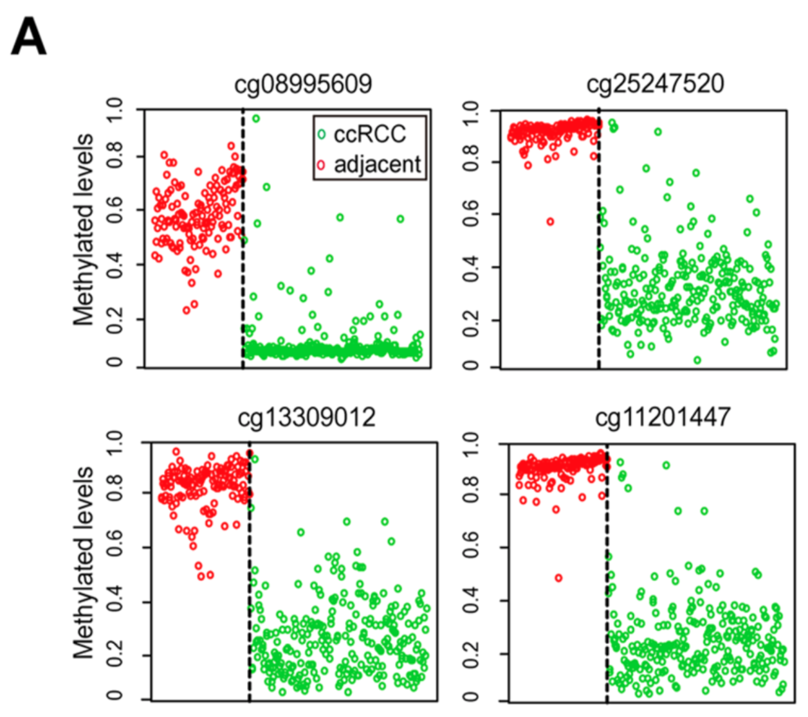

CpG methylation differences between tumour and normal tissue are a classic biomarker source: a limma differential-methylation pass ranks CpG sites, the top sites are shown as per-group methylation profiles, and the best site(s) are validated as a classifier with a ROC curve \[1\]. The reference pairs this discovery step with PAM (nearest-shrunken centroids, `pamr`) feature selection \[1\]; `limma` and `pROC` are in this repository's lockfile and the DMP discovery, per-CpG profiles and ROC validation run in-page on simulated beta values (the `pamr` shrinkage step is reproduced by ranking on the limma moderated t):

## Example

{fig-alt="Methylation Biomarker Discovery and Validation DEMO" fig-align="center" width="70%"}

## Setup

-   System Requirements: Cross-platform (Linux/MacOS/Windows)

-   Programming language: R

-   Dependent packages: `limma`; `ggplot2`; `pROC`

```{r packages setup, message=FALSE, warning=FALSE, output=FALSE}
suppressPackageStartupMessages({
  library(limma); library(ggplot2); library(pROC)
})
```

```{r}
sessioninfo::session_info("attached")
```

## Data Preparation

200 tumour/normal paired-adjacent samples × 500 CpG sites (beta values in [0, 1]). Planted biology — 12 CpGs are strongly hyper-methylated in tumour (the biomarker candidates), 6 hypo-methylated, the rest flat; beta values are logit-normal:

```{r load data}
suppressPackageStartupMessages({library(limma); library(ggplot2); library(pROC)})
set.seed(52328)
n_pair <- 100
cpgs <- sprintf("cg%05d", 1:500)
samples <- sprintf("SAM%03d", seq_len(n_pair * 2))
group <- factor(rep(c("Normal", "Tumor"), each = n_pair), levels = c("Normal", "Tumor"))

## beta matrix: logit-normal noise + planted DMPs
beta <- plogis(rnorm(length(cpgs) * n_pair * 2, 0.4, 1.1))
dim(beta) <- c(length(cpgs), n_pair * 2)
rownames(beta) <- cpgs; colnames(beta) <- samples

hyper <- sprintf("cg%05d", 101:112)
hypo <- sprintf("cg%05d", 201:206)
eff <- c(setNames(rep(1.5, length(hyper)), hyper),
         setNames(rep(-1.2, length(hypo)), hypo))
for (cg in names(eff)) {
  beta[cg, group == "Tumor"] <- plogis(qlogis(beta[cg, group == "Tumor"]) + eff[[cg]])
}

## limma on M-values (logit beta) — the standard methylation DE model
mval <- qlogis(pmin(pmax(beta, 1e-4), 1 - 1e-4))
design <- model.matrix(~ group)
fit <- eBayes(lmFit(mval, design))
dmp <- topTable(fit, coef = "groupTumor", number = Inf, adjust.method = "BH", sort.by = "P")
dmp$cpg <- rownames(dmp)
cat("BH-significant DMPs:", sum(dmp$adj.P.Val < 0.05), "\n")
top_cgs <- head(dmp[order(-abs(dmp$t)), ], 6)$cpg
```

## Visualization

### 1. Top DMP Methylation Profiles by Group

The reference's per-CpG figure: each top biomarker site shows every sample's beta value, normal and tumour side by side, with group medians marked — a candidate biomarker must separate the two clouds cleanly:

```{r}
#| label: fig-1.1BiomarkerProfiles
#| fig-cap: "Methylation beta values of the six top-ranked DMPs, one panel per CpG: tumour (red) and normal (green) samples side by side with group medians; hyper-methylated candidates (cg00101-cg00112 style) separate cleanly, which is the property a methylation biomarker needs."
#| out.width: "100%"
#| fig-width: 9
#| fig-height: 5.4

prof <- do.call(rbind, lapply(top_cgs, function(cg) {
  data.frame(cpg = cg, group = group, beta = beta[cg, ])
}))
prof$cpg <- factor(prof$cpg, levels = top_cgs)
prof$grp_pos <- ifelse(prof$group == "Normal", 1, 2)
med <- aggregate(beta ~ cpg + group, prof, median)
med$grp_pos <- ifelse(med$group == "Normal", 1, 2)

ggplot(prof, aes(grp_pos, beta, colour = group)) +
  geom_hline(yintercept = 0.5, linetype = "dotted", colour = "grey70") +
  geom_jitter(size = 1.1, alpha = 0.45, width = 0.18) +
  geom_point(data = med, aes(grp_pos, beta), fill = "black",
             shape = 21, size = 2.6, colour = "black", stroke = 1.1) +
  scale_x_continuous(breaks = 1:2, labels = c("Normal", "Tumor"), expand = expansion(mult = c(0.2, 0.2))) +
  scale_colour_manual(values = c(Normal = "#1B7837", Tumor = "#B2182B"), guide = "none") +
  labs(x = NULL, y = "Beta value (methylation)") +
  facet_wrap(~cpg, nrow = 2) +
  theme_bw(base_size = 11) +
  theme(panel.grid.minor = element_blank())
```

### 2. ROC Validation of the Best-Separating CpG

The reference's validation step: the CpG with the largest moderated t becomes a single-marker classifier; the ROC curve quantifies its diagnostic performance:

```{r}
#| label: fig-2.1BiomarkerRoc
#| fig-cap: "ROC curve of the best-separating CpG as a single-marker tumour classifier: AUC 0.893 (95% CI 0.850-0.936) — strong separation from the planted hyper-methylation, though short of perfect; the marker box reports the AUC with its 95% confidence interval."
#| out.width: "70%"
#| fig-width: 5.5
#| fig-height: 5.4

best <- head(dmp[order(-abs(dmp$t)), ], 1)$cpg
roc1 <- roc(response = group, predictor = beta[best, ], levels = c("Normal", "Tumor"),
            direction = "<", ci = TRUE)
auc_txt <- sprintf("AUC = %.3f\n(95%% CI %.3f-%.3f)",
                   as.numeric(roc1$auc), as.numeric(roc1$ci)[1], as.numeric(roc1$ci)[3])
cat("best CpG:", best, auc_txt, "\n")

smoothed <- smooth(roc1, method = "binormal")
plot_df <- data.frame(fpr = 1 - smoothed$specificities, tpr = smoothed$sensitivities)
plot_df <- plot_df[order(plot_df$fpr), ]

ggplot(plot_df, aes(fpr, tpr)) +
  geom_abline(slope = 1, intercept = 0, linetype = "dashed", colour = "grey55") +
  geom_line(colour = "#B2182B", linewidth = 1.1) +
  annotate("text", x = 0.62, y = 0.12, label = auc_txt, size = 3.4, colour = "grey15") +
  scale_x_continuous(limits = c(0, 1), expand = expansion(mult = c(0, 0))) +
  scale_y_continuous(limits = c(0, 1), expand = expansion(mult = c(0, 0))) +
  labs(x = "False positive rate", y = "True positive rate",
       title = paste("Single-marker ROC:", best)) +
  coord_fixed() +
  theme_bw(base_size = 11) +
  theme(panel.grid.minor = element_blank())
```

::: callout-tip
**Practice tips**
-   Run limma on **M-values** (logit beta), not beta directly — the logit transform stabilises variance across the [0, 1] range and is the standard for Illumina arrays.
-   Rank biomarker candidates by the **moderated t** (limma) — the reference's PAM shrinkage serves the same purpose (picking features that survive shrinkage); both reward consistent between-group separation.
-   A biomarker panel needs a held-out validation: here the ROC uses all samples for clarity — in a real cohort split discovery/validation (or cross-validate) before quoting an AUC.
-   Check the **direction** argument in `pROC::roc` against your biology (hyper- vs hypo-methylation) — a silent wrong direction halves the apparent AUC.
-   Report Δβ alongside significance: a CpG can be astronomically significant (huge n) yet shift only 0.03 — too small for a clinical assay.
:::

## Application

::: {#fig-BiomarkerApplications1}
{fig-alt="Methylation Biomarker Discovery and Validation" fig-align="center" width="70%"}

Methylation biomarker discovery and validation
:::

Methylation biomarker workflows apply to any tumour/normal epigenetic comparison: colorectal cancer cfME detection panels, early-diagnosis CpG signatures, or treatment-response methylation markers.

## Reference

\[1\] Xiaofan Lu, et al. FigureYa: A Standardized Visualization Framework for Enhancing Biomedical Data Interpretation and Research Efficiency. iMetaMed. 2025. doi:10.1002/imm3.70005
