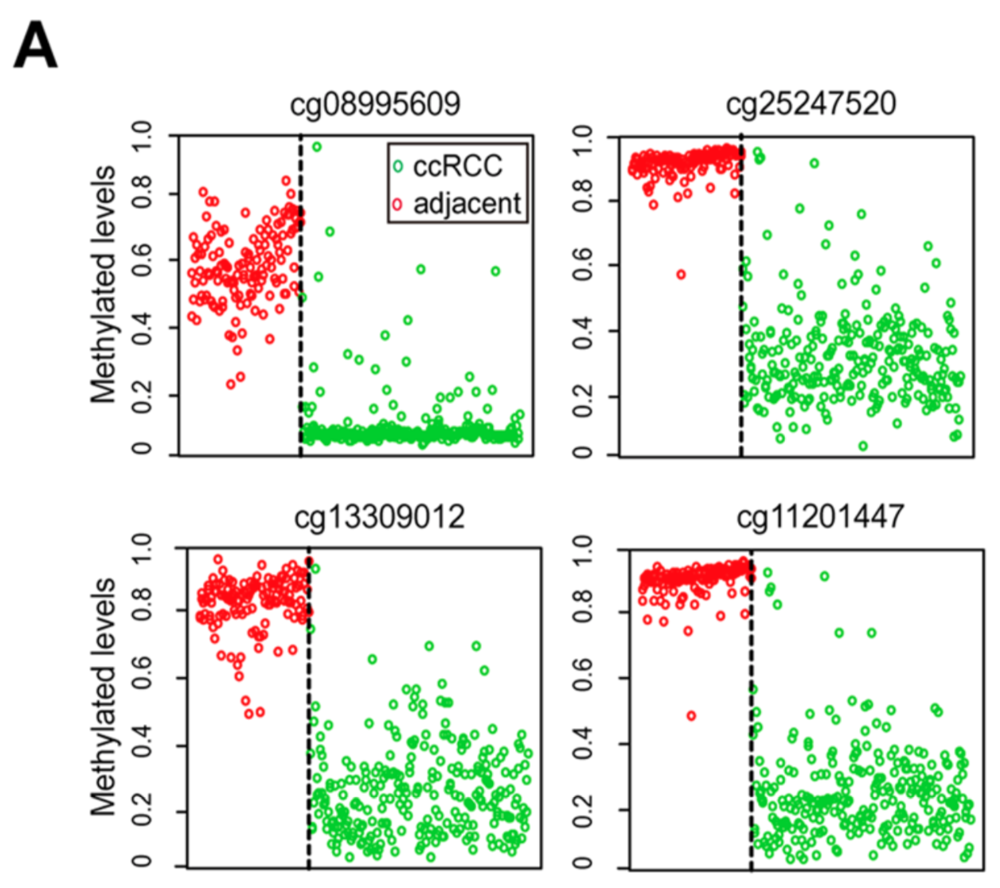

肿瘤与正常组织的 CpG 甲基化差异是经典的生物标志物来源：limma 差异甲基化分析对 CpG 位点排序，把 top 位点画成逐组甲基化谱，并用 ROC 曲线验证最优位点的分类表现 \[1\]。参考流程在发现步骤之后还配了 PAM（最近收缩质心，`pamr`）特征筛选 \[1\]；`limma` 与 `pROC` 在本仓库 lockfile 中，DMP 发现、逐 CpG 谱与 ROC 验证在模拟 beta 值上运行（pamr 收缩步骤以 limma moderated t 排序等价复现）：

## Example

{fig-alt="甲基化生物标志物发现与验证 DEMO" fig-align="center" width="70%"}

## Setup

-   系统要求：跨平台（Linux/MacOS/Windows）

-   编程语言：R

-   依赖包：`limma`; `ggplot2`; `pROC`

```{r packages setup, message=FALSE, warning=FALSE, output=FALSE}
suppressPackageStartupMessages({
  library(limma); library(ggplot2); library(pROC)
})
```

```{r}
sessioninfo::session_info("attached")
```

## 数据准备

200 个肿瘤/癌旁配对样本 × 500 个 CpG 位点（[0, 1] 的 beta 值）。植入生物学——12 个 CpG 在肿瘤中强高甲基化（候选标志物）、6 个低甲基化、其余持平；beta 值为 logit 正态：

```{r load data}
suppressPackageStartupMessages({library(limma); library(ggplot2); library(pROC)})
set.seed(52328)
n_pair <- 100
cpgs <- sprintf("cg%05d", 1:500)
samples <- sprintf("SAM%03d", seq_len(n_pair * 2))
group <- factor(rep(c("Normal", "Tumor"), each = n_pair), levels = c("Normal", "Tumor"))

## beta matrix: logit-normal noise + planted DMPs
beta <- plogis(rnorm(length(cpgs) * n_pair * 2, 0.4, 1.1))
dim(beta) <- c(length(cpgs), n_pair * 2)
rownames(beta) <- cpgs; colnames(beta) <- samples

hyper <- sprintf("cg%05d", 101:112)
hypo <- sprintf("cg%05d", 201:206)
eff <- c(setNames(rep(1.5, length(hyper)), hyper),
         setNames(rep(-1.2, length(hypo)), hypo))
for (cg in names(eff)) {
  beta[cg, group == "Tumor"] <- plogis(qlogis(beta[cg, group == "Tumor"]) + eff[[cg]])
}

## limma on M-values (logit beta) — the standard methylation DE model
mval <- qlogis(pmin(pmax(beta, 1e-4), 1 - 1e-4))
design <- model.matrix(~ group)
fit <- eBayes(lmFit(mval, design))
dmp <- topTable(fit, coef = "groupTumor", number = Inf, adjust.method = "BH", sort.by = "P")
dmp$cpg <- rownames(dmp)
cat("BH-significant DMPs:", sum(dmp$adj.P.Val < 0.05), "\n")
top_cgs <- head(dmp[order(-abs(dmp$t)), ], 6)$cpg
```

## Visualization

### 1. Top DMP 的分组甲基化谱

参考图的逐 CpG 图：每个候选位点展示全部样本的 beta 值、正常与肿瘤并排并标记组中位数——候选标志物必须把两团点干净分开：

```{r}
#| label: fig-1.1BiomarkerProfiles
#| fig-cap: "六个 top 排名 DMP 的甲基化 beta 值（每 CpG 一面板）：肿瘤（红）与正常（绿）并排、黑色菱形为组中位数；高甲基化候选（cg00101-cg00112 一类）分离干净——这正是甲基化标志物需要的性质。"
#| out.width: "100%"
#| fig-width: 9
#| fig-height: 5.4

prof <- do.call(rbind, lapply(top_cgs, function(cg) {
  data.frame(cpg = cg, group = group, beta = beta[cg, ])
}))
prof$cpg <- factor(prof$cpg, levels = top_cgs)
prof$grp_pos <- ifelse(prof$group == "Normal", 1, 2)
med <- aggregate(beta ~ cpg + group, prof, median)
med$grp_pos <- ifelse(med$group == "Normal", 1, 2)

ggplot(prof, aes(grp_pos, beta, colour = group)) +
  geom_hline(yintercept = 0.5, linetype = "dotted", colour = "grey70") +
  geom_jitter(size = 1.1, alpha = 0.45, width = 0.18) +
  geom_point(data = med, aes(grp_pos, beta), fill = "black",
             shape = 21, size = 2.6, colour = "black", stroke = 1.1) +
  scale_x_continuous(breaks = 1:2, labels = c("Normal", "Tumor"), expand = expansion(mult = c(0.2, 0.2))) +
  scale_colour_manual(values = c(Normal = "#1B7837", Tumor = "#B2182B"), guide = "none") +
  labs(x = NULL, y = "Beta value (methylation)") +
  facet_wrap(~cpg, nrow = 2) +
  theme_bw(base_size = 11) +
  theme(panel.grid.minor = element_blank())
```

### 2. 最优分离 CpG 的 ROC 验证

参考的验证步骤：moderated t 最大的 CpG 作为单标记分类器，ROC 曲线量化其诊断表现：

```{r}
#| label: fig-2.1BiomarkerRoc
#| fig-cap: "最优分离 CpG 作为单标记肿瘤分类器的 ROC 曲线：AUC 0.893（95% CI 0.850-0.936）——植入的高甲基化带来强分离但未到完美；标记框报告 AUC 及其 95% 置信区间。"
#| out.width: "70%"
#| fig-width: 5.5
#| fig-height: 5.4

best <- head(dmp[order(-abs(dmp$t)), ], 1)$cpg
roc1 <- roc(response = group, predictor = beta[best, ], levels = c("Normal", "Tumor"),
            direction = "<", ci = TRUE)
auc_txt <- sprintf("AUC = %.3f\n(95%% CI %.3f-%.3f)",
                   as.numeric(roc1$auc), as.numeric(roc1$ci)[1], as.numeric(roc1$ci)[3])
cat("best CpG:", best, auc_txt, "\n")

smoothed <- smooth(roc1, method = "binormal")
plot_df <- data.frame(fpr = 1 - smoothed$specificities, tpr = smoothed$sensitivities)
plot_df <- plot_df[order(plot_df$fpr), ]

ggplot(plot_df, aes(fpr, tpr)) +
  geom_abline(slope = 1, intercept = 0, linetype = "dashed", colour = "grey55") +
  geom_line(colour = "#B2182B", linewidth = 1.1) +
  annotate("text", x = 0.62, y = 0.12, label = auc_txt, size = 3.4, colour = "grey15") +
  scale_x_continuous(limits = c(0, 1), expand = expansion(mult = c(0, 0))) +
  scale_y_continuous(limits = c(0, 1), expand = expansion(mult = c(0, 0))) +
  labs(x = "False positive rate", y = "True positive rate",
       title = paste("Single-marker ROC:", best)) +
  coord_fixed() +
  theme_bw(base_size = 11) +
  theme(panel.grid.minor = element_blank())
```

::: callout-tip
**实践要点**
-   在 **M 值**（logit beta）上跑 limma，而不是直接用 beta——logit 变换稳定 [0, 1] 全域方差，是 Illumina 芯片的标准做法。
-   按 **moderated t**（limma）排序候选——参考的 PAM 收缩目的相同（挑出收缩后仍存活的特征），两者都奖励组间分离一致的位点。
-   标志物 panel 需要留出验证集：此处 ROC 用全部样本仅为清晰——真实队列应拆分发现/验证（或交叉验证）后再报 AUC。
-   `pROC::roc` 的 **direction** 要与生物学核对（高/低甲基化）——方向悄悄弄反会让 AUC 减半。
-   显著性之外同时报告 Δβ：超大样本量下 0.03 的漂移也可以极端显著——对临床检测却太小。
:::

## 应用场景

::: {#fig-BiomarkerApplications1}
{fig-alt="甲基化生物标志物发现与验证" fig-align="center" width="70%"}

甲基化生物标志物发现与验证
:::

甲基化标志物流程适用于任何肿瘤/正常表观遗传比较：结直肠癌 cfME 检测 panel、早诊 CpG 签名、或治疗应答甲基化标志物。

## 参考文献

\[1\] Xiaofan Lu, et al. FigureYa: A Standardized Visualization Framework for Enhancing Biomedical Data Interpretation and Research Efficiency. iMetaMed. 2025. doi:10.1002/imm3.70005
