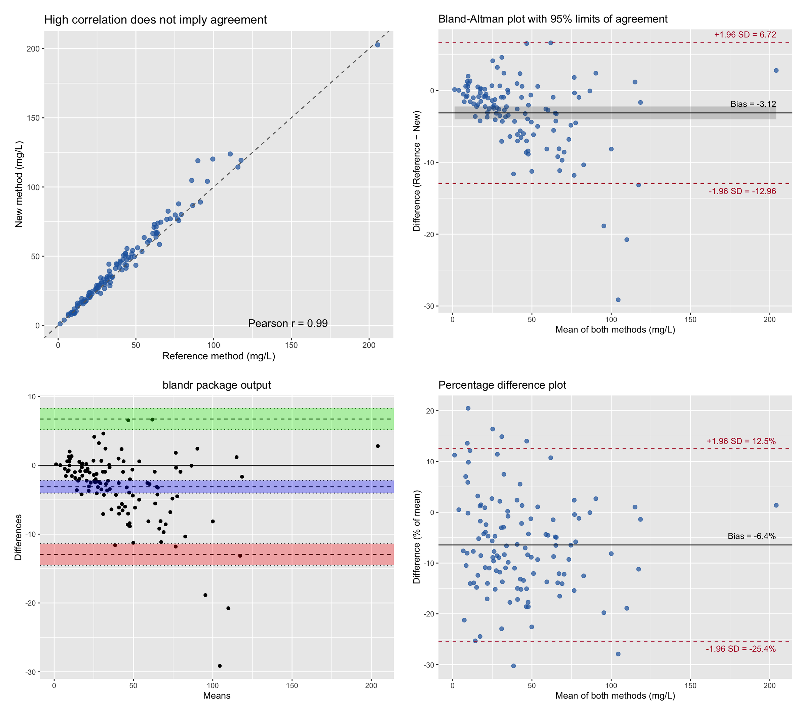
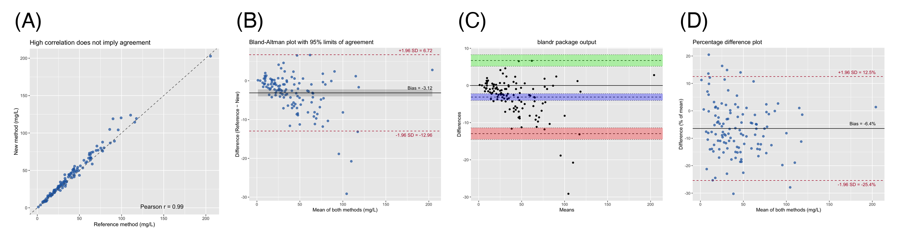

The Bland-Altman plot is the standard graphical tool for assessing **agreement between two quantitative measurement methods** — for example, a new point-of-care assay versus a reference laboratory method, or a wearable device versus clinic blood-pressure measurement \[1\]. Each subject is measured by both methods; the plot shows the *difference* between the two readings against their *average*. Three horizontal summaries anchor the interpretation: the mean difference (**bias**, the systematic offset between methods) and the **95% limits of agreement** (bias ± 1.96 × SD of the differences, the range within which 95% of the disagreements between the two methods are expected to fall \[2\].

The key insight the plot teaches is that a large Pearson correlation coefficient does *not* imply agreement: correlation measures the strength of a *linear association*, which any consistently inflated method will still show. Agreement is judged on the magnitude of the differences relative to clinical relevance, not on r.

This tutorial covers four practical workflows in R:

1. A paired scatter plot that shows why correlation is not agreement;
2. A hand-built Bland-Altman plot with bias, 95% limits of agreement and their confidence intervals (ggplot2);
3. The same analysis with the `blandr` package \[3\];
4. A *percentage* difference plot that stabilizes the variance when measurement error grows with the magnitude of the measurement (proportional bias).

## Example

{fig-alt="BlandAltmanPlot DEMO" fig-align="center" width="60%"}

## Setup

-   System Requirements: Cross-platform (Linux/MacOS/Windows)

-   Programming language: R

-   Dependent packages: `blandr`; `ggplot2`; `dplyr`

```{r packages setup, message=FALSE, warning=FALSE, output=FALSE}
# Installing necessary packages
if (!requireNamespace("blandr", quietly = TRUE)) {
  install.packages("blandr")
}

# Load packages
library(ggplot2)
library(dplyr)
library(blandr)
```

```{r}
sessioninfo::session_info("attached")
```

## Data Preparation

We simulate a method-comparison study of $n = 120$ samples assayed for a serum biomarker (mg/L) by a reference laboratory method (`ref`) and a new point-of-care method (`new`). The simulation embeds two features commonly seen in real method comparisons: a modest *proportional* overestimation by the new method, and measurement error whose spread grows with the biomarker concentration (heteroscedasticity). Both features will surface graphically in the Bland-Altman plot below.

```{r load data, message=FALSE, warning=FALSE}
set.seed(2026)

n <- 120
# Right-skewed biomarker concentrations, as tumor markers typically are
true_conc <- rgamma(n, shape = 2, scale = 20)

method_data <- data.frame(
  ref = true_conc * (1 + rnorm(n, 0, 0.05)),      # reference method, ~5% CV
  new = true_conc * (1 + rnorm(n, 0.06, 0.09))    # new method: +6% proportional bias, ~9% CV
) |>
  mutate(
    avg  = (ref + new) / 2,   # best available estimate of the true value
    diff = ref - new          # reference minus new
  )

head(method_data)
```

## Visualization

### 1. Why Correlation Is Not Agreement

```{r}
#| label: fig-1.1PairedScatter
#| fig-cap: "Paired measurements by the two methods; the Pearson correlation is high although the new method runs systematically low."
#| out.width: "70%"
#| fig-width: 6
#| fig-height: 5.5
#| warning: false
#| message: false

r <- cor(method_data$ref, method_data$new)

ggplot(method_data, aes(x = ref, y = new)) +
  geom_point(color = "#2166AC", alpha = 0.7, size = 2) +
  geom_abline(slope = 1, intercept = 0, linetype = "dashed", color = "grey40") +
  annotate("text", x = max(method_data$ref) * 0.72, y = min(method_data$new) * 1.6,
           label = sprintf("Pearson r = %.2f", r), size = 4.2) +
  labs(x = "Reference method (mg/L)", y = "New method (mg/L)",
       title = "High correlation does not imply agreement")
```

The two methods correlate almost perfectly (r ≈ 0.99), yet the points drift progressively *below* the identity line as concentrations rise — the new method systematically under-reads at high values. Correlation is blind to exactly this behavior, which is why agreement needs its own plot.

### 2. Hand-Built Bland-Altman Plot with Confidence Intervals

```{r}
#| label: fig-2.1ManualBA
#| fig-cap: "Bland-Altman plot of the same data: mean difference (bias) with its 95% CI (grey band) and the 95% limits of agreement (dashed)."
#| out.width: "70%"
#| fig-width: 6.5
#| fig-height: 5.5
#| warning: false
#| message: false

bias    <- mean(method_data$diff)
sd_diff <- sd(method_data$diff)
loa     <- c(bias - 1.96 * sd_diff, bias + 1.96 * sd_diff)
n       <- nrow(method_data)

# Exact standard errors (Bland & Altman 1986): the limits are estimated
# quantities and carry their own uncertainty, especially in small samples.
se_bias <- sd_diff / sqrt(n)
se_loa  <- sqrt(sd_diff^2 * (1 / n + 1.96^2 / (2 * (n - 1))))

ggplot(method_data, aes(x = avg, y = diff)) +
  geom_point(color = "#2166AC", alpha = 0.7, size = 2) +
  geom_ribbon(aes(ymin = bias - 1.96 * se_bias, ymax = bias + 1.96 * se_bias),
              alpha = 0.2, color = NA) +
  geom_hline(yintercept = bias, color = "black") +
  geom_hline(yintercept = loa, color = "#B2182B", linetype = "dashed") +
  annotate("text", x = max(method_data$avg), y = bias, vjust = -1, hjust = 1,
           label = sprintf("Bias = %.2f", bias), size = 3.6) +
  annotate("text", x = max(method_data$avg), y = loa[2], vjust = -0.8, hjust = 1,
           label = sprintf("+1.96 SD = %.2f", loa[2]), size = 3.6, color = "#B2182B") +
  annotate("text", x = max(method_data$avg), y = loa[1], vjust = 1.7, hjust = 1,
           label = sprintf("-1.96 SD = %.2f", loa[1]), size = 3.6, color = "#B2182B") +
  labs(x = "Mean of both methods (mg/L)", y = "Difference (Reference − New)",
       title = "Bland-Altman plot with 95% limits of agreement")
```

The average difference of about −3 mg/L is the *bias*: the new method reads lower than the reference on average. The dashed lines are the 95% limits of agreement — the interval within which 95% of the differences between the two methods are expected to lie. Whether that interval is *acceptable* is a clinical judgement, not a statistical one: an agreement limit of ±10 mg/L is irrelevant for a biomarker whose decision threshold is 50 mg/L but unacceptable if the threshold is 5 mg/L.

Note the funnel shape: the scatter of differences widens at high concentrations, a warning sign addressed in Section 4.

### 3. The Same Analysis with blandr

```{r}
#| label: fig-3.1Blandr
#| fig-cap: "blandr draws the plot and shades the confidence regions of the bias and both limits."
#| out.width: "70%"
#| fig-width: 6.5
#| fig-height: 5.5
#| warning: false
#| message: false

blandr.draw(method_data$ref, method_data$new,
            plotTitle = "blandr package output")
```

`blandr.draw()` reproduces the hand-built analysis: same bias, same limits of agreement, and — like the grey band above — confidence intervals around each estimated line (shaded regions). The package also provides numeric summaries via `blandr.output.text()` for reporting.

### 4. Percentage Differences for Proportional Bias

When the scatter of differences grows with the magnitude of the measurement (the funnel in Section 2), expressing the difference as a *percentage* of the average — or log-transforming both measurements before the analysis \[2\] — restores a constant spread, and the limits of agreement become interpretable across the whole measurement range.

```{r}
#| label: fig-4.1PercentageBA
#| fig-cap: "Percentage difference plot: the funnel disappears once differences are scaled by the mean, giving one bias (−6.4%) and one pair of limits valid across the range."
#| out.width: "70%"
#| fig-width: 6.5
#| fig-height: 5.5
#| warning: false
#| message: false

method_data <- method_data |>
  mutate(pct_diff = diff / avg * 100)

pct_bias <- mean(method_data$pct_diff)
pct_loa  <- c(pct_bias - 1.96 * sd(method_data$pct_diff),
              pct_bias + 1.96 * sd(method_data$pct_diff))

ggplot(method_data, aes(x = avg, y = pct_diff)) +
  geom_point(color = "#2166AC", alpha = 0.7, size = 2) +
  geom_hline(yintercept = pct_bias, color = "black") +
  geom_hline(yintercept = pct_loa, color = "#B2182B", linetype = "dashed") +
  annotate("text", x = max(method_data$avg), y = pct_bias, vjust = -1, hjust = 1,
           label = sprintf("Bias = %.1f%%", pct_bias), size = 3.6) +
  annotate("text", x = max(method_data$avg), y = pct_loa[2], vjust = -0.8, hjust = 1,
           label = sprintf("+1.96 SD = %.1f%%", pct_loa[2]), size = 3.6, color = "#B2182B") +
  annotate("text", x = max(method_data$avg), y = pct_loa[1], vjust = 1.7, hjust = 1,
           label = sprintf("-1.96 SD = %.1f%%", pct_loa[1]), size = 3.6, color = "#B2182B") +
  labs(x = "Mean of both methods (mg/L)", y = "Difference (% of mean)",
       title = "Percentage difference plot")
```

On the percentage scale the bias is −6.4% with limits of about −25% to +13%: a compact statement of method agreement that holds at low and high concentrations alike.

::: callout-tip
## Practice tips

-   The x-axis should be the *average* of the two methods (the best estimate of the true value), never one method alone — plotting against a single method induces spurious correlation in the differences.
-   Report the confidence intervals of the bias *and* of both limits; point estimates alone overstate the precision of small agreement studies.
-   Check the funnel shape before quoting raw-unit limits. If spread grows with magnitude, switch to percentage differences or log-transform.
-   Do not substitute the paired t-test for the plot: a non-significant t-test does not establish agreement, and a significant one does not necessarily preclude it.
:::

## Application

Method-comparison plots are required when laboratories introduce a new assay or device: clinical chemistry (new analyzer vs incumbent), physiology (wearable vs catheter blood pressure), and imaging-derived quantities (AI segmentation vs manual contour). The panel below mirrors a typical publication layout: (A) the paired scatter that motivates the analysis, (B) the Bland-Altman plot with bias and limits, (C) the package output with confidence regions, and (D) the percentage plot for proportional bias.

{fig-alt="BlandAltmanPlot Application" fig-align="center" width="60%"}

## Reference

\[1\] Bland JM, Altman DG. Statistical methods for assessing agreement between two methods of clinical measurement. Lancet. 1986;327(8476):307-310. doi:10.1016/S0140-6736(86)90837-8

\[2\] Bland JM, Altman DG. Measuring agreement in method comparison studies. Stat Methods Med Res. 1999;8(2):135-160. doi:10.1177/096228029900800204

\[3\] Datta S. blandr: a Bland-Altman method comparison package for R. 2018. doi:10.5281/zenodo.824522
