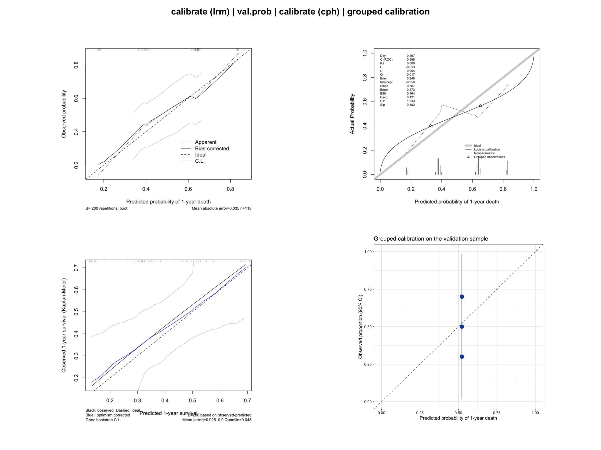
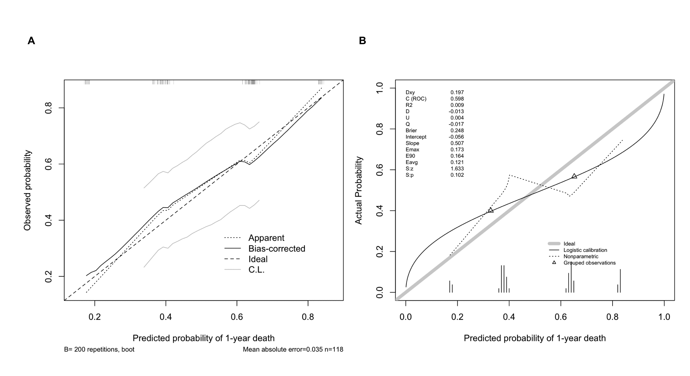

A calibration curve assesses the *accuracy* of a prediction model: among patients predicted to have a given risk, how often does the event actually occur? A perfectly calibrated model lies on the 45° line of a plot of observed versus predicted probabilities. Discrimination (see the ROC curve tutorial) and calibration answer different questions — a model can rank patients well yet systematically over- or under-estimate absolute risks \[1\]. Together with decision curve analysis, calibration is part of the standard evaluation suite of clinical prediction models.

This tutorial covers four calibration workflows in R (`rms` package):

1. Logistic-model calibration with bootstrap smoothing (`calibrate`);
2. External-style validation of predicted probabilities (`val.prob`);
3. Cox-model calibration of predicted survival at a fixed horizon;
4. A ggplot2 version with grouped observed-versus-predicted rates.

## Example

{fig-alt="CalibrationPlot DEMO" fig-align="center" width="60%"}

## Setup

-   System Requirements: Cross-platform (Linux/MacOS/Windows)

-   Programming language: R

-   Dependent packages: `survival`; `dplyr`; `rms`; `ggplot2`

```{r packages setup, message=FALSE, warning=FALSE, output=FALSE}
# Installing necessary packages
if (!requireNamespace("rms", quietly = TRUE)) {
  install.packages("rms")
}

# Load packages
library(survival)
library(dplyr)
library(ggplot2)
library(rms)
```

```{r}
sessioninfo::session_info("attached")
```

## Data Preparation

We again use the `lung` data set from the `survival` package (North Central Cancer Treatment Group lung cancer trial) \[2\], with death within one year as the binary endpoint for the logistic models and overall survival for the Cox model. The data are split into a training and a validation subsample to demonstrate `val.prob()`.

```{r load data, message=FALSE, warning=FALSE}
data(lung, package = "survival")

set.seed(2026)
lung2 <- lung %>%
  filter(complete.cases(age, sex, ph.ecog, ph.karno, pat.karno, meal.cal, wt.loss)) %>%
  mutate(y1y = as.integer(time < 365 & status == 2))  # death within 365 days
  # Caveat: patients censored before day 365 are counted as non-events.

idx <- sample(seq_len(nrow(lung2)), size = round(0.7 * nrow(lung2)))
train <- lung2[idx, ]
valid <- lung2[-idx, ]

cat("Train:", nrow(train), " Valid:", nrow(valid),
    " Events (train):", sum(train$y1y), "\n")

dd <- datadist(lung2)   # datadist based on the full data
options(datadist = "dd")
```

## Visualization

### 1. Logistic-Model Calibration with Bootstrap Smoothing

`calibrate()` on a `lrm` fit uses bootstrap-corrected estimates of the predicted-versus-observed curve, which is less noisy than a raw grouping of a single sample \[3\].

```{r}
#| label: fig-1.1LrmCalibrate
#| fig-cap: "Bootstrap-corrected calibration curve of the logistic model (bias-corrected line)."
#| out.width: "70%"
#| fig-width: 6.5
#| fig-height: 6
#| warning: false
#| message: false

lrm_fit <- lrm(y1y ~ age + sex + ph.ecog, data = train, x = TRUE, y = TRUE)
set.seed(2026)  # keep the bootstrap calibration reproducible across renders
cal_lrm <- calibrate(lrm_fit, method = "boot", B = 200)
plot(cal_lrm, xlab = "Predicted probability of 1-year death",
     ylab = "Observed probability")
```

The "apparent" line is the in-sample fit; the "bias-corrected" line adjusts for overfitting and is the one to report. A slope below 1 indicates predictions that are too extreme (overfit).

### 2. Validating Predicted Probabilities with val.prob

`val.prob()` takes predicted probabilities and the binary outcome of an *independent* sample and reports the calibration intercept, slope, discrimination (C-index = AUC), Brier score and more.

```{r}
#| label: fig-2.1ValProb
#| fig-cap: "Split-sample validation of the logistic model on the held-out sample with val.prob."
#| out.width: "70%"
#| fig-width: 6.5
#| fig-height: 6
#| warning: false
#| message: false

pred_valid <- predict(lrm_fit, newdata = valid, type = "fitted")
val.prob(pred_valid, valid$y1y,
         m = 20, cex = 0.6,   # groups of 20 observations for the plotted points
         xlab = "Predicted probability of 1-year death")
```

The thick grey diagonal is ideal calibration; the triangles mark the grouped observed rates (20 per group). The printed statistics include the calibration intercept (ideally 0) and calibration slope (ideally 1).

### 3. Cox-Model Calibration of Survival Probabilities

For survival models, calibration is assessed at a fixed horizon: the predicted probability of surviving one year is compared with the Kaplan-Meier observed proportion \[3\].

```{r}
#| label: fig-3.1CphCalibrate
#| fig-cap: "Bootstrap calibration of the Cox model for 1-year survival."
#| out.width: "70%"
#| fig-width: 6.5
#| fig-height: 6
#| warning: false
#| message: false

cph_fit <- cph(Surv(time, status) ~ age + sex + ph.ecog,
               data = train, x = TRUE, y = TRUE, surv = TRUE, time.inc = 365)
set.seed(2026)
cal_cph <- calibrate(cph_fit, u = 365, method = "boot", B = 200, m = 40)
plot(cal_cph, xlab = "Predicted 1-year survival",
     ylab = "Observed 1-year survival (Kaplan-Meier)")
```

`u = 365` must match `time.inc` in the `cph` call, and `m` controls the number of observations per group used to estimate the curve.

### 4. A ggplot2 Version with Grouped Calibration Points

```{r}
#| label: fig-4.1GroupedCalibration
#| fig-cap: "Observed versus predicted 1-year death risk in quintile groups (validation sample)."
#| out.width: "70%"
#| fig-width: 6
#| fig-height: 6
#| warning: false
#| message: false

valid$pred_valid <- pred_valid  # needed so each group uses its own predictions

grouped <- valid %>%
  mutate(pred_group = ntile(pred_valid, n = 5)) %>%
  group_by(pred_group) %>%
  summarise(mean_pred = mean(pred_valid),
            obs_rate = mean(y1y),
            se = sqrt(obs_rate * (1 - obs_rate) / n()),
            n = n(),
            .groups = "drop")

ggplot(grouped, aes(mean_pred, obs_rate)) +
  geom_abline(slope = 1, intercept = 0, linetype = "dashed", color = "grey50") +
  geom_pointrange(aes(ymin = pmax(obs_rate - 1.96 * se, 0),
                      ymax = pmin(obs_rate + 1.96 * se, 1)),
                  color = "#2166AC", size = 0.8) +
  coord_cartesian(xlim = c(0, 1), ylim = c(0, 1)) +
  labs(x = "Predicted probability of 1-year death",
       y = "Observed proportion (95% CI)",
       title = "Grouped calibration on the validation sample") +
  theme_bw()
```

This transparent construction — bucket predictions, compare observed event rates — is exactly what grouped calibration curves show, and makes the sample size behind each point visible. Note the wide intervals: calibration assessment needs large samples.

### 5. Publication-Style Calibration with the Hosmer-Lemeshow Test

The layout biomarker papers ship with: the bias-corrected calibration curve against the ideal 45° line, annotated with the **Hosmer-Lemeshow goodness-of-fit test** \[5\] — p > 0.05 means no departure from perfect calibration. `ResourceSelection::hoslem.test()` provides the statistic; the dependency-free equivalent below groups predictions into deciles and compares observed vs expected events with a chi-square on g − 2 degrees of freedom.

```{r}
#| label: fig-5.1HosmerCalibration
#| fig-cap: "Bootstrap-corrected calibration of the full model against the ideal line, annotated with the Hosmer-Lemeshow p value."
#| out.width: "70%"
#| fig-width: 5.5
#| fig-height: 5.5
#| warning: false
#| message: false

hoslem_p <- function(y, p, g = 10) {
  brk <- unique(quantile(p, seq(0, 1, length.out = g + 1)))
  grp <- cut(p, breaks = brk, include.lowest = TRUE)
  obs <- tapply(y, grp, sum)
  expd <- tapply(p, grp, sum)
  nn <- tapply(y, grp, length)
  chi <- sum((obs - expd)^2 / (expd * (1 - expd / nn)))
  pchisq(chi, df = length(levels(grp)) - 2, lower.tail = FALSE)
}
glm_full <- glm(y1y ~ age + sex + ph.ecog + meal.cal + wt.loss,
                data = lung2, family = binomial)
p_hl <- hoslem_p(lung2$y1y, fitted(glm_full), g = 10)

lrm_full <- lrm(y1y ~ age + sex + ph.ecog + meal.cal + wt.loss,
                data = lung2, x = TRUE, y = TRUE)
cal_full <- calibrate(lrm_full, method = "boot", B = 200)

red <- adjustcolor("#FF0197", 0.6)
blue <- "#0093FF"
plot(cal_full[, "predy"], cal_full[, "calibrated.corrected"],
     type = "l", lwd = 2, col = red,
     xlim = c(0, 1), ylim = c(0, 1),
     xlab = "Predicted probability of 1-year death",
     ylab = "Observed proportion")
abline(0, 1, lwd = 1.5, lty = "longdash", col = blue)
legend("topleft", bty = "n", lwd = 2, lty = c("longdash", "solid"),
       col = c(blue, red),
       legend = c("Ideal", "Full model (bias-corrected)"))
text(0, 0.04, sprintf("Hosmer-Lemeshow %s",
     ifelse(p_hl < 0.001, "p < 0.001", sprintf("p = %.3f", p_hl))), adj = 0)
```

The H-L test here is computed on the *uncorrected* fitted probabilities (its standard form); the curve shows the bootstrap-corrected calibration. A significant H-L p flags miscalibration even when the curve looks close to the diagonal — report both together.

::: callout-tip
## Practice tips

-   H-L is sensitive to the number of groups: g = 10 is convention, but with small samples reduce g so each decile holds enough events.
-   This logistic calibration is for diagnostic-type endpoints; survival-model calibration uses `calibrate()` on a `cph` fit with the `u` horizon (Section 3).
-   Report the H-L p value with the curve, not instead of it — a non-significant test is necessary but not sufficient evidence of calibration.
:::

## Application

Calibration curves are reported alongside nomograms in prediction-model papers, typically as "training set + validation set" pairs. The panel below mirrors that layout with this tutorial's outputs: (A) bootstrap-corrected calibration on the training sample and (B) independent-sample validation with `val.prob`.

{fig-alt="CalibrationPlot Application" fig-align="center" width="60%"}

## Reference

\[1\] Van Calster B, McLernon DJ, van Smeden M, et al. Calibration: the Achilles heel of predictive analytics. BMC Med. 2019;17(1):230. doi:10.1186/s12916-019-1466-7

\[2\] Loprinzi CL, Laurie JA, Wieand HS, et al. Prospective evaluation of prognostic variables from patient-completed questionnaires. North Central Cancer Treatment Group. J Clin Oncol. 1994;12(3):601-607. doi:10.1200/JCO.1994.12.3.601

\[3\] Harrell FE Jr. Regression Modeling Strategies: With Applications to Linear Models, Logistic and Ordinal Regression, and Survival Analysis. 2nd ed. Springer; 2015. doi:10.1007/978-3-319-19425-7

\[4\] Collins GS, Reitsma JB, Altman DG, Moons KGM. Transparent Reporting of a multivariable prediction model for Individual Prognosis Or Diagnosis (TRIPOD). BMJ. 2015;350:g7594. doi:10.1136/bmj.g7594

\[5\] Xiaofan Lu, et al. FigureYa: A Standardized Visualization Framework for Enhancing Biomedical Data Interpretation and Research Efficiency. iMetaMed. 2025. doi:10.1002/imm3.70005
