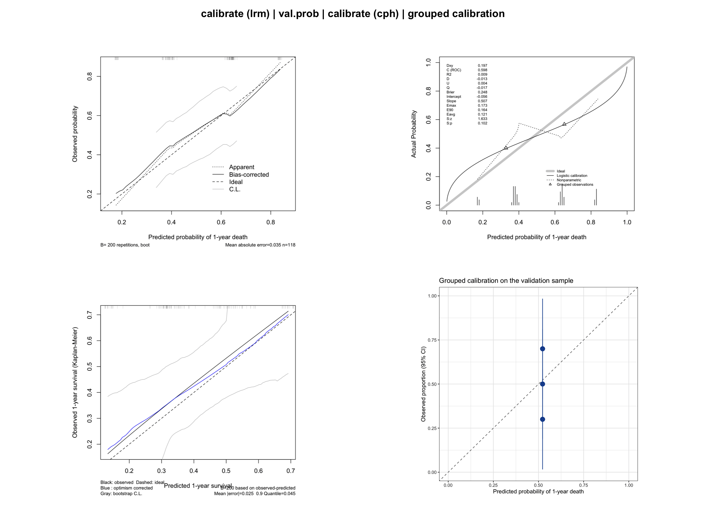
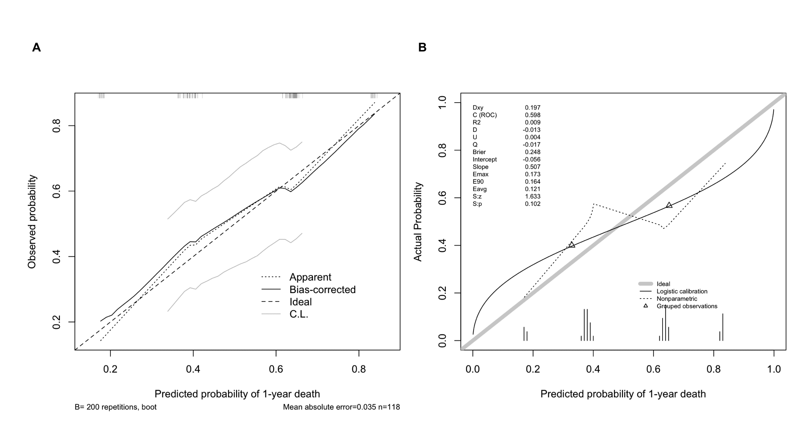

校准曲线（Calibration curve）评估预测模型的*准确性*（accuracy）：在预测风险相近的患者群体中，事件的实际发生率是否与预测值一致？校准完美的模型在校准图（预测概率 vs 观察概率）上应落在 45° 对角线上。区分度（见 ROC 曲线教程）与校准回答的是不同的问题——一个模型可能把患者排序排得很好，却系统性高估或低估绝对风险 \[1\]。与决策曲线分析一样，校准曲线是临床预测模型标准评估套件的组成部分。

本教程涵盖 R 中（`rms` 包）四种校准工作流：

1. logistic 模型的 bootstrap 平滑校准（`calibrate`）；
2. 预测概率的验证集式评估（`val.prob`）；
3. Cox 模型在固定时间点的生存概率校准；
4. 分组“观察 vs 预测”率的 ggplot2 版本。

## 示例

{fig-alt="CalibrationPlot DEMO" fig-align="center" width="60%"}

## 环境配置

-   系统要求：跨平台（Linux/MacOS/Windows）

-   编程语言：R

-   依赖包：`survival`；`dplyr`；`rms`；`ggplot2`

```{r packages setup, message=FALSE, warning=FALSE, output=FALSE}
# 安装必要的包
if (!requireNamespace("rms", quietly = TRUE)) {
  install.packages("rms")
}

# 加载包
library(survival)
library(dplyr)
library(ggplot2)
library(rms)
```

```{r}
sessioninfo::session_info("attached")
```

## 数据准备

仍使用 `survival` 包内置的 `lung` 数据集（北中部癌症治疗组肺癌临床试验）\[2\]：logistic 模型以“一年内死亡”为二元终点，Cox 模型以总生存为终点。将数据拆分为训练集和验证集，用于演示 `val.prob()`。

```{r load data, message=FALSE, warning=FALSE}
data(lung, package = "survival")

set.seed(2026)
lung2 <- lung %>%
  filter(complete.cases(age, sex, ph.ecog, ph.karno, pat.karno, meal.cal, wt.loss)) %>%
  mutate(y1y = as.integer(time < 365 & status == 2))  # 365 天内死亡
  # 注意：365 天内删失的患者在此被计为非事件。

idx <- sample(seq_len(nrow(lung2)), size = round(0.7 * nrow(lung2)))
train <- lung2[idx, ]
valid <- lung2[-idx, ]

cat("训练集:", nrow(train), " 验证集:", nrow(valid),
    " 事件数(训练集):", sum(train$y1y), "\n")

dd <- datadist(lung2)   # 基于全量数据的 datadist
options(datadist = "dd")
```

## 可视化

### 1. logistic 模型的 bootstrap 平滑校准

对 `lrm` 拟合对象使用 `calibrate()`，通过 bootstrap 校正得到“预测 vs 观察”曲线，比单样本直接分组的做法更平滑、噪声更小 \[3\]。

```{r}
#| label: fig-1.1LrmCalibrate
#| fig-cap: "logistic 模型的 bootstrap 校正校准曲线（Bias-corrected 线）。"
#| out.width: "70%"
#| fig-width: 6.5
#| fig-height: 6
#| warning: false
#| message: false

lrm_fit <- lrm(y1y ~ age + sex + ph.ecog, data = train, x = TRUE, y = TRUE)
set.seed(2026)  # 固定随机种子，保证 bootstrap 校准跨渲染可复现
cal_lrm <- calibrate(lrm_fit, method = "boot", B = 200)
plot(cal_lrm, xlab = "Predicted probability of 1-year death",
     ylab = "Observed probability")
```

“Apparent”线是样本内拟合；“Bias-corrected”线经过了过拟合校正，是应当报告的那条。斜率小于 1 提示预测过于极端（过拟合）。

### 2. 使用 val.prob 验证预测概率

`val.prob()` 接收*独立*样本的预测概率与二元结局，报告校准截距、校准斜率、区分度（C 指数 = AUC）、Brier 分数等多项指标。

```{r}
#| label: fig-2.1ValProb
#| fig-cap: "用 val.prob 在留出样本上对 logistic 模型做拆分样本验证。"
#| out.width: "70%"
#| fig-width: 6.5
#| fig-height: 6
#| warning: false
#| message: false

pred_valid <- predict(lrm_fit, newdata = valid, type = "fitted")
val.prob(pred_valid, valid$y1y,
         m = 20, cex = 0.6,   # 每组 20 个观测用于绘制分组点
         xlab = "Predicted probability of 1-year death")
```

粗灰对角线是理想校准；三角形标记分组的观察发生率（每组 20 例）。打印的统计量包括校准截距（理想为 0）和校准斜率（理想为 1）。

### 3. Cox 模型生存概率的校准

对生存模型，校准在固定时间点评估：将预测的一年生存概率与 Kaplan-Meier 观察比例进行比较 \[3\]。

```{r}
#| label: fig-3.1CphCalibrate
#| fig-cap: "Cox 模型 1 年生存的 bootstrap 校准。"
#| out.width: "70%"
#| fig-width: 6.5
#| fig-height: 6
#| warning: false
#| message: false

cph_fit <- cph(Surv(time, status) ~ age + sex + ph.ecog,
               data = train, x = TRUE, y = TRUE, surv = TRUE, time.inc = 365)
set.seed(2026)
cal_cph <- calibrate(cph_fit, u = 365, method = "boot", B = 200, m = 40)
plot(cal_cph, xlab = "Predicted 1-year survival",
     ylab = "Observed 1-year survival (Kaplan-Meier)")
```

`u = 365` 必须与 `cph` 调用中的 `time.inc` 一致；`m` 控制估计曲线时每组的观测数。

### 4. 分组校准点的 ggplot2 版本

```{r}
#| label: fig-4.1GroupedCalibration
#| fig-cap: "验证集中各五分位组的观察率与预测 1 年死亡风险对比。"
#| out.width: "70%"
#| fig-width: 6
#| fig-height: 6
#| warning: false
#| message: false

valid$pred_valid <- pred_valid  # 每组必须使用自己的预测值

grouped <- valid %>%
  mutate(pred_group = ntile(pred_valid, n = 5)) %>%
  group_by(pred_group) %>%
  summarise(mean_pred = mean(pred_valid),
            obs_rate = mean(y1y),
            se = sqrt(obs_rate * (1 - obs_rate) / n()),
            n = n(),
            .groups = "drop")

ggplot(grouped, aes(mean_pred, obs_rate)) +
  geom_abline(slope = 1, intercept = 0, linetype = "dashed", color = "grey50") +
  geom_pointrange(aes(ymin = pmax(obs_rate - 1.96 * se, 0),
                      ymax = pmin(obs_rate + 1.96 * se, 1)),
                  color = "#2166AC", size = 0.8) +
  coord_cartesian(xlim = c(0, 1), ylim = c(0, 1)) +
  labs(x = "Predicted probability of 1-year death",
       y = "Observed proportion (95% CI)",
       title = "Grouped calibration on the validation sample") +
  theme_bw()
```

这一透明的构造——将预测分桶、比较观察事件率——正是分组校准曲线的原理，并且能看到每个点背后的样本量。注意置信区间很宽：校准评估需要较大的样本量。
### 5. 发表级校准图与 Hosmer-Lemeshow 检验

生物标志物论文的标准版式：偏倚校正后的校准曲线对照 45° 理想线，并标注 **Hosmer-Lemeshow 拟合优度检验** \[5\]——p > 0.05 表示无偏离理想校准。`ResourceSelection::hoslem.test()` 提供该统计量；下面的免依赖等价实现把预测概率分成十分组、按 g − 2 自由度的卡方比较观测与期望事件数。

```{r}
#| label: fig-5.1HosmerCalibration
#| fig-cap: "完整模型的 bootstrap 校正校准曲线对照理想线，并标注 Hosmer-Lemeshow p 值。"
#| out.width: "70%"
#| fig-width: 5.5
#| fig-height: 5.5
#| warning: false
#| message: false

hoslem_p <- function(y, p, g = 10) {
  brk <- unique(quantile(p, seq(0, 1, length.out = g + 1)))
  grp <- cut(p, breaks = brk, include.lowest = TRUE)
  obs <- tapply(y, grp, sum)
  expd <- tapply(p, grp, sum)
  nn <- tapply(y, grp, length)
  chi <- sum((obs - expd)^2 / (expd * (1 - expd / nn)))
  pchisq(chi, df = length(levels(grp)) - 2, lower.tail = FALSE)
}
glm_full <- glm(y1y ~ age + sex + ph.ecog + meal.cal + wt.loss,
                data = lung2, family = binomial)
p_hl <- hoslem_p(lung2$y1y, fitted(glm_full), g = 10)

lrm_full <- lrm(y1y ~ age + sex + ph.ecog + meal.cal + wt.loss,
                data = lung2, x = TRUE, y = TRUE)
cal_full <- calibrate(lrm_full, method = "boot", B = 200)

red <- adjustcolor("#FF0197", 0.6)
blue <- "#0093FF"
plot(cal_full[, "predy"], cal_full[, "calibrated.corrected"],
     type = "l", lwd = 2, col = red,
     xlim = c(0, 1), ylim = c(0, 1),
     xlab = "Predicted probability of 1-year death",
     ylab = "Observed proportion")
abline(0, 1, lwd = 1.5, lty = "longdash", col = blue)
legend("topleft", bty = "n", lwd = 2, lty = c("longdash", "solid"),
       col = c(blue, red),
       legend = c("Ideal", "Full model (bias-corrected)"))
text(0, 0.04, sprintf("Hosmer-Lemeshow %s",
     ifelse(p_hl < 0.001, "p < 0.001", sprintf("p = %.3f", p_hl))), adj = 0)
```

H-L 检验按其标准形式计算在*未校正*的拟合概率上；曲线展示的是 bootstrap 校正后的校准。即使曲线贴近对角线，显著的 H-L p 也能标记出校准失衡——两者应同时报告。

::: callout-tip
## 实践要点

-   H-L 检验对分组数敏感：惯例是 g = 10，但小样本时应减小 g 以保证每个十分组有足够事件数。
-   此逻辑回归校准适用于诊断型终点；生存模型的校准要对 `cph` 拟合用带 `u` 时间点的 `calibrate()`（第 3 节）。
-   H-L p 值要与曲线一起报告而非替代曲线——不显著的检验是校准的必要而非充分证据。
:::

### 6. GiViTI 校准带与 bootstrap 置信带

GiViTI 方法一眼可判二分类模型的校准：若校准带——观测率的分箱、加权、前向选择多项式的单侧 bootstrap 置信带——始终不触及恒等对角线，即拒绝校准假设 \[5\]。CRAN 的 `givitiR` 提供标准实现；下面代码块以基础 R 重建同一图面，使本页不带额外依赖、统计量十行之内可审。

```{r}
#| label: fig-6.1GivitiBelt
#| fig-cap: "GiViTI 式校准带：观测率曲线（分箱、加权、前向选阶多项式）配嵌套单侧 80% 与 95% bootstrap 带，对照理想对角线；平均偏差附 bootstrap p 值。"
#| out.width: "95%"
#| warning: false
#| message: false
#| fig-width: 7
#| fig-height: 5

set.seed(6301)
n <- 600
age <- runif(n, 40, 90); sten <- rbinom(n, 1, 0.45); hyd <- rbinom(n, 1, 0.3)
lin <- -2.0 + 0.09 * (age - 65) + 1.20 * sten + 1.00 * hyd
obs <- rbinom(n, 1, plogis(lin))
dfl <- data.frame(obs = obs, age = age, sten = sten, hyd = hyd)
mod <- glm(obs ~ age + sten + hyd, family = binomial, data = dfl)
pred <- as.numeric(fitted(mod))
# GiViTI 路线：分箱观测率、加权多项式、前向选择阶数
fit_giviti <- function(xv, yv, nbins = 14, maxDeg = 3, thres = 0.05) {
  br <- unique(quantile(xv, seq(0, 1, length.out = nbins + 1)))
  bi <- as.integer(cut(xv, br, include.lowest = TRUE))
  bx <- tapply(xv, bi, mean); by <- tapply(yv, bi, mean); bw <- tapply(yv, bi, length)
  keep <- !is.na(bx) & bw >= 8
  bx <- bx[keep]; by <- by[keep]; bw <- bw[keep]
  best <- 1
  for (d in 2:maxDeg) {   # forward selection: keep the extra term if it pays off
    f0 <- lm(by ~ poly(bx, best, raw = TRUE), weights = bw)
    f1 <- lm(by ~ poly(bx, d, raw = TRUE), weights = bw)
    pv <- tryCatch(anova(f0, f1)[["Pr(>F)"]][2], error = function(e) NA)
    if (!is.na(pv) && pv < thres) best <- d else break
  }
  list(deg = best, coef = coef(lm(by ~ poly(bx, best, raw = TRUE), weights = bw)))
}
eval_curve <- function(cf, gridv) {
  d <- length(cf) - 1
  as.numeric(outer(gridv, 0:d, `^`) %*% cf)
}
gf <- fit_giviti(pred, obs)
grid <- seq(quantile(pred, 0.02), quantile(pred, 0.98), length.out = 60)
m <- eval_curve(gf$coef, grid)
# bootstrap 重抽按相同阶数重拟合，否则带内混入选择噪声
boot <- matrix(NA, nrow = 400, ncol = length(grid))
for (b in seq_len(400)) {
  ii <- sample.int(n, replace = TRUE)
  gb <- tryCatch(fit_giviti(pred[ii], obs[ii], maxDeg = gf$deg), error = function(e) NULL)
  if (!is.null(gb) && gb$deg == gf$deg) boot[b, ] <- eval_curve(gb$coef, grid)
}
lo80 <- apply(boot, 2, quantile, probs = 0.10, na.rm = TRUE)
lo95 <- apply(boot, 2, quantile, probs = 0.025, na.rm = TRUE)
ok <- complete.cases(cbind(m, lo80, lo95)) & m > -0.02 & m < 1.02
m <- m[ok]; lo80 <- lo80[ok]; lo95 <- lo95[ok]; grid_ <- grid[ok]
# 校准带合理性：带居拟合之下；对恒等线的偏差给出 bootstrap p
boot_dev <- rowMeans(abs(boot[, ok, drop = FALSE] -
              matrix(grid_, nrow = 400, ncol = sum(ok), byrow = TRUE)), na.rm = TRUE)
obs_dev <- mean(abs(m - grid_))
pval <- mean(boot_dev >= obs_dev, na.rm = TRUE)
stopifnot(obs_dev < 0.05)
dfb <- data.frame(pred = grid_, fit = m, lo80 = lo80, lo95 = lo95)
ggplot() +
  geom_abline(slope = 1, intercept = 0, colour = "grey45", linetype = 2) +
  geom_ribbon(data = dfb, aes(pred, ymin = lo95, ymax = fit), fill = "#B2182B", alpha = 0.16) +
  geom_ribbon(data = dfb, aes(pred, ymin = lo80, ymax = fit), fill = "#B2182B", alpha = 0.34) +
  geom_line(data = dfb, aes(pred, fit), colour = "#8A1B24", linewidth = 0.8) +
  labs(x = "Predicted probability", y = "Observed event rate",
       title = "GiViTI-style calibration belt (inner 80%, outer 95% one-sided bands)",
       subtitle = paste0("mean |f(x) - x| = ", round(obs_dev, 3),
                         ", bootstrap p = ", round(pval, 3),
                         ", selected degree = ", gf$deg)) +
  coord_cartesian(xlim = c(0, 1), ylim = c(0, 1)) +
  theme_classic(base_size = 11)
```

::: callout-tip
**实践要点**

-   每次 bootstrap 重抽皆按前向选定之阶数重拟合：逐重抽放开阶数会把模型选择噪声折入带内，令其处处虚胖。
-   曲线仅在 `pred` 的支撑内求值（此处取分位窗）——loess 之类局部拟合在概率两端的稀疏区外推极差。
-   `anova()` 前向步进对应原方法的 `thres = 0.95`/`maxDeg = 4` 机制：本数据仅支撑 1 阶，而带的薄度本身就是校准良好的证据。
:::

## 应用

校准曲线通常与列线图（Nomogram）一同出现在预测模型论文中，典型形式是"训练集 + 验证集"成对展示。下图按该版式组装本教程的输出：(A) 训练样本的 bootstrap 校正校准；(B) 用 `val.prob` 进行的独立样本验证。

{fig-alt="CalibrationPlot Application" fig-align="center" width="60%"}

## 参考文献

\[1\] Van Calster B, McLernon DJ, van Smeden M, et al. Calibration: the Achilles heel of predictive analytics. BMC Med. 2019;17(1):230. doi:10.1186/s12916-019-1466-7

\[2\] Loprinzi CL, Laurie JA, Wieand HS, et al. Prospective evaluation of prognostic variables from patient-completed questionnaires. North Central Cancer Treatment Group. J Clin Oncol. 1994;12(3):601-607. doi:10.1200/JCO.1994.12.3.601

\[3\] Harrell FE Jr. Regression Modeling Strategies: With Applications to Linear Models, Logistic and Ordinal Regression, and Survival Analysis. 2nd ed. Springer; 2015. doi:10.1007/978-3-319-19425-7

\[4\] Collins GS, Reitsma JB, Altman DG, Moons KGM. Transparent Reporting of a multivariable prediction model for Individual Prognosis Or Diagnosis (TRIPOD). BMJ. 2015;350:g7594. doi:10.1136/bmj.g7594

\[5\] Xiaofan Lu, et al. FigureYa: A Standardized Visualization Framework for Enhancing Biomedical Data Interpretation and Research Efficiency. iMetaMed. 2025. doi:10.1002/imm3.70005
