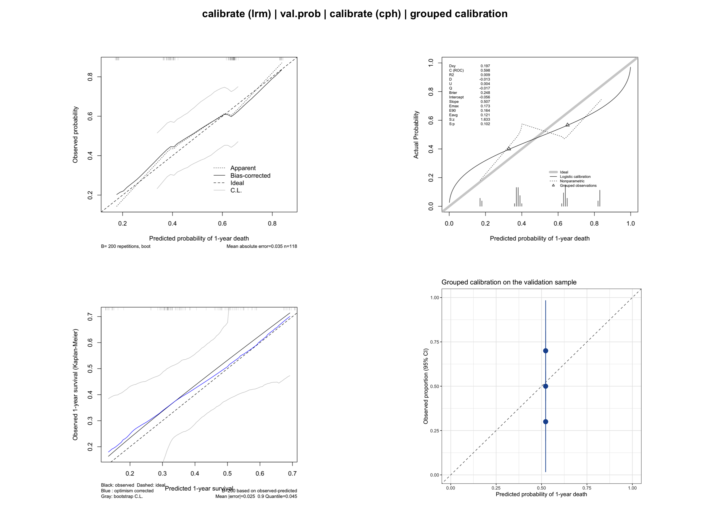
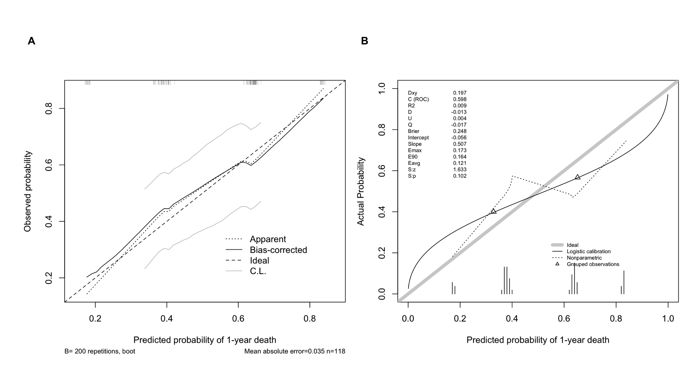

校准曲线（Calibration curve）评估预测模型的*准确性*（accuracy）：在预测风险相近的患者群体中，事件的实际发生率是否与预测值一致？校准完美的模型在校准图（预测概率 vs 观察概率）上应落在 45° 对角线上。区分度（见 ROC 曲线教程）与校准回答的是不同的问题——一个模型可能把患者排序排得很好，却系统性高估或低估绝对风险 \[1\]。与决策曲线分析一样，校准曲线是临床预测模型标准评估套件的组成部分。

本教程涵盖 R 中（`rms` 包）四种校准工作流：

1. logistic 模型的 bootstrap 平滑校准（`calibrate`）；
2. 预测概率的验证集式评估（`val.prob`）；
3. Cox 模型在固定时间点的生存概率校准；
4. 分组“观察 vs 预测”率的 ggplot2 版本。

## 示例

{fig-alt="CalibrationPlot DEMO" fig-align="center" width="60%"}

## 环境配置

-   系统要求：跨平台（Linux/MacOS/Windows）

-   编程语言：R

-   依赖包：`survival`；`dplyr`；`rms`；`ggplot2`

```{r packages setup, message=FALSE, warning=FALSE, output=FALSE}
# 安装必要的包
if (!requireNamespace("rms", quietly = TRUE)) {
  install.packages("rms")
}

# 加载包
library(survival)
library(dplyr)
library(ggplot2)
library(rms)
```

```{r}
sessioninfo::session_info("attached")
```

## 数据准备

仍使用 `survival` 包内置的 `lung` 数据集（北中部癌症治疗组肺癌临床试验）\[2\]：logistic 模型以“一年内死亡”为二元终点，Cox 模型以总生存为终点。将数据拆分为训练集和验证集，用于演示 `val.prob()`。

```{r load data, message=FALSE, warning=FALSE}
data(lung, package = "survival")

set.seed(2026)
lung2 <- lung %>%
  filter(complete.cases(age, sex, ph.ecog, ph.karno, pat.karno, meal.cal, wt.loss)) %>%
  mutate(y1y = as.integer(time < 365 & status == 2))  # 365 天内死亡

idx <- sample(seq_len(nrow(lung2)), size = round(0.7 * nrow(lung2)))
train <- lung2[idx, ]
valid <- lung2[-idx, ]

cat("训练集:", nrow(train), " 验证集:", nrow(valid),
    " 事件数(训练集):", sum(train$y1y), "\n")

dd <- datadist(lung2)   # 基于全量数据的 datadist
options(datadist = "dd")
```

## 可视化

### 1. logistic 模型的 bootstrap 平滑校准

对 `lrm` 拟合对象使用 `calibrate()`，通过 bootstrap 校正得到“预测 vs 观察”曲线，比单样本直接分组的做法更平滑、噪声更小 \[3\]。

```{r}
#| label: fig-1.1LrmCalibrate
#| fig-cap: "logistic 模型的 bootstrap 校正校准曲线（Bias-corrected 线）。"
#| out.width: "70%"
#| fig-width: 6.5
#| fig-height: 6
#| warning: false
#| message: false

lrm_fit <- lrm(y1y ~ age + sex + ph.ecog, data = train, x = TRUE, y = TRUE)
set.seed(2026)  # 固定随机种子，保证 bootstrap 校准跨渲染可复现
cal_lrm <- calibrate(lrm_fit, method = "boot", B = 200)
plot(cal_lrm, xlab = "Predicted probability of 1-year death",
     ylab = "Observed probability")
```

“Apparent”线是样本内拟合；“Bias-corrected”线经过了过拟合校正，是应当报告的那条。斜率小于 1 提示预测过于极端（过拟合）。

### 2. 使用 val.prob 验证预测概率

`val.prob()` 接收*独立*样本的预测概率与二元结局，报告校准截距、校准斜率、区分度（C 指数 = AUC）、Brier 分数等多项指标。

```{r}
#| label: fig-2.1ValProb
#| fig-cap: "在留出样本上用 val.prob 对 logistic 模型进行外部验证。"
#| out.width: "70%"
#| fig-width: 6.5
#| fig-height: 6
#| warning: false
#| message: false

pred_valid <- predict(lrm_fit, newdata = valid, type = "fitted")
val.prob(pred_valid, valid$y1y,
         m = 20, cex = 0.6,   # 每组 20 个观测用于绘制分组点
         xlab = "Predicted probability of 1-year death")
```

虚线对角线是理想校准；三角形标记分组的观察发生率（每组 20 例）。打印的统计量包括校准截距（理想为 0）和校准斜率（理想为 1）。

### 3. Cox 模型生存概率的校准

对生存模型，校准在固定时间点评估：将预测的一年生存概率与 Kaplan-Meier 观察比例进行比较 \[3\]。

```{r}
#| label: fig-3.1CphCalibrate
#| fig-cap: "Cox 模型 1 年生存的 bootstrap 校准。"
#| out.width: "70%"
#| fig-width: 6.5
#| fig-height: 6
#| warning: false
#| message: false

cph_fit <- cph(Surv(time, status) ~ age + sex + ph.ecog,
               data = train, x = TRUE, y = TRUE, surv = TRUE, time.inc = 365)
set.seed(2026)
cal_cph <- calibrate(cph_fit, u = 365, method = "boot", B = 200, m = 40)
plot(cal_cph, xlab = "Predicted 1-year survival",
     ylab = "Observed 1-year survival (Kaplan-Meier)")
```

`u = 365` 必须与 `cph` 调用中的 `time.inc` 一致；`m` 控制估计曲线时每组的观测数。

### 4. 分组校准点的 ggplot2 版本

```{r}
#| label: fig-4.1GroupedCalibration
#| fig-cap: "验证集中各分位组的观察率与预测 1 年死亡风险对比。"
#| out.width: "70%"
#| fig-width: 6
#| fig-height: 6
#| warning: false
#| message: false

grouped <- valid %>%
  mutate(pred_group = ntile(pred_valid, n = 5)) %>%
  group_by(pred_group) %>%
  summarise(mean_pred = mean(pred_valid),
            obs_rate = mean(y1y),
            se = sqrt(obs_rate * (1 - obs_rate) / n()),
            n = n(),
            .groups = "drop")

ggplot(grouped, aes(mean_pred, obs_rate)) +
  geom_abline(slope = 1, intercept = 0, linetype = "dashed", color = "grey50") +
  geom_pointrange(aes(ymin = pmax(obs_rate - 1.96 * se, 0),
                      ymax = pmin(obs_rate + 1.96 * se, 1)),
                  color = "#2166AC", size = 0.8) +
  coord_cartesian(xlim = c(0, 1), ylim = c(0, 1)) +
  labs(x = "Predicted probability of 1-year death",
       y = "Observed proportion (95% CI)",
       title = "Grouped calibration on the validation sample") +
  theme_bw()
```

这一透明的构造——将预测分桶、比较观察事件率——正是分组校准曲线的原理，并且能看到每个点背后的样本量。注意置信区间很宽：校准评估需要较大的样本量。

## 应用

校准曲线通常与列线图（Nomogram）一同出现在预测模型论文中，典型形式是"训练集 + 验证集"成对展示。下图按该版式组装本教程的输出：(A) 训练样本的 bootstrap 校正校准；(B) 用 `val.prob` 进行的独立样本验证。

{fig-alt="CalibrationPlot Application" fig-align="center" width="60%"}

## 参考文献

\[1\] Van Calster B, McLernon DJ, van Smeden M, et al. Calibration: the Achilles heel of predictive analytics. BMC Med. 2019;17(1):230. doi:10.1186/s12916-019-1466-7

\[2\] Loprinzi CL, Laurie JA, Wieand HS, et al. Prospective evaluation of prognostic variables from patient-completed questionnaires. North Central Cancer Treatment Group. J Clin Oncol. 1994;12(3):601-607. doi:10.1200/JCO.1994.12.3.601

\[3\] Harrell FE Jr. Regression Modeling Strategies: With Applications to Linear Models, Logistic and Ordinal Regression, and Survival Analysis. 2nd ed. Springer; 2015. doi:10.1007/978-3-319-19425-7

\[4\] Collins GS, Reitsma JB, Altman DG, Moons KGM. Transparent Reporting of a multivariable prediction model for Individual Prognosis Or Diagnosis (TRIPOD). BMJ. 2015;350:g7594. doi:10.1136/bmj.g7594
