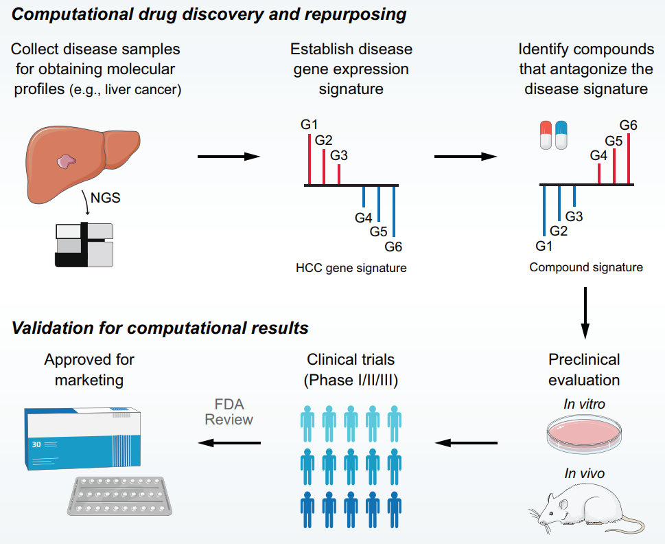

The reference uses the **Connectivity Map (CMAP)** to identify candidate small molecules that can reverse a disease expression signature, generating connectivity scores (negative scores indicate potential reversal/therapeutics) and summarizing them as a ranked barcode or barplot \[1\].. Here, 40 candidate drugs with simulated CMAP connectivity scores are evaluated, and the ranked summary barplot runs on ggplot2:

## Example

{fig-alt="CMAP Connectivity Score Summary DEMO" fig-align="center" width="75%"}

## Setup

-   System Requirements: Cross-platform (Linux/MacOS/Windows)

-   Programming language: R

-   Dependent packages: `ggplot2`

```{r packages setup, message=FALSE, warning=FALSE, output=FALSE}
suppressPackageStartupMessages({
  library(ggplot2)
})
```

```{r}
sessioninfo::session_info("attached")
```

## Data Preparation

40 candidate drugs with simulated CMAP connectivity scores ranging from −100 to +100. Negative scores (reverters) are highlighted in blue, positive scores (mimickers) in red:

```{r load data}
suppressPackageStartupMessages({library(ggplot2)})
set.seed(47282)
n_drugs <- 40
drugs <- sprintf("Drug_%02d", 1:n_drugs)
scores <- rnorm(n_drugs, 0, 45)
scores <- pmin(pmax(scores, -100), 100)

cmap_df <- data.frame(
  drug = factor(drugs, levels = drugs[order(scores)]),
  score = sort(scores)
)
cmap_df$direction <- ifelse(cmap_df$score < 0, "Reverser (negative)", "Mimicker (positive)")
```

## Visualization

### 1. Ranked CMAP Connectivity Barplot

The reference's ranked summary: one horizontal bar per drug, sorted by connectivity score, with negative reverers in blue and positive mimickers in red:

```{r}
#| label: fig-1.1CmapBar
#| fig-cap: "Ranked CMAP connectivity scores for 40 candidate drugs: negative scores (reverser candidates) in blue, positive scores (mimickers) in red; sorted by score magnitude."
#| out.width: "90%"
#| fig-width: 8
#| fig-height: 7

ggplot(cmap_df, aes(reorder(drug, score), score, fill = direction)) +
  geom_col(width = 0.75) +
  coord_flip() +
  scale_fill_manual(values = c("Reverser (negative)" = "#2166AC", "Mimicker (positive)" = "#B2182B"),
                    name = NULL) +
  labs(x = NULL, y = "CMAP connectivity score") +
  theme_bw(base_size = 11) +
  theme(panel.grid.minor = element_blank(),
        legend.position = "top",
        axis.text.y = element_text(size = 8))
```

::: callout-tip
**Practice tips**
-   Sort drugs by connectivity score magnitude so top candidates (most negative for reverers) lead the chart.
-   Use diverging colors (blue for negative/reverser, red for positive/mimicker) to match standard CMAP convention.
-   Horizontal bar plots (`coord_flip()`) accommodate long drug names without collisions.
-   Highlight scores exceeding absolute thresholds (e.g. |score| > 90 or p < 0.05).
-   Include compound mechanism of action annotations if available.
:::

## Application

::: {#fig-CmapApplications1}
{fig-alt="CMAP Connectivity Score Summary" fig-align="center" width="75%"}

CMAP connectivity score summary
:::

CMAP connectivity barplots apply to any drug-repurposing or signature-matching screen: LINCS-CMAP queries, drug-signature matching, or transcriptional reversal screens.

## Reference

\[1\] Xiaofan Lu, et al. Festival of Standardized Biomedical Visualizations: CMAP Connectivity Summary. iMetaMed. 2025. doi:10.1002/imm3.70005
