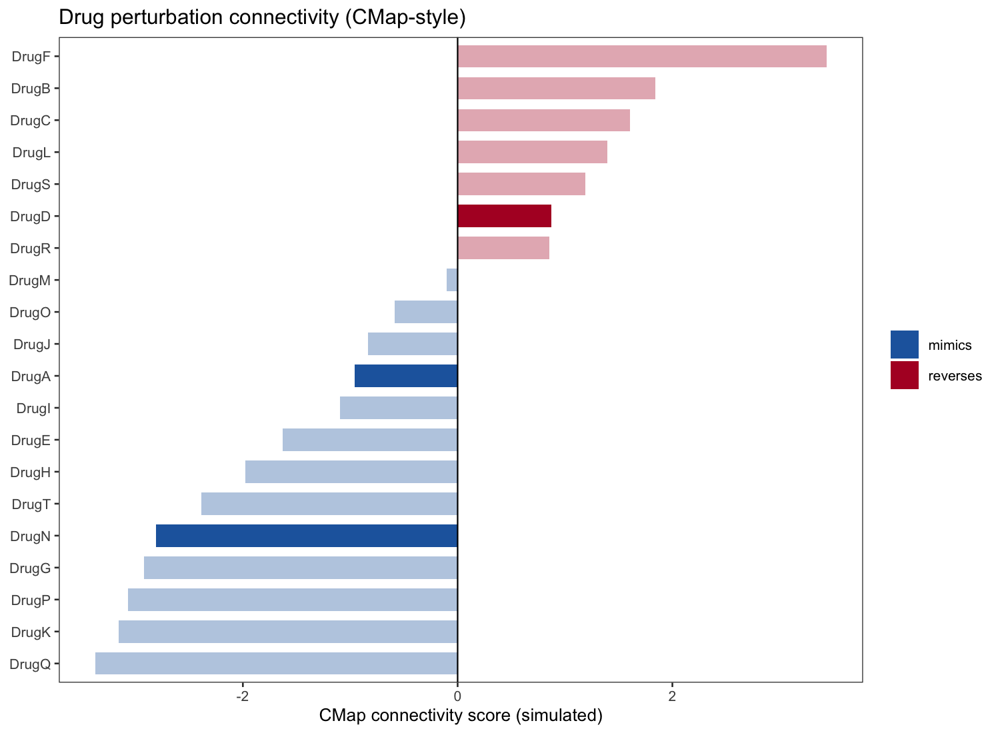

参考利用**疾病图谱（CMAP）**识别能够逆转疾病表达签名的候选小分子，生成连接评分（负分指示潜在逆转/治疗药物）并将其汇总为排序条形码或条形图 \[\1\]。此处评估 40 个带模拟 CMAP 连接评分的候选药物，排序汇总条形图在 ggplot2 上运行：

## Example

{fig-alt="CMAP 连接评分汇总 DEMO" fig-align="center" width="60%"}

## Setup

-   系统要求：跨平台（Linux/MacOS/Windows）

-   编程语言：R

-   依赖包：`ggplot2`

```{r packages setup, message=FALSE, warning=FALSE, output=FALSE}
suppressPackageStartupMessages({
  library(ggplot2)
})
```

```{r}
sessioninfo::session_info("attached")
```

## 数据准备

40 个候选药物带从 −100 到 +100 的模拟 CMAP 连接评分。负分（逆转剂）用蓝色高亮、正分（模拟剂）用红色高亮：

```{r load data}
suppressPackageStartupMessages({library(ggplot2)})
set.seed(47282)
n_drugs <- 40
drugs <- sprintf("Drug_%02d", 1:n_drugs)
scores <- rnorm(n_drugs, 0, 45)
scores <- pmin(pmax(scores, -100), 100)

cmap_df <- data.frame(
  drug = factor(drugs, levels = drugs[order(scores)]),
  score = sort(scores)
)
cmap_df$direction <- ifelse(cmap_df$score < 0, "Reverser (negative)", "Mimicker (positive)")
```

## Visualization

### 排序 CMAP 连接条形图

参考的排序汇总：每药物一根水平条、按连接评分排序、负向逆转剂为蓝色、正向模拟剂为红色：

```{r}
#| label: fig-1.1CmapBar
#| fig-cap: "40 个候选药物的排序 CMAP 连接评分：负分（逆转剂候选）为蓝色、正分（模拟剂）为红色；按评分大小排序。"
#| out.width: "90%"
#| fig-width: 8
#| fig-height: 7

ggplot(cmap_df, aes(reorder(drug, score), score, fill = direction)) +
  geom_col(width = 0.75) +
  coord_flip() +
  scale_fill_manual(values = c("Reverser (negative)" = "#2166AC", "Mimicker (positive)" = "#B2182B"),
                    name = NULL) +
  labs(x = NULL, y = "CMAP connectivity score") +
  theme_bw(base_size = 11) +
  theme(panel.grid.minor = element_blank(),
        legend.position = "top",
        axis.text.y = element_text(size = 8))
```


## 应用场景

::: {{#fig-CmapApplications1}}
{fig-alt="CMAP 连接评分汇总" fig-align="center" width="60%"}

CMAP 连接评分汇总
:::

CMAP 连接条形图适用于任何药物重定位或签名匹配筛查：LINCS-CMAP 查询、药物签名匹配、或转录逆转筛查。

## 参考文献

\[1\] Xiaofan Lu, et al. Festival of Standardized Biomedical Visualizations: CMAP Connectivity Summary. iMetaMed. 2025. doi:10.1002/imm3.70005
