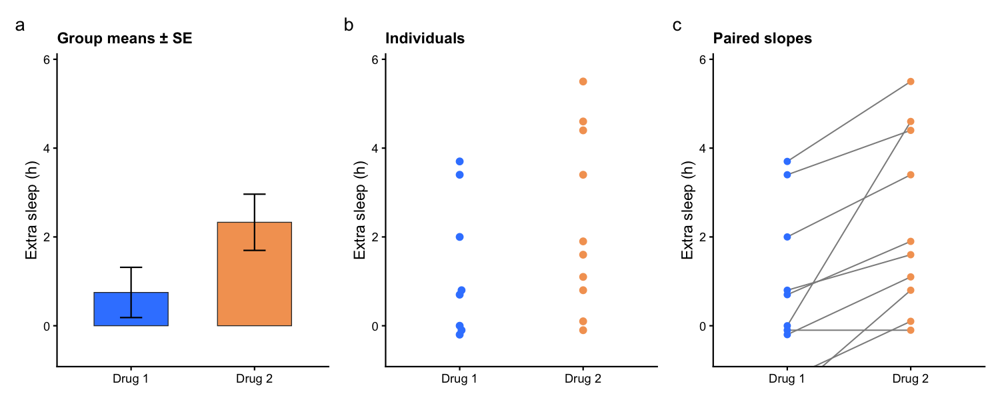

组合面板并排从三个角度回答同一个比较问题：**柱状图**展示各组均值与误差棒，**蜂群散点**暴露每一个个体观测，**配对折线图**追踪每位受试者跨两种条件的变化。三者同读，能分辨单一汇总所掩盖的问题——表面上的均值差异，究竟来自每位受试者的一致移动，还是少数人的大幅响应？只有配对面板能回答。本教程复现《顶刊图社》系列（第006期）介绍的图表类型，见文末参考文献。

## 示例

{fig-alt="CombinationPanel DEMO" fig-align="center" width="95%"}

这张组合面板分析了经典的 `sleep` 研究（10 位患者、两种安眠药、配对设计）。面板 **a** 展示每种药物的平均额外睡眠时长与标准误；面板 **b** 用蜂群散点画出每位患者的结果；面板 **c** 连接每位患者的两次测量值——普遍向上的斜率表明多数患者服用 Drug 2 后睡得更多，这正是均值本身无法提供的配对证据。

## 环境配置

-   系统要求：跨平台（Linux/MacOS/Windows）

-   编程语言：R

-   依赖包：`tidyverse`；`ggbeeswarm`；`patchwork`

```{r packages setup, message=FALSE, warning=FALSE, output=FALSE}
# Installing necessary packages
if (!requireNamespace("tidyverse", quietly = TRUE)) {
  install.packages("tidyverse")
}
if (!requireNamespace("ggbeeswarm", quietly = TRUE)) {
  install.packages("ggbeeswarm")
}
if (!requireNamespace("patchwork", quietly = TRUE)) {
  install.packages("patchwork")
}

# Load packages
library(tidyverse)
library(ggbeeswarm)
library(patchwork)
```

## 数据准备

示例使用 base R 内置的 `sleep` 数据集：10 位患者在两种药物下的配对额外睡眠时长——每位患者每种条件一行，正是三个面板共同需要的长表形态。

```{r load data, message=FALSE}
data("sleep")

sleep_data <- sleep |>
  mutate(group = factor(group, labels = c("Drug 1", "Drug 2")),
         ID = factor(ID))

head(sleep_data, 4)
```

三个面板共用同一个 y 轴范围，才能互相参照；先固定范围，避免出现三套自动刻度。

```{r shared scales, message=FALSE}
panel_colors <- c("Drug 1" = "#3a86ff", "Drug 2" = "#f4a261")
panel_theme <- theme_classic(base_size = 11) +
  theme(legend.position = "none",
        plot.title = element_text(size = 11, face = "bold"))
shared_range <- coord_cartesian(ylim = c(-0.6, 5.8))

summary_stats <- sleep_data |>
  group_by(group) |>
  summarise(mean_extra = mean(extra), se = sd(extra) / sqrt(n()), .groups = "drop")
```

## 可视化

### 1. 三个面板

每个面板都是普通的 ggplot；`patchwork` 用 `+` 把它们拼起来并自动加面板字母。柱状面板画均值与误差棒，蜂群面板需要 `ggbeeswarm`，配对面板通过 `group = ID` 把每位患者的两点连起来。

```{r}
#| label: fig-1.1ComboPanels
#| fig-cap: "sleep 研究的柱状/蜂群/配对折线三面板"
#| out.width: "100%"
#| warning: false
#| message: false
#| fig-width: 10
#| fig-height: 4

panel_a <- ggplot(summary_stats, aes(group, mean_extra, fill = group)) +
  geom_col(width = .6, colour = "grey20", linewidth = .3) +
  geom_errorbar(aes(ymin = mean_extra - se, ymax = mean_extra + se),
                width = .18, linewidth = .5) +
  scale_fill_manual(values = panel_colors) +
  labs(x = NULL, y = "Extra sleep (h)", title = "Group means ± SE") +
  panel_theme + shared_range

panel_b <- ggplot(sleep_data, aes(group, extra, colour = group)) +
  geom_beeswarm(cex = 1.6, size = 2) +
  scale_colour_manual(values = panel_colors) +
  labs(x = NULL, y = "Extra sleep (h)", title = "Individuals") +
  panel_theme + shared_range

panel_c <- ggplot(sleep_data, aes(group, extra, group = ID)) +
  geom_line(colour = "grey55", linewidth = .45) +
  geom_point(aes(colour = group), size = 1.8) +
  scale_colour_manual(values = panel_colors) +
  labs(x = NULL, y = "Extra sleep (h)", title = "Paired slopes") +
  panel_theme + shared_range

panel_a + panel_b + panel_c + plot_annotation(tag_levels = "a")
```

::: callout-tip
**关键参数：**

- 配对面板里的 `group = ID`：把散点图变为斜率图的关键；保持每位受试者每种条件一行。
- `coord_cartesian(ylim = ...)`：只裁剪视野而不丢数据——用它给所有面板统一范围。
- `patchwork`：用 `+` 横向拼、`plot_layout(ncol = 1)` 纵向堆叠；`plot_annotation(tag_levels = "a")` 加面板字母。
:::

### 2. 纵向堆叠与配对检验

纵向堆叠适合窄图版，配对设计还允许把配对检验直接标注在斜率面板上。注意 R 的一个惯用法：`t.test()` 不能把公式写法与 `paired = TRUE` 合用——应传入两组向量。

```{r}
#| label: fig-1.2StackedCombo
#| fig-cap: "带配对 t 检验标注的纵向组合面板"
#| out.width: "60%"
#| warning: false
#| message: false
#| fig-width: 4.2
#| fig-height: 10

wide <- sleep_data |>
  select(ID, group, extra) |>
  pivot_wider(names_from = group, values_from = extra)
paired_test <- t.test(wide[["Drug 2"]], wide[["Drug 1"]], paired = TRUE)
test_label <- sprintf("paired t-test: p = %.3f, mean diff = %.2f h",
                      paired_test$p.value, paired_test$estimate)

panel_c2 <- panel_c +
  labs(title = NULL) +
  annotate("text", x = 1.5, y = 5.6, label = test_label, size = 3.2)

panel_a + panel_b + panel_c2 +
  plot_layout(ncol = 1) +
  plot_annotation(tag_levels = "a")
```

### 3. 高亮均值轨迹

在个体斜率之上叠加均值轨迹，把组水平的位移与个体散布分开——粗线是结论，细线是支撑它的证据。

```{r}
#| label: fig-1.3MeanTrajectory
#| fig-cap: "高亮均值轨迹的配对斜率图"
#| out.width: "70%"
#| warning: false
#| message: false
#| fig-width: 5
#| fig-height: 5

panel_c +
  stat_summary(aes(group = 1), fun = mean, geom = "line",
               colour = "grey10", linewidth = 1.1) +
  stat_summary(aes(group = 1), fun = mean, geom = "point",
               shape = 18, size = 3.2, colour = "grey10") +
  labs(title = "Mean trajectory (bold)")
```

## 应用场景

-   **配对临床设计**：治疗前后、匹配病例对照、交叉试验。
-   **任意双条件比较**：a–c 三个面板一起呈现，提前满足审稿人对变异性、离群点与配对证据的常见追问。
-   **结果报告**：检验标注把图形与统计绑定，而不是把统计留成隐含。
-   组合就是普通的 patchwork——每个面板都可以换成箱线图、密度图或其他任何汇总，互不影响。

## 参考文献

\[1\] 顶刊图社 | 第006期：分组折线图+蜂群点图+柱状图. 微信公众号文章. <http://mp.weixin.qq.com/s?__biz=MzU5NjE2ODU0OQ==&mid=2247483799&idx=1&sn=2de1939cc2f43454563fbd9ae297a492>

\[2\] Student (Gosset WS). The probable error of a mean. Biometrika. 1908;6(1):1-25. doi:10.2307/2331554（对 `sleep` 测量数据进行分析的经典论文）。
