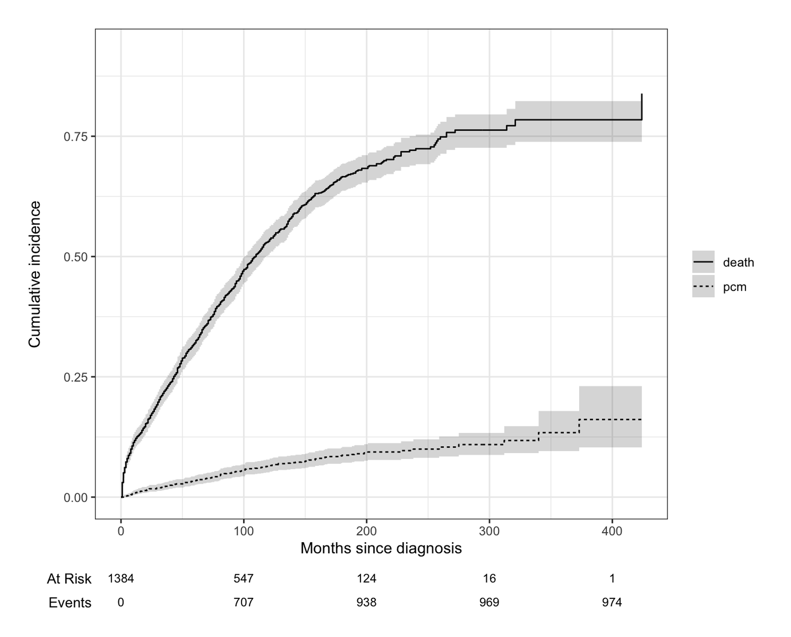
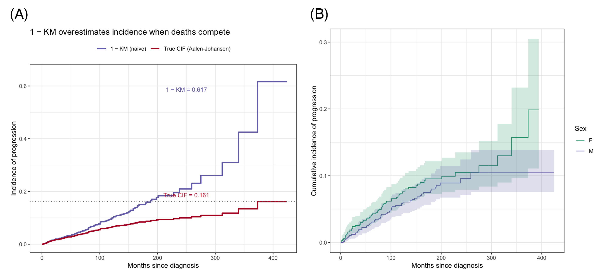

When patients can fail from more than one cause — progression *or* death, relapse *or* transplant mortality — standard Kaplan–Meier analysis is wrong for the event of interest: censoring patients at their competing event pretends they were still at risk of progressing, and the naive 1 − KM estimator **overestimates** the incidence, dramatically so when the competing event is common \[1\]. The correct descriptive tool is the **cumulative incidence function** (CIF, Aalen–Johansen estimator), which treats competing events as competing: a subject who dies can no longer progress, and the CIFs of all causes sum to 1.

Group comparison uses **Gray's test** (a K-sample test on the CIFs), and regression uses the **Fine–Gray subdistribution hazard model** \[2\]. This tutorial walks through all three with `tidycmprsk` \[3\] and `ggsurvfit` \[4\], on the classic `mgus2` cohort \[5\]: 1,384 patients with monoclonal gammopathy of undetermined significance, where progression to plasma cell malignancy competes with death.

This tutorial covers four workflows:

1. CIFs of both competing outcomes with confidence intervals and risk table;
2. CIFs by a covariate with Gray's test;
3. Fine–Gray subdistribution hazard regression;
4. Why 1 − KM overestimates incidence — the comparison every reviewer asks for.

## Example

{fig-alt="CompetingRiskPlot DEMO" fig-align="center" width="60%"}

## Setup

-   System Requirements: Cross-platform (Linux/MacOS/Windows)

-   Programming language: R

-   Dependent packages: `survival`; `tidycmprsk`; `ggsurvfit`; `ggplot2`; `dplyr`

```{r packages setup, message=FALSE, warning=FALSE, output=FALSE}
# Installing necessary packages
if (!requireNamespace("tidycmprsk", quietly = TRUE)) {
  install.packages("tidycmprsk")
}
if (!requireNamespace("ggsurvfit", quietly = TRUE)) {
  install.packages("ggsurvfit")
}

# Load packages
library(survival)
library(tidycmprsk)
library(ggsurvfit)
library(ggplot2)
library(dplyr)
```

```{r}
sessioninfo::session_info("attached")
```

## Data Preparation

`mgus2` ships with the `survival` package \[5\]: 1,384 MGUS patients followed from diagnosis for progression to a plasma cell malignancy (PCM) or death. Follow-up time is the earlier of progression (`ptime`) and last contact (`futime`); the competing-risks event code is 0 = censored, 1 = PCM (the event of interest), 2 = death (the competing event).

```{r load data, message=FALSE, warning=FALSE}
data(mgus2)

mgus2$etime <- with(mgus2, ifelse(pstat == 1, ptime, futime))
mgus2$event <- with(mgus2, ifelse(pstat == 1, 1, ifelse(death == 1, 2, 0)))
mgus2$event_f <- factor(mgus2$event, levels = 0:2,
                        labels = c("censored", "pcm", "death"))

cat("Patients:", nrow(mgus2),
    "| progression:", sum(mgus2$event == 1),
    "| death (competing):", sum(mgus2$event == 2), "\n")
```

## Visualization

### 1. Cumulative Incidence of Both Outcomes

```{r}
#| label: fig-1.1CIF
#| fig-cap: "Aalen-Johansen cumulative incidence of progression and of death (the competing event), with 95% confidence bands and a risk table; the two CIFs are estimated jointly and sum to the all-cause incidence."
#| out.width: "85%"
#| fig-width: 7.5
#| fig-height: 6
#| warning: false
#| message: false

ci1 <- cuminc(Surv(etime, event_f) ~ 1, data = mgus2)

ggcuminc(ci1, outcome = c("pcm", "death")) +
  add_confidence_interval() +
  add_risktable(size = 3) +
  scale_color_manual(values = c(pcm = "#B2182B", death = "#2166AC"), name = NULL) +
  scale_fill_manual(values = c(pcm = "#B2182B", death = "#2166AC"), guide = "none") +
  xlab("Months since diagnosis") +
  ylab("Cumulative incidence") +
  theme_bw(base_size = 11)
```

Death dominates: by 20 years roughly 78% have died versus about 16% who have progressed — which is exactly the setting where naive Kaplan–Meier analysis of progression goes wrong (Section 4).

### 2. Comparing Groups with Gray's Test

```{r}
#| label: fig-2.1BySex
#| fig-cap: "Cumulative incidence of progression by sex with 95% confidence intervals; the caption reports Gray's test."
#| out.width: "70%"
#| fig-width: 6.5
#| fig-height: 5.5
#| warning: false
#| message: false

ci2 <- cuminc(Surv(etime, event_f) ~ sex, data = mgus2)
gt <- glance(ci2)
cat(sprintf("Gray's test, progression: chi-square = %.2f, df = %d, p = %.3f\n",
            gt$statistic_1, gt$df_1, gt$p.value_1))
cat(sprintf("Gray's test, death:       chi-square = %.2f, df = %d, p = %.3f\n",
            gt$statistic_2, gt$df_2, gt$p.value_2))

ggcuminc(ci2, outcome = "pcm") +
  add_confidence_interval() +
  scale_color_manual(values = c(F = "#1B9E77", M = "#7570B3"), name = "Sex") +
  scale_fill_manual(values = c(F = "#1B9E77", M = "#7570B3"), guide = "none") +
  xlab("Months since diagnosis") +
  ylab("Cumulative incidence of progression") +
  theme_bw(base_size = 11)
```

Men progress slightly faster than women, but Gray's test does not reach significance at the 0.05 level — with the effect quantified properly by the regression below.

### 3. Fine-Gray Regression

```{r}
#| label: fig-3.1FineGray
#| fig-cap: "Fine-Gray subdistribution hazard ratios for progression (log scale): male sex is non-significant, older age is protective (fewer remaining years in which to progress)."
#| out.width: "70%"
#| fig-width: 6.5
#| fig-height: 3.8
#| warning: false
#| message: false

fg <- crr(Surv(etime, event_f) ~ sex + age, data = mgus2, failcode = "pcm")
fgdf <- tidy(fg, exponentiate = TRUE, conf.int = TRUE) |>
  mutate(term_lbl = recode(term, sexM = "Sex: M vs F", age = "Age (per year)"))

ggplot(fgdf, aes(x = estimate, y = term_lbl)) +
  geom_errorbar(aes(xmin = conf.low, xmax = conf.high), orientation = "y",
                width = 0.12, color = "#B2182B") +
  geom_point(size = 3, color = "#B2182B") +
  geom_vline(xintercept = 1, linetype = "dashed", color = "grey40") +
  scale_x_log10() +
  labs(x = "Subdistribution hazard ratio (log scale)", y = NULL,
       title = "Fine-Gray regression: progression to malignancy") +
  theme_bw(base_size = 11)
```

The subdistribution HR answers the clinically relevant question — how the covariate shifts the *absolute* incidence of progression in the presence of the competing risk. For the etiologic (cause-specific) question, fit `survival::coxph` instead and say which one you report.

### 4. Why 1 − KM Overestimates: The Comparison Figure

```{r}
#| label: fig-4.1NaiveKM
#| fig-cap: "Naive 1 - KM (deaths censored) reaches 0.62 while the true cumulative incidence of progression is 0.16: treating deaths as censoring pretends those patients were still at risk."
#| out.width: "70%"
#| fig-width: 6.5
#| fig-height: 5.5
#| warning: false
#| message: false

kmfit <- survfit(Surv(etime, event == 1) ~ 1, data = mgus2)  # deaths censored
kmdf <- data.frame(time = kmfit$time, est = 1 - kmfit$surv)
cidf <- tidy(ci1) |>
  filter(outcome == "pcm") |>
  select(time, cif = estimate)
cidf <- rbind(data.frame(time = 0, cif = 0), cidf)

ggplot() +
  geom_step(data = kmdf, aes(time, est, color = "1 − KM (naive)"),
            linewidth = 1, direction = "hv") +
  geom_step(data = cidf, aes(time, cif, color = "True CIF (Aalen-Johansen)"),
            linewidth = 1, direction = "hv") +
  geom_hline(yintercept = tail(cidf$cif, 1), linetype = "dotted", color = "grey40") +
  annotate("text", x = 250, y = tail(cidf$cif, 1) + 0.025, size = 3.4, color = "#B2182B",
           label = sprintf("True CIF = %.3f", tail(cidf$cif, 1))) +
  annotate("text", x = 250, y = max(kmdf$est) - 0.03, size = 3.4, color = "#7570B3",
           label = sprintf("1 − KM = %.3f", max(kmdf$est))) +
  scale_color_manual(values = c("1 − KM (naive)" = "#7570B3",
                                "True CIF (Aalen-Johansen)" = "#B2182B"), name = NULL) +
  coord_cartesian(xlim = c(0, 420), ylim = c(0, 0.65)) +
  labs(x = "Months since diagnosis", y = "Incidence of progression",
       title = "1 − KM overestimates incidence when deaths compete") +
  theme_bw(base_size = 11) + theme(legend.position = "top")
```

The naive curve rises almost four times above the truth by 20 years. Whenever a competing event is more than a rarity, report Aalen–Johansen CIFs — a Kaplan–Meier curve of the event of interest alone is a common and consequential reviewer catch.

::: callout-tip
## Practice tips

-   Encode outcomes as a factor with the event of interest first, competing event second, censoring last; `tidycmprsk::cuminc()` requires the two-level `Surv(time, factor)` syntax.
-   Report CIFs with confidence intervals and the risk table — readers judge the follow-up, not just the curve.
-   Gray's test compares incidence; the log-rank test on cause-specific survival answers a different question. Pick per the estimand.
-   In Fine–Gray models, covariate effects on the *subdistribution* hazard can have counterintuitive signs (older age appears "protective" against progression because death removes patients first) — interpret against the CIF, not the hazard.
:::

## Application

Competing-risk curves are standard in transplantation (relapse vs non-relapse mortality), geriatric oncology (progression vs other-cause death), and device/cardiology studies (arrhythmia vs all-cause death). The panel below mirrors a typical publication layout: (A) CIFs of both outcomes with risk table and (B) the naive 1 − KM versus true CIF comparison.

{fig-alt="CompetingRiskPlot Application" fig-align="center" width="60%"}

## Reference

\[1\] Austin PC, Fine JP. Practical recommendations for reporting Fine-Gray model analyses for competing risk data. Stat Med. 2017;36(4):5391-5400. doi:10.1002/sim.7501

\[2\] Fine JP, Gray RJ. A proportional hazards model for the subdistribution of a competing risk. J Am Stat Assoc. 1999;94(446):496-509. doi:10.1080/01621459.1999.10474144

\[3\] Sjoberg DD, Fei T. tidycmprsk: competing risks estimation. R package version 1.1.2. 2026. doi:10.32614/CRAN.package.tidycmprsk

\[4\] Sjoberg DD, Whiting K, Curry M, Lavery JA, Larmarange J. Reproducible summary tables with the gtsummary package. R J. 2021;13:570-580. doi:10.32614/RJ-2021-053 (ggsurvfit builds on gtsummary)

\[5\] Kyle RA, Therneau TM, Rajkumar SV, et al. A long-term study of prognosis in monoclonal gammopathy of undetermined significance. N Engl J Med. 2002;346(8):564-569. doi:10.1056/NEJMoa011332
