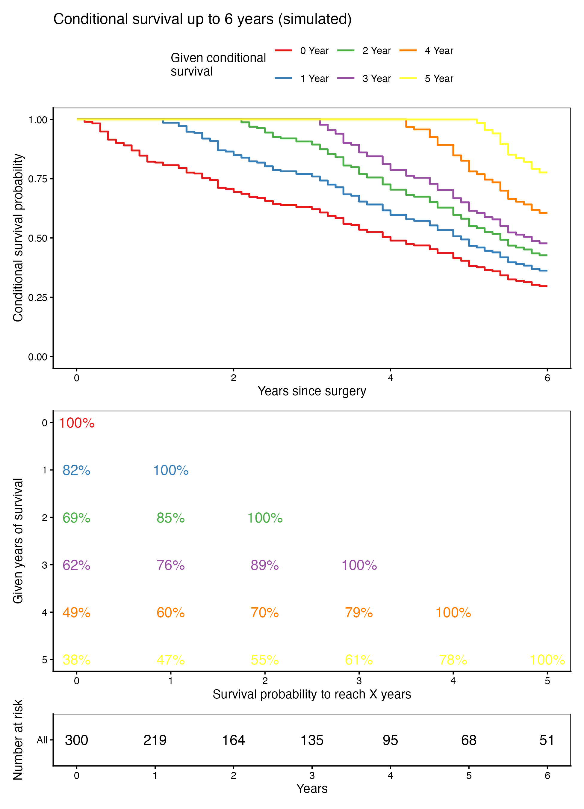

Conditional survival reframes prognosis as **P(surviving X total years | already survived s years)**: as s grows, the curves climb toward 1, quantifying how "time survived" itself is prognostic \[1\]. The reference (Fig. 1 of the pancreatic-cohort study) delivers three aligned views — the conditional curves, the full probability matrix, and the numbers at risk. The `condsurv` package is installed but never actually called: the load-bearing mechanism is refitting the KM with `start.time = at[i]`, so this tutorial reproduces everything with `survival` + `ggplot2` alone:

## Example

{fig-alt="Conditional Survival DEMO" fig-align="center" width="60%"}

## Setup

-   System Requirements: Cross-platform (Linux/MacOS/Windows)

-   Programming language: R

-   Dependent packages: `survival`; `ggplot2`; `survminer`; `patchwork`; `RColorBrewer`

```{r packages setup, message=FALSE, warning=FALSE, output=FALSE}
suppressPackageStartupMessages({
  library(survival)
  library(ggplot2)
})
```

```{r}
sessioninfo::session_info("attached")
```

## Data Preparation

300 simulated patients with `futime` capped at 8 years (Exponential hazard 0.28/yr) and ~62% events — time in years, matching the reference's conditioning grid of 0-5 years survived and 6-year horizon:

```{r load data}
suppressPackageStartupMessages({library(survival); library(ggplot2); library(survminer); library(patchwork); library(RColorBrewer)})
set.seed(18301)
n <- 300
dat <- data.frame(futime = pmin(8, rexp(n, rate = 0.28)), fustat = rbinom(n, 1, 0.62))
at <- 0:5; surv.cut <- 6
mycol <- brewer.pal(6, "Set1")
basekm <- survfit(Surv(futime, fustat) ~ 1, data = dat, type = "kaplan-meier",
                  error = "greenwood", conf.type = "plain")
```

## Visualization

### 1. Curves, Probability Matrix, and Risk Table

The three-panel stack: conditional KM step curves (one per "given s years", each refit with `start.time` so it restarts at 1.0), the lower-triangle probability matrix with text coloured by conditioning time, and the risk table — read together, every step up in s lifts the prognosis:

```{r}
#| label: fig-1.1CondSurv
#| fig-cap: "Conditional survival of 300 simulated patients: KM step curves conditioned on 0-5 years already survived (top), the lower-triangle conditional probability matrix (middle, S(y | y0) = S(y)/S(y0)) and the numbers at risk (bottom)."
#| out.width: "70%"
#| warning: false
#| message: false
#| fig-width: 6.5
#| fig-height: 9

## conditional curves: refit the KM with start.time = at[i] (each starts at 1.0)
fitkm <- lapply(at, function(a)
  survfit(Surv(futime, fustat) ~ 1, data = dat, start.time = a,
          type = "kaplan-meier", error = "greenwood", conf.type = "plain"))
curves <- do.call(rbind, lapply(seq_along(at), function(i) {
  cs <- summary(fitkm[[i]], times = seq(0, surv.cut, 0.1))
  data.frame(timept = cs$time, prob = cs$surv, condtime = at[i])
}))
curves$condtime <- factor(paste0(curves$condtime, " Year"), levels = paste0(at, " Year"))
## conditional probability matrix: S(y | survived y0) = S(y) / S(y0)
cs_mat <- sapply(at, function(y0) sapply(at, function(y)
  if (y < y0) NA else summary(basekm, times = y)$surv / summary(basekm, times = y0)$surv))
dimnames(cs_mat) <- list(con = at, years = at)
mat <- data.frame(con = rep(at, times = length(at)),
                  years = rep(at, each = length(at)),
                  est = as.vector(cs_mat))
mat$lab <- ifelse(is.na(mat$est), NA, sprintf("%.0f%%", mat$est * 100))
risk <- summary(basekm, times = 0:surv.cut)$n.risk
rk <- data.frame(time = 0:surv.cut, n = risk)

p1 <- ggplot(curves, aes(timept, prob, colour = condtime)) +
  geom_step(linewidth = 0.7, direction = "hv") +
  geom_segment(x = 0, xend = max(at), y = 1, yend = 1, colour = mycol[length(at)],
               linewidth = 0.6, linetype = 1) +
  scale_colour_manual(values = mycol, name = "Given conditional\nsurvival") +
  coord_cartesian(xlim = c(0, surv.cut), ylim = c(0, 1)) +
  labs(x = "Years since surgery", y = "Conditional survival probability",
       title = "Conditional survival up to 6 years (simulated)") +
  theme_classic(base_size = 10) + theme(panel.border = element_rect(fill = NA, colour = "black"),
                                        legend.position = "top")
p2 <- ggplot(mat, aes(years, con)) +
  geom_text(aes(label = lab, colour = con), size = 4, show.legend = FALSE) +
  scale_y_reverse(breaks = at) + scale_x_continuous(breaks = at) +
  scale_colour_gradientn(colours = mycol) +
  labs(x = "Survival probability to reach X years", y = "Given years of survival") +
  theme_classic(base_size = 10) +
  theme(panel.border = element_rect(fill = NA, colour = "black"))
p3 <- ggplot(rk, aes(time, "All")) +
  geom_text(aes(label = n), size = 4, colour = "black") +
  scale_x_continuous(breaks = 0:surv.cut) +
  labs(x = "Years", y = "Number at risk") +
  theme_classic(base_size = 10) +
  theme(panel.border = element_rect(fill = NA, colour = "black"))
p1 / p2 / p3 + plot_layout(ncol = 1, heights = c(5, 5, 1))
```

::: callout-tip
**Practice tips**

-   Refit with `survfit(..., start.time = at[i])` instead of dividing survival functions — the refit KM restarts at 1.0 at the conditioning time and carries correct Greenwood variance for the risk table.
-   The matrix cell is `S(y) / S(y0)` from the **same** base KM; leave the upper triangle blank (y < y0 is undefined) rather than filling it with 100%.
-   Input time must already be in years (the conditioning grid and `surv.cut` are in those units) — converting days inside the page keeps the axis honest.
:::

## Applications

::: {#fig-CondSurvApplications1}
{fig-alt="Conditional survival overview" fig-align="center" width="60%"}

Conditional survival overview
:::

Conditional survival applies to any cohort with follow-up: post-resection cancers (the reference), transplant graft survival, or progression-free survival after completing first-line therapy.

## Reference

\[1\] Xiaofan Lu, et al. FigureYa: A Standardized Visualization Framework for Enhancing Biomedical Data Interpretation and Research Efficiency. iMetaMed. 2025. doi:10.1002/imm3.70005

\[2\] Latenstein AEJ, van Roessel S, van der Geest LGM, et al. Conditional Survival After Resection for Pancreatic Cancer: A Population-Based Study and Prediction Model. Ann Surg Oncol. 2020;27(7):2516-2524. doi:10.1245/s10434-020-08235-w