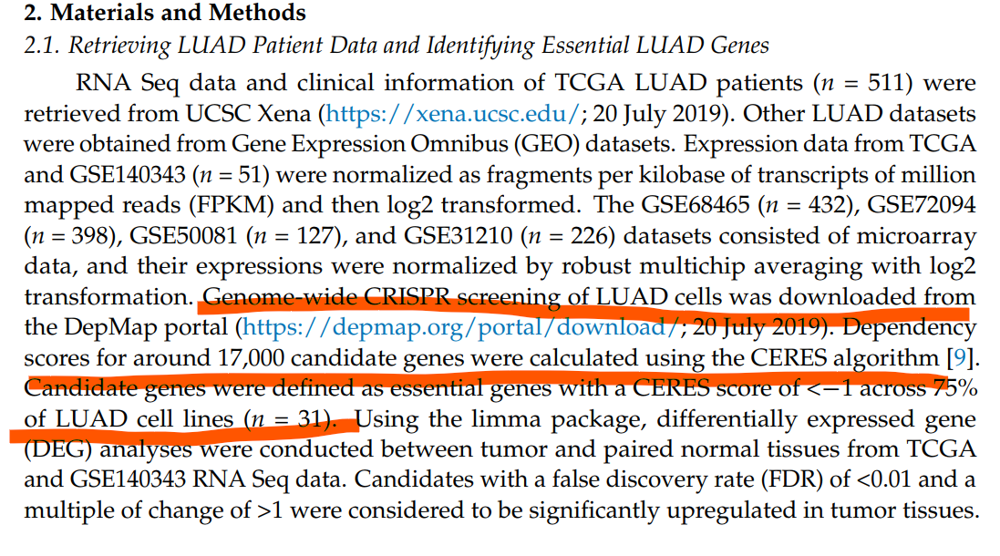

The reference bridges two worlds: **CERES dependency scores** from the DepMap CRISPR screen define which genes a lung adenocarcinoma cell line cannot live without, and those essential genes are then tested for tumour-specific expression in paired TCGA tumour/normal samples with limma — the surviving heatmap stratifies patients into clusters \[1\]. The DepMap CSVs (and the `ClassDiscovery::distanceMatrix` / private `NMF:::ccRamp` helpers) are replaced by an in-page simulated CERES matrix and base-R equivalents; limma itself runs unchanged from the lockfile:

## Example

{fig-alt="CRISPR Essential Genes to TCGA DEG DEMO" fig-align="center" width="75%"}

## Setup

-   System Requirements: Cross-platform (Linux/MacOS/Windows)

-   Programming language: R

-   Dependent packages: `limma`; `pheatmap`

```{r packages setup, message=FALSE, warning=FALSE, output=FALSE}
suppressPackageStartupMessages({
  library(limma); library(pheatmap)
})
```

```{r}
sessioninfo::session_info("attached")
```

## Data Preparation

The reference's candidate rule, applied to simulated data: a gene is **essential** when its CERES score is below −1 in > 75% of LUAD cell lines. 800 genes × 30 cell lines, 690 planted as common essentials. The paired TCGA block then simulates 59 tumour/normal pairs: essential genes get a tumour-up shift for a subset (the eventual DEGs) and housekeeping genes stay flat, so the limma result — and the patient clusters it induces — are interpretable:

```{r load data}
suppressPackageStartupMessages({library(limma); library(pheatmap)})
set.seed(41240)
n_genes <- 800; n_ccl <- 30; n_pair <- 59
genes <- c(sprintf("ESSENTIAL%03d", 1:690), sprintf("OTHER%03d", 1:110))
ceres <- matrix(rnorm(n_genes * n_ccl, -0.3, 0.4), n_genes, n_ccl,
                dimnames = list(genes, sprintf("LUAD%03d", 1:n_ccl)))
ceres[sprintf("ESSENTIAL%03d", 1:690), ] <- ceres[sprintf("ESSENTIAL%03d", 1:690), ] - 1.1
candidate.genes <- rownames(ceres)[apply(ceres, 1, function(x) sum(x < -1) > 0.75 * ncol(ceres))]
length(candidate.genes)

## paired TCGA tumour/normal expression of the candidates
com_code <- sprintf("TCGA-%02d", 1:n_pair)
pair.t.sam <- paste0(com_code, "-01A"); pair.n.sam <- paste0(com_code, "-11A")
gset <- matrix(rnorm(length(candidate.genes) * 2 * n_pair, 5, 0.6),
               length(candidate.genes), 2 * n_pair,
               dimnames = list(candidate.genes, c(pair.t.sam, pair.n.sam)))
## tumour-up shift for a subset of essentials (the future DEGs)
up.genes <- sample(candidate.genes, 40)
gset[up.genes, pair.t.sam] <- gset[up.genes, pair.t.sam] + 1.9

pd <- data.frame(Samples = c(pair.t.sam, pair.n.sam),
                 Group = rep(c("pT", "pN"), c(n_pair, n_pair)),
                 row.names = c(pair.t.sam, pair.n.sam))
design <- model.matrix(~ -1 + factor(pd$Group, levels = c("pT", "pN")))
colnames(design) <- c("pT", "pN")
fit <- limma::lmFit(gset, design = design)
fit2 <- limma::eBayes(limma::contrasts.fit(
  fit, limma::makeContrasts(pT - pN, levels = c("pT", "pN"))), 0.01)
resData <- limma::topTable(fit2, adjust = "fdr", sort.by = "B", number = Inf)
colnames(resData)[1] <- "log2fc"
resData$id <- rownames(resData)
degs <- resData[resData$adj.P.Val < 0.01 & resData$log2fc > 1.5, ]
nrow(degs)
```

## Visualization

### 1. Essential-Gene DEG Heatmap with Patient Clustering

The reference's deliverable: z-scored, ±2-capped expression of the significantly tumour-upregulated essentials, columns clustered by the reference's Ward-D on Euclidean distance (base `dist` + `hclust` here), with the pT/pN annotation strip proving the clusters align with sample class:

```{r}
#| label: fig-1.1CrisprHeatmap
#| fig-cap: "Tumour-upregulated essential genes (rows) across 118 paired samples (columns, Ward-D clustered): expression z-scored and capped at +/-2; the pT/pN strip confirms the clusters separate tumour from normal."
#| out.width: "100%"
#| fig-width: 9
#| fig-height: 7

annColors <- list(Group = c(pT = "red", pN = "steelblue"))
indata <- as.matrix(gset[degs$id, rownames(pd)])
plotdata <- t(scale(t(indata)))
plotdata <- pmin(pmax(plotdata, -2), 2)
hcs <- hclust(dist(t(indata)), method = "ward.D")
pheatmap(plotdata,
         color = colorRampPalette(c("blue", "white", "red"))(64),
         border_color = NA,
         cluster_rows = TRUE,
         cluster_cols = hcs,
         show_rownames = FALSE,
         show_colnames = FALSE,
         annotation_col = pd[, "Group", drop = FALSE],
         annotation_colors = annColors,
         treeheight_col = 20,
         treeheight_row = 20,
         legend = TRUE)
```

### 2. The Volcano Gate: Which Essentials Are Tumour-Up?

The reference's filter (`padj < 0.01 & log2FC > 1.5`) is easier to audit as a volcano of the limma result with the selected essentials highlighted — the genes that pass both the CRISPR essentiality screen and the tumour-expression gate:

```{r}
#| label: fig-2.1CrisprVolcano
#| fig-cap: "Volcano of the paired limma test for all CERES candidates: selected tumour-upregulated essentials (padj < 0.01, log2FC > 1.5) in red; the rest grey. The planted effect sizes place the selected set cleanly in the upper-right tail."
#| out.width: "80%"
#| fig-width: 7
#| fig-height: 6

resData$is_sel <- resData$id %in% degs$id
resData$nl <- -log10(pmax(resData$P.Value, 1e-300))
plot(resData$log2fc, resData$nl,
     col = ifelse(resData$is_sel, "#B2182B", "grey62"),
     pch = ifelse(resData$is_sel, 19, 16), cex = ifelse(resData$is_sel, 1.3, 0.6),
     xlab = "log2 fold change (pT vs pN)",
     ylab = "-log10(P)", las = 1)
abline(v = 1.5, lty = 2, col = "grey40")
abline(h = -log10(0.01), lty = 2, col = "grey40")
legend("topleft", c("selected essentials", "other candidates"),
       col = c("#B2182B", "grey62"), pch = c(19, 16), bty = "n", cex = 0.85)
text(1.52, max(resData$nl) * 0.97, "log2FC > 1.5", adj = 0, cex = 0.8, col = "grey30")
```

::: callout-tip
**Practice tips**

-   The essentiality rule is a **quantile over cell lines**, not a mean: `sum(x < -1) > 0.75 * ncol(...)` — a gene lethal in 3/30 lines is not a LUAD dependency.
-   Intersect the candidates with the TCGA gene symbols before limma; DepMap uses its own naming and the unmatched rows silently drop out of the model.
-   Cluster the samples on the **uncapped** expression (`dist(t(indata))`) but render the heatmap capped: capping before clustering distorts distances; capping only the display keeps tiles readable.
-   `NMF:::ccRamp` is a private function and `ClassDiscovery::distanceMatrix` a whole-package dependency for one call — `colorRampPalette(c("blue","white","red"))` and `dist()` are drop-in replacements.
-   Pair-wise tumour/normal design (`~ -1 + Group` + `makeContrasts`) removes patient effects that a unpaired design would bury.
:::

## Application

::: {#fig-CrisprScreenApplications1}
{fig-alt="CRISPR Essential Genes to TCGA DEG" fig-align="center" width="75%"}

CRISPR essential genes to TCGA DEG
:::

The screen → bulk-tumour bridge generalizes: any genome-scale perturbation score (CRISPR, RNAi, drug sensitivity) can be filtered by the same quantile rule and validated against a paired or unpaired tumour/normal cohort with limma.

## Reference

\[1\] Xiaofan Lu, et al. FigureYa: A Standardized Visualization Framework for Enhancing Biomedical Data Interpretation and Research Efficiency. iMetaMed. 2025. doi:10.1002/imm3.70005
