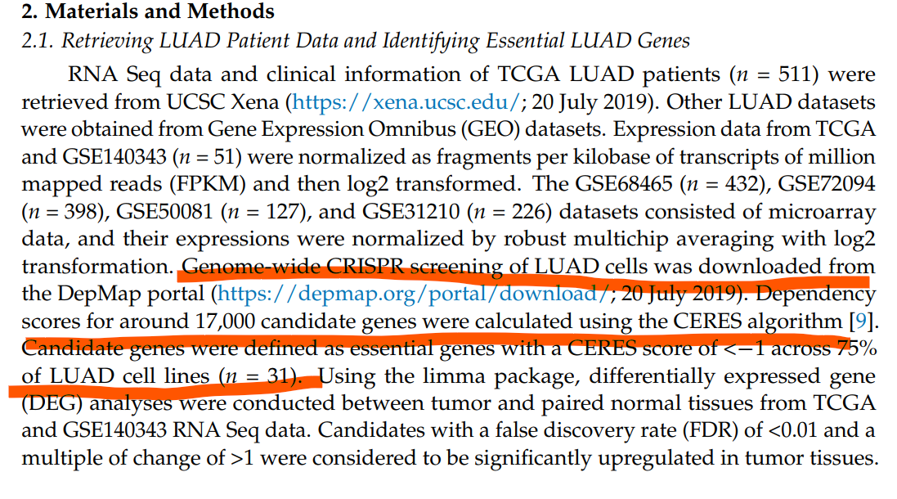

参考文档打通两个世界：DepMap CRISPR 筛选的 **CERES 依赖评分**定义肺腺癌细胞系离了哪些基因活不下去，这些必需基因再用 limma 在 TCGA 配对肿瘤/正常样本中检验肿瘤特异表达——最终的热图把病人分层成簇 \[1\]。DepMap CSV（及 `ClassDiscovery::distanceMatrix`、私有函数 `NMF:::ccRamp`）由页内模拟 CERES 矩阵和 base R 等价物替代；limma 本身在 lockfile 中原样运行：

## Example

{fig-alt="CRISPR 必需基因到 TCGA 差异表达 DEMO" fig-align="center" width="60%"}

## Setup

-   系统要求：跨平台（Linux/MacOS/Windows）

-   编程语言：R

-   依赖包：`limma`; `pheatmap`

```{r packages setup, message=FALSE, warning=FALSE, output=FALSE}
suppressPackageStartupMessages({
  library(limma); library(pheatmap)
})
```

```{r}
sessioninfo::session_info("attached")
```

## 数据准备

参考的候选规则用于模拟数据：基因的 CERES 评分在 >75% LUAD 细胞系中低于 −1 即判为**必需**。800 基因 × 30 细胞系、690 个植入为共有必需。配对 TCGA 块模拟 59 个肿瘤/正常对：部分必需基因获得肿瘤上调位移（最终 DEGs）、管家基因保持平稳，limma 结果及其诱导的病人聚类因此可解读：

```{r load data}
suppressPackageStartupMessages({library(limma); library(pheatmap)})
set.seed(41240)
n_genes <- 800; n_ccl <- 30; n_pair <- 59
genes <- c(sprintf("ESSENTIAL%03d", 1:690), sprintf("OTHER%03d", 1:110))
ceres <- matrix(rnorm(n_genes * n_ccl, -0.3, 0.4), n_genes, n_ccl,
                dimnames = list(genes, sprintf("LUAD%03d", 1:n_ccl)))
ceres[sprintf("ESSENTIAL%03d", 1:690), ] <- ceres[sprintf("ESSENTIAL%03d", 1:690), ] - 1.1
candidate.genes <- rownames(ceres)[apply(ceres, 1, function(x) sum(x < -1) > 0.75 * ncol(ceres))]
length(candidate.genes)

## paired TCGA tumour/normal expression of the candidates
com_code <- sprintf("TCGA-%02d", 1:n_pair)
pair.t.sam <- paste0(com_code, "-01A"); pair.n.sam <- paste0(com_code, "-11A")
gset <- matrix(rnorm(length(candidate.genes) * 2 * n_pair, 5, 0.6),
               length(candidate.genes), 2 * n_pair,
               dimnames = list(candidate.genes, c(pair.t.sam, pair.n.sam)))
## tumour-up shift for a subset of essentials (the future DEGs)
up.genes <- sample(candidate.genes, 40)
gset[up.genes, pair.t.sam] <- gset[up.genes, pair.t.sam] + 1.9

pd <- data.frame(Samples = c(pair.t.sam, pair.n.sam),
                 Group = rep(c("pT", "pN"), c(n_pair, n_pair)),
                 row.names = c(pair.t.sam, pair.n.sam))
design <- model.matrix(~ -1 + factor(pd$Group, levels = c("pT", "pN")))
colnames(design) <- c("pT", "pN")
fit <- limma::lmFit(gset, design = design)
fit2 <- limma::eBayes(limma::contrasts.fit(
  fit, limma::makeContrasts(pT - pN, levels = c("pT", "pN"))), 0.01)
resData <- limma::topTable(fit2, adjust = "fdr", sort.by = "B", number = Inf)
colnames(resData)[1] <- "log2fc"
resData$id <- rownames(resData)
degs <- resData[resData$adj.P.Val < 0.01 & resData$log2fc > 1.5, ]
nrow(degs)
```

## Visualization

### 必需基因 DEG 热图 + 病人聚类

参考的交付物：显著肿瘤上调必需基因的 z-score 化、±2 截断表达，列按参考的 Ward-D 欧氏距离聚类（此处 base `dist` + `hclust`），pT/pN 注释条证明聚类与样本类别对齐：

```{r}
#| label: fig-1.1CrisprHeatmap
#| fig-cap: "肿瘤上调必需基因（行）在 118 个配对样本（列，Ward-D 聚类）中的热图：表达 z-score 化并截断 ±2；pT/pN 色条确认聚类分离肿瘤与正常。"
#| out.width: "100%"
#| fig-width: 9
#| fig-height: 7

annColors <- list(Group = c(pT = "red", pN = "steelblue"))
indata <- as.matrix(gset[degs$id, rownames(pd)])
plotdata <- t(scale(t(indata)))
plotdata <- pmin(pmax(plotdata, -2), 2)
hcs <- hclust(dist(t(indata)), method = "ward.D")
pheatmap(plotdata,
         color = colorRampPalette(c("blue", "white", "red"))(64),
         border_color = NA,
         cluster_rows = TRUE,
         cluster_cols = hcs,
         show_rownames = FALSE,
         show_colnames = FALSE,
         annotation_col = pd[, "Group", drop = FALSE],
         annotation_colors = annColors,
         treeheight_col = 20,
         treeheight_row = 20,
         legend = TRUE)
```

### 火山图门槛：哪些必需基因肿瘤上调？

参考的过滤条件（`padj < 0.01 & log2FC > 1.5`）作为 limma 结果的火山图更好审计——选中必需基因标红，同时通过 CRISPR 必需性筛选与肿瘤表达门槛的基因一目了然：

```{r}
#| label: fig-2.1CrisprVolcano
#| fig-cap: "全部 CERES 候选的配对 limma 检验火山图：选中的肿瘤上调必需基因（padj < 0.01、log2FC > 1.5）标红，其余灰色；植入的效应量把选中集合干净地放进右上尾。"
#| out.width: "80%"
#| fig-width: 7
#| fig-height: 6

resData$is_sel <- resData$id %in% degs$id
resData$nl <- -log10(pmax(resData$P.Value, 1e-300))
plot(resData$log2fc, resData$nl,
     col = ifelse(resData$is_sel, "#B2182B", "grey62"),
     pch = ifelse(resData$is_sel, 19, 16), cex = ifelse(resData$is_sel, 1.3, 0.6),
     xlab = "log2 fold change (pT vs pN)",
     ylab = "-log10(P)", las = 1)
abline(v = 1.5, lty = 2, col = "grey40")
abline(h = -log10(0.01), lty = 2, col = "grey40")
legend("topleft", c("selected essentials", "other candidates"),
       col = c("#B2182B", "grey62"), pch = c(19, 16), bty = "n", cex = 0.85)
text(1.52, max(resData$nl) * 0.97, "log2FC > 1.5", adj = 0, cex = 0.8, col = "grey30")
```


## 应用场景

::: {{#fig-CrisprScreenApplications1}}
{fig-alt="CRISPR 必需基因到 TCGA 差异表达" fig-align="center" width="60%"}

CRISPR 必需基因到 TCGA 差异表达
:::

筛选→bulk 肿瘤的桥梁可推广：任何全基因组扰动评分（CRISPR、RNAi、药敏）都能按同一分位数规则过滤，再用 limma 对配对或非配对队列验证。

## 参考文献

\[1\] Xiaofan Lu, et al. FigureYa: A Standardized Visualization Framework for Enhancing Biomedical Data Interpretation and Research Efficiency. iMetaMed. 2025. doi:10.1002/imm3.70005
