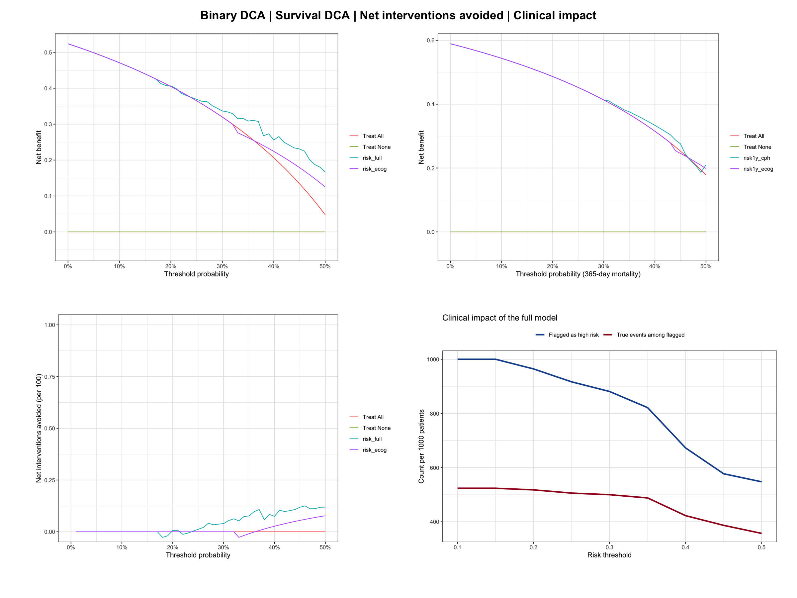
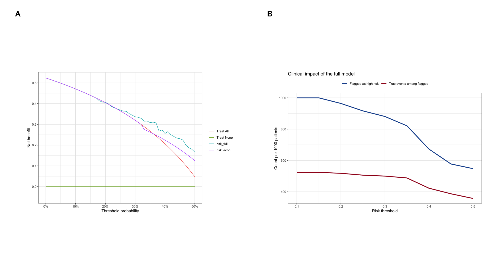

Decision curve analysis (DCA) evaluates the *clinical usefulness* of a prediction model: how much net benefit does acting on the model's predictions bring, compared with treating everyone or treating no one, across a range of risk thresholds? Net benefit equals the true positives gained per patient minus the false positives, each false positive weighted by the ratio of harm-to-benefit implied by the threshold \[1\]. A model is only clinically useful if its net benefit exceeds both default strategies in the threshold range relevant to the decision at hand — discrimination (AUC) and calibration alone cannot answer this \[2\]. Together with ROC curves and calibration curves, DCA is one of the standard evaluation plots of clinical prediction models.

This tutorial covers four DCA workflows in R with the `dcurves` package \[3\], the maintained implementation by the authors of the method (the older `rmda` package has been removed from CRAN):

1. Decision curves for binary endpoints with two competing models;
2. Decision curves for survival endpoints at a fixed horizon;
3. Net interventions avoided — how many interventions per 100 patients the model can safely reduce;
4. A hand-computed clinical impact curve showing detected events per 1000 patients.

## Example

{fig-alt="DCAPlot DEMO" fig-align="center" width="60%"}

## Setup

-   System Requirements: Cross-platform (Linux/MacOS/Windows)

-   Programming language: R

-   Dependent packages: `survival`; `dplyr`; `rms`; `dcurves`; `ggplot2`

```{r packages setup, message=FALSE, warning=FALSE, output=FALSE}
# Installing necessary packages
if (!requireNamespace("rms", quietly = TRUE)) {
  install.packages("rms")
}
if (!requireNamespace("dcurves", quietly = TRUE)) {
  install.packages("dcurves")
}

# Load packages
library(survival)
library(dplyr)
library(ggplot2)
library(rms)
library(dcurves)
```

```{r}
sessioninfo::session_info("attached")
```

## Data Preparation

We use the `lung` data set from the `survival` package (North Central Cancer Treatment Group lung cancer trial) \[4\]. Every strategy fed to `dca()` must be a *predicted probability between 0 and 1*, so we derive:

- `risk_full` / `risk_ecog`: predicted 1-year mortality from a full and a simple logistic model (binary endpoint);
- `risk1y_cph` / `risk1y_ecog`: predicted 1-year mortality risk from full and simple Cox models (survival endpoint).

```{r load data, message=FALSE, warning=FALSE}
data(lung, package = "survival")

lung2 <- lung %>%
  filter(complete.cases(age, sex, ph.ecog, ph.karno, pat.karno, meal.cal, wt.loss)) %>%
  mutate(y1y = as.integer(time < 365 & status == 2))  # death within 365 days

# Binary endpoint: logistic models
m_full   <- glm(y1y ~ age + sex + ph.ecog + meal.cal + wt.loss,
                data = lung2, family = binomial)
m_simple <- glm(y1y ~ ph.ecog, data = lung2, family = binomial)
lung2$risk_full  <- fitted(m_full)
lung2$risk_ecog  <- fitted(m_simple)

# Survival endpoint: Cox models with predicted 1-year risk
dd <- datadist(lung2)
options(datadist = "dd")
cph_full <- cph(Surv(time, status) ~ age + sex + ph.ecog,
                data = lung2, x = TRUE, y = TRUE, surv = TRUE, time.inc = 365)
cph_ecog <- cph(Surv(time, status) ~ ph.ecog,
                data = lung2, x = TRUE, y = TRUE, surv = TRUE, time.inc = 365)
lung2$risk1y_cph  <- 1 - Survival(cph_full)(365, predict(cph_full, type = "lp"))
lung2$risk1y_ecog <- 1 - Survival(cph_ecog)(365, predict(cph_ecog, type = "lp"))

head(lung2[, c("y1y", "risk_full", "risk_ecog", "risk1y_cph", "risk1y_ecog")])
```

## Visualization

### 1. Decision Curves for a Binary Endpoint

`dca()` always plots the two default strategies — treat all and treat none — plus one curve per model. Only thresholds with clinical relevance (here 0–50%) should be shown \[2\].

```{r}
#| label: fig-1.1BinaryDCA
#| fig-cap: "Decision curves of two models for 1-year mortality; net benefit versus risk threshold."
#| out.width: "80%"
#| fig-width: 8
#| fig-height: 5.5
#| warning: false
#| message: false

dca_bin <- dca(y1y ~ risk_full + risk_ecog, data = lung2,
               thresholds = seq(0, 0.5, 0.01))
plot(dca_bin, smooth = FALSE) +
  labs(x = "Threshold probability", y = "Net benefit") +
  theme_bw()
```

Reading the plot: at a threshold of 20% (e.g. "intensify follow-up if predicted 1-year death risk exceeds 20%"), a model with higher net benefit than "treat all" identifies patients safely; where model curves fall below both defaults the model adds no value.

### 2. Decision Curves for a Survival Endpoint

For censored time-to-event outcomes, pass a `Surv` object and the horizon of interest; `dcurves` estimates the Kaplan-Meier-based event rate at that time.

```{r}
#| label: fig-2.1SurvivalDCA
#| fig-cap: "Decision curves of two Cox models for the 365-day mortality risk."
#| out.width: "80%"
#| fig-width: 8
#| fig-height: 5.5
#| warning: false
#| message: false

dca_surv <- dca(Surv(time, status) ~ risk1y_cph + risk1y_ecog, data = lung2,
                time = 365, thresholds = seq(0, 0.5, 0.01))
plot(dca_surv, smooth = FALSE) +
  labs(x = "Threshold probability (365-day mortality)", y = "Net benefit") +
  theme_bw()
```

### 3. Net Interventions Avoided

A more tangible translation: for each threshold, how many interventions per 100 patients could be avoided without missing true events, compared with intervening on everyone?

```{r}
#| label: fig-3.1NetInterventionsAvoided
#| fig-cap: "Net interventions avoided per 100 patients by the full model."
#| out.width: "80%"
#| fig-width: 8
#| fig-height: 5.5
#| warning: false
#| message: false

nia <- net_intervention_avoided(dca_bin)
plot(nia, smooth = FALSE) +
  labs(x = "Threshold probability", y = "Net interventions avoided (per 100)") +
  theme_bw()
```

Positive values mean that using the model would spare that many interventions per 100 patients relative to treating everybody, at the same number of missed events.

### 4. Hand-Computed Clinical Impact Curve

The clinical impact curve shows, per 1000 patients, how many would be flagged as high risk and how many of those are true events, as the threshold varies \[1\]. `dcurves` does not ship this variant, but it is a direct calculation:

```{r}
#| label: fig-4.1ClinicalImpact
#| fig-cap: "Clinical impact curve: patients flagged and true events detected per 1000 patients."
#| out.width: "80%"
#| fig-width: 8
#| fig-height: 5.5
#| warning: false
#| message: false

n <- nrow(lung2)
impact <- do.call(rbind, lapply(seq(0.1, 0.5, 0.05), function(t) {
  flagged <- lung2$risk_full >= t
  data.frame(threshold = t,
             high_risk = sum(flagged) / n * 1000,
             events_detected = sum(lung2$y1y[flagged]) / n * 1000)
}))

ggplot(impact, aes(x = threshold)) +
  geom_line(aes(y = high_risk, color = "Flagged as high risk"), linewidth = 1.1) +
  geom_line(aes(y = events_detected, color = "True events among flagged"), linewidth = 1.1) +
  scale_color_manual(values = c("#2166AC", "#B2182B"), name = NULL) +
  labs(x = "Risk threshold",
       y = "Count per 1000 patients",
       title = "Clinical impact of the full model") +
  theme_bw() +
  theme(legend.position = "top")
```

The gap between the two lines is the number of unnecessary interventions per 1000 patients at each threshold — small gaps at clinically relevant thresholds indicate a useful model.

## Application

Decision curves are routinely reported in clinical prediction-model studies next to ROC and calibration curves. The panel below shows the typical pairing: (A) decision curves across thresholds and (B) the clinical impact curve.

{fig-alt="DCAPlot Application" fig-align="center" width="60%"}

## Reference

\[1\] Vickers AJ, Elkin EB. Decision curve analysis: a novel method for evaluating prediction models. Med Decis Making. 2006;26(6):565-574. doi:10.1177/0272989X06295361

\[2\] Vickers AJ, van Calster B, Steyerberg EW. A simple, step-by-step guide to interpreting decision curve analysis. Diagn Progn Res. 2019;3(1):18. doi:10.1186/s41512-019-0064-7

\[3\] Sjoberg DD, Curry M, Whiting K, Mancia CP. Presenting and analyzing performance of risk models: an introduction to the dcurves R package. 2022. https://www.danieldsjoberg.com/dcurves/

\[4\] Loprinzi CL, Laurie JA, Wieand HS, et al. Prospective evaluation of prognostic variables from patient-completed questionnaires. North Central Cancer Treatment Group. J Clin Oncol. 1994;12(3):601-607. doi:10.1200/JCO.1994.12.3.601
