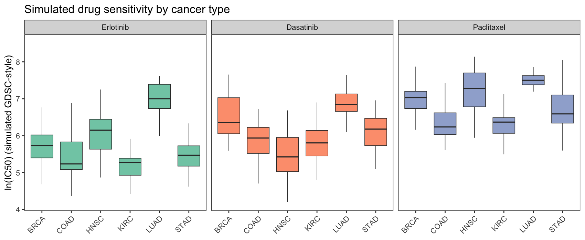

Pharmacogenomic screens such as GDSC measure each cell line's half-maximal inhibitory concentration (**IC50**) for hundreds of drugs; regression models like `pRRophetic`/`oncoPredict` then project those IC50 values onto bulk tumour expression to predict per-sample drug sensitivity \[1\]. The recurring figure is a drug × cancer-type boxplot asking whether a tumour type is intrinsically more sensitive. This tutorial reproduces the plotting half on a simulated TCGA-style matrix.

## Example

{fig-alt="DrugSensitivityPlot DEMO" fig-align="center" width="60%"}

## Setup

-   System Requirements: Cross-platform (Linux/MacOS/Windows)

-   Programming language: R

-   Dependent packages: `ggplot2`; `dplyr`; `tidyr`

```{r packages setup, message=FALSE, warning=FALSE, output=FALSE}
# Load packages
suppressPackageStartupMessages({
  library(ggplot2)
  library(dplyr)
  library(tidyr)
})
```

```{r}
sessioninfo::session_info("attached")
```

## Data Preparation

Simulated ln(IC50) values for three drugs across six cancer types, 30 samples per type, with planted type effects (LUAD extra-sensitive to Erlotinib, HNSC resistant to Dasatinib):

```{r load data}
set.seed(10501)
cancers <- c("BRCA", "COAD", "LUAD", "HNSC", "STAD", "KIRC")
drugs <- c("Erlotinib", "Dasatinib", "Paclitaxel")
ds <- do.call(rbind, lapply(drugs, function(dr) {
  base <- c(Erlotinib = 5.8, Dasatinib = 6.4, Paclitaxel = 6.9)[dr]
  do.call(rbind, lapply(cancers, function(cc) {
    eff <- c(BRCA = 0, COAD = -0.4, LUAD = 0.5, HNSC = 0.2, STAD = -0.2, KIRC = -0.6)[cc]
    if (dr == "Erlotinib" && cc == "LUAD") eff <- 1.2
    if (dr == "Dasatinib" && cc == "HNSC") eff <- -0.9
    data.frame(drug = dr, tissue = cc, IC50 = rnorm(30, base + eff, 0.55))
  }))
}))
ds$drug <- factor(ds$drug, levels = drugs)
```

## Visualization

### 1. Drug x Cancer-Type Boxplots

```{r}
#| label: fig-1.1DrugBoxes
#| fig-cap: "Simulated ln(IC50) by cancer type for three drugs: each panel is one drug, boxes are cancer types; the planted LUAD-Erlotinib sensitivity and HNSC-Dasatinib resistance are visible."
#| out.width: "100%"
#| warning: false
#| message: false
#| fig-width: 9.5
#| fig-height: 4

ggplot(ds, aes(tissue, IC50, fill = tissue)) +
  geom_boxplot(outlier.shape = NA, alpha = 0.85, linewidth = 0.3) +
  facet_wrap(~drug) +
  scale_fill_brewer(palette = "Set2", guide = "none") +
  labs(x = NULL, y = "ln(IC50) (simulated GDSC-style)",
       title = "Simulated drug sensitivity by cancer type") +
  theme_bw(base_size = 11) +
  theme(axis.text.x = element_text(angle = 45, hjust = 1),
        panel.grid = element_blank())
```

### 2. Per-Type Wilcoxon Stars

For real GDSC/oncoPredict output the interesting statement is per-type: which cancer types differ from the rest? A manual Wilcoxon pass over each type places stars above the boxes — `ggpubr::stat_compare_means()` cannot fan out over one test per x position, so the stars are computed and placed by hand:

```{r}
#| label: fig-2.1DrugStars
#| fig-cap: "Erlotinib ln(IC50) by type with stars from per-type Wilcoxon tests vs all other types (BH-corrected)."
#| out.width: "90%"
#| warning: false
#| message: false
#| fig-width: 8.5
#| fig-height: 4.5

erlo <- ds %>% filter(drug == "Erlotinib")
wt <- do.call(rbind, lapply(cancers, function(cc) {
  p <- wilcox.test(IC50 ~ tissue == cc, data = erlo)$p.value
  data.frame(tissue = cc, p = p)
}))
wt$p.adj <- p.adjust(wt$p, method = "BH")
star_df <- data.frame(
  tissue = factor(wt$tissue, levels = cancers),
  y = tapply(erlo$IC50, erlo$tissue, max) + 0.3,
  lab = ifelse(wt$p.adj < 0.05, "*", ""))
ggplot(erlo, aes(tissue, IC50, fill = tissue)) +
  geom_boxplot(outlier.shape = NA, alpha = 0.85, linewidth = 0.3) +
  geom_text(data = star_df, aes(tissue, y, label = lab),
            inherit.aes = FALSE, size = 5, colour = "grey10") +
  scale_fill_brewer(palette = "Set2", guide = "none") +
  scale_y_continuous(expand = expansion(mult = c(0.05, 0.12))) +
  labs(x = NULL, y = "ln(IC50) (simulated)",
       title = "Erlotinib: per-type Wilcoxon stars (BH-corrected)") +
  theme_bw(base_size = 11) +
  theme(axis.text.x = element_text(angle = 45, hjust = 1),
        panel.grid = element_blank(), legend.position = "none")
```

::: callout-tip
**Practice tips**

-   `pRRophetic`/`oncoPredict` need the GDSC training matrix and are not in this repository's lockfile; the simulated matrix here reproduces the *figure*, and the prediction route is documented in the reference.
-   Per-type stars on one drug are k independent tests — correct them (BH above) and say which correction the stars reflect.
-   IC50 values live on a ln scale in GDSC releases; plot ln(IC50), not IC50, or the boxplots compress into the floor.
:::

## Applications

::: {#fig-DrugSensitivityApplications1}
{fig-alt="DrugSensitivityPlot Application" fig-align="center" width="60%"}

Drug sensitivity by cancer type
:::

The same layout serves ex-vivo drug screens (PRISM, CTRP) and any per-group IC50 comparison.

## Reference

\[1\] Xiaofan Lu, et al. FigureYa: A Standardized Visualization Framework for Enhancing Biomedical Data Interpretation and Research Efficiency. iMetaMed. 2025. doi:10.1002/imm3.70005

\[2\] Geeleher P, Cox N, Huang RS. pRRophetic: an R package for prediction of clinical chemotherapeutic response from tumor gene expression levels. PLoS ONE. 2014;9(9):e107468. doi:10.1371/journal.pone.0107468
