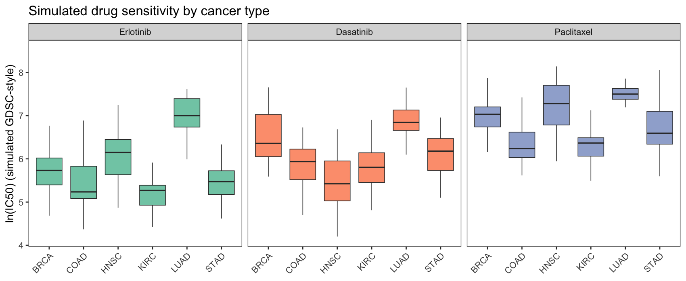

GDSC 等药物基因组学筛选测量每个细胞系对数百种药物的**半最大抑制浓度（IC50）**；`pRRophetic`/`oncoPredict` 等回归模型再将 IC50 投影到 bulk 肿瘤表达谱上预测逐样本药敏 \[1\]。反复出现的图是药物 × 癌种的箱线图——问某癌种是否天然更敏感。本教程在模拟 TCGA 风格矩阵上复现绘图部分。

## Example

{fig-alt="DrugSensitivityPlot DEMO" fig-align="center" width="60%"}

## Setup

-   系统要求：跨平台（Linux/MacOS/Windows）

-   编程语言：R

-   依赖包：`ggplot2`；`dplyr`；`tidyr`

```{r packages setup, message=FALSE, warning=FALSE, output=FALSE}
suppressPackageStartupMessages({
  library(ggplot2)
  library(dplyr)
  library(tidyr)
})
```

```{r}
sessioninfo::session_info("attached")
```

## 数据准备

三种药物 × 六个癌种的模拟 ln(IC50)（每型 30 样本），植入了类型效应（LUAD 对 Erlotinib 超敏感、HNSC 对 Dasatinib 耐药）：

```{r load data}
sessioninfo::session_info("attached")
```

## Visualization

### 1. 药物 × 癌种箱线图

```{r}
#| label: fig-1.1DrugBoxes
#| fig-cap: "三种药物的模拟 ln(IC50) 按癌种分组：每面板一种药物；可见植入的 LUAD-Erlotinib 敏感与 HNSC-Dasatinib 耐药。"
#| out.width: "100%"
#| warning: false
#| message: false
#| fig-width: 9.5
#| fig-height: 4

set.seed(10501)
cancers <- c("BRCA", "COAD", "LUAD", "HNSC", "STAD", "KIRC")
drugs <- c("Erlotinib", "Dasatinib", "Paclitaxel")
ds <- do.call(rbind, lapply(drugs, function(dr) {
  base <- c(Erlotinib = 5.8, Dasatinib = 6.4, Paclitaxel = 6.9)[dr]
  do.call(rbind, lapply(cancers, function(cc) {
    eff <- c(BRCA = 0, COAD = -0.4, LUAD = 0.5, HNSC = 0.2, STAD = -0.2, KIRC = -0.6)[cc]
    if (dr == "Erlotinib" && cc == "LUAD") eff <- 1.2
    if (dr == "Dasatinib" && cc == "HNSC") eff <- -0.9
    data.frame(drug = dr, tissue = cc, IC50 = rnorm(30, base + eff, 0.55))
  }))
}))
ds$drug <- factor(ds$drug, levels = drugs)
```

### 2. 逐类型 Wilcoxon 星号

真实 GDSC/oncoPredict 输出的关键信息是逐类型：哪些癌种与其余不同？`ggpubr::stat_compare_means()` 无法一次扇出到逐 x 位置的多重检验，星号需手工计算摆放：

```{r}
#| label: fig-2.1DrugStars
#| fig-cap: "Erlotinib ln(IC50) 按类型分组，星号为逐类型与其余的 Wilcoxon 检验（BH 校正）。"
#| out.width: "90%"
#| warning: false
#| message: false
#| fig-width: 8.5
#| fig-height: 4.5

#| label: fig-1.1DrugBoxes
#| fig-cap: "Simulated ln(IC50) by cancer type for three drugs: each panel is one drug, boxes are cancer types; the planted LUAD-Erlotinib sensitivity and HNSC-Dasatinib resistance are visible."
#| out.width: "100%"
#| warning: false
#| message: false
#| fig-width: 9.5
#| fig-height: 4

ggplot(ds, aes(tissue, IC50, fill = tissue)) +
  geom_boxplot(outlier.shape = NA, alpha = 0.85, linewidth = 0.3) +
  facet_wrap(~drug) +
  scale_fill_brewer(palette = "Set2", guide = "none") +
  labs(x = NULL, y = "ln(IC50) (simulated GDSC-style)",
       title = "Simulated drug sensitivity by cancer type") +
  theme_bw(base_size = 11) +
  theme(axis.text.x = element_text(angle = 45, hjust = 1),
        panel.grid = element_blank())
```

::: callout-tip
**实践要点**

-   `pRRophetic`/`oncoPredict` 需要 GDSC 训练矩阵且不在本仓库 lockfile 中；此处模拟矩阵复现的是*图*，预测路线在参考文档中记录。
-   一种药物的逐类型星号是 k 次独立检验——校正它们（上方用 BH）并写明星号反映的校正方式。
-   GDSC 的 IC50 以 ln 刻度发布；画 ln(IC50) 而非 IC50，否则箱线图压到底部。
:::

## Applications

::: {#fig-DrugSensitivityApplications1}
{fig-alt="DrugSensitivityPlot Application" fig-align="center" width="60%"}

按癌种的药物敏感性
:::

同一版式适用于体外药物筛选（PRISM、CTRP）和任何分组 IC50 比较。

## Reference

\[1\] Xiaofan Lu, et al. FigureYa: A Standardized Visualization Framework for Enhancing Biomedical Data Interpretation and Research Efficiency. iMetaMed. 2025. doi:10.1002/imm3.70005

\[2\] Geeleher P, Cox N, Huang RS. pRRophetic: an R package for prediction of clinical chemotherapeutic response from tumor gene expression levels. PLoS ONE. 2014;9(9):e107468. doi:10.1371/journal.pone.0107468