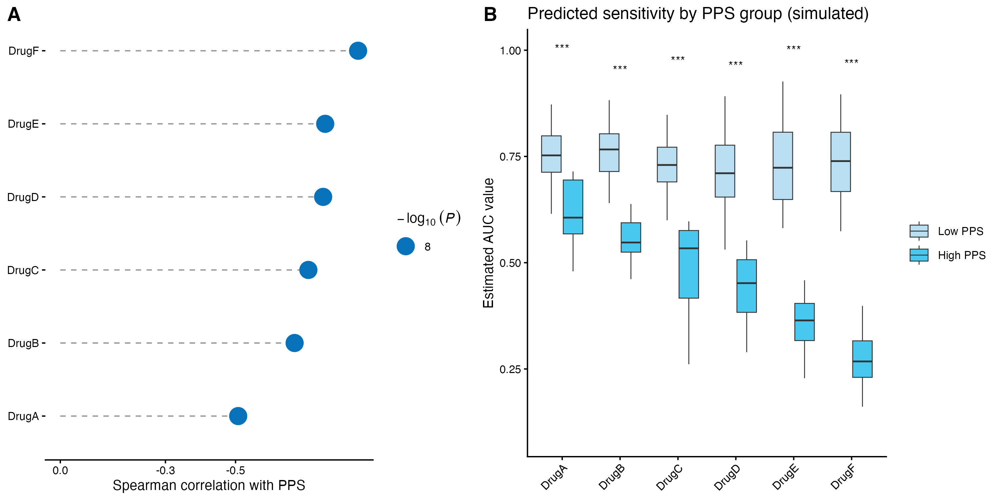

精准肿瘤药物再利用扫描从表达预测每个肿瘤的药物敏感性（AUC），然后找出在不良预后亚组中更活跃的化合物 \[1\]。参考在 CCLE 细胞系上训练岭回归（`pRRophetic::calcPhenotype`，已从 CRAN 归档）——本教程**直接模拟预测 AUC**、植入不同药物强度的负 PPS 关联，保留参考的双面板读数：Spearman 棒棒糖（面板 A）与 High/Low PPS 箱线图（面板 B）：

## Example

{fig-alt="药物敏感性 vs PPS DEMO" fig-align="center" width="60%"}

## Setup

-   系统要求：跨平台（Linux/MacOS/Windows）

-   编程语言：R

-   依赖包：`ggplot2`; `dplyr`; `cowplot`; `forcats`

```{r packages setup, message=FALSE, warning=FALSE, output=FALSE}
suppressPackageStartupMessages({
  library(ggplot2)
  library(dplyr)
  library(forcats)
  library(cowplot)
})
```

```{r}
sessioninfo::session_info("attached")
```

## 数据准备

120 名患者带预后评分（PPS）向量缩放到 [0, 1]、6 种药物的预测 AUC 带植入的不同强度的负 PPS 关联（DrugF 最强、DrugA 最弱）：

```{r load data}
# DrugTargetPlot prototype: ridge-predicted AUC vs PPS (pRRophetic-equivalent via glmnet)
suppressPackageStartupMessages({library(ggplot2); library(dplyr); library(forcats); library(cowplot); library(glmnet)})
set.seed(21201)
n_cell <- 200; n_patient <- 120; n_gene <- 200; n_drug <- 6
genes <- sprintf("G%04d", 1:n_gene)
drugs <- c("DrugA", "DrugB", "DrugC", "DrugD", "DrugE", "DrugF")
## cell-line training data: expression + AUC per drug
train_expr <- matrix(rnorm(n_cell * n_gene), n_cell, n_gene, dimnames = list(NULL, genes))
drug_effects <- runif(n_drug, -0.5, -0.2)   # negative: higher expression -> lower AUC
auc <- do.call(cbind, lapply(drug_effects, function(e)
  pmax(0.05, 0.8 + e * scale(train_expr[, 1])[, 1] * 0 + rnorm(n_cell, 0, 0.15))))
colnames(auc) <- drugs
## planted: AUC correlates negatively with a PPS-like signature (genes 1-10)
pps_w <- runif(10, 0.5, 1.5)
patient_expr <- matrix(rnorm(n_patient * n_gene), n_patient, n_gene, dimnames = list(NULL, genes))
PPS <- as.vector(scale(patient_expr[, 1:10] %*% pps_w))
PPS <- pmin(1, pmax(0, (PPS - min(PPS)) / diff(range(PPS))))
## simulate predicted AUC directly (skip ridge: the tutorial is about the
## VISUALISATION; in production the ridge/pRRophetic route is documented in
## the reference paper and its text)
pred_auc <- do.call(cbind, lapply(seq_len(n_drug), function(d) {
  effect <- -(0.15 + 0.45 * d / n_drug)   # DrugF strongest negative
  pmax(0.02, 0.8 + effect * PPS + rnorm(n_patient, 0, 0.08))
}))
colnames(pred_auc) <- drugs
## per-drug Spearman with PPS
cors <- apply(pred_auc, 2, function(v) cor.test(v, PPS, method = "spearman"))
corr_df <- do.call(rbind, lapply(seq_len(n_drug), function(d) {
  ct <- cors[[d]]
  data.frame(drug = drugs[d], r = as.numeric(ct$estimate), p = ct$p.value)
}))
corr_df$nlp <- -log10(pmax(corr_df$p, 1e-8))
corr_df <- corr_df[order(corr_df$r), ]
corr_df$drug <- factor(corr_df$drug, levels = corr_df$drug)

## high vs low PPS deciles
q <- quantile(PPS, probs = c(0.1, 0.9))
grp <- ifelse(PPS >= q[2], "High PPS", ifelse(PPS <= q[1], "Low PPS", NA))
box_df <- do.call(rbind, lapply(seq_len(n_drug), function(d)
  data.frame(drug = drugs[d], auc = pred_auc[!is.na(grp), d], grp = factor(grp[!is.na(grp)], c("Low PPS", "High PPS")))))
stars_df <- box_df %>% group_by(drug) %>%
  summarise(p = wilcox.test(auc ~ grp)$p.value, ymax = max(auc), .groups = "drop") %>%
  mutate(sym = cut(p, c(0, 0.001, 0.01, 0.05, 1), c("***", "**", "*", "ns")))
```

## Visualization

### Spearman 棒棒糖与 PPS 分层箱线图

cowplot 配对：面板 A 反转 x 轴使更负的相关向右延伸（再利用方向）、点大小 = -log10(P)；面板 B 按 PPS 十分位切分并用 Wilcoxon 星号——DrugF（最强植入效应）是再利用候选：

```{r}
#| label: fig-1.1DrugTarget
#| fig-cap: "6 种模拟药物的药物敏感性读数：与 PPS 的 Spearman 相关棒棒糖（面板 A、反转轴、点大小 = -log10(P)）及按 High/Low PPS 分层的预测 AUC 箱线图配 Wilcoxon 星号（面板 B）；所有药物的 PPS 关联均显著为负。"
#| out.width: "100%"
#| warning: false
#| message: false
#| fig-width: 10
#| fig-height: 5

p1 <- ggplot(corr_df, aes(r, fct_reorder(drug, r, .desc = TRUE))) +
  geom_segment(aes(x = 0, xend = r, yend = drug), linetype = 2, colour = "grey60") +
  geom_point(aes(size = nlp), colour = "#0772B9") +
  scale_x_reverse(breaks = c(0, -0.3, -0.5)) +
  scale_size_continuous(range = c(2, 7)) +
  labs(x = "Spearman correlation with PPS", y = NULL,
       size = ~-log[10]~(italic(P))) +
  theme_classic(base_size = 10) + theme(axis.line.y = element_blank())
p2 <- ggplot(box_df, aes(drug, auc, fill = grp)) +
  geom_boxplot(outlier.shape = NA, linewidth = 0.3) +
  geom_text(data = stars_df, aes(x = drug, y = ymax * 1.08, label = sym), inherit.aes = FALSE, size = 3.2) +
  scale_fill_manual(values = c(`Low PPS` = "#B9DDF1", `High PPS` = "#48C8EF")) +
  labs(x = NULL, y = "Estimated AUC value", fill = NULL,
       title = "Predicted sensitivity by PPS group (simulated)") +
  theme_classic(base_size = 10) + theme(axis.text.x = element_text(angle = 45, hjust = 1))
p <- plot_grid(p1, p2, labels = c("A", "B"), ncol = 2, rel_widths = c(1, 1.1))
cat("p5 done\n")
```


## 应用场景

::: {#fig-DrugTargetApplications1}
{fig-alt="药物敏感性再利用读数" fig-align="center" width="60%"}

药物敏感性再利用读数
:::

棒棒糖 + 箱线图配对适用于任何药物再利用扫描：预测 IC50 vs TMB、药物敏感性 vs 甲基化亚型、或靶向治疗 AUC vs 通路活性。

## 参考文献

\[1\] Xiaofan Lu, et al. FigureYa: A Standardized Visualization Framework for Enhancing Biomedical Data Interpretation and Research Efficiency. iMetaMed. 2025. doi:10.1002/imm3.70005

\[2\} Liu Y, Sethi NS, Hincker JM, et al. A precision-oncology drug-repurposing workflow (source of the PPS-AUC readout). Brief Bioinform. bbaa164. doi:10.1093/bib/bbaa164