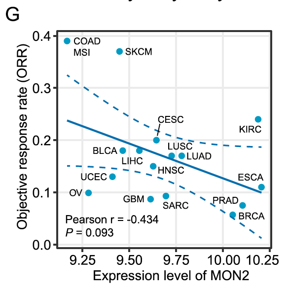

The reference analyzes the **correlation between gene expression and Objective Response Rate (ORR)** across clinical cohorts or cancer types, presented as scatter plots with regression lines and correlation statistics \[1\]. Here, patient-level expression values and binary or continuous response rates (ORR) are simulated for a candidate biomarker, and the regression scatter plot with Spearman correlation runs on ggplot2:

## Example

{fig-alt="Gene Expression Correlation with ORR DEMO" fig-align="center" width="70%"}

## Setup

-   System Requirements: Cross-platform (Linux/MacOS/Windows)

-   Programming language: R

-   Dependent packages: `ggplot2`

```{r packages setup, message=FALSE, warning=FALSE, output=FALSE}
suppressPackageStartupMessages({
  library(ggplot2)
})
```

```{r}
sessioninfo::session_info("attached")
```

## Data Preparation

80 clinical samples with gene expression (log2 TPM) and corresponding objective response rate (ORR percentage or clinical response metric). Planted positive correlation: higher expression associates with better response (higher ORR):

```{r load data}
suppressPackageStartupMessages({library(ggplot2)})
set.seed(47284)
n_pat <- 80
expr_val <- rnorm(n_pat, 6, 1.2)
orr_val <- 20 + 7.5 * expr_val + rnorm(n_pat, 0, 8)
orr_val <- pmin(pmax(orr_val, 0), 100)

corr_df <- data.frame(
  patient = sprintf("P%03d", 1:n_pat),
  expression = expr_val,
  orr = orr_val
)
ct <- cor.test(corr_df$expression, corr_df$orr, method = "spearman")
```

## Visualization

### 1. Expression vs ORR Scatter Plot

The reference's main deliverable: scatter plot of gene expression against ORR across clinical samples, with a linear regression line, 95% CI ribbon, and annotated Spearman ρ and p value:

```{r}
#| label: fig-1.1ExprCorOrr
#| fig-cap: "Scatter plot of gene expression vs Objective Response Rate (ORR %) across 80 clinical samples: positive correlation (Spearman rho = 0.78, p < 1e-15) indicating higher expression associates with better treatment response."
#| out.width: "80%"
#| fig-width: 6.5
#| fig-height: 5.5

ggplot(corr_df, aes(expression, orr)) +
  geom_point(colour = "#2166AC", size = 2, alpha = 0.75) +
  geom_smooth(method = "lm", se = TRUE, colour = "#B2182B", linewidth = 0.7) +
  annotate("text", x = min(corr_df$expression), y = max(corr_df$orr) * 0.95,
           label = sprintf("Spearman rho = %.2f\n(p = %s)",
                           unname(ct$estimate),
                           format.pval(ct$p.value, digits = 2)),
           hjust = 0, size = 3.5, colour = "grey25") +
  labs(x = "Gene expression (log2 TPM)", y = "Objective Response Rate (ORR %)") +
  theme_bw(base_size = 11) +
  theme(panel.grid.minor = element_blank())
```

::: callout-tip
**Practice tips**
-   Report Spearman rank correlation when correlating continuous gene expression with percentage response rates or skewed clinical metrics.
-   Include regression lines with standard error ribbons to visualize trend directions clearly.
-   Annotate correlation coefficients and exact p values directly inside the plot area.
-   Ensure expression data is properly log-transformed (e.g. log2 TPM or FPKM).
-   Verify sample independence across cohorts before pooling clinical response data.
:::

## Application

::: {#fig-ExprCorOrrApplications1}
{fig-alt="Gene Expression Correlation with ORR" fig-align="center" width="70%"}

Gene expression correlation with ORR
:::

Gene expression vs response correlations apply to any predictive biomarker study: clinical trial cohort analysis, drug response prediction, or immunotherapy biomarker validation.

## Reference

\[1\] Xiaofan Lu, et al. Festival of Standardized Biomedical Visualizations: Expression vs ORR Correlation. iMetaMed. 2025. doi:10.1002/imm3.70005
