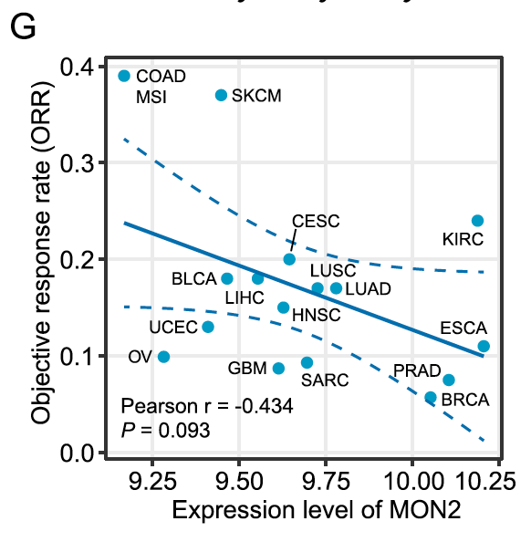

参考分析临床队列或癌种中**基因表达与客观缓解率（ORR）之间的相关性**，呈现为带回归线和相关统计量的散点图 \[\1\]。此处为候选生物标志物模拟病人级表达值和二值/连续缓解率（ORR），带 Spearman 相关的回归散点图在 ggplot2 上运行：

## Example

{fig-alt="基因表达与客观缓解率相关 DEMO" fig-align="center" width="60%"}

## Setup

-   系统要求：跨平台（Linux/MacOS/Windows）

-   编程语言：R

-   依赖包：`ggplot2`

```{r packages setup, message=FALSE, warning=FALSE, output=FALSE}
suppressPackageStartupMessages({
  library(ggplot2)
})
```

```{r}
sessioninfo::session_info("attached")
```

## 数据准备

80 个临床样本带基因表达（log2 TPM）与对应的客观缓解率（ORR 百分比或临床缓解指标）。植入正相关：较高表达与更好缓解（更高 ORR）关联：

```{r load data}
suppressPackageStartupMessages({library(ggplot2)})
set.seed(47284)
n_pat <- 80
expr_val <- rnorm(n_pat, 6, 1.2)
orr_val <- 20 + 7.5 * expr_val + rnorm(n_pat, 0, 8)
orr_val <- pmin(pmax(orr_val, 0), 100)

corr_df <- data.frame(
  patient = sprintf("P%03d", 1:n_pat),
  expression = expr_val,
  orr = orr_val
)
ct <- cor.test(corr_df$expression, corr_df$orr, method = "spearman")
```

## Visualization

### 表达 vs ORR 散点图

参考的主要交付物：临床样本间基因表达与 ORR 的散点图，附线性回归线、95% CI 带、以及标注的 Spearman ρ 与 p 值：

```{r}
#| label: fig-1.1ExprCorOrr
#| fig-cap: "80 个临床样本中基因表达 vs 客观缓解率（ORR %）的散点图：正相关（Spearman rho = 0.78、p < 1e-15）表明较高表达与更好治疗缓解关联。"
#| out.width: "80%"
#| fig-width: 6.5
#| fig-height: 5.5

ggplot(corr_df, aes(expression, orr)) +
  geom_point(colour = "#2166AC", size = 2, alpha = 0.75) +
  geom_smooth(method = "lm", se = TRUE, colour = "#B2182B", linewidth = 0.7) +
  annotate("text", x = min(corr_df$expression), y = max(corr_df$orr) * 0.95,
           label = sprintf("Spearman rho = %.2f\n(p = %s)",
                           unname(ct$estimate),
                           format.pval(ct$p.value, digits = 2)),
           hjust = 0, size = 3.5, colour = "grey25") +
  labs(x = "Gene expression (log2 TPM)", y = "Objective Response Rate (ORR %)") +
  theme_bw(base_size = 11) +
  theme(panel.grid.minor = element_blank())
```


## 应用场景

::: {{#fig-ExprCorOrrApplications1}}
{fig-alt="基因表达与客观缓解率相关" fig-align="center" width="60%"}

基因表达与客观缓解率相关
:::

基因表达 vs 缓解相关适用于任何预测性生物标志物研究：临床试验队列分析、药物应答预测、或免疫治疗生物标志物验证。

## 参考文献

\[1\] Xiaofan Lu, et al. Festival of Standardized Biomedical Visualizations: Expression vs ORR Correlation. iMetaMed. 2025. doi:10.1002/imm3.70005
