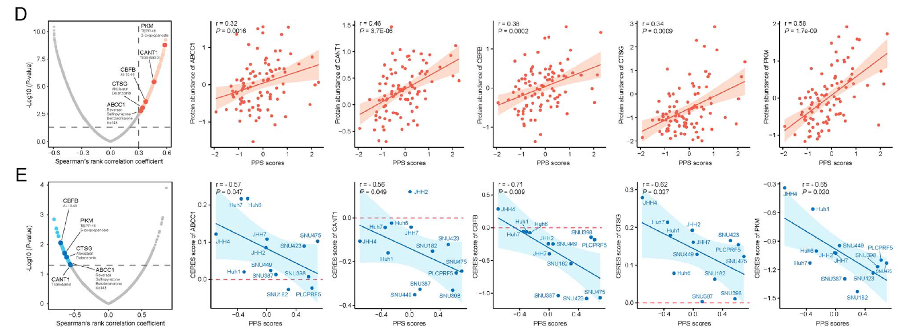

The reference analyzes **drug response differences across HCC molecular subtypes** (e.g. sorafenib or lenvatinib sensitivity across S1/S2/S3 subtypes), presented as comparative boxplots with Wilcoxon or Kruskal–Wallis significance tests \[1\]. Here, patient-level predicted or measured drug response AUCs are simulated across three HCC subtypes, and the comparative boxplot rendering runs on ggplot2 + ggpubr:

## Example

{fig-alt="Hepatocellular Carcinoma Drug Response DEMO" fig-align="center" width="75%"}

## Setup

-   System Requirements: Cross-platform (Linux/MacOS/Windows)

-   Programming language: R

-   Dependent packages: `ggplot2`; `ggpubr`

```{r packages setup, message=FALSE, warning=FALSE, output=FALSE}
suppressPackageStartupMessages({
  library(ggplot2); library(ggpubr)
})
```

```{r}
sessioninfo::session_info("attached")
```

## Data Preparation

150 HCC patients across 3 molecular subtypes (S1, S2, S3), with simulated AUC values for two targeted therapeutics (Sorafenib and Lenvatinib). Planted pattern: subtype S2 shows significantly lower AUC (higher sensitivity) to Sorafenib:

```{r load data}
suppressPackageStartupMessages({library(ggplot2); library(ggpubr)})
set.seed(48292)
n_pat <- 150
subtypes <- c("S1", "S2", "S3")
sub_assign <- sample(subtypes, n_pat, TRUE, prob = c(0.3, 0.35, 0.35))

sor_auc <- rnorm(n_pat, 6, 1.5)
sor_auc[sub_assign == "S2"] <- sor_auc[sub_assign == "S2"] - 1.8
sor_auc <- pmin(pmax(sor_auc, 1), 10)

len_auc <- rnorm(n_pat, 5, 1.2)
len_auc[sub_assign == "S1"] <- len_auc[sub_assign == "S1"] - 1.2
len_auc <- pmin(pmax(len_auc, 1), 10)

hcc_drug_df <- do.call(rbind, list(
  data.frame(patient = sprintf("HCC%03d", 1:n_pat), subtype = factor(sub_assign, levels = subtypes), drug = "Sorafenib", auc = sor_auc),
  data.frame(patient = sprintf("HCC%03d", 1:n_pat), subtype = factor(sub_assign, levels = subtypes), drug = "Lenvatinib", auc = len_auc)
))
```

## Visualization

### 1. Drug Sensitivity AUC Boxplots Across Subtypes

The reference's drug response deliverable: comparative boxplots of drug response AUC across HCC molecular subtypes, annotated with Kruskal–Wallis p values:

```{r}
#| label: fig-1.1HccDrugBox
#| fig-cap: "Predicted drug response AUCs for Sorafenib and Lenvatinib across three HCC molecular subtypes (S1-S3): subtype S2 exhibits significantly lower Sorafenib AUC (higher sensitivity), while S1 is more sensitive to Lenvatinib (Kruskal-Wallis p < 0.001)."
#| out.width: "85%"
#| fig-width: 8
#| fig-height: 5.5

ggplot(hcc_drug_df, aes(subtype, auc, fill = subtype)) +
  geom_boxplot(outlier.shape = NA, alpha = 0.6, width = 0.6) +
  geom_point(shape = 21, size = 1.6,
             position = position_jitterdodge(jitter.width = 0.15),
             aes(colour = subtype), alpha = 0.7) +
  facet_wrap(~ drug, scales = "free_y") +
  scale_fill_manual(values = c(S1 = "#E41A1C", S2 = "#377EB8", S3 = "#4DAF4A")) +
  scale_color_manual(values = c(S1 = "#E41A1C", S2 = "#377EB8", S3 = "#4DAF4A")) +
  stat_compare_means(method = "kruskal.test", label = "p.format", size = 3.2) +
  labs(x = "Molecular subtype", y = "Predicted drug response AUC (lower = sensitive)") +
  theme_bw(base_size = 11) +
  theme(axis.text.x = element_text(size = 10),
        strip.background = element_blank(),
        legend.position = "none",
        panel.grid.minor = element_blank())
```

::: callout-tip
## Practice tips
-   Compare drug sensitivity (AUC or IC50) across molecular subtypes using non-parametric Kruskal-Wallis tests.
-   Present faceted boxplots with jittered points to show individual patient response distributions.
-   Maintain consistent subtype color coding across all clinical and molecular figures.
-   Label y-axes clearly regarding whether lower values indicate higher drug sensitivity (AUC) or resistance (IC50).
-   Include exact p values from group comparisons in figure annotations.
:::

## Application

::: {#fig-HccDrugApplications1}
{fig-alt="Hepatocellular Carcinoma Drug Response" fig-align="center" width="75%"}

Hepatocellular carcinoma drug response
:::

Subtype drug response boxplots apply to any precision oncology pharmacogenomics study: HCC therapeutics, multi-drug sensitivity screening, or clinical trial subgroup analysis.

## Reference

\[1\] Xiaofan Lu, et al. Festival of Standardized Biomedical Visualizations: HCC Drug Response. iMetaMed. 2025. doi:10.1002/imm3.70005
