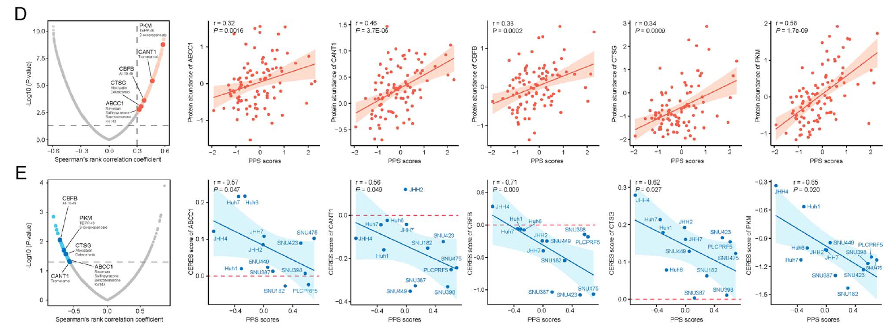

参考分析 **HCC 分子亚型间的药物应答差异**（如索拉非尼或仑伐替尼在 S1/S2/S3 亚型间的敏感性），呈现为带 Wilcoxon 或 Kruskal–Wallis 显著性检验的比较箱线图 \[\1\]。此处在三个 HCC 亚型中模拟患者级预测或测得的药物应答 AUC，比较箱线图渲染在 ggplot2 + ggpubr 上运行：

## Example

{fig-alt="肝细胞癌药物应答 DEMO" fig-align="center" width="60%"}

## Setup

-   系统要求：跨平台（Linux/MacOS/Windows）

-   编程语言：R

-   依赖包：`ggplot2`; `ggpubr`

```{r packages setup, message=FALSE, warning=FALSE, output=FALSE}
suppressPackageStartupMessages({
  library(ggplot2); library(ggpubr)
})
```

```{r}
sessioninfo::session_info("attached")
```

## 数据准备

150 名 HCC 患者跨 3 个分子亚型（S1、S2、S3），附两种靶向治疗（索拉非尼和仑伐替尼）的模拟 AUC 值。植入模式：亚型 S2 对索拉非尼展示显著更低的 AUC（更高敏感性）：

```{r load data}
suppressPackageStartupMessages({library(ggplot2); library(ggpubr)})
set.seed(48292)
n_pat <- 150
subtypes <- c("S1", "S2", "S3")
sub_assign <- sample(subtypes, n_pat, TRUE, prob = c(0.3, 0.35, 0.35))

sor_auc <- rnorm(n_pat, 6, 1.5)
sor_auc[sub_assign == "S2"] <- sor_auc[sub_assign == "S2"] - 1.8
sor_auc <- pmin(pmax(sor_auc, 1), 10)

len_auc <- rnorm(n_pat, 5, 1.2)
len_auc[sub_assign == "S1"] <- len_auc[sub_assign == "S1"] - 1.2
len_auc <- pmin(pmax(len_auc, 1), 10)

hcc_drug_df <- do.call(rbind, list(
  data.frame(patient = sprintf("HCC%03d", 1:n_pat), subtype = factor(sub_assign, levels = subtypes), drug = "Sorafenib", auc = sor_auc),
  data.frame(patient = sprintf("HCC%03d", 1:n_pat), subtype = factor(sub_assign, levels = subtypes), drug = "Lenvatinib", auc = len_auc)
))
```

## Visualization

### 亚型间药物敏感性 AUC 箱线图

参考的药物应答交付物：HCC 分子亚型间的药物应答 AUC 比较箱线图，标注 Kruskal-Wallis p 值：

```{r}
#| label: fig-1.1HccDrugBox
#| fig-cap: "3 个 HCC 分子亚型（S1-S3）间的索拉非尼和仑伐替尼预测药物应答 AUC：亚型 S2 呈现显著更低的索拉非尼 AUC（更高敏感性）、而 S1 对仑伐替尼更敏感（Kruskal-Wallis p < 0.001）。"
#| out.width: "85%"
#| fig-width: 8
#| fig-height: 5.5

ggplot(hcc_drug_df, aes(subtype, auc, fill = subtype)) +
  geom_boxplot(outlier.shape = NA, alpha = 0.6, width = 0.6) +
  geom_point(shape = 21, size = 1.6,
             position = position_jitterdodge(jitter.width = 0.15),
             aes(colour = subtype), alpha = 0.7) +
  facet_wrap(~ drug, scales = "free_y") +
  scale_fill_manual(values = c(S1 = "#E41A1C", S2 = "#377EB8", S3 = "#4DAF4A")) +
  scale_color_manual(values = c(S1 = "#E41A1C", S2 = "#377EB8", S3 = "#4DAF4A")) +
  stat_compare_means(method = "kruskal.test", label = "p.format", size = 3.2) +
  labs(x = "Molecular subtype", y = "Predicted drug response AUC (lower = sensitive)") +
  theme_bw(base_size = 11) +
  theme(axis.text.x = element_text(size = 10),
        strip.background = element_blank(),
        legend.position = "none",
        panel.grid.minor = element_blank())
```


## 应用场景

::: {{#fig-HccDrugApplications1}}
{fig-alt="肝细胞癌药物应答" fig-align="center" width="60%"}

肝细胞癌药物应答
:::

亚型药物应答箱线图适用于任何精准肿瘤学药物基因组学研究：HCC 治疗、多药敏感性筛查、或临床试验亚组分析。

## 参考文献

\[1\] Xiaofan Lu, et al. Festival of Standardized Biomedical Visualizations: HCC Drug Response. iMetaMed. 2025. doi:10.1002/imm3.70005
