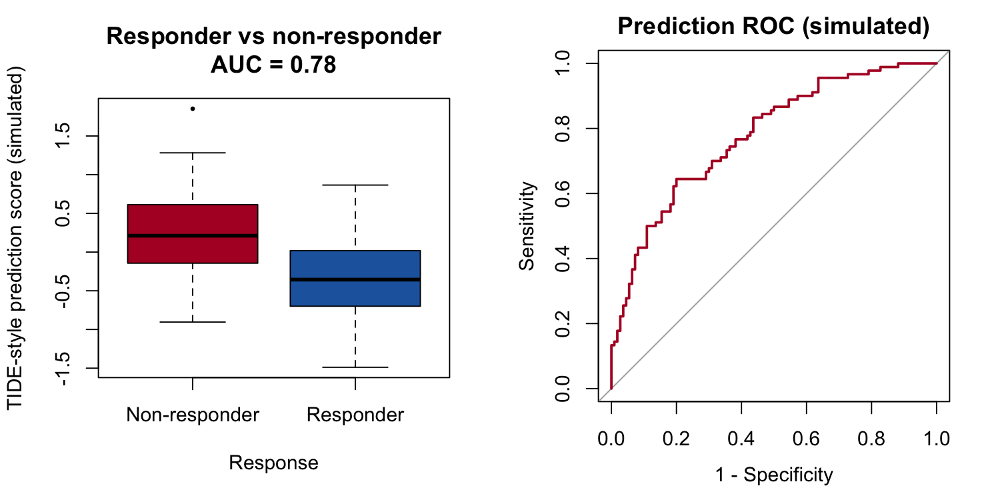

Immune-checkpoint responders can be anticipated from bulk expression by **signature-based predictors** such as TIDE: a pre-fitted gene-signature model converts each tumour's expression profile into a score, and responders vs non-responders separate on that score with an ROC curve quantifying the separation \[1\]. FigureYa106 mimics that layout. This tutorial reproduces the plotting half — boxplot plus ROC on a simulated TIDE-style score — since the TIDE web tool itself is external:

## Example

{fig-alt="ImmunotherapyPlot DEMO" fig-align="center" width="60%"}

## Setup

-   System Requirements: Cross-platform (Linux/MacOS/Windows)

-   Programming language: R

-   Dependent packages: `pROC`; `ggplot2`

```{r packages setup, message=FALSE, warning=FALSE, output=FALSE}
if (!requireNamespace("pROC", quietly = TRUE)) {
  install.packages("pROC", repos = "https://cloud.r-project.org")
}
suppressPackageStartupMessages({
  library(pROC)
  library(ggplot2)
})
```

```{r}
sessioninfo::session_info("attached")
```

## Data Preparation

Simulated scores for 200 anti-PD-1 patients (110 non-responders / 90 responders); the planted effect gives a usable-but-not-perfect AUC, which is what real TIDE-style predictors achieve:

```{r load data}
set.seed(10601)
n_it <- 200
tide <- data.frame(
  TIDE = c(rnorm(110, 0.35, 0.55), rnorm(90, -0.35, 0.55)),
  Response = c(rep("Non-responder", 110), rep("Responder", 90)))
tide$Response <- factor(tide$Response, levels = c("Responder", "Non-responder"))
```

## Visualization

### 1. Score Separation Boxplot

```{r}
#| label: fig-1.1TideBox
#| fig-cap: "TIDE-style score by response class (simulated): non-responders score higher (higher tumour-intrinsic immune suppression); boxes carry jittered points."
#| out.width: "70%"
#| warning: false
#| message: false
#| fig-width: 6.5
#| fig-height: 4.5

ggplot(tide, aes(Response, TIDE, fill = Response)) +
  geom_boxplot(outlier.shape = NA, alpha = 0.85, linewidth = 0.35) +
  geom_jitter(width = 0.15, size = 0.7, alpha = 0.45, colour = "grey25") +
  scale_fill_manual(values = c(Responder = "#2166AC", `Non-responder` = "#B2182B"),
                    name = NULL) +
  labs(x = NULL, y = "TIDE-style prediction score (simulated)",
       title = "Score separation by response class") +
  theme_bw(base_size = 11) +
  theme(panel.grid = element_blank(), legend.position = "top")
```

### 2. Prediction ROC

For a score where **higher = less responsive**, `pROC::roc()` must be told the direction explicitly or it silently flips:

```{r}
#| label: fig-2.1TideROC
#| fig-cap: "ROC of the TIDE-style score for predicting non-response (simulated): AUC printed in the legend; the dashed diagonal is chance."
#| out.width: "65%"
#| warning: false
#| message: false
#| fig-width: 6
#| fig-height: 5.5

roc_it <- pROC::roc(tide$Response, tide$TIDE,
                    levels = c("Responder", "Non-responder"),
                    direction = "<", quiet = TRUE)
auc_txt <- sprintf("AUC = %.2f", as.numeric(roc_it$auc))
ggplot(data.frame(fpr = 1 - roc_it$specificities, tpr = roc_it$sensitivities),
       aes(fpr, tpr)) +
  geom_line(colour = "#B2182B", linewidth = 1.1) +
  geom_abline(intercept = 0, slope = 1, linetype = "dashed", colour = "grey45") +
  annotate("text", x = 0.65, y = 0.1, label = auc_txt, size = 5, colour = "#B2182B") +
  scale_x_continuous(limits = c(0, 1), expand = c(0, 0)) +
  scale_y_continuous(limits = c(0, 1), expand = c(0, 0)) +
  labs(x = "False-positive rate", y = "True-positive rate",
       title = "Prediction ROC (simulated TIDE-style score)") +
  coord_fixed() +
  theme_bw(base_size = 11) +
  theme(panel.grid = element_blank())
```

::: callout-tip
**Practice tips**

-   `pROC::roc()` picks `direction` automatically when not given — with a "higher score = worse" predictor the silent flip inverts the AUC; **always pass `levels` and `direction`**.
-   The reference's SubMap module additionally tests cross-dataset response signatures; this page covers the score-separation half that translates directly into a paper figure.
-   Report the AUC **with a confidence interval** (`pROC::ci.auc()`) — a single AUC number without one is not publishable.
:::

## Applications

::: {#fig-ImmunotherapyApplications1}
{fig-alt="ImmunotherapyPlot Application" fig-align="center" width="60%"}

TIDE-style score separation
:::

The box + ROC pair applies to any continuous predictor of a binary clinical outcome: TIDE, IPS, MPS, or your own signature score.

## Reference

\[1\] Xiaofan Lu, et al. FigureYa: A Standardized Visualization Framework for Enhancing Biomedical Data Interpretation and Research Efficiency. iMetaMed. 2025. doi:10.1002/imm3.70005

\[2\] Jiang P, Gu S, Pan D, et al. Signatures of T cell dysfunction and exclusion predict cancer immunotherapy response. Nat Med. 2018;24(10):1550-1558. doi:10.1038/s41591-018-0136-1

\[3\] Robin X, Turck N, Hainard A, et al. pROC: an open-source package for R and S+ to analyze and compare ROC curves. BMC Bioinformatics. 2011;12:77. doi:10.1186/1471-2105-12-77
