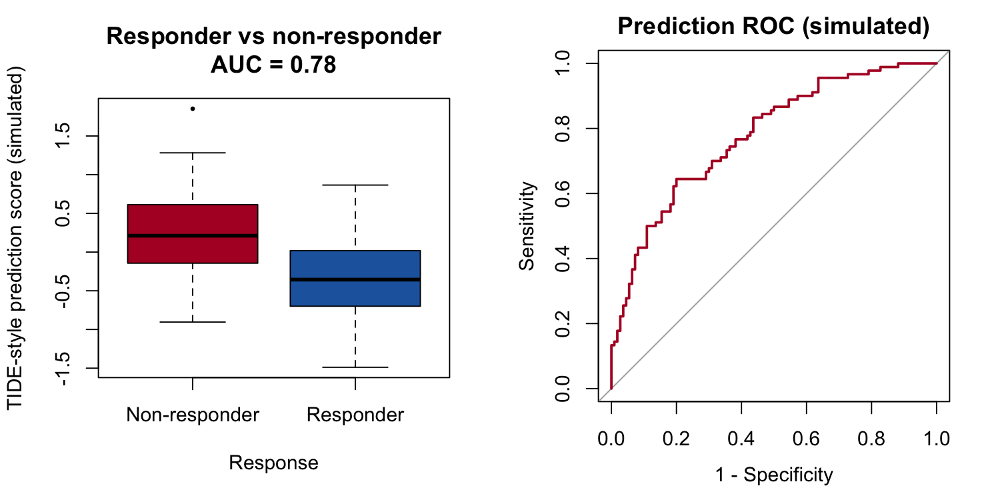

基于 signature 的预测器（如 TIDE）将肿瘤表达谱转换为评分，应答者与非应答者在该评分上分离，ROC 曲线量化分离度 \[1\]。FigureYa106 模仿该版式。本教程复现绘图部分——模拟 TIDE 风格评分的箱线图 + ROC——因为 TIDE 网页工具本身是外部服务：

## Example

{fig-alt="ImmunotherapyPlot DEMO" fig-align="center" width="60%"}

## Setup

-   系统要求：跨平台（Linux/MacOS/Windows）

-   编程语言：R

-   依赖包：`pROC`；`ggplot2`

```{r packages setup, message=FALSE, warning=FALSE, output=FALSE}
if (!requireNamespace("pROC", quietly = TRUE)) {
  install.packages("pROC", repos = "https://cloud.r-project.org")
}
suppressPackageStartupMessages({
  library(pROC)
  library(ggplot2)
})
```

```{r}
sessioninfo::session_info("attached")
```

## 数据准备

200 名抗 PD-1 患者的模拟评分（110 非应答 / 90 应答）；植入的效应给出一个可用但非完美的 AUC——这正是真实 TIDE 风格预测器的水平：

```{r load data}
sessioninfo::session_info("attached")
```

## Visualization

### 1. 评分分离箱线图

```{r}
#| label: fig-1.1TideBox
#| fig-cap: "TIDE 风格评分按应答类别分组（模拟）：非应答者评分更高（肿瘤内在免疫抑制更强）；箱体叠加抖动点。"
#| out.width: "70%"
#| warning: false
#| message: false
#| fig-width: 6.5
#| fig-height: 4.5

set.seed(10601)
n_it <- 200
tide <- data.frame(
  TIDE = c(rnorm(110, 0.35, 0.55), rnorm(90, -0.35, 0.55)),
  Response = c(rep("Non-responder", 110), rep("Responder", 90)))
tide$Response <- factor(tide$Response, levels = c("Responder", "Non-responder"))
```

### 2. 预测 ROC

评分为"越高越不应答"时，`pROC::roc()` 必须显式指定 `direction` 否则会静默翻转：

```{r}
#| label: fig-2.1TideROC
#| fig-cap: "TIDE 风格评分预测非应答的 ROC（模拟）：AUC 印在图内；虚线对角线为随机水平。"
#| out.width: "65%"
#| warning: false
#| message: false
#| fig-width: 6
#| fig-height: 5.5

#| label: fig-1.1TideBox
#| fig-cap: "TIDE-style score by response class (simulated): non-responders score higher (higher tumour-intrinsic immune suppression); boxes carry jittered points."
#| out.width: "70%"
#| warning: false
#| message: false
#| fig-width: 6.5
#| fig-height: 4.5

ggplot(tide, aes(Response, TIDE, fill = Response)) +
  geom_boxplot(outlier.shape = NA, alpha = 0.85, linewidth = 0.35) +
  geom_jitter(width = 0.15, size = 0.7, alpha = 0.45, colour = "grey25") +
  scale_fill_manual(values = c(Responder = "#2166AC", `Non-responder` = "#B2182B"),
                    name = NULL) +
  labs(x = NULL, y = "TIDE-style prediction score (simulated)",
       title = "Score separation by response class") +
  theme_bw(base_size = 11) +
  theme(panel.grid = element_blank(), legend.position = "top")
```

::: callout-tip
**实践要点**

-   `pROC::roc()` 未指定 `direction` 时会自动选择——"评分越高越差"的预测器会被静默翻转 AUC；**务必传 `levels` 和 `direction`**。
-   参考文档的 SubMap 模块额外做跨数据集应答 signature 检验；本页覆盖的是可直接转化为论文图的评分分离部分。
-   报告 AUC 时**附置信区间**（`pROC::ci.auc()`）——无区间的单一 AUC 数值不可发表。
:::

## Applications

::: {#fig-ImmunotherapyApplications1}
{fig-alt="ImmunotherapyPlot Application" fig-align="center" width="60%"}

TIDE 风格评分分离
:::

箱线图 + ROC 组合适用于任何连续预测器 vs 二元临床结局：TIDE、IPS、MPS 或自己的 signature 评分。

## Reference

\[1\] Xiaofan Lu, et al. FigureYa: A Standardized Visualization Framework for Enhancing Biomedical Data Interpretation and Research Efficiency. iMetaMed. 2025. doi:10.1002/imm3.70005

\[2\] Jiang P, Gu S, Pan D, et al. Signatures of T cell dysfunction and exclusion predict cancer immunotherapy response. Nat Med. 2018;24(10):1550-1558. doi:10.1038/s41591-018-0136-1

\[3\] Robin X, Turck N, Hainard A, et al. pROC: an open-source package for R and S+ to analyze and compare ROC curves. BMC Bioinformatics. 2011;12:77. doi:10.1186/1471-2105-12-77