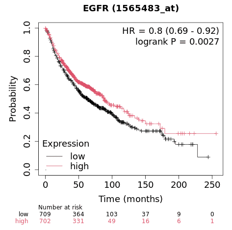
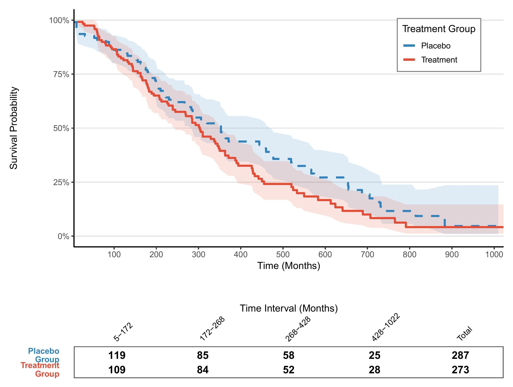
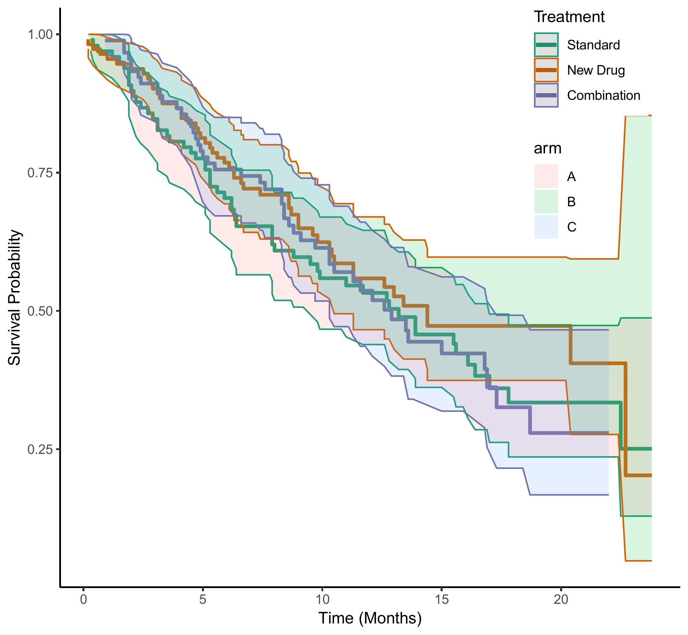

## Example

{fig-alt="KaplanMeierPlot DEMO1" fig-align="center" width="60%"}

Survival analysis studies the time that passes before an event occurs. The most common application in clinical research is the estimation of mortality (predicting the survival time of patients), but survival analysis can also be applied to other fields such as mechanical failure time.

## Setup

-   System Requirements: Cross-platform (Linux/MacOS/Windows)

-   Programming language: R

-   Dependent packages: `survival`, `survminer`, `ggplot2`, `dplyr`, `tidyr`, `zoo`, `patchwork`

```{r packages setup, message=FALSE, warning=FALSE, output=FALSE}
# Install packages
if (!requireNamespace("survival", quietly = TRUE)) {
  install.packages("survival")
}
if (!requireNamespace("survminer", quietly = TRUE)) {
  install.packages("survminer")
}
if (!requireNamespace("ggplot2", quietly = TRUE)) {
  install.packages("ggplot2")
}
if (!requireNamespace("dplyr", quietly = TRUE)) {
  install.packages("dplyr")
}
if (!requireNamespace("tidyr", quietly = TRUE)) {
  install.packages("tidyr")
}
if (!requireNamespace("zoo", quietly = TRUE)) {
  install.packages("zoo")
}
if (!requireNamespace("patchwork", quietly = TRUE)) {
  install.packages("patchwork")
}

# Load packages
library(survival)    
library(survminer)   
library(ggplot2)     
library(dplyr)
library(tidyr)
library(zoo)
library(patchwork)
```

```{r}
sessioninfo::session_info("attached")
```

## Data Preparation

```{r load data1, message=FALSE}
#| warning: false

# Using the built-in lung dataset (from the survival package)
data("lung")
# Data preprocessing
surv_data <- lung %>%
  mutate(
    status = ifelse(status == 2, 1, 0),  # Transition state code (1=event)
    sex = factor(sex, labels = c("Male", "Female")),
    group = sample(c("Treatment", "Placebo"), n(), replace = TRUE)
  )

# View data structure
glimpse(surv_data)

# Survival time distribution
summary(surv_data$time)

# Fitting survival curves
fit <- survfit(Surv(time, status) ~ group, data = surv_data)

# Extract curve data
surv_curve <- surv_summary(fit) 


# Calculate the log-rank test P value
diff <- survdiff(Surv(time, status) ~ group, data = surv_data)
p_value <- signif(1 - pchisq(diff$chisq, length(diff$n)-1), 3)
```

## Visualization

### 1. Basic Plot

Use basic functions to draw the caption and description of the image.

```{r}
#| label: fig-1.1basicKM
#| fig-cap: "Basic survival curve"
#| out.width: "95%"
#| warning: false
#| message: false
#| fig-width: 6
#| fig-height: 4

# Basic survival curve
p1 <- ggplot(surv_curve, aes(x = time, y = surv, color = strata)) +
  geom_step(linewidth = 1) +
  labs(x = "Time (Months)", y = "Survival Probability") +
  scale_y_continuous(labels = scales::percent)
p1
```

```{r}
#| label: fig-1.2basicKM
#| fig-cap: "Basic survival curve"
#| out.width: "95%"
#| warning: false
#| message: false
#| fig-width: 6
#| fig-height: 4

# Code Example (Taking the Supplementary Parameter bins as an example)-----
## Custom aesthetic mapping
group_colors <- c("Treatment" = "#E64B35", "Placebo" = "#3182BD")
line_types <- c("Treatment" = "solid", "Placebo" = "dashed")

# Complete plot code
p_km <- ggplot(surv_curve, aes(x = time, color = group, fill = group)) +
      # First draw the confidence interval
      geom_ribbon(aes(ymin = lower, ymax = upper), 
                  alpha = 0.15, 
                  colour = NA) +
      # Draw the survival curve again
      geom_step(aes(y = surv, linetype = group), 
                linewidth = 1.2) +
      # Color Mapping
      scale_color_manual(
        values = group_colors,
        name = "Treatment Group",
        labels = c("Placebo", "Treatment")
      ) +
      # Fill color map
      scale_fill_manual(
        values = group_colors,
        guide = "none"
      ) +
      # Line Mapping
      scale_linetype_manual(
        values = line_types,
        guide = "none"  # Share legend with colors
      ) +
      # Coordinate axis optimization
      scale_x_continuous(
        name = "Time (Months)",
        expand = c(0, 0),
        breaks = seq(0, 1000, by = 100)
      ) +
      scale_y_continuous(
        name = "Survival Probability",
        labels = scales::percent,
        limits = c(0, 1)
      ) +
      # Theme Settings
      theme_classic(base_size = 12) +
      theme(
        legend.position = c(0.85, 0.85),
        legend.background = element_rect(fill = "white", colour = "grey50"),
        panel.grid.major.y = element_line(colour = "grey90")
      )
p_km
```

### 2. More advanced plot

```{r}
#| label: fig-2.1enhancedKM
#| fig-cap: "Beautified survival curve"
#| out.width: "95%"
#| warning: false
#| message: false
#| fig-width: 6
#| fig-height: 4
#| eval: false

# ----------------------------
# Risk table data generation
# ----------------------------
# Generate quantile breakpoints (automatically adapt to data distribution)
custom_breaks <- quantile(surv_curve$time, 
                          probs = seq(0, 1, 0.25), 
                          na.rm = TRUE) %>%
  unique()  # Ensure breakpoints are unique

# How to correctly generate interval labels
time_labels <- paste0(
  round(custom_breaks[-length(custom_breaks)]),  # Starting point (excluding the last one)
  "-",
  round(custom_breaks[-1])  # End point (excluding the first one)
)

# Generate segmented risk table data --------------------------------------------------------
risk_table_segmented <- surv_curve %>%
  mutate(
    time_interval = cut(time,
                        breaks = custom_breaks,
                        include.lowest = TRUE,
                        right = FALSE,
                        labels = time_labels)
  ) %>%
  group_by(group, time_interval) %>%
  summarise(
    n_risk = ifelse(all(is.na(n.risk)), 0, max(n.risk, na.rm = TRUE)),  # Take the maximum number of people at risk within the interval
    .groups = "drop"
  ) %>%
  complete(group, time_interval, fill = list(n_risk = 0)) %>%
  # 4. Added total row (fixed syntax)
  bind_rows(
    group_by(., group) %>%
      summarise(
        time_interval = "Total",
        n_risk = sum(n_risk, na.rm = TRUE),
        .groups = "drop"
      )
  ) %>%
  mutate(
    group = factor(group, levels = c("Treatment", "Placebo")),
    time_interval = factor(time_interval, levels = c(time_labels, "Total") )
  )

# Plot of a segmented risk table with borders ----------------------------------------------------
risk_table_plot <- ggplot(risk_table_segmented, 
                          aes(x = time_interval, y = group)) +
  # # Cell background (with border)
  # geom_tile(color = "gray50", fill = "white", linewidth = 0.5, 
  #           width = 0.95, height = 0.95) +
  # Numeric Label
  geom_text(aes(label = n_risk), size = 4.5, fontface = "bold", color = "black") +
  # Column header style
  scale_x_discrete(
    name = "Time Interval (Months)",
    position = "top",
    expand = expansion(add = 0.5)
  ) +
  scale_y_discrete(
    name = NULL, 
    limits = rev,
    labels = c("Treatment\nGroup", "Placebo\nGroup")  # Add group labels
  ) +
  # Color system
  scale_fill_manual(values = group_colors, guide = "none") +
  # Theme System
  theme_minimal(base_size = 12) +
  theme(
    axis.text.x = element_text(angle = 45, hjust = 0, color = "black"),
    axis.text.y = element_text(
      color = group_colors,
      face = "bold",
      margin = margin(r = 15)
    ),
    panel.grid = element_blank(),
    plot.margin = margin(t = 30, b = 5, unit = "pt"),
    axis.title.x = element_text(margin = margin(t = 15))
  ) +
  # Add an outer border
  annotate("rect",
           xmin = -Inf, xmax = Inf, ymin = -Inf, ymax = Inf,
           color = "gray30", fill = NA, linewidth = 0.8)
risk_table_plot

# ----------------------------
# Plot parameter settings
# ----------------------------
group_colors <- c("Treatment" = "#E64B35", "Placebo" = "#3182BD")
theme_set(theme_minimal(base_size = 12))

# ----------------------------
# KM survival curve drawing
# ----------------------------
p_km <- ggplot(surv_curve, aes(x = time, color = group, fill = group)) +
  # First draw the confidence interval
  geom_ribbon(aes(ymin = lower, ymax = upper), 
              alpha = 0.15, 
              colour = NA) +
  # Draw the survival curve again
  geom_step(aes(y = surv, linetype = group), 
            linewidth = 1.2) +
  # Color Mapping
  scale_color_manual(
    values = group_colors,
    name = "Treatment Group",
    labels = c("Placebo", "Treatment")
  ) +
  # Fill color map
  scale_fill_manual(
    values = group_colors,
    guide = "none"
  ) +
  # Line Mapping
  scale_linetype_manual(
    values = line_types,
    guide = "none"  # Share legend with colors
  ) +
  # Coordinate axis optimization
  scale_x_continuous(
    name = "Time (Months)",
    expand = c(0, 0),
    breaks = seq(0, 1000, by = 100)
  ) +
  scale_y_continuous(
    name = "Survival Probability",
    labels = scales::percent,
    limits = c(0, 1)
  ) +
  # Theme Settings
  theme_classic(base_size = 12) +
  theme(
    legend.position = c(0.85, 0.85),
    legend.background = element_rect(fill = "white", colour = "grey50"),
    panel.grid.major.y = element_line(colour = "grey90")
  )
p_km

# ----------------------------
# Graphic Combination
# ----------------------------
final_plot <- p_km / risk_table_plot + 
  plot_layout(heights = c(3, 0.4))

final_plot
```

::: {#fig-Fig2-1}
{fig-alt="Fig2-1" fig-align="center" width="60%"}

Beautified survival curve
:::

### Risk Table Below the KM Curve

The **risk table** below a KM curve shows the number of patients at risk at each time point \[7\] — it is what reviewers check to assess the reliability of the curve at late follow-up times. `survminer::ggsurvplot()` draws it with `risk.table = TRUE`.

```{r}
#| label: fig-risktable
#| fig-cap: "KM curve with risk table showing number at risk at each time point, stratified by treatment group."
#| out.width: "95%"
#| warning: false
#| message: false
#| fig-width: 8
#| fig-height: 6

set.seed(2911)
n_rt <- 200
km_data <- data.frame(
  time = rexp(n_rt, 0.06),
  event = sample(0:1, n_rt, replace = TRUE, prob = c(0.2, 0.8)),
  group = rep(c("Control", "Treated"), each = n_rt / 2))
km_data$time[km_data$group == "Treated"] <- km_data$time[km_data$group == "Treated"] * 1.6

fit_rt <- survfit(Surv(time, event) ~ group, data = km_data)
ggsurvplot(fit_rt, data = km_data,
           risk.table = TRUE,
           risk.table.col = "strata",
           risk.table.height = 0.25,
           palette = c("#2874C5", "#B2182B"),
           legend.title = "Group",
           xlab = "Time (months)",
           xlim = c(0, 96),
           break.time.by = 12,
           pval = TRUE)
```

::: callout-tip
**Practice tips**

-   `risk.table.height` controls the proportion of the figure occupied by the table; 0.25 is typical.
-   Use `risk.table.y.text.col = TRUE` to colour the risk table labels to match the curves.
-   `tables.theme = theme_cleantable()` removes the table grid lines for a cleaner look.
:::

## Application
## Application

::: {#fig-KaplanMeierPlotApplications1}
{fig-alt="KaplanMeierPlotApp1" fig-align="center" width="60%"}

Three sets of KM curves
:::

This figure shows the comparison of the generated survival time between the three groups of data: Standard, New Drug, and Combination.

## Reference

\[1\] Kassambara A, et al. Survminer: Drawing Survival Curves using ggplot2. JOSS 2017

\[2\] Wickham H. ggplot2: Elegant Graphics for Data Analysis. Springer 2016


\[7\] Xiaofan Lu, et al. FigureYa: A Standardized Visualization Framework for Enhancing Biomedical Data Interpretation and Research Efficiency. iMetaMed. 2025. doi:10.1002/imm3.70005
