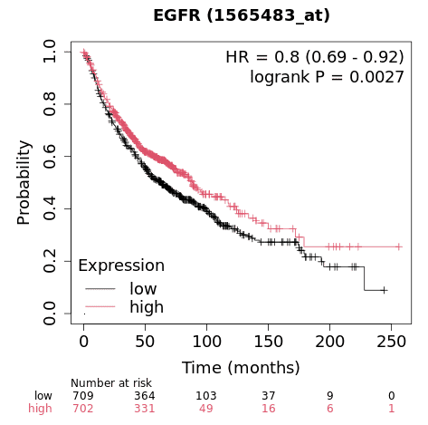
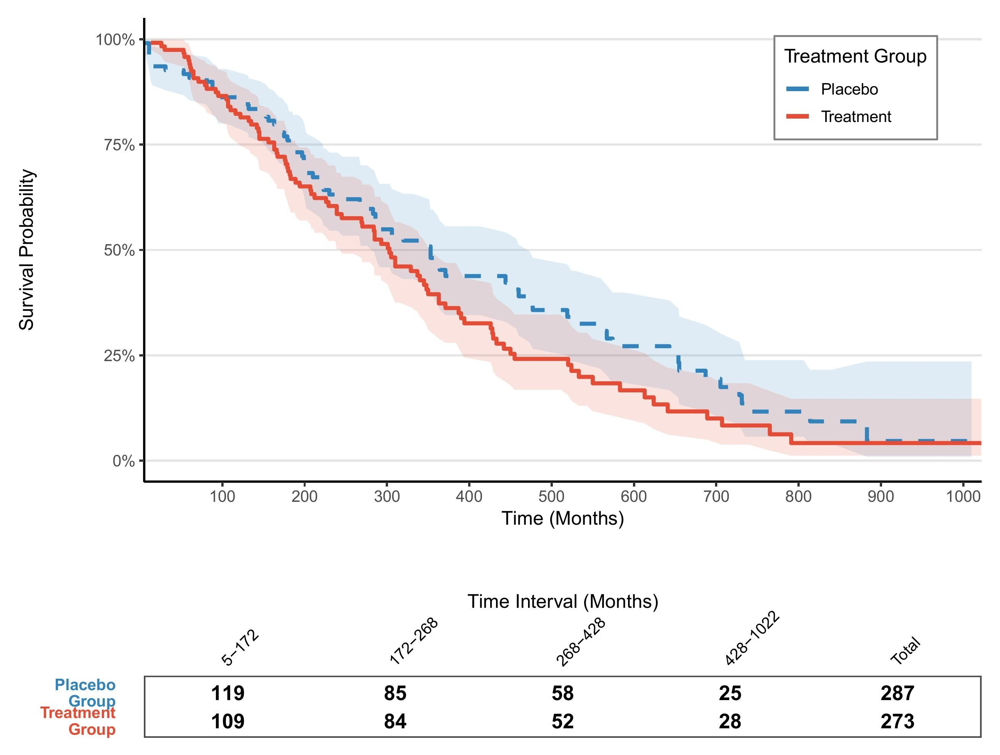
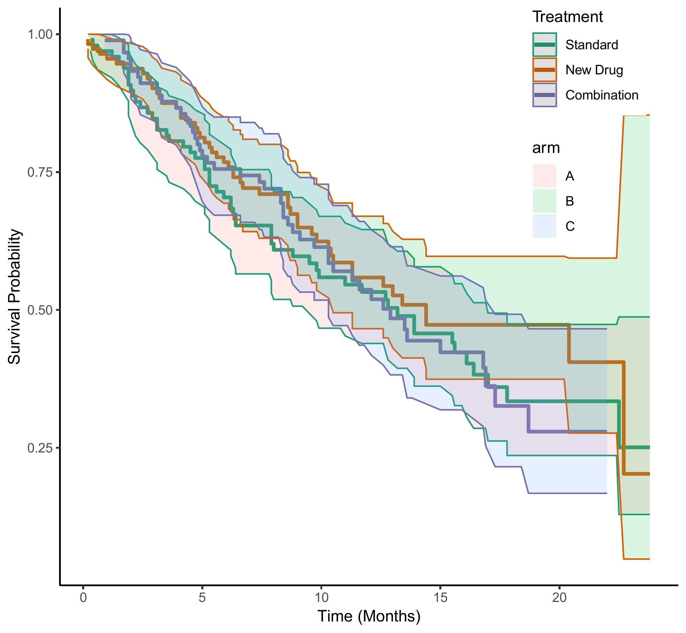

## 示例

{fig-alt="KaplanMeierPlot DEMO1" fig-align="center" width="60%"}

生存分析研究的是某个事件发生之前过去的时间，在临床研究中最常见的应用就是死亡率的估计(预测患者的生存时间)，不过生存分析也可以应用于其他领域如机械故障时间等。

```{r}
#| echo: false
#| output: asis
bizard_setup("survival", "survminer", "ggplot2", "dplyr", "tidyr", "zoo", "patchwork", lang = "zh")
```

```{r}
sessioninfo::session_info("attached")
```

## 数据准备

```{r load data1, message=FALSE}
#| warning: false

# 使用内置lung数据集（来自survival包）
data("lung", package = "survival")
# 数据预处理
surv_data <- lung %>%
  mutate(
    status = ifelse(status == 2, 1, 0),  # 转换状态编码（1=事件）
    sex = factor(sex, labels = c("Male", "Female")),
    group = sample(c("Treatment", "Placebo"), n(), replace = TRUE)
  )

# 查看数据结构
glimpse(surv_data)

# 生存时间分布
summary(surv_data$time)

# 拟合生存曲线
fit <- survfit(Surv(time, status) ~ group, data = surv_data)

# 提取曲线数据
surv_curve <- surv_summary(fit) 


# 计算log-rank检验P值
diff <- survdiff(Surv(time, status) ~ group, data = surv_data)
p_value <- signif(1 - pchisq(diff$chisq, length(diff$n)-1), 3)
```

## 可视化

### 1. 基础绘图

使用基础函数绘制图片的图注和简介。

```{r}
#| label: fig-1.1basicKM
#| fig-cap: "基础生存曲线"
#| out.width: "95%"
#| warning: false
#| message: false
#| fig-width: 6
#| fig-height: 4

# 基础生存曲线
p1 <- ggplot(surv_curve, aes(x = time, y = surv, color = strata)) +
  geom_step(linewidth = 1) +
  labs(x = "Time (Months)", y = "Survival Probability") +
  scale_y_continuous(labels = scales::percent)
p1
```

```{r}
#| label: fig-1.2basicKM
#| fig-cap: "基础生存曲线"
#| out.width: "95%"
#| warning: false
#| message: false
#| fig-width: 6
#| fig-height: 4

# 代码示例（以补充参数bins为例）-----
## 自定义美学映射
group_colors <- c("Treatment" = "#E64B35", "Placebo" = "#3182BD")
line_types <- c("Treatment" = "solid", "Placebo" = "dashed")

# 完整绘图代码
p_km <- ggplot(surv_curve, aes(x = time, color = group, fill = group)) +
      # 先绘制置信区间
      geom_ribbon(aes(ymin = lower, ymax = upper), 
                  alpha = 0.15, 
                  colour = NA) +
      # 再绘制生存曲线
      geom_step(aes(y = surv, linetype = group), 
                linewidth = 1.2) +
      # 颜色映射
      scale_color_manual(
        values = group_colors,
        name = "Treatment Group",
        labels = c("Placebo", "Treatment")
      ) +
      # 填充色映射
      scale_fill_manual(
        values = group_colors,
        guide = "none"
      ) +
      # 线型映射
      scale_linetype_manual(
        values = line_types,
        guide = "none"  # 与颜色共用图例
      ) +
      # 坐标轴优化
      scale_x_continuous(
        name = "Time (Months)",
        expand = c(0, 0),
        breaks = seq(0, 1000, by = 100)
      ) +
      scale_y_continuous(
        name = "Survival Probability",
        labels = scales::percent,
        limits = c(0, 1)
      ) +
      # 主题设置
      theme_classic(base_size = 12) +
      theme(
        legend.position = c(0.85, 0.85),
        legend.background = element_rect(fill = "white", colour = "grey50"),
        panel.grid.major.y = element_line(colour = "grey90")
      )
p_km
```

### 2. 更多进阶图表

```{r}
#| label: fig-2.1enhancedKM
#| fig-cap: "美化版生存曲线"
#| out.width: "95%"
#| warning: false
#| message: false
#| fig-width: 6
#| fig-height: 4
#| eval: false

# ----------------------------
# 风险表数据生成
# ----------------------------
# 生成分位数断点（自动适应数据分布）
custom_breaks <- quantile(surv_curve$time, 
                          probs = seq(0, 1, 0.25), 
                          na.rm = TRUE) %>%
  unique()  # 确保断点唯一

# 正确生成区间标签的方法
time_labels <- paste0(
  round(custom_breaks[-length(custom_breaks)]),  # 起始点（排除最后一个）
  "-",
  round(custom_breaks[-1])  # 结束点（排除第一个）
)

# 生成分段式风险表数据 --------------------------------------------------------
risk_table_segmented <- surv_curve %>%
  mutate(
    time_interval = cut(time,
                        breaks = custom_breaks,
                        include.lowest = TRUE,
                        right = FALSE,
                        labels = time_labels)
  ) %>%
  group_by(group, time_interval) %>%
  summarise(
    n_risk = ifelse(all(is.na(n.risk)), 0, max(n.risk, na.rm = TRUE)),  # 取区间内最大风险人数
    .groups = "drop"
  ) %>%
  complete(group, time_interval, fill = list(n_risk = 0)) %>%
  # 4. 添加总计行（修复语法）
  bind_rows(
    group_by(., group) %>%
      summarise(
        time_interval = "Total",
        n_risk = sum(n_risk, na.rm = TRUE),
        .groups = "drop"
      )
  ) %>%
  mutate(
    group = factor(group, levels = c("Treatment", "Placebo")),
    time_interval = factor(time_interval, levels = c(time_labels, "Total") )
  )

# 带边框的分段式风险表绘图 ----------------------------------------------------
risk_table_plot <- ggplot(risk_table_segmented, 
                          aes(x = time_interval, y = group)) +
  # # 单元格背景（带边框）
  # geom_tile(color = "gray50", fill = "white", linewidth = 0.5, 
  #           width = 0.95, height = 0.95) +
  # 数值标签
  geom_text(aes(label = n_risk), size = 4.5, fontface = "bold", color = "black") +
  # 列标题样式
  scale_x_discrete(
    name = "Time Interval (Months)",
    position = "top",
    expand = expansion(add = 0.5)
  ) +
  scale_y_discrete(
    name = NULL, 
    limits = rev,
    labels = c("Treatment\nGroup", "Placebo\nGroup")  # 添加分组标签
  ) +
  # 颜色系统
  scale_fill_manual(values = group_colors, guide = "none") +
  # 主题系统
  theme_minimal(base_size = 12) +
  theme(
    axis.text.x = element_text(angle = 45, hjust = 0, color = "black"),
    axis.text.y = element_text(
      color = group_colors,
      face = "bold",
      margin = margin(r = 15)
    ),
    panel.grid = element_blank(),
    plot.margin = margin(t = 30, b = 5, unit = "pt"),
    axis.title.x = element_text(margin = margin(t = 15))
  ) +
  # 添加外边框
  annotate("rect",
           xmin = -Inf, xmax = Inf, ymin = -Inf, ymax = Inf,
           color = "gray30", fill = NA, linewidth = 0.8)
risk_table_plot

# ----------------------------
# 绘图参数设置
# ----------------------------
group_colors <- c("Treatment" = "#E64B35", "Placebo" = "#3182BD")
theme_set(theme_minimal(base_size = 12))

# ----------------------------
# KM生存曲线绘制
# ----------------------------
p_km <- ggplot(surv_curve, aes(x = time, color = group, fill = group)) +
  # 先绘制置信区间
  geom_ribbon(aes(ymin = lower, ymax = upper), 
              alpha = 0.15, 
              colour = NA) +
  # 再绘制生存曲线
  geom_step(aes(y = surv, linetype = group), 
            linewidth = 1.2) +
  # 颜色映射
  scale_color_manual(
    values = group_colors,
    name = "Treatment Group",
    labels = c("Placebo", "Treatment")
  ) +
  # 填充色映射
  scale_fill_manual(
    values = group_colors,
    guide = "none"
  ) +
  # 线型映射
  scale_linetype_manual(
    values = line_types,
    guide = "none"  # 与颜色共用图例
  ) +
  # 坐标轴优化
  scale_x_continuous(
    name = "Time (Months)",
    expand = c(0, 0),
    breaks = seq(0, 1000, by = 100)
  ) +
  scale_y_continuous(
    name = "Survival Probability",
    labels = scales::percent,
    limits = c(0, 1)
  ) +
  # 主题设置
  theme_classic(base_size = 12) +
  theme(
    legend.position = c(0.85, 0.85),
    legend.background = element_rect(fill = "white", colour = "grey50"),
    panel.grid.major.y = element_line(colour = "grey90")
  )
p_km

# ----------------------------
# 图形组合
# ----------------------------
final_plot <- p_km / risk_table_plot + 
  plot_layout(heights = c(3, 0.4))

final_plot
```

::: {#fig-Fig2-1}
{fig-alt="Fig2-1" fig-align="center" width="60%"}

美化版生存曲线
:::

### Risk Table（风险表）

KM 曲线下方的**风险表**展示每个时间点仍在随访的患者数 \[7\]——审稿人用它评估曲线在晚期随访时的可靠性。`survminer::ggsurvplot()` 通过 `risk.table = TRUE` 绘制。

```{r}
#| label: fig-risktable
#| fig-cap: "KM 曲线 + 风险表，按处理组分层的每个时间点风险人数。"
#| out.width: "95%"
#| warning: false
#| message: false
#| fig-width: 8
#| fig-height: 6

set.seed(2911)
n_rt <- 200
km_data <- data.frame(
  time = rexp(n_rt, 0.06),
  event = sample(0:1, n_rt, replace = TRUE, prob = c(0.2, 0.8)),
  group = rep(c("Control", "Treated"), each = n_rt / 2))
km_data$time[km_data$group == "Treated"] <- km_data$time[km_data$group == "Treated"] * 1.6

fit_rt <- survfit(Surv(time, event) ~ group, data = km_data)
ggsurvplot(fit_rt, data = km_data,
           risk.table = TRUE,
           risk.table.col = "strata",
           risk.table.height = 0.25,
           palette = c("#2874C5", "#B2182B"),
           legend.title = "Group",
           xlab = "Time (months)",
           xlim = c(0, 96),
           break.time.by = 12,
           pval = TRUE)
```

::: callout-tip
**实践要点**

-   `risk.table.height` 控制风险表占整图的比例；0.25 是常用值。
-   `risk.table.y.text.col = TRUE` 让风险表标签颜色与曲线匹配。
-   `tables.theme = theme_cleantable()` 去除表格网格线，使画面更干净。
:::

## Application

## 应用场景

### 1. 疾病分布

::: {#fig-KaplanMeierPlotApplications1}
{fig-alt="KaplanMeierPlotApp1" fig-align="center" width="60%"}

三组KM曲线
:::

该图展示了 Standard、New Drug、Combination 三组数据之间的生成生存时间比较。

## 参考文献

\[1\] Kassambara A, et al. Survminer: Drawing Survival Curves using ggplot2. JOSS 2017

\[2\] Wickham H. ggplot2: Elegant Graphics for Data Analysis. Springer 2016


\[7\] Xiaofan Lu, et al. FigureYa: A Standardized Visualization Framework for Enhancing Biomedical Data Interpretation and Research Efficiency. iMetaMed. 2025. doi:10.1002/imm3.70005
