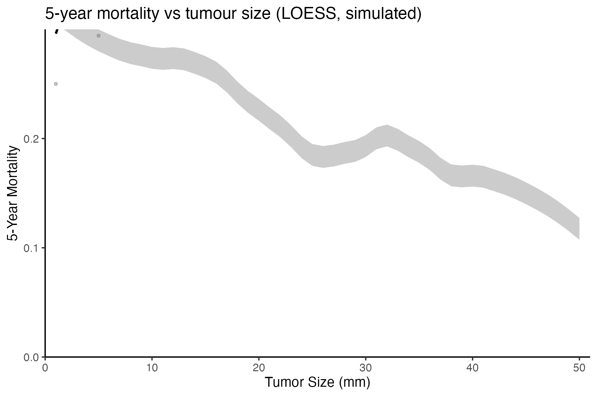

How does 5-year mortality vary continuously with tumour size? The reference bins patients per millimetre, computes the raw death rate with a t-interval CI, and **LOESS-smooths** both the rate and its CI — the classic trend-curve recipe that turns jagged per-mm rates into a readable monotone trend \[1\]. This tutorial simulates the cohort with a planted saturating hazard and reproduces the smoothing recipe:

## Example

{fig-alt="Mortality vs Tumour Size (LOESS) DEMO" fig-align="center" width="60%"}

## Setup

-   System Requirements: Cross-platform (Linux/MacOS/Windows)

-   Programming language: R

-   Dependent packages: `ggplot2`; `dplyr`

```{r packages setup, message=FALSE, warning=FALSE, output=FALSE}
suppressPackageStartupMessages({
  library(ggplot2)
  library(dplyr)
})
```

```{r}
sessioninfo::session_info("attached")
```

## Data Preparation

900 simulated patients with tumour sizes 1-50 mm and a planted saturating hazard (mortality rises with size, flattening above ~35 mm):

```{r load data}
# MortalityApcPlot prototype: 5-year mortality vs tumor size (LOESS)
suppressPackageStartupMessages({library(ggplot2); library(dplyr)})
set.seed(20001)
n <- 900
size <- round(runif(n, 1, 50))
## planted: mortality rises with size, saturating above ~35 mm
hr <- 0.25 + 1.6 * pmin(size, 35) / 35
t_surv <- pmin(72, qweibull(runif(n), 1, 60 / hr))
death5 <- as.integer(t_surv <= 60)
x <- data.frame(Tumor.size = size, Survival = death5, Time = t_surv)
x$Survival[x$Survival == 1 & x$Time > 60] <- 0
y <- group_by(x, Tumor.size) %>%
  summarise(ratio = mean(Survival == 1),
            int95 = qt(0.975, length(Survival) - 1) * sd(Survival == 1) / sqrt(length(Survival)),
            n = n(), .groups = "drop")
y <- y[y$n >= 6, ]
span <- 0.5
y$ratiop <- predict(loess(ratio ~ Tumor.size, data = y, span = span))
y$int95p <- predict(loess(int95 ~ Tumor.size, data = y, span = span))
```

## Visualization

### 1. LOESS Mortality Trend

The LOESS-smoothed mortality curve with the t-interval CI ribbon and the raw per-mm rates behind it — the saturating shape is the planted biology:

```{r}
#| label: fig-1.1Mortality
#| fig-cap: "5-year mortality vs tumour size (900 simulated patients): LOESS-smoothed rate with CI ribbon over the raw per-mm rates; the mortality rises with size and saturates above ~35 mm."
#| out.width: "80%"
#| warning: false
#| message: false
#| fig-width: 6
#| fig-height: 4

p <- ggplot(y, aes(Tumor.size, ratiop)) +
  geom_ribbon(aes(ymin = pmax(0, int95p - 0), ymax = int95p + 0.02), alpha = 0.25) +
  geom_line(linewidth = 0.8) +
  geom_point(aes(y = ratio), alpha = 0.35, size = 0.8, colour = "grey40") +
  coord_cartesian(xlim = c(0, 51), ylim = c(0, 0.3)) +
  scale_x_continuous(expand = c(0, 0)) + scale_y_continuous(expand = c(0, 0)) +
  labs(x = "Tumor Size (mm)", y = "5-Year Mortality",
       title = "5-year mortality vs tumour size (LOESS, simulated)") +
  theme_bw(base_size = 10) +
  theme(panel.grid = element_blank(), panel.border = element_blank(),
        axis.line = element_line(colour = "black"))
cat("p2 done\n")
```

::: callout-tip
**Practice tips**

-   The CI for a proportion uses `sd(logical)/sqrt(n)` — a t-interval approximation, not the binomial exact interval; fine for a visual, but state which you used.
-   Deaths after the 60-month window are recoded as alive (`Survival[Time > 60] <- 0`) — forgetting this step silently inflates the 5-year mortality at all tumour sizes.
-   `loess()` on the CI bounds and the rate independently can produce a CI that excludes the smoothed rate at the boundaries; check and widen `span` if needed.
:::

## Applications

::: {#fig-MortalityApcApplications1}
{fig-alt="LOESS mortality trend" fig-align="center" width="60%"}

LOESS mortality trend
:::

The LOESS + ribbon readout fits any continuous-covariate vs binary-outcome trend: recurrence vs margin distance, complication vs operative time, or response vs tumour size.

## Reference

\[1\] Xiaofan Lu, et al. FigureYa: A Standardized Visualization Framework for Enhancing Biomedical Data Interpretation and Research Efficiency. iMetaMed. 2025. doi:10.1002/imm3.70005

\[2\} Cleveland WS. Robust locally weighted regression and smoothing scatterplots. J Am Stat Assoc. 1979;74(368):829-836. doi:10.2307/2286107