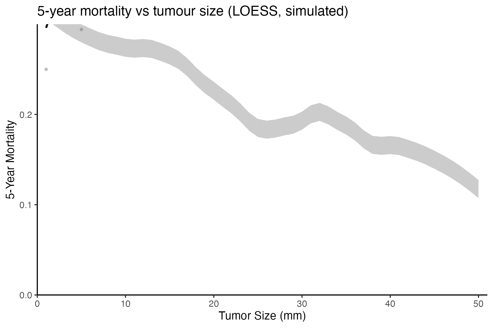

5 年死亡率如何随肿瘤大小连续变化？参考文档逐毫米分箱患者、计算原始死亡率与 t 区间 CI、并 **LOESS 平滑**两者——经典趋势曲线配方，将参差的逐毫米死亡率转为可读的单调趋势 \[1\]。本教程模拟带植入饱和风险的队列并复现该平滑配方：

## Example

{fig-alt="死亡率 vs 肿瘤大小（LOESS） DEMO" fig-align="center" width="60%"}

## Setup

-   系统要求：跨平台（Linux/MacOS/Windows）

-   编程语言：R

-   依赖包：`ggplot2`; `dplyr`

```{r packages setup, message=FALSE, warning=FALSE, output=FALSE}
suppressPackageStartupMessages({
  library(ggplot2)
  library(dplyr)
})
```

```{r}
sessioninfo::session_info("attached")
```

## 数据准备

900 个模拟患者、肿瘤大小 1-50 mm，植入饱和风险（死亡率随大小上升、~35 mm 以上趋平）：

```{r load data}
# MortalityApcPlot prototype: 5-year mortality vs tumor size (LOESS)
suppressPackageStartupMessages({library(ggplot2); library(dplyr)})
set.seed(20001)
n <- 900
size <- round(runif(n, 1, 50))
## planted: mortality rises with size, saturating above ~35 mm
hr <- 0.25 + 1.6 * pmin(size, 35) / 35
t_surv <- pmin(72, qweibull(runif(n), 1, 60 / hr))
death5 <- as.integer(t_surv <= 60)
x <- data.frame(Tumor.size = size, Survival = death5, Time = t_surv)
x$Survival[x$Survival == 1 & x$Time > 60] <- 0
y <- group_by(x, Tumor.size) %>%
  summarise(ratio = mean(Survival == 1),
            int95 = qt(0.975, length(Survival) - 1) * sd(Survival == 1) / sqrt(length(Survival)),
            n = n(), .groups = "drop")
y <- y[y$n >= 6, ]
span <- 0.5
y$ratiop <- predict(loess(ratio ~ Tumor.size, data = y, span = span))
y$int95p <- predict(loess(int95 ~ Tumor.size, data = y, span = span))
```

## Visualization

### LOESS 死亡率趋势

LOESS 平滑死亡率曲线配 t 区间 CI 条带与身后的原始逐毫米死亡率——饱和形状即植入的生物学：

```{r}
#| label: fig-1.1Mortality
#| fig-cap: "5 年死亡率 vs 肿瘤大小（900 个模拟患者）：LOESS 平滑死亡率配 CI 条带叠加原始逐毫米死亡率；死亡率随大小上升并在 ~35 mm 以上饱和。"
#| out.width: "80%"
#| warning: false
#| message: false
#| fig-width: 6
#| fig-height: 4

p <- ggplot(y, aes(Tumor.size, ratiop)) +
  geom_ribbon(aes(ymin = pmax(0, int95p - 0), ymax = int95p + 0.02), alpha = 0.25) +
  geom_line(linewidth = 0.8) +
  geom_point(aes(y = ratio), alpha = 0.35, size = 0.8, colour = "grey40") +
  coord_cartesian(xlim = c(0, 51), ylim = c(0, 0.3)) +
  scale_x_continuous(expand = c(0, 0)) + scale_y_continuous(expand = c(0, 0)) +
  labs(x = "Tumor Size (mm)", y = "5-Year Mortality",
       title = "5-year mortality vs tumour size (LOESS, simulated)") +
  theme_bw(base_size = 10) +
  theme(panel.grid = element_blank(), panel.border = element_blank(),
        axis.line = element_line(colour = "black"))
ggsave("/tmp/bizard_b37/proto/p2_mortality.png", p, width = 6, height = 4, bg = "white")
cat("p2 done\n")
```


## 应用场景

::: {#fig-MortalityApcApplications1}
{fig-alt="LOESS 死亡率趋势" fig-align="center" width="60%"}

LOESS 死亡率趋势
:::

LOESS + 条带读数适用于任何连续协变量 vs 二分类结局的趋势：切缘距离 vs 复发、手术时间 vs 并发症、或肿瘤大小 vs 应答。

## 参考文献

\[1\] Xiaofan Lu, et al. FigureYa: A Standardized Visualization Framework for Enhancing Biomedical Data Interpretation and Research Efficiency. iMetaMed. 2025. doi:10.1002/imm3.70005

\[2\} Cleveland WS. Robust locally weighted regression and smoothing scatterplots. J Am Stat Assoc. 1979;74(368):829-836. doi:10.2307/2286107