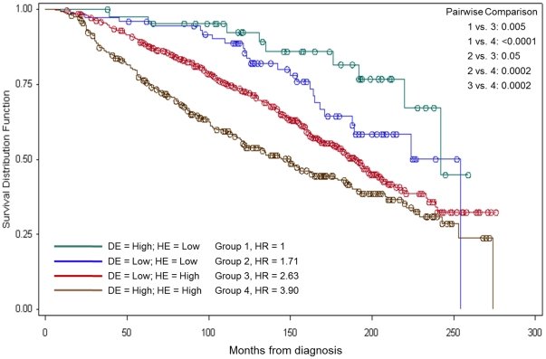

Before designing a survival study, the reference calculates how many **events and patients** are needed to detect a hazard ratio (HR) with specified power, using Schoenfeld's approximation: n_events = (Z_{α/2} + Z_{β})² / [p₁ × p₂ × log(HR)²], where p₁ and p₂ are the proportions of patients in each arm \[1\]. The required number of patients is then derived from the expected event rate over the study duration. Both formulas run in-page with base R `qnorm` and the results are plotted as power curves:

## Example

{fig-alt="Survival Sample Size Estimation DEMO" fig-align="center" width="70%"}

## Setup

-   System Requirements: Cross-platform (Linux/MacOS/Windows)

-   Programming language: R

-   Dependent packages: `ggplot2`

```{r packages setup, message=FALSE, warning=FALSE, output=FALSE}
suppressPackageStartupMessages({
  library(ggplot2)
})
```

```{r}
sessioninfo::session_info("attached")
```

## Data Preparation

Schoenfeld's formula for the required number of events at a two-sided α = 0.05 with 80% or 90% power, across a range of hazard ratios (0.5 to 0.9) and allocation ratios (1:1):

```{r load data}
suppressPackageStartupMessages({library(ggplot2)})
alpha <- 0.05
power_levels <- c(0.80, 0.90)
hrs <- seq(0.5, 0.9, by = 0.05)

n_events <- function(hr, alpha, power) {
  z_a <- qnorm(1 - alpha / 2)
  z_b <- qnorm(power)
  ((z_a + z_b)^2) / (0.5 * 0.5 * log(hr)^2)
}
power_df <- do.call(rbind, lapply(power_levels, function(pw) {
  data.frame(hr = hrs, n_events = sapply(hrs, n_events, alpha, pw),
             power = pw)
}))
power_df$power <- factor(power_df$power, levels = c(0.80, 0.90))
```

## Visualization

### 1. Required Events vs Hazard Ratio

The reference's power curve: required events as a function of HR at 80% and 90% power, showing the steep increase as HR approaches 1:

```{r}
#| label: fig-1.1NSurvEvents
#| fig-cap: "Required number of events (Schoenfeld's approximation) vs hazard ratio at 80% and 90% power: a HR of 0.7 needs ~247 events at 80% power, while a HR of 0.5 needs only ~65."
#| out.width: "80%"
#| fig-width: 7
#| fig-height: 5.2

ggplot(power_df, aes(hr, n_events, colour = power)) +
  geom_line(linewidth = 1) +
  geom_point(size = 2.2) +
  scale_colour_manual(values = c(`0.8` = "#2166AC", `0.9` = "#B2182B"),
                      name = "Power") +
  labs(x = "Hazard ratio (treatment vs control)",
       y = "Required number of events") +
  theme_bw(base_size = 11) +
  theme(panel.grid.minor = element_blank())
```

### 2. Required Patients Given Expected Event Rate

The number of patients needed given the number of events and an assumed event rate over the study period — the practical answer a trial designer needs:

```{r}
#| label: fig-2.1NSurvPatients
#| fig-cap: "Required number of patients (events / expected event rate) for three event rates across the same HR range: lower event rates dramatically inflate the required cohort size."
#| out.width: "80%"
#| fig-width: 7
#| fig-height: 5.2

event_rates <- c(0.3, 0.5, 0.7)
patient_df <- do.call(rbind, lapply(event_rates, function(er) {
  data.frame(hr = hrs,
             n_patients = sapply(hrs, n_events, alpha, 0.80) / er,
             event_rate = er)
}))
ggplot(patient_df, aes(hr, n_patients, colour = factor(event_rate))) +
  geom_line(linewidth = 1) +
  geom_point(size = 2.2) +
  scale_colour_manual(values = c(`0.3` = "#B2182B", `0.5` = "#4472C4", `0.7` = "#6F8B35"),
                      name = "Event rate") +
  labs(x = "Hazard ratio", y = "Required number of patients") +
  theme_bw(base_size = 11) +
  theme(panel.grid.minor = element_blank())
```

::: callout-tip
**Practice tips**
-   Schoenfeld's approximation gives the **number of events**, not patients — divide by the expected event rate over the study duration to get the patient target.
-   The formula assumes equal allocation (1:1); unequal allocation inflates the requirement by 1/(4·p₁·p₂).
-   The HR is the assumed true effect — use a clinically meaningful minimum detectable difference, not a post-hoc estimate.
-   Two-sided α = 0.05 is the default; one-sided tests (for non-inferiority) halve the Z value.
-   The event rate depends on follow-up duration and baseline hazard — estimate it from a pilot or published cohort before finalising the sample size.
:::

## Application

::: {#fig-NSurvApplications1}
{fig-alt="Survival Sample Size Estimation" fig-align="center" width="70%"}

Survival sample size estimation
:::

Schoenfeld's sample-size calculation applies to any two-arm survival study: immunotherapy clinical trials, biomarker-stratified cohorts, or observational survival analyses.

## Reference

\[1\] Xiaofan Lu, et al. FigureYa: A Standardized Visualization Framework for Enhancing Biomedical Data Interpretation and Research Efficiency. iMetaMed. 2025. doi:10.1002/imm3.70005
