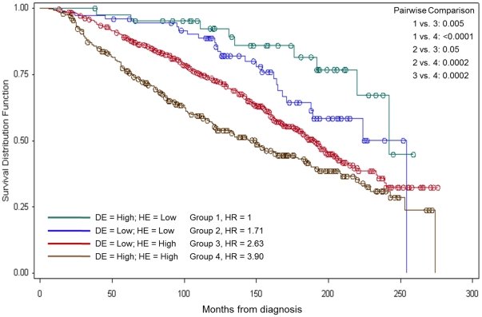

在设计生存研究之前，参考流程用 Schoenfeld 近似计算检测给定风险比（HR）所需的**事件数与患者数**：n_events = (Z_{α/2} + Z_{β})² / [p₁ × p₂ × log(HR)²]，其中 p₁、p₂ 为两组患者比例 \[1\]。所需患者数再由研究期内预期事件率推得。两个公式均在页内用 base R `qnorm` 计算，并以功效曲线呈现：

## Example

{fig-alt="生存研究样本量估算 DEMO" fig-align="center" width="70%"}

## Setup

-   系统要求：跨平台（Linux/MacOS/Windows）

-   编程语言：R

-   依赖包：`ggplot2`

```{r packages setup, message=FALSE, warning=FALSE, output=FALSE}
suppressPackageStartupMessages({
  library(ggplot2)
})
```

```{r}
sessioninfo::session_info("attached")
```

## 数据准备

双侧 α = 0.05、80% 与 90% 功效下，Schoenfeld 近似给出的所需事件数随风险比（0.5 到 0.9）与 1:1 分组比例的变化：

```{r load data}
suppressPackageStartupMessages({library(ggplot2)})
alpha <- 0.05
power_levels <- c(0.80, 0.90)
hrs <- seq(0.5, 0.9, by = 0.05)

n_events <- function(hr, alpha, power) {
  z_a <- qnorm(1 - alpha / 2)
  z_b <- qnorm(power)
  ((z_a + z_b)^2) / (0.5 * 0.5 * log(hr)^2)
}
power_df <- do.call(rbind, lapply(power_levels, function(pw) {
  data.frame(hr = hrs, n_events = sapply(hrs, n_events, alpha, pw),
             power = pw)
}))
power_df$power <- factor(power_df$power, levels = c(0.80, 0.90))
```

## Visualization

### 1. 所需事件数 vs 风险比

参考图的核心曲线：所需事件数随 HR 变化（80% 与 90% 功效），HR 越接近 1 需求急剧上升：

```{r}
#| label: fig-1.1NSurvEvents
#| fig-cap: "Schoenfeld 近似下所需事件数随风险比的变化（80% 与 90% 功效）：HR=0.7 在 80% 功效下约需 247 例事件，而 HR=0.5 仅需约 65 例。"
#| out.width: "80%"
#| fig-width: 7
#| fig-height: 5.2

ggplot(power_df, aes(hr, n_events, colour = power)) +
  geom_line(linewidth = 1) +
  geom_point(size = 2.2) +
  scale_colour_manual(values = c(`0.8` = "#2166AC", `0.9` = "#B2182B"),
                      name = "Power") +
  labs(x = "Hazard ratio (treatment vs control)",
       y = "Required number of events") +
  theme_bw(base_size = 11) +
  theme(panel.grid.minor = element_blank())
```

### 2. 给定事件率下的所需患者数

已知事件数与研究期内假设的事件率后即可推得所需患者数——这是试验设计者真正关心的数字：

```{r}
#| label: fig-2.1NSurvPatients
#| fig-cap: "给定事件率下所需患者数（事件数 / 预期事件率）：事件率越低，所需队列规模急剧膨胀。"
#| out.width: "80%"
#| fig-width: 7
#| fig-height: 5.2

event_rates <- c(0.3, 0.5, 0.7)
patient_df <- do.call(rbind, lapply(event_rates, function(er) {
  data.frame(hr = hrs,
             n_patients = sapply(hrs, n_events, alpha, 0.80) / er,
             event_rate = er)
}))
ggplot(patient_df, aes(hr, n_patients, colour = factor(event_rate))) +
  geom_line(linewidth = 1) +
  geom_point(size = 2.2) +
  scale_colour_manual(values = c(`0.3` = "#B2182B", `0.5` = "#4472C4", `0.7` = "#6F8B35"),
                      name = "Event rate") +
  labs(x = "Hazard ratio", y = "Required number of patients") +
  theme_bw(base_size = 11) +
  theme(panel.grid.minor = element_blank())
```

::: callout-tip
**实践要点**
-   Schoenfeld 近似给出的是**事件数**而非患者数——需除以研究期内的预期事件率才得到患者目标。
-   公式假设 1:1 等比例分组；不等比例分组会使需求按 1/(4·p₁·p₂) 膨胀。
-   HR 是假设的真实效应——应使用有临床意义的最小可检测差异，而非事后估计值。
-   双侧 α = 0.05 是默认设置；单侧检验（如非劣效设计）将 Z 值减半。
-   事件率取决于随访时长与基线风险——在最终确定样本量前，应从先导研究或已发表队列中估计。
:::

## 应用场景

::: {#fig-NSurvApplications1}
{fig-alt="生存研究样本量估算" fig-align="center" width="70%"}

生存研究样本量估算
:::

Schoenfeld 样本量计算适用于任何两组生存研究：免疫治疗临床试验、生物标志物分层队列、或观察性生存分析。

## 参考文献

\[1\] Xiaofan Lu, et al. FigureYa: A Standardized Visualization Framework for Enhancing Biomedical Data Interpretation and Research Efficiency. iMetaMed. 2025. doi:10.1002/imm3.70005
