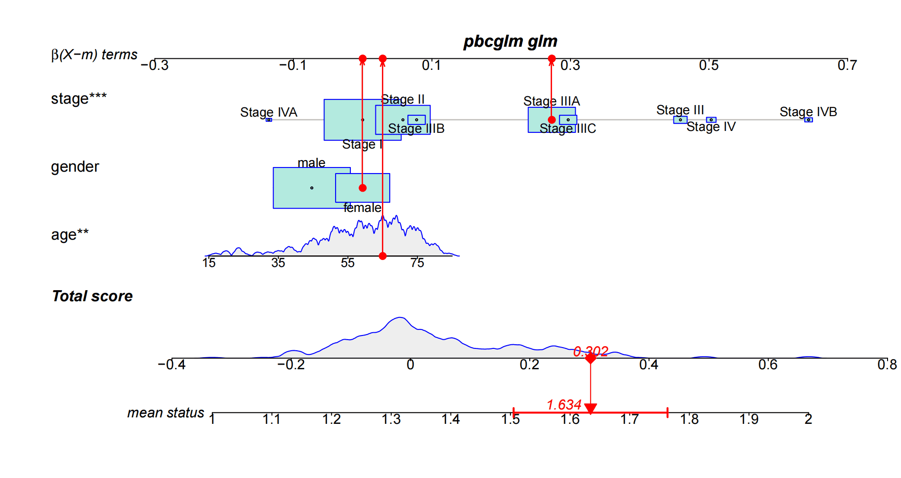
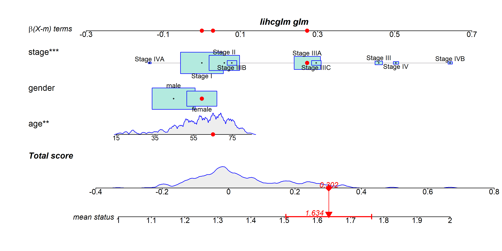
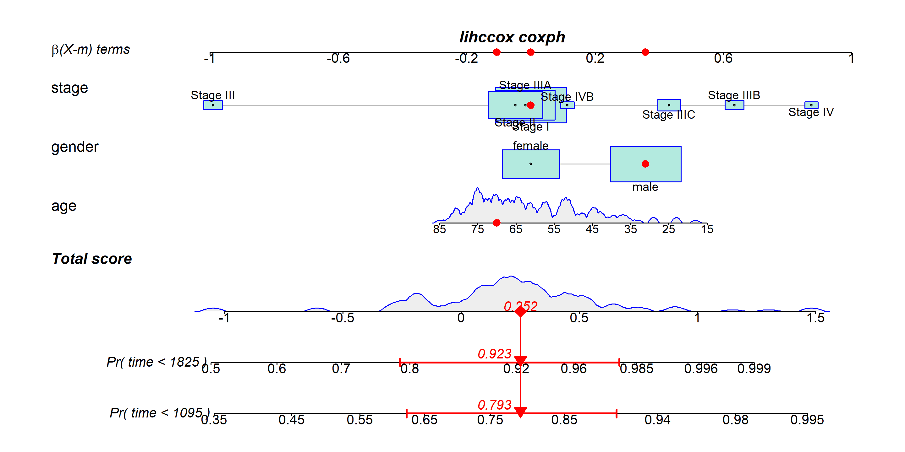
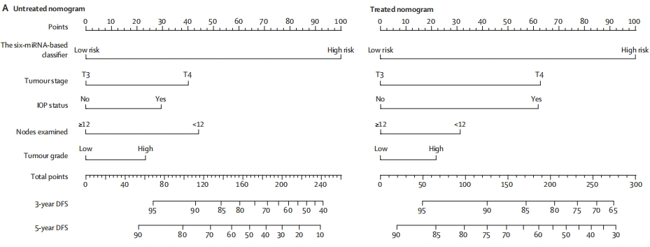

Simply put, a nomogram graphically displays the results of logistic regression or Cox regression. It uses the regression coefficient of each independent variable to develop a scoring criteria, assigning a score to each independent variable value. A total score is then calculated for each patient, and a conversion function is used to convert this score into the probability of a specific outcome for that patient.

Common nomogram names mainly consist of three parts:
1. The name of the variable in the prediction model: for example, "stage," "gender," and "age" in the figure. Each variable is marked with a scale on the line segment, indicating the range of values for that variable. The length of the line segment reflects the degree of influence of that factor on the outcome event.
2. Score: This includes individual scores ("β(X-m) terms" in the figure) and a total score ("Total score"). The individual scores represent the scores of each variable at different values, while the total score is the sum of all variable scores.
3. Predicted probability: for example, "mean status" represents the probability of death.

## Example

{fig-alt="Nomogram DEMO1" fig-align="center" width="60%"}

As indicated by the red arrows, find the individual scores for each variable for this patient. Finally, add up the individual scores for all variables to obtain the patient's total score. Based on this total score, draw a vertical line downward to determine the patient's risk of invasive lung adenocarcinoma.

## Setup

-   System Requirements: Cross-platform (Linux/MacOS/Windows)

-   Programming language: R

-   Dependent packages: `readr`, `rms`, `survival`, `regplot`

```{r packages setup, message=FALSE, warning=FALSE, output=FALSE}
# Installing packages
if (!requireNamespace("readr", quietly = TRUE)) {
  install.packages("readr")
}
if (!requireNamespace("rms", quietly = TRUE)) {
  install.packages("rms")
}
if (!requireNamespace("survival", quietly = TRUE)) {
  install.packages("survival")
}
if (!requireNamespace("regplot", quietly = TRUE)) {
  if (!requireNamespace("remotes", quietly = TRUE)) install.packages("remotes")
  remotes::install_github("cran/regplot")
}

# Load packages
library(readr)
library(rms)
library(survival)
library(regplot)
if (!requireNamespace("nomogramEx", quietly = TRUE)) {
  install.packages("nomogramEx", repos = "https://cloud.r-project.org")
}
```

```{r}
sessioninfo::session_info("attached")
```

## Data Preparation

The data were downloaded from the [Phenotype](https://xenabrowser.net/datapages/?cohort=GDC%20TCGA%20Liver%20Cancer%20(LIHC)&removeHub=https%3A%2F%2Fxena.treehouse.gi.ucsc.edu%3A443) file of the GDC TCGA Liver Cancer (LIHC) database in the Xena browser \[2\].

```{r load data, message=FALSE}
## Loading data
clinical <- readr::read_tsv("https://bizard-1301043367.cos.ap-guangzhou.myqcloud.com/TCGA-LIHC.clinical.tsv")
LIHC <- cbind(clinical$sample,clinical[,c('gender.demographic',
                                          'vital_status.demographic',
                                          'days_to_death.demographic',
                                          'days_to_last_follow_up.diagnoses',
                                          'age_at_index.demographic',
                                          'ajcc_pathologic_stage.diagnoses')])
colnames(LIHC) <- c('bcr_patient_barcode','gender','status','time_death','time_followup','age','stage')
table(LIHC$status)
LIHC <- LIHC[LIHC$status != 'Not Reported',]
LIHC$status <- as.numeric(ifelse(LIHC$status=='Dead','2','1') ) # Death is 2 in nomogram
## Analysis time: dead patients use days_to_death, censored patients use
## days_to_last_follow_up. Fitting on days_to_death alone silently drops
## every censored patient (NA time), which also removes factor levels that
## regplot's model.frame re-evaluation then reports as "new levels".
LIHC$time <- ifelse(LIHC$status == 2, LIHC$time_death, LIHC$time_followup)
LIHC <- LIHC[!is.na(LIHC$time) & LIHC$time > 0, ]
```

## Visualization

### 1. Basic Nomogram

The basic nomogram shows the results of modeling survival status (status) with age (age), sex (gender), and disease stage (stage) using a generalized linear model.

```{r}
#| label: fig-1.1BasicNomogram
#| fig-cap: "Basic Nomogram"
#| out.width: "95%"
#| warning: false
#| message: false
#| fig-width: 10
#| fig-height: 5

# Basic Nomogram
dd=datadist(LIHC)
options(datadist="dd")
## Build a logist model and draw a nomogram
f1 <- lrm(status ~ age + gender + stage , data =  LIHC)
nom <- nomogram(f1, fun=plogis, lp=F, funlabel="Risk")
plot(nom)
```

We can also use the nomogram to show the results of the Cox regression model for modeling survival time (time), survival status (status) with age (age), gender (gender), and disease stage (stage).

```{r}
#| label: fig-1.2BasicNomogram
#| fig-cap: "Constructing a COX proportional hazards model"
#| out.width: "95%"
#| warning: false
#| message: false
#| fig-width: 10
#| fig-height: 5

## Constructing a COX proportional hazards model
f2 <- psm(Surv(time,status) ~ age+gender+stage,data =  LIHC, dist='lognormal')
med <- Quantile(f2) # Calculate median survival time
surv <- Survival(f2) # Constructing a survival probability function
## Draw a nomogram of the median survival time of COX regression
nom <- nomogram(f2, fun=function(x) med(lp=x),funlabel="Median Survival Time")
plot(nom)
```

We can also plot the predicted 3-year-5-year-survival probabilities using a nomogram.

```{r}
#| label: fig-1.3BasicNomogram
#| fig-cap: "Predict 3-5 year survival probability"
#| out.width: "95%"
#| warning: false
#| message: false
#| fig-width: 10
#| fig-height: 5

## The time unit of LIHC data is "days". Here we plot the 3-year and 5-year survival probabilities.
nom <- nomogram(f2, fun=list(function(x) surv(1095, x),
                             function(x) surv(1825, x),
                             function(x) med(lp=x)),
                funlabel=c("3-year Survival Probability", "5-year Survival Probability","Median Survival Time"))
plot(nom, xfrac=.2)
```

### 2. Beautify Nomogram

In addition to using nomogram for modeling and drawing, we can also use the survival package and regplot package for modeling and drawing. The figure below shows the construction and drawing of the model using a generalized linear model.

```{r}
#| label: fig-2.1BeautifyNomogram
#| fig-cap: "Beautify Nomogram1"
#| out.width: "95%"
#| warning: false
#| message: false
#| fig-width: 10
#| fig-height: 5
#| eval: false

# Displays logistic regression, supports "lm", "glm", "coxph", "survreg" and "negbin"
## Plot a logistic regression, showing odds scale and confidence interval
lihcglm <- glm(status ~ age + gender + stage, data=LIHC )
regplot(lihcglm, 
        observation=LIHC[1,], 
        odds=TRUE, 
        interval="confidence")
```

::: {#fig-2-1}
{fig-alt="Nomogram2-1" fig-align="center" width="60%"}

Beautify Nomogram1
:::

The figure below shows the construction and drawing of the model using the generalized linear model.

```{r}
#| label: fig-2.2BeautifyNomogram
#| fig-cap: "Beautify Nomogram2"
#| out.width: "95%"
#| warning: false
#| message: false
#| fig-width: 10
#| fig-height: 5

## model=TRUE stores the model frame so regplot's added.obs() can score a new
## observation; without it, newer survival re-evaluates the call in the
## formula's environment (set by rms::datadist) where the data is not found.
lihccox <- coxph(formula = Surv(time,status) ~ age+gender+stage , data = LIHC, model = TRUE)
## regplot's added.obs() relies on survival's model.frame.coxph finding this
## exact symbol in the global environment (survival 3.8 evaluates the model
## call there, bypassing the function's own scope), so name it exactly "app".
app <- rbind(LIHC[2, ], LIHC)
regplot(lihccox,
        observation=LIHC[2,], # Scoring and displaying the indicators of observation 2 on the nomogram
        failtime = c(1095,1825),# Predict 3-year and 5-year mortality risk, the unit here is day
        prfail = TRUE, # TRUE is required in cox regression
        showP = T, # Whether statistical differences are shown
        droplines = F, # Observation 2 Example Scoring Whether to Draw a Line
        interval="confidence") # Displaying credible intervals for observations
```

::: {#fig-2-2}
{fig-alt="Nomogram2-2" fig-align="center" width="60%"}

Beautify Nomogram2
:::

### 3. Calibrate the Nomogram

A nomogram is a prediction model, so before it is used — or published — it must be **calibrated**: do predicted survival probabilities match observed ones? The reference workflow \[3\] fits the same Cox model with `rms::cph(..., surv = TRUE, time.inc = ...)` and uses `rms::calibrate()` (bootstrap bias correction, Kaplan–Meier observed probabilities at the horizon time). An ideal nomogram tracks the 45° dashed line; the distance between the apparent (×) and bias-corrected (•) curves shows how much overfitting the optimism correction removes.

```{r}
#| label: fig-3.1Calibration3y
#| fig-cap: "Bootstrap calibration of the Cox nomogram at 3 years (u = 1095 days): apparent (×) vs bias-corrected (•) survival against the ideal 45° line."
#| out.width: "65%"
#| warning: false
#| message: false
#| fig-width: 6.5
#| fig-height: 5.5

## consolidate TCGA stage labels (Stage IA/IB -> Stage I) so every level has support
lihc_cal <- LIHC
lihc_cal$stage3 <- factor(sub("[ABCD]$", "", as.character(lihc_cal$stage)))
lihc_cal$gender <- factor(lihc_cal$gender)
lihc_cal <- lihc_cal[complete.cases(lihc_cal[, c("time", "status", "age", "gender", "stage3")]), ]
dd2 <- datadist(lihc_cal)
options(datadist = "dd2")

f3y <- cph(Surv(time, status) ~ age + gender + stage3, data = lihc_cal,
           x = TRUE, y = TRUE, surv = TRUE, time.inc = 1095)
cal3y <- calibrate(f3y, cmethod = "KM", method = "boot", u = 1095, B = 200)
plot(cal3y, xlab = "Predicted 3-year survival probability",
     ylab = "Observed survival (KM)", subtitles = FALSE)
```

```{r}
#| label: fig-3.2Calibration5y
#| fig-cap: "Bootstrap calibration of the Cox nomogram at 5 years (u = 1825 days): the model tracks the ideal line within the bootstrap confidence bars."
#| out.width: "65%"
#| warning: false
#| message: false
#| fig-width: 6.5
#| fig-height: 5.5

f5y <- cph(Surv(time, status) ~ age + gender + stage3, data = lihc_cal,
           x = TRUE, y = TRUE, surv = TRUE, time.inc = 1825)
cal5y <- calibrate(f5y, cmethod = "KM", method = "boot", u = 1825, B = 200)
plot(cal5y, xlab = "Predicted 5-year survival probability",
     ylab = "Observed survival (KM)", subtitles = FALSE)
```

::: callout-tip
**Practice tips**

-   `time.inc` and `u` must be the **same horizon**, and `surv = TRUE` must be set at fit time — `calibrate()` re-uses the survival function stored inside the fit; mismatched horizons silently calibrate the wrong endpoint.
-   `cmethod = "KM"` compares against Kaplan–Meier estimates in prediction bands; report B (here 200) — small B makes the error bars themselves noisy.
-   Two horizons on one page (3-year and 5-year) is the standard clinical presentation: a model can calibrate well early and drift late.

::: callout-note
**Interactive variant.** FigureYa30Plus ships a browser-based nomogram app (a PWA you can open offline): <https://github.com/ying-ge/FigureYa/tree/main/FigureYa30Plus_nomogram_app>. It lets a clinician drag each variable and read the predicted probability instantly — useful for teaching and clinical discussion; for publication, the static nomogram plus a calibration plot above remains the required pair.
:::
:::

### 4. Extract the Score Formula

A published nomogram usually travels with an **explicit scoring formula** so a reader can total points by hand. `nomogramEx` reverse-engineers the printed nomogram into per-variable point equations plus the points-to-linear-predictor mapping \[3\]:

```{r}
#| warning: false
#| message: false

suppressPackageStartupMessages(library(nomogramEx))
## nomogramEx reads a plain-lp nomogram (no `fun` transformation):
## per-variable points are polynomial functions of the covariate
nom_lp <- nomogram(f2, lp = TRUE)
nomogramEx(nomo = nom_lp, np = 1, digit = 4)
```

::: callout-tip
**Practice tips**

-   `nomogramEx()` only accepts nomograms on the **linear-predictor scale** — pass `lp = TRUE` and no `fun=`; the survival-probability scale is then a separate monotone map you document once.
-   A printed nomogram plus its formula should give identical totals; verify one patient by hand before submitting the manuscript.
-   The FigureYa30Plus Shiny app is essentially this formula wrapped in a UI — when a web tool is requested, the formula is the deliverable, not the plot.
:::

## Application

::: {#fig-NomogramApplications}
{fig-alt="NomogramApp1" fig-align="center" width="60%"}

Applications of Nomogram
:::

This figure shows two schematics of clinical applications that integrate a 6-miRNA-based classifier with four clinicopathological risk factors to predict which patients are likely to benefit from adjuvant chemotherapy after surgery for stage II colon cancer. \[2\]

## Reference

\[1\] Goldman MJ, Craft B, Hastie M, et al. Visualizing and interpreting cancer genomics data via the Xena platform. Nat Biotechnol. 2020;38(6):675-678. doi:10.1038/s41587-020-0546-8

\[2\] Zhang JX, Song W, Chen ZH, et al. Prognostic and predictive value of a microRNA signature in stage II colon cancer: a microRNA expression analysis [published correction appears in Lancet Oncol. 2014 Jan;15(1):e4]. Lancet Oncol. 2013;14(13):1295-1306. doi:10.1016/S1470-2045(13)70491-1

\[3\] Xiaofan Lu, et al. FigureYa: A Standardized Visualization Framework for Enhancing Biomedical Data Interpretation and Research Efficiency. iMetaMed. 2025. doi:10.1002/imm3.70005

