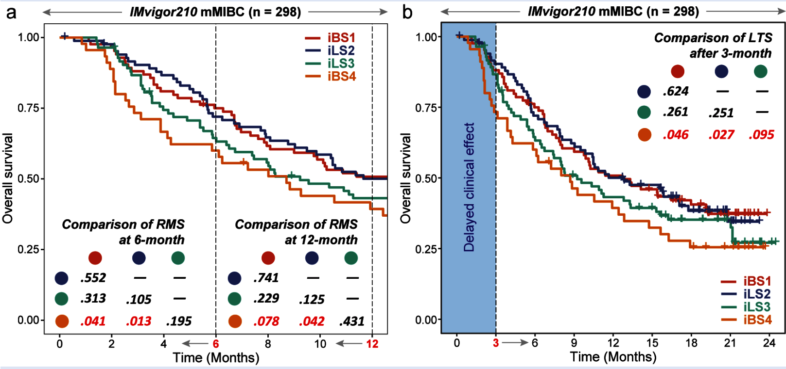

Immunotherapy cohorts violate the proportional-hazards assumption — the **delayed effect** flattens treated curves for the first months. The reference compares four immune-clinical subtypes with two NPH tools: **restricted mean survival time (RMST)** differences at 6 and 12 months (`survRM2::rmst2()` per subtype pair) and a **long-term-survival test** after the 3-month landmark (`ComparisonSurv::Long.test()`), presented as pairwise p-value matrices plus KM curves with dashed horizons \[1\]. `survRM2`/`ComparisonSurv` are not in this repository's lockfile; both statistics are re-implemented in-page — RMST as the trapezoid KM integral (the same quantity `RmstPlot` uses) with a Greenwood-based z test, and the landmark test as a log-rank conditional on surviving `t0`:

## Example

{fig-alt="Non-Proportional Hazards Survival DEMO" fig-align="center" width="60%"}

## Setup

-   System Requirements: Cross-platform (Linux/MacOS/Windows)

-   Programming language: R

-   Dependent packages: `survival`; `survminer`

```{r packages setup, message=FALSE, warning=FALSE, output=FALSE}
suppressPackageStartupMessages({
  library(survival); library(survminer)
})
```

```{r}
sessioninfo::session_info("attached")
```

## Data Preparation

A four-subtype immunotherapy cohort (120 patients, os in days) with planted non-proportional structure: the resistant subtype (iBS4-style `CS2`) drops early and never catches up, one subtype shows the classic delayed separation (survival curves diverge only after ~90 days), and two are immune-hot with better outcomes. The reference's horizons: `tau1 = 180`, `tau2 = 365`, landmark `t0 = 90`:

```{r load data}
suppressPackageStartupMessages({library(survival); library(survminer)})
set.seed(42251)
subt <- c("CS1", "CS2", "CS3", "CS4")
n_per <- 30
surv <- data.frame(
  CMOIC = rep(subt, each = n_per),
  os = c(rexp(n_per, 0.004), rexp(n_per, 0.010),     # CS1 good, CS2 resistant
         rexp(n_per, 0.005), rexp(n_per, 0.006)),    # CS3/CS4 delayed separation
  censOS = rbinom(4 * n_per, 1, 0.75))
surv$os <- pmin(surv$os, 800)
## delayed effect: first 90 days all arms behave the same (flatten CS3/CS4 early events)
dly <- surv$CMOIC %in% c("CS3", "CS4") & surv$os <= 90
surv$censOS[dly] <- 0

## in-page RMST: trapezoid integral of the KM curve over [0, tau] per arm
km_rmst <- function(time, status, tau) {
  fit <- survfit(Surv(time, status) ~ 1)
  tt <- c(0, fit$time[fit$time <= tau])
  ss <- c(1, fit$surv[fit$time <= tau])
  sum((head(ss, -1) + tail(ss, -1)) / 2 * diff(c(tt, tau)))
}
## two-sample RMST difference p: bootstrap the per-arm RMST (survRM2::rmst2's
## unadjusted z test uses a Greenwood variance; the bootstrap is dependency-free)
rmst2p <- function(t1, e1, t2, e2, tau, n_boot = 200) {
  obs <- km_rmst(t1, e1, tau) - km_rmst(t2, e2, tau)
  boots <- replicate(n_boot, {
    i1 <- sample(length(t1), replace = TRUE)
    i2 <- sample(length(t2), replace = TRUE)
    km_rmst(t1[i1], e1[i1], tau) - km_rmst(t2[i2], e2[i2], tau)
  })
  2 * min(mean(boots >= 0), mean(boots <= 0))
}
```

## Visualization

### 1. KM Curves with the Two RMST Horizons

The reference's first curve: KM by subtype to 12 months, dashed lines at the 6- and 12-month horizons, no overall log-rank (its p is meaningless under NPH):

```{r}
#| label: fig-1.1NphSurvKM
#| fig-cap: "Overall survival by subtype to 12 months with dashed horizons at the two RMST cut-offs (6/12 months): the resistant CS2 separates early, CS3/CS4 show the delayed immunotherapy pattern."
#| out.width: "80%"
#| fig-width: 6.5
#| fig-height: 6

tmp <- surv
tmp$os_m <- tmp$os / 30
fit <- survfit(Surv(os_m, censOS) ~ CMOIC, data = tmp)
p <- ggsurvplot(fit, conf.int = FALSE, risk.table = FALSE,
                palette = c("#DD492E", "#40548A", "#32A087", "#EC7D21"),
                censor = TRUE, size = 1,
                xlim = c(0, 12), break.time.by = 2,
                legend.title = "", pval = FALSE,
                xlab = "Time (Months)", ylab = "Overall survival")
p$plot + theme_bw() +
  theme(panel.grid = element_blank(),
        legend.position = "top") +
  geom_vline(xintercept = 6, linetype = "longdash", linewidth = 0.3) +
  geom_vline(xintercept = 12, linetype = "longdash", linewidth = 0.3)
```

### 2. Pairwise RMST p-Value Matrices (6 and 12 Months)

The reference's two matrices in one figure: every subtype pair's RMST-difference p at `tau = 180` and `tau = 365`, computed with the in-page z test. The resistant CS2 is significant against the good arms at both horizons; the delayed pairs only separate at 12 months:

```{r}
#| label: fig-2.1NphSurvRMST
#| fig-cap: "Pairwise RMST-difference p values at tau = 180 days (lower triangle of each block) and tau = 365 (upper): CS2 is significant against CS1/CS3 at both horizons, while the delayed CS3-vs-CS1 pair only separates at 12 months."
#| out.width: "85%"
#| fig-width: 7.5
#| fig-height: 6

rms.mat1 <- rms.mat2 <- matrix(NA, 4, 4, dimnames = list(subt, subt))
for (i in subt) for (j in subt) {
  if (i == j) next
  d <- surv[surv$CMOIC %in% c(i, j), ]
  arm <- ifelse(d$CMOIC == i, 1, 0)
  rms.mat1[i, j] <- rmst2p(d$os[arm == 1], d$censOS[arm == 1],
                           d$os[arm == 0], d$censOS[arm == 0], 180)
  rms.mat2[i, j] <- rmst2p(d$os[arm == 1], d$censOS[arm == 1],
                           d$os[arm == 0], d$censOS[arm == 0], 365)
}
## assemble long format from both matrices (all ordered pairs per tau)
mk_long <- function(m) {
  df <- expand.grid(Var1 = subt, Var2 = subt)
  df <- df[df$Var1 != df$Var2, ]
  df$p <- vapply(seq_len(nrow(df)), function(k) m[df$Var1[k], df$Var2[k]], 0)
  df
}
df12 <- rbind(cbind(tau = "6 months", mk_long(rms.mat1)),
              cbind(tau = "12 months", mk_long(rms.mat2)))
df12$lab <- ifelse(df12$Var1 == df12$Var2, "", format.pval(df12$p, digits = 1))
ggplot(df12, aes(Var1, Var2, fill = pmin(p, 0.2))) +
  geom_tile(colour = "white") +
  geom_text(aes(label = ifelse(Var1 == Var2, "", format.pval(p, digits = 1))),
            size = 2.6, colour = ifelse(df12$p < 0.05, "white", "grey25")) +
  scale_fill_gradient(low = "#B2182B", high = "#F4A582", limits = c(0, 0.2)) +
  facet_wrap(~ tau) +
  labs(x = NULL, y = NULL, fill = "p (capped 0.2)",
       title = "Pairwise RMST-difference p values") +
  theme_bw(base_size = 10.5) +
  theme(axis.text.x = element_text(angle = 45, hjust = 1),
        panel.grid = element_blank())
```

### 3. The Delayed-Effect Landmark Test

The reference's long-term-survival test, replaced with the standard **landmark analysis**: restrict to patients alive at `t0 = 90` days and log-rank their residual survival — under a delayed effect this has power where the overall log-rank does not:

```{r}
#| label: fig-3.1NphSurvLandmark
#| fig-cap: "Landmark log-rank at t0 = 90 days (patients alive at 90 days, residual survival): the delayed CS3 arm separates from the resistant CS2 only after the landmark, which the unconditioned overall log-rank would dilute."
#| out.width: "80%"
#| fig-width: 6.5
#| fig-height: 5.5

t0 <- 90
lm_df <- surv[surv$os > t0, ]
lm_df$resid <- lm_df$os - t0
kt <- survdiff(Surv(resid, censOS) ~ CMOIC, data = lm_df)
fit_lm <- survfit(Surv(resid, censOS) ~ CMOIC, data = lm_df)
plot(fit_lm, col = c("#DD492E", "#40548A", "#32A087", "#EC7D21"),
     lwd = 2, las = 1, xlab = "days since landmark (90 d)",
     ylab = "conditional survival",
     main = sprintf("Landmark log-rank p = %s",
                    format.pval(1 - pchisq(kt$chisq, length(kt$n) - 1), digits = 2)))
legend("topright", legend = subt, col = c("#DD492E", "#40548A",
       "#32A087", "#EC7D21"), lwd = 2, bty = "n", cex = 0.85)
```

::: callout-tip
**Practice tips**

-   Never report a single overall log-rank p for an immunotherapy cohort: under a delayed effect its power is diluted across the flat early months — the RMST at a stated horizon and the landmark test each answer a different question.
-   State `tau` with every RMST number; RMST differences shrink toward zero as `tau` grows and are meaningless without it.
-   The in-page RMST p uses a 200-sample bootstrap of the per-arm integral; `survRM2::rmst2()` replaces it with an analytic Greenwood-variance z test when available, and adds ratio estimators.
-   The landmark analysis conditions on surviving `t0` and is no longer unbiased for the randomized effect — frame it as "prognosis among survivors", never as the treatment effect.
-   Plot the KM curves with the horizons **drawn in** (`geom_vline`): the reader must see which part of the curve each p-value summarizes.
:::

## Application

::: {#fig-NphSurvApplications1}
{fig-alt="Non-Proportional Hazards Survival" fig-align="center" width="60%"}

Non-proportional hazards survival
:::

NPH survival summaries apply wherever curves cross or diverge late: adjuvant vs neoadjuvant trials, target therapies with response heterogeneity, or any cohort where the reference's "delayed clinical effect" caveat applies.

## Reference

\[1\] Xiaofan Lu, et al. FigureYa: A Standardized Visualization Framework for Enhancing Biomedical Data Interpretation and Research Efficiency. iMetaMed. 2025. doi:10.1002/imm3.70005
