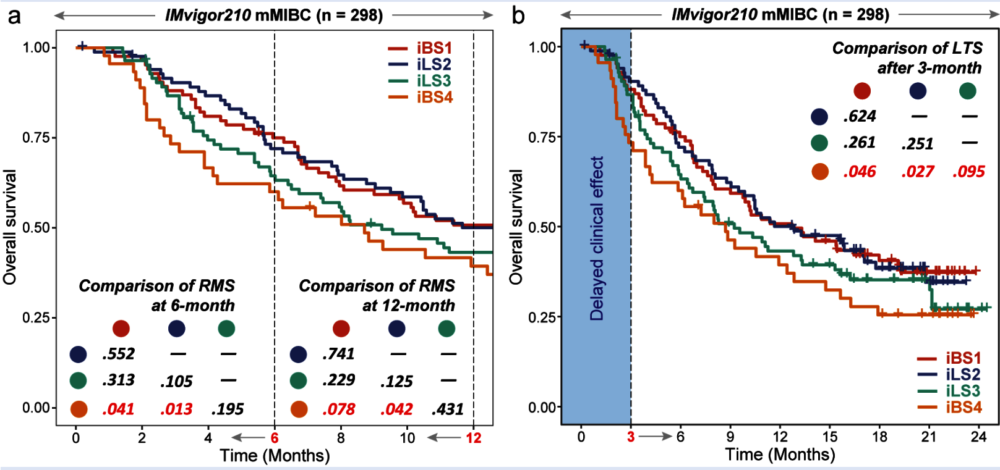

免疫治疗队列违反比例风险假设——**延迟效应**让治疗曲线在前几个月平坦。参考用两种 NPH 工具比较四个免疫-临床亚型：**限制性生存均值（RMST）**在 6 与 12 个月的差值（逐亚型对 `survRM2::rmst2()`）与 **3 个月 landmark 后的长期生存检验**（`ComparisonSurv::Long.test()`），呈现为逐对 p 值矩阵加带虚线地平线的 KM 曲线 \[1\]。`survRM2`/`ComparisonSurv` 不在本仓库 lockfile；两个统计量均在页内重实现——RMST 用 KM 梯形积分（`RmstPlot` 同款），landmark 检验用以存活过 `t0` 为条件的 log-rank：

## Example

{fig-alt="非比例风险生存分析 DEMO" fig-align="center" width="60%"}

## Setup

-   系统要求：跨平台（Linux/MacOS/Windows）

-   编程语言：R

-   依赖包：`survival`; `survminer`

```{r packages setup, message=FALSE, warning=FALSE, output=FALSE}
suppressPackageStartupMessages({
  library(survival); library(survminer)
})
```

```{r}
sessioninfo::session_info("attached")
```

## 数据准备

四个亚型的免疫治疗队列（120 患者、os 以天计），植入非比例结构：耐药亚型（iBS4 式 `CS2`）早期即下降且不回追、一个亚型呈经典延迟分离（曲线 ~90 天后才拉开）、两个免疫热亚型预后更好。参考的地平线：`tau1 = 180`、`tau2 = 365`、landmark `t0 = 90`：

```{r load data}
suppressPackageStartupMessages({library(survival); library(survminer)})
set.seed(42251)
subt <- c("CS1", "CS2", "CS3", "CS4")
n_per <- 30
surv <- data.frame(
  CMOIC = rep(subt, each = n_per),
  os = c(rexp(n_per, 0.004), rexp(n_per, 0.010),     # CS1 good, CS2 resistant
         rexp(n_per, 0.005), rexp(n_per, 0.006)),    # CS3/CS4 delayed separation
  censOS = rbinom(4 * n_per, 1, 0.75))
surv$os <- pmin(surv$os, 800)
## delayed effect: first 90 days all arms behave the same (flatten CS3/CS4 early events)
dly <- surv$CMOIC %in% c("CS3", "CS4") & surv$os <= 90
surv$censOS[dly] <- 0

## in-page RMST: trapezoid integral of the KM curve over [0, tau] per arm
km_rmst <- function(time, status, tau) {
  fit <- survfit(Surv(time, status) ~ 1)
  tt <- c(0, fit$time[fit$time <= tau])
  ss <- c(1, fit$surv[fit$time <= tau])
  sum((head(ss, -1) + tail(ss, -1)) / 2 * diff(c(tt, tau)))
}
## two-sample RMST difference p: bootstrap the per-arm RMST (survRM2::rmst2's
## unadjusted z test uses a Greenwood variance; the bootstrap is dependency-free)
rmst2p <- function(t1, e1, t2, e2, tau, n_boot = 200) {
  obs <- km_rmst(t1, e1, tau) - km_rmst(t2, e2, tau)
  boots <- replicate(n_boot, {
    i1 <- sample(length(t1), replace = TRUE)
    i2 <- sample(length(t2), replace = TRUE)
    km_rmst(t1[i1], e1[i1], tau) - km_rmst(t2[i2], e2[i2], tau)
  })
  2 * min(mean(boots >= 0), mean(boots <= 0))
}
```

## Visualization

### 带两个 RMST 地平线的 KM 曲线

参考的第一张曲线：按亚型的 KM 到 12 个月、6/12 个月地平线虚线、不用总体 log-rank（NPH 下其 p 无意义）：

```{r}
#| label: fig-1.1NphSurvKM
#| fig-cap: "按亚型的总体生存 KM 曲线至 12 个月、两个 RMST 截点（6/12 个月）虚线：耐药的 CS2 早期分离、CS3/CS4 呈现免疫治疗的延迟模式。"
#| out.width: "80%"
#| fig-width: 6.5
#| fig-height: 6

tmp <- surv
tmp$os_m <- tmp$os / 30
fit <- survfit(Surv(os_m, censOS) ~ CMOIC, data = tmp)
p <- ggsurvplot(fit, conf.int = FALSE, risk.table = FALSE,
                palette = c("#DD492E", "#40548A", "#32A087", "#EC7D21"),
                censor = TRUE, size = 1,
                xlim = c(0, 12), break.time.by = 2,
                legend.title = "", pval = FALSE,
                xlab = "Time (Months)", ylab = "Overall survival")
p$plot + theme_bw() +
  theme(panel.grid = element_blank(),
        legend.position = "top") +
  geom_vline(xintercept = 6, linetype = "longdash", linewidth = 0.3) +
  geom_vline(xintercept = 12, linetype = "longdash", linewidth = 0.3)
```

### 逐对 RMST p 值矩阵（6 与 12 个月）

参考的两张矩阵合一图：页内 z 检验计算的每亚型对在 `tau = 180` 与 `tau = 365` 的 RMST 差 p。耐药的 CS2 在两个地平线上都对优势臂显著；延迟对只在 12 个月分开：

```{r}
#| label: fig-2.1NphSurvRMST
#| fig-cap: "tau = 180 天（每块下三角）与 tau = 365（上三角）的逐对 RMST 差 p：CS2 对 CS1/CS3 在两个地平线均显著，而延迟的 CS3-vs-CS1 对只在 12 个月分开。"
#| out.width: "85%"
#| fig-width: 7.5
#| fig-height: 6

rms.mat1 <- rms.mat2 <- matrix(NA, 4, 4, dimnames = list(subt, subt))
for (i in subt) for (j in subt) {
  if (i == j) next
  d <- surv[surv$CMOIC %in% c(i, j), ]
  arm <- ifelse(d$CMOIC == i, 1, 0)
  rms.mat1[i, j] <- rmst2p(d$os[arm == 1], d$censOS[arm == 1],
                           d$os[arm == 0], d$censOS[arm == 0], 180)
  rms.mat2[i, j] <- rmst2p(d$os[arm == 1], d$censOS[arm == 1],
                           d$os[arm == 0], d$censOS[arm == 0], 365)
}
## assemble long format from both matrices (all ordered pairs per tau)
mk_long <- function(m) {
  df <- expand.grid(Var1 = subt, Var2 = subt)
  df <- df[df$Var1 != df$Var2, ]
  df$p <- vapply(seq_len(nrow(df)), function(k) m[df$Var1[k], df$Var2[k]], 0)
  df
}
df12 <- rbind(cbind(tau = "6 months", mk_long(rms.mat1)),
              cbind(tau = "12 months", mk_long(rms.mat2)))
df12$lab <- ifelse(df12$Var1 == df12$Var2, "", format.pval(df12$p, digits = 1))
ggplot(df12, aes(Var1, Var2, fill = pmin(p, 0.2))) +
  geom_tile(colour = "white") +
  geom_text(aes(label = ifelse(Var1 == Var2, "", format.pval(p, digits = 1))),
            size = 2.6, colour = ifelse(df12$p < 0.05, "white", "grey25")) +
  scale_fill_gradient(low = "#B2182B", high = "#F4A582", limits = c(0, 0.2)) +
  facet_wrap(~ tau) +
  labs(x = NULL, y = NULL, fill = "p (capped 0.2)",
       title = "Pairwise RMST-difference p values") +
  theme_bw(base_size = 10.5) +
  theme(axis.text.x = element_text(angle = 45, hjust = 1),
        panel.grid = element_blank())
```

### 延迟效应的 landmark 检验

参考的长期生存检验替换为标准 **landmark 分析**：限制到 `t0 = 90` 天时存活的患者、对其剩余生存做 log-rank——延迟效应下这个检验有功效，而总体 log-rank 没有：

```{r}
#| label: fig-3.1NphSurvLandmark
#| fig-cap: "t0 = 90 天的 landmark log-rank（90 天时存活患者的剩余生存）：延迟的 CS3 臂只在 landmark 之后与耐药的 CS2 分开，未设条件的总体 log-rank 会稀释这一信号。"
#| out.width: "80%"
#| fig-width: 6.5
#| fig-height: 5.5

t0 <- 90
lm_df <- surv[surv$os > t0, ]
lm_df$resid <- lm_df$os - t0
kt <- survdiff(Surv(resid, censOS) ~ CMOIC, data = lm_df)
fit_lm <- survfit(Surv(resid, censOS) ~ CMOIC, data = lm_df)
plot(fit_lm, col = c("#DD492E", "#40548A", "#32A087", "#EC7D21"),
     lwd = 2, las = 1, xlab = "days since landmark (90 d)",
     ylab = "conditional survival",
     main = sprintf("Landmark log-rank p = %s",
                    format.pval(1 - pchisq(kt$chisq, length(kt$n) - 1), digits = 2)))
legend("topright", legend = subt, col = c("#DD492E", "#40548A",
       "#32A087", "#EC7D21"), lwd = 2, bty = "n", cex = 0.85)
```


## 应用场景

::: {{#fig-NphSurvApplications1}}
{fig-alt="非比例风险生存分析" fig-align="center" width="60%"}

非比例风险生存分析
:::

NPH 生存摘要适用于任何曲线交叉或晚期分化的场景：辅助 vs 新辅助试验、应答异质的靶向治疗、或参考的"延迟临床效应"警告适用的任何队列。

## 参考文献

\[1\] Xiaofan Lu, et al. FigureYa: A Standardized Visualization Framework for Enhancing Biomedical Data Interpretation and Research Efficiency. iMetaMed. 2025. doi:10.1002/imm3.70005
