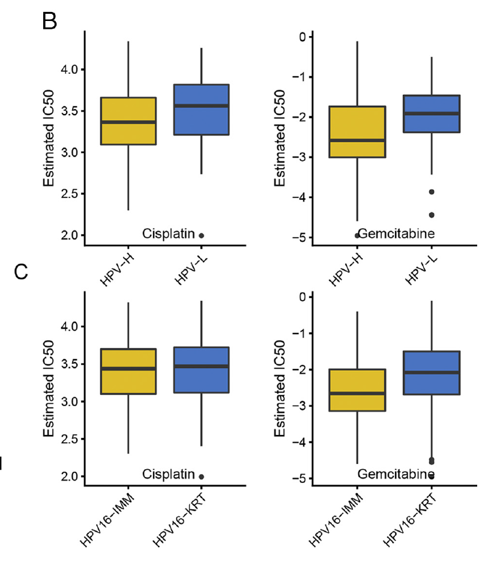

`oncoPredict::calcPhenotype()` trains ridge models on **cell-line expression + measured drug IC50** and applies them to tumour expression to predict every sample's IC50 per drug; the reference then Wilcoxon-tests the predicted IC50s between two immune subtypes (C1 vs C2 of the cervical-cancer cohort) and boxplots the significant drugs \[1\]. The `oncoPredict` package (and its GDSC/CTRP downloads) is not in this repository's lockfile — the ridge-regression prediction itself is re-implemented in-page (~15 lines; the package's added value is data plumbing and ComBat batch correction, described in the prose) — so the whole workflow, prediction through Wilcoxon to boxplots, runs locally:

## Example

{fig-alt="Predicted IC50 Between Subgroups DEMO" fig-align="center" width="75%"}

## Setup

-   System Requirements: Cross-platform (Linux/MacOS/Windows)

-   Programming language: R

-   Dependent packages: `glmnet`; `ggplot2`; `ggpubr`

```{r packages setup, message=FALSE, warning=FALSE, output=FALSE}
suppressPackageStartupMessages({
  library(glmnet); library(ggplot2)
})
```

```{r}
sessioninfo::session_info("attached")
```

## Data Preparation

The three matrices `calcPhenotype` needs, simulated with planted structure: (1) GDSC-like cell-line expression (600 genes × 40 lines), (2) cell-line IC50 (14 drugs, two of them mechanistically tied to the C1/C2 signature difference), (3) tumour expression of 138 samples split into immune clusters C1/C2. The prediction is ridge regression (`glmnet` alpha = 0, lambda picked by internal CV — the same estimator `calcPhenotype` wraps), trained per drug on cell lines and applied to tumours:

```{r load data}
suppressPackageStartupMessages({library(glmnet); library(ggplot2)})
set.seed(42247)
n_gene <- 600; n_ccl <- 40; n_tum <- 138
genes <- sprintf("GENE%03d", 1:n_gene)
ccl.expr <- matrix(rnorm(n_gene * n_ccl, 8, 1.2), n_gene, n_ccl,
                   dimnames = list(genes, sprintf("CL%02d", 1:n_ccl)))
## drugs with a real expression-IC50 relationship
ccl.ic50 <- matrix(runif(14 * n_ccl, 1, 9), 14, n_ccl,
                   dimnames = list(c("SN-38", "Gemcitabine", "Cisplatin", "Paclitaxel",
                                     "Doxorubicin", "Etoposide", "Olaparib", "Sorafenib",
                                     "Sunitinib", "Trametinib", "Everolimus", "Dasatinib",
                                     "Bortezomib", "Venetoclax"), colnames(ccl.expr)))
sig <- sample(genes, 40)
ccl.ic50["SN-38", ] <- ccl.ic50["SN-38", ] + 0.8 * scale(colSums(ccl.expr[sig, ]/40))[, 1]
ccl.ic50["Gemcitabine", ] <- ccl.ic50["Gemcitabine", ] + 0.7 * scale(colSums(ccl.expr[sample(genes, 30), ]/30))[, 1]

## tumours: two immune clusters with different expression of the SN-38 signature
ann <- data.frame(sample = sprintf("CESC-%03d", 1:n_tum),
                  ImmClust = sample(c("C1", "C2"), n_tum, TRUE, prob = c(0.4, 0.6)),
                  row.names = sprintf("CESC-%03d", 1:n_tum))
tum.expr <- matrix(rnorm(n_gene * n_tum, 8, 1.2), n_gene, n_tum,
                   dimnames = list(genes, ann$sample))
tum.expr[sig, ann$ImmClust == "C1"] <- tum.expr[sig, ann$ImmClust == "C1"] + 0.9
```

## Visualization

### 1. The Prediction: Ridge Models per Drug

`calcPhenotype` in miniature: match genes between training and test, fit one ridge model per drug on cell lines, predict tumour IC50s. (`calcPhenotype` additionally ComBat-corrects the two expression matrices first — with microarray training + RNA-seq test it recommends `batchCorrect = "eb"`; the simulated matrices share a scale, so no correction is needed here.)

```{r}
#| label: fig-1.1OncoPredictFit
#| fig-cap: "Ridge prediction of tumour IC50: per-drug models trained on cell lines (top, training-set observed vs fitted) transfer to tumours (bottom, predicted IC50 distribution by immune cluster). SN-38 and Gemcitabine separate C1/C2; the rest stay flat."
#| out.width: "90%"
#| fig-width: 8.5
#| fig-height: 5.6

com_genes <- intersect(rownames(ccl.expr), rownames(tum.expr))
drug_pred <- matrix(NA, nrow(ccl.ic50), n_tum, dimnames = list(rownames(ccl.ic50), ann$sample))
fitted_mat <- matrix(NA, nrow(ccl.ic50), n_ccl, dimnames = list(rownames(ccl.ic50), colnames(ccl.expr)))
for (dg in rownames(ccl.ic50)) {
  y <- ccl.ic50[dg, ]
  fit <- cv.glmnet(t(ccl.expr[com_genes, ]), y, alpha = 0, nfolds = 5)
  fitted_mat[dg, ] <- as.numeric(predict(fit, t(ccl.expr[com_genes, ]), s = "lambda.min"))
  drug_pred[dg, ] <- as.numeric(predict(fit, t(tum.expr[com_genes, ]), s = "lambda.min"))
}
## two-panel check: training fit (SN-38) + tumour predictions by cluster
op <- par(mfrow = c(1, 2), mar = c(4.5, 4.5, 3, 1))
plot(ccl.ic50["SN-38", ], fitted_mat["SN-38", ],
     xlab = "observed IC50 (cell lines)", ylab = "ridge fitted IC50",
     main = "SN-38: training fit", las = 1, pch = 19, col = "#4472C4")
abline(0, 1, lty = 2, col = "grey40")
boxplot(split(drug_pred["SN-38", ], ann$ImmClust[ann$sample %in% colnames(drug_pred)]),
        names = c("C1", "C2"), ylab = "predicted IC50 (SN-38)",
        main = "Tumour predictions", las = 1, col = c("#EABF00", "#2874C5"))
par(op)
```

### 2. Wilcoxon Screen and Boxplots of the Significant Drugs

The reference's downstream: per-drug Wilcoxon between C1/C2, log2FC of mean IC50, and boxplots for the hits — the same three-panel layout as FigureYa105GDSC:

```{r}
#| label: fig-2.1OncoPredictWilcox
#| fig-cap: "Predicted IC50 by immune cluster for the four lowest-Wilcoxon-p drugs: SN-38 and Gemcitabine (planted mechanism) show significant C1 vs C2 differences; the flat drugs stay non-significant. p from Wilcoxon rank-sum, annotated per panel."
#| out.width: "90%"
#| fig-width: 8.5
#| fig-height: 6.4

outTab <- do.call(rbind, lapply(rownames(drug_pred), function(dg) {
  tmp <- data.frame(sen = drug_pred[dg, ], group = ann[ann$sample %in% colnames(drug_pred), "ImmClust"])
  wt <- suppressWarnings(wilcox.test(sen ~ group, data = tmp))
  data.frame(drug = dg, p = wt$p.value,
             log2fc = log2(mean(tmp$sen[tmp$group == "C2"]) / mean(tmp$sen[tmp$group == "C1"])))
}))
outTab <- outTab[order(outTab$p), ]
sig_drugs <- head(outTab$drug, 4)

library(ggpubr)
plot_df <- do.call(rbind, lapply(sig_drugs, function(dg) {
  data.frame(drug = paste0(dg, "\nWilcoxon p = ", format.pval(
    outTab$p[outTab$drug == dg], digits = 2)),
    sen = drug_pred[dg, ], group = ann[ann$sample %in% colnames(drug_pred), "ImmClust"])
}))
ggplot(plot_df, aes(group, sen, fill = group)) +
  geom_boxplot(outlier.shape = NA, alpha = 0.5) +
  geom_point(shape = 21, size = 1.8,
             position = position_jitterdodge(jitter.width = 0.12),
             aes(color = group), alpha = 0.7) +
  scale_fill_manual(values = c(C1 = "#EABF00", C2 = "#2874C5")) +
  scale_color_manual(values = c(C1 = "#EABF00", C2 = "#2874C5")) +
  facet_wrap(~ drug, ncol = 2) +
  xlab(NULL) + ylab("predicted IC50") +
  theme_bw(base_size = 10.5) +
  theme(axis.text.x = element_blank(),
        axis.ticks.x = element_blank(),
        strip.background = element_blank(),
        legend.title = element_blank())
```

::: callout-tip
**Practice tips**

-   `calcPhenotype` writes `calcPhenotype_Output/DrugPredictions.csv` (samples × drugs) — everything downstream of that file is plotting, so the whole analysis survives a package upgrade as long as the file format holds.
-   Match **gene symbols** between training and test before fitting; the function silently intersects them, and an accidental 200-gene overlap produces nonsense predictions with no error.
-   `batchCorrect = "eb"` (ComBat) for microarray-trained models applied to microarray-like data; `"standardize"` when the test set is RNA-seq — the two matrices' scales, not the tumour biology, are the usual source of spurious separation.
-   The package applies its own power transform to IC50: if your response data are already log-scale, `exp()` them first or the transform double-compensates.
-   Screen predicted IC50s with a Wilcoxon **and** report the direction (which cluster is more sensitive); a significant difference without direction is unactionable.
:::

## Application

::: {#fig-OncoPredictApplications1}
{fig-alt="Predicted IC50 Between Subgroups" fig-align="center" width="75%"}

Predicted IC50 between subgroups
:::

The train-on-lines → predict-on-tumours → test-between-groups pipeline works for any subgrouping: immune clusters, mutation classes, or expression quartiles — anywhere a treatment hypothesis needs a tumour-level readout the cohort never measured.

## Reference

\[1\] Xiaofan Lu, et al. FigureYa: A Standardized Visualization Framework for Enhancing Biomedical Data Interpretation and Research Efficiency. iMetaMed. 2025. doi:10.1002/imm3.70005
