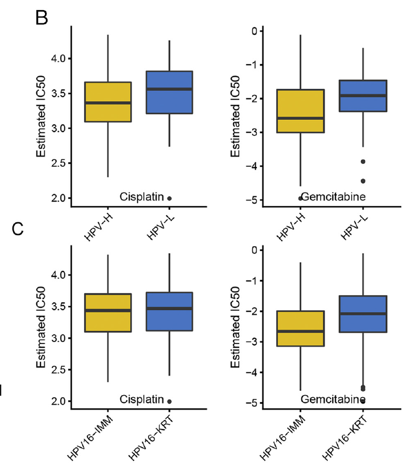

`oncoPredict::calcPhenotype()` 用**细胞系表达 + 实测药物 IC50** 训练岭模型、应用到肿瘤表达谱预测每样本每药物的 IC50；参考文档随后在两个免疫亚型（C1 vs C2）间做 Wilcoxon 检验、箱线图展示显著药物 \[1\]。`oncoPredict` 包（及其 GDSC/CTRP 数据下载）不在本仓库 lockfile——岭回归预测本身在页内重实现（约 15 行；包的增值在数据管线与 ComBat 批次矫正，正文已叙述）——预测到 Wilcoxon 到箱线图整条工作流本地可跑：

## Example

{fig-alt="亚组间预测 IC50 比较 DEMO" fig-align="center" width="60%"}

## Setup

-   系统要求：跨平台（Linux/MacOS/Windows）

-   编程语言：R

-   依赖包：`glmnet`; `ggplot2`; `ggpubr`

```{r packages setup, message=FALSE, warning=FALSE, output=FALSE}
suppressPackageStartupMessages({
  library(glmnet); library(ggplot2)
})
```

```{r}
sessioninfo::session_info("attached")
```

## 数据准备

`calcPhenotype` 需要的三个矩阵，带植入结构模拟：(1) GDSC 式细胞系表达（600 基因 × 40 系）、(2) 细胞系 IC50（14 个药物、其中两个与 C1/C2 签名差异机制绑定）、(3) 138 个肿瘤样本表达按免疫簇 C1/C2 分组。预测是岭回归（`glmnet` alpha = 0、lambda 内部 CV 选取——与 `calcPhenotype` 包装的估计器相同），逐药物在细胞系上训练、应用到肿瘤：

```{r load data}
suppressPackageStartupMessages({library(glmnet); library(ggplot2)})
set.seed(42247)
n_gene <- 600; n_ccl <- 40; n_tum <- 138
genes <- sprintf("GENE%03d", 1:n_gene)
ccl.expr <- matrix(rnorm(n_gene * n_ccl, 8, 1.2), n_gene, n_ccl,
                   dimnames = list(genes, sprintf("CL%02d", 1:n_ccl)))
## drugs with a real expression-IC50 relationship
ccl.ic50 <- matrix(runif(14 * n_ccl, 1, 9), 14, n_ccl,
                   dimnames = list(c("SN-38", "Gemcitabine", "Cisplatin", "Paclitaxel",
                                     "Doxorubicin", "Etoposide", "Olaparib", "Sorafenib",
                                     "Sunitinib", "Trametinib", "Everolimus", "Dasatinib",
                                     "Bortezomib", "Venetoclax"), colnames(ccl.expr)))
sig <- sample(genes, 40)
ccl.ic50["SN-38", ] <- ccl.ic50["SN-38", ] + 0.8 * scale(colSums(ccl.expr[sig, ]/40))[, 1]
ccl.ic50["Gemcitabine", ] <- ccl.ic50["Gemcitabine", ] + 0.7 * scale(colSums(ccl.expr[sample(genes, 30), ]/30))[, 1]

## tumours: two immune clusters with different expression of the SN-38 signature
ann <- data.frame(sample = sprintf("CESC-%03d", 1:n_tum),
                  ImmClust = sample(c("C1", "C2"), n_tum, TRUE, prob = c(0.4, 0.6)),
                  row.names = sprintf("CESC-%03d", 1:n_tum))
tum.expr <- matrix(rnorm(n_gene * n_tum, 8, 1.2), n_gene, n_tum,
                   dimnames = list(genes, ann$sample))
tum.expr[sig, ann$ImmClust == "C1"] <- tum.expr[sig, ann$ImmClust == "C1"] + 0.9
```

## Visualization

### 预测：逐药物岭模型

微型 `calcPhenotype`：训练/测试间匹配基因、逐药物在细胞系上拟合岭模型、预测肿瘤 IC50（`calcPhenotype` 会先对两张表达矩阵做 ComBat——芯片训练 + RNA-seq 测试推荐 `batchCorrect = "eb"`；模拟矩阵共享尺度、此处无需矫正）：

```{r}
#| label: fig-1.1OncoPredictFit
#| fig-cap: "肿瘤 IC50 岭预测：细胞系上逐药物模型（上，训练集观测 vs 拟合）迁移到肿瘤（下，按免疫簇分布的预测 IC50）。SN-38 与 Gemcitabine 分开 C1/C2；其余药物平坦。"
#| out.width: "90%"
#| fig-width: 8.5
#| fig-height: 5.6

com_genes <- intersect(rownames(ccl.expr), rownames(tum.expr))
drug_pred <- matrix(NA, nrow(ccl.ic50), n_tum, dimnames = list(rownames(ccl.ic50), ann$sample))
fitted_mat <- matrix(NA, nrow(ccl.ic50), n_ccl, dimnames = list(rownames(ccl.ic50), colnames(ccl.expr)))
for (dg in rownames(ccl.ic50)) {
  y <- ccl.ic50[dg, ]
  fit <- cv.glmnet(t(ccl.expr[com_genes, ]), y, alpha = 0, nfolds = 5)
  fitted_mat[dg, ] <- as.numeric(predict(fit, t(ccl.expr[com_genes, ]), s = "lambda.min"))
  drug_pred[dg, ] <- as.numeric(predict(fit, t(tum.expr[com_genes, ]), s = "lambda.min"))
}
## two-panel check: training fit (SN-38) + tumour predictions by cluster
op <- par(mfrow = c(1, 2), mar = c(4.5, 4.5, 3, 1))
plot(ccl.ic50["SN-38", ], fitted_mat["SN-38", ],
     xlab = "observed IC50 (cell lines)", ylab = "ridge fitted IC50",
     main = "SN-38: training fit", las = 1, pch = 19, col = "#4472C4")
abline(0, 1, lty = 2, col = "grey40")
boxplot(split(drug_pred["SN-38", ], ann$ImmClust[ann$sample %in% colnames(drug_pred)]),
        names = c("C1", "C2"), ylab = "predicted IC50 (SN-38)",
        main = "Tumour predictions", las = 1, col = c("#EABF00", "#2874C5"))
par(op)
```

### Wilcoxon 筛选与显著药物箱线图

参考的下游：逐药物 C1/C2 Wilcoxon、平均 IC50 的 log2FC、显著药物箱线图——与 FigureYa105GDSC 相同的三面板版式：

```{r}
#| label: fig-2.1OncoPredictWilcox
#| fig-cap: "按免疫簇的预测 IC50（Wilcoxon p 最低的四个药物）：植入机制的 SN-38 与 Gemcitabine 呈现显著 C1 vs C2 差异；平坦药物不显著。p 为 Wilcoxon 秩和检验、逐面板标注。"
#| out.width: "90%"
#| fig-width: 8.5
#| fig-height: 6.4

outTab <- do.call(rbind, lapply(rownames(drug_pred), function(dg) {
  tmp <- data.frame(sen = drug_pred[dg, ], group = ann[ann$sample %in% colnames(drug_pred), "ImmClust"])
  wt <- suppressWarnings(wilcox.test(sen ~ group, data = tmp))
  data.frame(drug = dg, p = wt$p.value,
             log2fc = log2(mean(tmp$sen[tmp$group == "C2"]) / mean(tmp$sen[tmp$group == "C1"])))
}))
outTab <- outTab[order(outTab$p), ]
sig_drugs <- head(outTab$drug, 4)

library(ggpubr)
plot_df <- do.call(rbind, lapply(sig_drugs, function(dg) {
  data.frame(drug = paste0(dg, "\nWilcoxon p = ", format.pval(
    outTab$p[outTab$drug == dg], digits = 2)),
    sen = drug_pred[dg, ], group = ann[ann$sample %in% colnames(drug_pred), "ImmClust"])
}))
ggplot(plot_df, aes(group, sen, fill = group)) +
  geom_boxplot(outlier.shape = NA, alpha = 0.5) +
  geom_point(shape = 21, size = 1.8,
             position = position_jitterdodge(jitter.width = 0.12),
             aes(color = group), alpha = 0.7) +
  scale_fill_manual(values = c(C1 = "#EABF00", C2 = "#2874C5")) +
  scale_color_manual(values = c(C1 = "#EABF00", C2 = "#2874C5")) +
  facet_wrap(~ drug, ncol = 2) +
  xlab(NULL) + ylab("predicted IC50") +
  theme_bw(base_size = 10.5) +
  theme(axis.text.x = element_blank(),
        axis.ticks.x = element_blank(),
        strip.background = element_blank(),
        legend.title = element_blank())
```


## 应用场景

::: {{#fig-OncoPredictApplications1}}
{fig-alt="亚组间预测 IC50 比较" fig-align="center" width="60%"}

亚组间预测 IC50 比较
:::

细胞系训练→肿瘤预测→组间检验的管线适用于任何分组：免疫簇、突变类、表达分位——凡治疗假设需要队列从未测过的肿瘤层面读数处。

## 参考文献

\[1\] Xiaofan Lu, et al. FigureYa: A Standardized Visualization Framework for Enhancing Biomedical Data Interpretation and Research Efficiency. iMetaMed. 2025. doi:10.1002/imm3.70005
