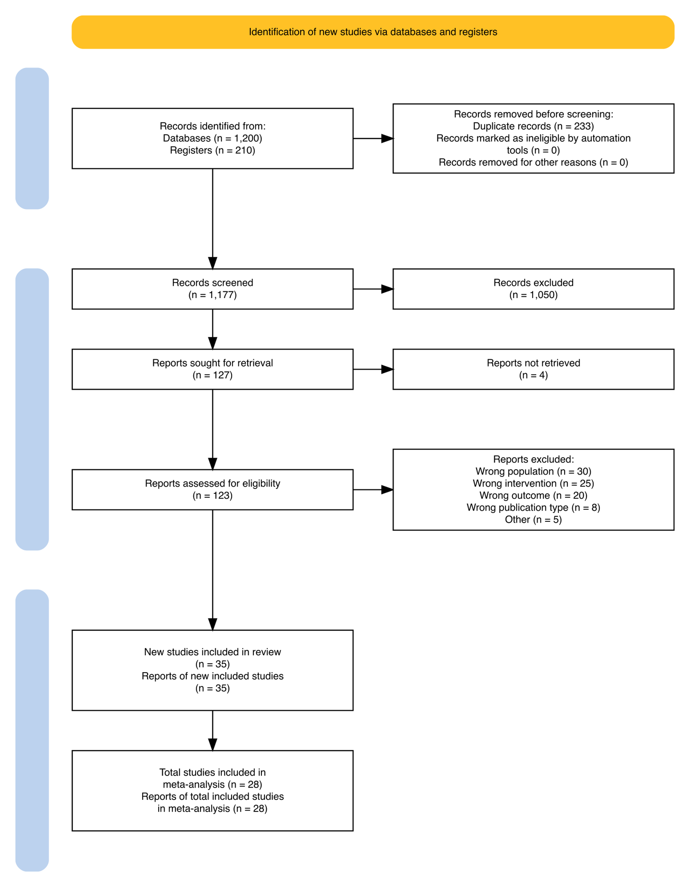
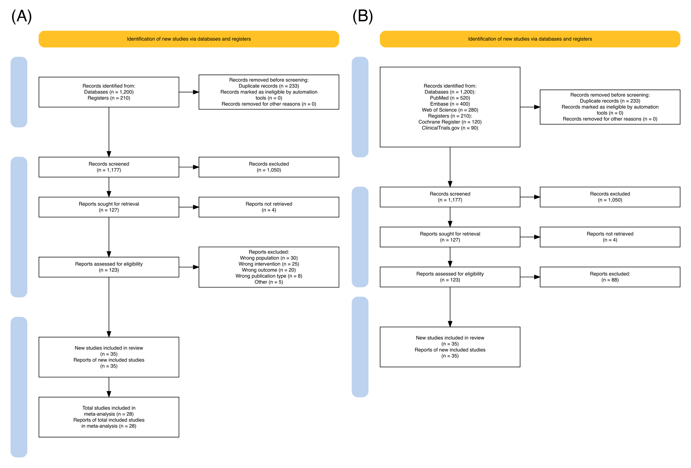

Every systematic review and meta-analysis must report **how many records were identified, screened, excluded, and finally included** — the PRISMA 2020 flow diagram \[1\]. It has two columns of boxes: identification and screening of records through databases and registers (new studies), plus, optionally, studies carried over from a previous version of the review and studies identified via other methods (citations, websites, organisations). Journals increasingly require the 2020 template; a hand-drawn or mismatched diagram is a common desk-rejection factor for review manuscripts.

The `PRISMA2020` R package \[2\] generates a 2020-conformant diagram from a template of counts, with optional interactive tooltips, per-database breakdowns, and a meta-analysis box. Because the diagram is code-generated, the counts can be *verified programmatically* — every stage must reconcile arithmetically with the next — which is exactly the property editors and peer reviewers probe first.

This tutorial covers three workflows:

1. The standard new-review diagram with reconciliation checks;
2. A detailed variant listing specific databases and registers;
3. The interactive version with hover tooltips for publication supplements.

## Example

{fig-alt="PRISMAFlow DEMO" fig-align="center" width="60%"}

## Setup

-   System Requirements: Cross-platform (Linux/MacOS/Windows)

-   Programming language: R

-   Dependent packages: `PRISMA2020` (renders via `DiagrammeR`)

```{r packages setup, message=FALSE, warning=FALSE, output=FALSE}
# Installing necessary packages
if (!requireNamespace("PRISMA2020", quietly = TRUE)) {
  install.packages("PRISMA2020")
}

# Load packages
library(PRISMA2020)
```

```{r}
sessioninfo::session_info("attached")
```

## Data Preparation

The package ships a CSV template whose rows are the diagram's boxes. We read it, override the counts of an example oncology review, and clear the tooltip URLs (used only by the interactive variant). The example flow: 1,200 database records + 210 register records, 233 duplicates removed, 1,177 screened, 1,050 excluded on title/abstract, 127 full texts sought, 4 not retrieved, 123 assessed, 88 excluded with reasons, 35 studies included in the review, of which 28 entered the meta-analysis.

```{r load data, message=FALSE, warning=FALSE}
tpl <- read.csv(system.file("extdata", "PRISMA.csv", package = "PRISMA2020"),
                stringsAsFactors = FALSE)

counts <- c(
  previous_studies = 0, previous_reports = 0,
  database_results = 1200, database_specific_results = 0,
  register_results = 210, register_specific_results = 0,
  website_results = 0, organisation_results = 0, citations_results = 0,
  duplicates = 233,
  excluded_automatic = 0, excluded_other = 0,
  records_screened = 1177, records_excluded = 1050,
  dbr_sought_reports = 127, dbr_notretrieved_reports = 4,
  other_sought_reports = 0, other_notretrieved_reports = 0,
  dbr_assessed = 123, dbr_excluded = 88,  # reasons enumerated below
  other_assessed = 0, other_excluded = 0,
  new_studies = 35, new_reports = 35,
  total_studies = 35, total_reports = 35,
  total_studies_ma = 28, total_reports_ma = 28
)
for (k in names(counts)) {
  idx <- which(tpl$data == k)
  if (length(idx)) tpl$n[idx] <- as.character(counts[[k]])
}
# Full-text exclusions must be enumerated with reasons (PRISMA 2020);
# format "Reason, count; ..." summing to dbr_excluded
tpl$n[tpl$data == "dbr_excluded"] <-
  "Wrong population, 30; Wrong intervention, 25; Wrong outcome, 20; Wrong publication type, 8; Other, 5"
tpl$url[!is.na(tpl$url)] <- ""   # tooltip hyperlinks: interactive mode only

prisma_counts <- PRISMA_data(tpl)
```

Before drawing, verify that the numbers reconcile — the most common PRISMA reviewer complaint is a diagram whose boxes do not add up \[1\]:

```{r reconcile, message=FALSE, warning=FALSE}
# Reconcile on the raw counts (PRISMA_data() renders numbers for display,
# e.g. "1,177", and is therefore not the place to do arithmetic)
stopifnot(
  counts[["database_results"]] + counts[["register_results"]] - counts[["duplicates"]] == counts[["records_screened"]],
  counts[["records_screened"]] - counts[["records_excluded"]] == counts[["dbr_sought_reports"]],
  counts[["dbr_sought_reports"]] - counts[["dbr_notretrieved_reports"]] == counts[["dbr_assessed"]],
  counts[["dbr_assessed"]] - counts[["dbr_excluded"]] == counts[["new_studies"]]
)
cat("All stages reconcile: 1,200 + 210 - 233 = 1,177 screened;",
    "123 assessed; 35 included; 28 in meta-analysis.\n")
```

## Visualization

### 1. Standard New-Review Diagram

```{r}
#| label: fig-1.1BasicPrisma
#| fig-cap: "PRISMA 2020 flow diagram of a new systematic review, with the meta-analysis box."
#| out.width: "80%"
#| warning: false
#| message: false

p1 <- PRISMA_flowdiagram(prisma_counts,
                         interactive = FALSE,
                         previous = FALSE, other = FALSE,
                         meta_analysis = TRUE,
                         side_boxes = TRUE,
                         fontsize = 9)
p1
```

The two blue side boxes label the review phases (identification, screening, included); the goldenrod title box would announce a previous version of the review if `previous = TRUE`. Counts print inside each box, with removed records branching to the right.

### 2. Detailed Variant: Per-Database Breakdown

Trials and review guidelines often ask *where* records came from. Filling the `database_specific_results` / `register_specific_results` rows and re-plotting with the detail switches lists every source:

```{r}
#| label: fig-2.1DetailedPrisma
#| fig-cap: "Detailed flow diagram listing each database and trial register searched."
#| out.width: "85%"
#| warning: false
#| message: false

tpl_d <- tpl
# Per-source breakdown goes in the n column of the *_specific_results rows,
# formatted "Name, count; Name, count"
tpl_d$n[tpl_d$data == "database_specific_results"] <- "PubMed, 520; Embase, 400; Web of Science, 280"
tpl_d$n[tpl_d$data == "register_specific_results"] <- "Cochrane Register, 120; ClinicalTrials.gov, 90"
prisma_detailed <- PRISMA_data(tpl_d)

p2 <- PRISMA_flowdiagram(prisma_detailed,
                         interactive = FALSE,
                         previous = FALSE, other = FALSE,
                         detail_databases = TRUE,
                         detail_registers = TRUE,
                         meta_analysis = FALSE,
                         side_boxes = TRUE,
                         fontsize = 9)
p2
```

The per-source entries inherit the `Name, count` pairs above — replace them with the sources actually searched in your review, keeping the same `Name, count; ...` format.

### 3. Interactive Version with Tooltips

```{r}
#| label: fig-3.1InteractivePrisma
#| fig-cap: "Interactive rendering: hovering a box shows its definition and the count it carries."
#| out.width: "85%"
#| warning: false
#| message: false

p3 <- PRISMA_flowdiagram(prisma_counts,
                         interactive = TRUE,
                         previous = FALSE, other = FALSE,
                         meta_analysis = TRUE,
                         side_boxes = TRUE,
                         fontsize = 9)
p3
```

In the rendered HTML page the boxes respond to hover, which makes the diagram self-documenting for readers of the online supplement; the exported PDF version of the same diagram remains fully static.

::: callout-tip
## Practice tips

-   Reconcile counts *programmatically* (as in Data Preparation) before submission: identified − duplicates = screened; screened − excluded = sought; assessed − excluded = included.
-   Report excluded full texts *with reasons* — if more than a handful of exclusion reasons apply, the 2020 statement expects them enumerated (the template's `dbr_excluded` row).
-   Set `previous = TRUE` only for updated reviews; misuse produces a diagram that no longer matches the 2020 template.
:::

## Application

PRISMA flow diagrams appear in every systematic review manuscript, registered protocols (PROSPERO updates), and living reviews that refresh the search over time. The panel below mirrors a typical publication layout: (A) the standard new-review diagram and (B) the detailed per-database variant.

{fig-alt="PRISMAFlow Application" fig-align="center" width="60%"}

## Reference

\[1\] Page MJ, McKenzie JE, Bossuyt PM, et al. The PRISMA 2020 statement: an updated guideline for reporting systematic reviews. BMJ. 2021;372:n71. doi:10.1136/bmj.n71

\[2\] Haddaway NR, Page MJ, Pritchard CC, McGuinness LA. PRISMA2020: An R package and Shiny app for producing PRISMA 2020-compliant flow diagrams, with interactivity for optimised digital transparency and Open Synthesis. Campbell Syst Rev. 2022;18(2):e1230. doi:10.1002/cl2.1230
