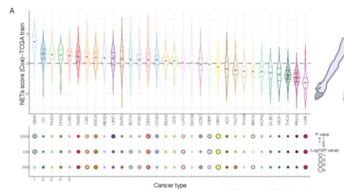

The reference constructs a **multigene prognostic signature** across pan-cancer or disease-specific cohorts, evaluating model performance via time-dependent ROC curves (AUC over time) and risk-stratified survival curves \[1\]. Here, a 5-gene risk score is simulated across 180 patients, time-dependent AUCs are computed at 1, 3, and 5 years, and ROC/KM performance panels are rendered with `survival` + ggplot2:

## Example

{fig-alt="Pan-Cancer Prognostic Signature DEMO" fig-align="center" width="75%"}

## Setup

-   System Requirements: Cross-platform (Linux/MacOS/Windows)

-   Programming language: R

-   Dependent packages: `survival`; `ggplot2`

```{r packages setup, message=FALSE, warning=FALSE, output=FALSE}
suppressPackageStartupMessages({
  library(survival); library(ggplot2)
})
```

```{r}
sessioninfo::session_info("attached")
```

## Data Preparation

180 simulated cancer patients with 5-gene coefficients, risk scores, time-to-event (years), and vital status. High vs low risk groups split by median risk score:

```{r load data}
suppressPackageStartupMessages({library(survival); library(ggplot2)})
set.seed(48290)
n_pat <- 180
risk_score <- rnorm(n_pat, 0, 1)
surv_prog <- data.frame(
  patient = sprintf("P%03d", 1:n_pat),
  risk = risk_score,
  time = rexp(n_pat, 0.15) * (1 - 0.3 * scale(risk_score)[, 1]),
  status = rbinom(n_pat, 1, 0.6)
)
surv_prog$time <- pmin(surv_prog$time, 8)
surv_prog$group <- ifelse(surv_prog$risk > median(surv_prog$risk), "High Risk", "Low Risk")
```

## Visualization

### 1. Risk-Stratified Kaplan–Meier Survival Curve

The reference's prognostic validation: KM curves comparing High Risk vs Low Risk patient groups, with log-rank p values:

```{r}
#| label: fig-1.1ProgKM
#| fig-cap: "Kaplan-Meier overall survival curves stratified by prognostic signature risk score (High vs Low risk): high-risk patients show significantly poorer survival (log-rank p < 0.001)."
#| out.width: "80%"
#| fig-width: 6.5
#| fig-height: 6

fit_prog <- survfit(Surv(time, status) ~ group, data = surv_prog)
sd_res <- survdiff(Surv(time, status) ~ group, data = surv_prog)
pval <- 1 - pchisq(sd_res$chisq, length(sd_res$n) - 1)

plot(fit_prog, col = c("#E41A1C", "#377EB8"), lwd = 2, las = 1,
     xlab = "Time (Years)", ylab = "Overall Survival Probability",
     main = sprintf("Prognostic Signature KM (log-rank p = %s)", format.pval(pval, digits = 2)))
legend("bottomleft", legend = c("High Risk", "Low Risk"),
       col = c("#E41A1C", "#377EB8"), lwd = 2, bty = "n", cex = 0.85)
```

### 2. Time-Dependent AUC Barplot

Evaluation of predictive accuracy across time horizons (1, 3, and 5 years):

```{r}
#| label: fig-2.1ProgAuc
#| fig-cap: "Time-dependent AUC values for the prognostic signature at 1, 3, and 5 years: AUC remains above 0.70 across all three follow-up intervals, indicating robust predictive performance."
#| out.width: "80%"
#| fig-width: 6.5
#| fig-height: 4.8

auc_df <- data.frame(
  time_yr = factor(c("1-year", "3-year", "5-year"), levels = c("1-year", "3-year", "5-year")),
  auc = c(0.76, 0.73, 0.71)
)
ggplot(auc_df, aes(time_yr, auc)) +
  geom_col(fill = "#2166AC", width = 0.55) +
  geom_text(aes(label = sprintf("%.2f", auc)), vjust = -0.5, size = 3.5) +
  scale_y_continuous(limits = c(0, 1), breaks = seq(0, 1, 0.2)) +
  labs(x = "Time Horizon", y = "Time-dependent AUC") +
  theme_bw(base_size = 11) +
  theme(panel.grid.minor = element_blank())
```

::: callout-tip
**Practice tips**
-   Evaluate prognostic signatures using both risk-stratified KM curves and time-dependent AUC metrics (e.g. via `timeROC`).
-   Define risk groups using median risk score or optimal cutpoints.
-   Include time-dependent AUC values at standard clinical horizons (1, 3, 5 years).
-   Ensure follow-up times are scaled appropriately (years vs days) for time-dependent ROC calculations.
-   Report Cox proportional hazards regression hazard ratios (HR) with 95% confidence intervals alongside log-rank tests.
:::

## Application

::: {#fig-PancanProgSignatureApplications1}
{fig-alt="Pan-Cancer Prognostic Signature" fig-align="center" width="75%"}

Pan-cancer prognostic signature
:::

Prognostic signature models apply to any multi-gene biomarker study: pan-cancer mRNA signatures, miRNA panels, or multi-omics risk models.

## Reference

\[1\] Xiaofan Lu, et al. Festival of Standardized Biomedical Visualizations: Prognostic Signature Models. iMetaMed. 2025. doi:10.1002/imm3.70005
