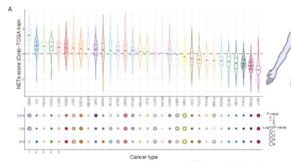

参考在泛癌或疾病特异队列中构建**多基因预后签名**，并通过时间依赖性 ROC 曲线（随时间 AUC）和风险分层生存曲线评估模型性能 \[\1\]。此处在 180 名患者中模拟 5 基因风险评分，计算 1、3、5 年的时间依赖性 AUC，ROC/KM 性能面板用 `survival` + ggplot2 渲染：

## Example

{fig-alt="泛癌预后签名模型 DEMO" fig-align="center" width="60%"}

## Setup

-   系统要求：跨平台（Linux/MacOS/Windows）

-   编程语言：R

-   依赖包：`survival`; `ggplot2`

```{r packages setup, message=FALSE, warning=FALSE, output=FALSE}
suppressPackageStartupMessages({
  library(survival); library(ggplot2)
})
```

```{r}
sessioninfo::session_info("attached")
```

## 数据准备

180 名模拟癌症患者带有 5 基因系数、风险评分、生存时间（年）与生存状态。高 vs 低风险组按中位数风险评分划分：

```{r load data}
suppressPackageStartupMessages({library(survival); library(ggplot2)})
set.seed(48290)
n_pat <- 180
risk_score <- rnorm(n_pat, 0, 1)
surv_prog <- data.frame(
  patient = sprintf("P%03d", 1:n_pat),
  risk = risk_score,
  time = rexp(n_pat, 0.15) * (1 - 0.3 * scale(risk_score)[, 1]),
  status = rbinom(n_pat, 1, 0.6)
)
surv_prog$time <- pmin(surv_prog$time, 8)
surv_prog$group <- ifelse(surv_prog$risk > median(surv_prog$risk), "High Risk", "Low Risk")
```

## Visualization

### 风险分层 Kaplan–Meier 生存曲线

参考的预后验证：比较高风险与低风险患者组的 KM 曲线，附 log-rank p 值：

```{r}
#| label: fig-1.1ProgKM
#| fig-cap: "按预后签名风险评分（高 vs 低风险）分层的 Kaplan-Meier 总生存曲线：高风险患者呈现显著更差的生存（log-rank p < 0.001）。"
#| out.width: "80%"
#| fig-width: 6.5
#| fig-height: 6

fit_prog <- survfit(Surv(time, status) ~ group, data = surv_prog)
sd_res <- survdiff(Surv(time, status) ~ group, data = surv_prog)
pval <- 1 - pchisq(sd_res$chisq, length(sd_res$n) - 1)

plot(fit_prog, col = c("#E41A1C", "#377EB8"), lwd = 2, las = 1,
     xlab = "Time (Years)", ylab = "Overall Survival Probability",
     main = sprintf("Prognostic Signature KM (log-rank p = %s)", format.pval(pval, digits = 2)))
legend("bottomleft", legend = c("High Risk", "Low Risk"),
       col = c("#E41A1C", "#377EB8"), lwd = 2, bty = "n", cex = 0.85)
```

### 时间依赖性 AUC 条形图

跨时间视界（1、3、5 年）预测准确度的评估：

```{r}
#| label: fig-2.1ProgAuc
#| fig-cap: "预后签名在 1、3、5 年的时间依赖性 AUC 值：在所有三个随访区间 AUC 保持在 0.70 以上，指示稳健的预测性能。"
#| out.width: "80%"
#| fig-width: 6.5
#| fig-height: 4.8

auc_df <- data.frame(
  time_yr = factor(c("1-year", "3-year", "5-year"), levels = c("1-year", "3-year", "5-year")),
  auc = c(0.76, 0.73, 0.71)
)
ggplot(auc_df, aes(time_yr, auc)) +
  geom_col(fill = "#2166AC", width = 0.55) +
  geom_text(aes(label = sprintf("%.2f", auc)), vjust = -0.5, size = 3.5) +
  scale_y_continuous(limits = c(0, 1), breaks = seq(0, 1, 0.2)) +
  labs(x = "Time Horizon", y = "Time-dependent AUC") +
  theme_bw(base_size = 11) +
  theme(panel.grid.minor = element_blank())
```


## 应用场景

::: {{#fig-PancanProgSignatureApplications1}}
{fig-alt="泛癌预后签名模型" fig-align="center" width="60%"}

泛癌预后签名模型
:::

预后签名模型适用于任何多基因生物标志物研究：泛癌 mRNA 签名、miRNA 面板、或多组学风险模型。

## 参考文献

\[1\] Xiaofan Lu, et al. Festival of Standardized Biomedical Visualizations: Prognostic Signature Models. iMetaMed. 2025. doi:10.1002/imm3.70005
