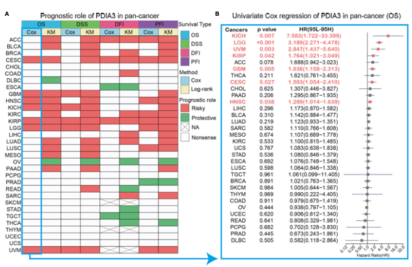

The reference's Fig. 3A: one gene's prognostic value is summarised **simultaneously across four survival endpoints** (OS, DSS, DFI, PFI) and many cancer types, drawn as a triangular heatmap where each tile carries the hazard-ratio direction (red = risk, green = protective) — a far denser readout than a stack of KM panels \[1\]. Univariate Cox regression per cancer × endpoint is run in-page on simulated expression/survival data, and only p < 0.05 tiles are coloured:

## Example

{fig-alt="Pan-Cancer Prognostic Heatmap Across Endpoints DEMO" fig-align="center" width="70%"}

## Setup

-   System Requirements: Cross-platform (Linux/MacOS/Windows)

-   Programming language: R

-   Dependent packages: `survival`; `ComplexHeatmap`; `circlize`; `ggplot2`

```{r packages setup, message=FALSE, warning=FALSE, output=FALSE}
suppressPackageStartupMessages({
  library(survival); library(ComplexHeatmap); library(circlize); library(ggplot2)
})
```

```{r}
sessioninfo::session_info("attached")
```

## Data Preparation

14 cancer types × 4 endpoints (OS, DSS, DFI, PFI), each with a simulated per-patient expression, time and event status. Planted biology: the gene is a **risk factor** in a third of the cancers (HR > 1, red), protective in a quarter (HR < 1, green), and non-significant elsewhere — the sparse-colour pattern the reference shows:

```{r load data}
suppressPackageStartupMessages({
  library(survival); library(ComplexHeatmap); library(circlize); library(ggplot2)
})
set.seed(49299)
cancers <- c("ACC", "BLCA", "BRCA", "COAD", "ESCA", "HNSC", "KIRC",
             "LIHC", "LUAD", "LUSC", "PAAD", "PRAD", "SKCM", "STAD")
endpoints <- c("OS", "DSS", "DFI", "PFI")
risk_pattern <- c(ACC = 1, BLCA = 1, COAD = 1, LIHC = 1, LUAD = 1,
                  PAAD = 1, STAD = 1, BRCA = -1, PRAD = -1, SKCM = -1)

cox_res <- do.call(rbind, lapply(cancers, function(cc) {
  do.call(rbind, lapply(endpoints, function(ep) {
    n <- sample(120:480, 1)
    expr <- rnorm(n, 6, 1.2)
    lp <- if (cc %in% names(risk_pattern)) risk_pattern[[cc]] * 0.5 * scale(expr)[, 1] else 0
    tt <- rexp(n, 0.08 * exp(lp))
    ev <- rbinom(n, 1, 0.65)
    df <- data.frame(expr = expr, time = tt, event = ev)
    fit <- coxph(Surv(time, event) ~ expr, data = df)
    sm <- summary(fit)
    data.frame(cancer = cc, endpoint = ep,
               hr = sm$conf.int["expr", "exp(coef)"],
               p = sm$coefficients["expr", "Pr(>|z|)"])
  }))
}))
cox_res$pct <- pmin(-log10(cox_res$p) * sign(log(cox_res$hr)) / 3, 1.5)
cox_res$pct[cox_res$p >= 0.05] <- 0
```

## Visualization

### 1. The Four-Endpoint Prognostic Heatmap

The reference's Fig. 3A layout: cancers as rows, the four endpoints as columns, tile colour = risk direction scaled by significance, blank tiles for p ≥ 0.05:

```{r}
#| label: fig-1.1PancanSurvHeatmap
#| fig-cap: "Prognostic heatmap of one gene across 14 cancers x 4 survival endpoints: red = risk factor (HR > 1, p < 0.05), green = protective (HR < 1, p < 0.05), white = non-significant; colour intensity scales with -log10(p)."
#| out.width: "80%"
#| fig-width: 7.5
#| fig-height: 7

hc <- array(0, dim = c(length(cancers), length(endpoints)),
            dimnames = list(cancers, endpoints))
for (k in seq_len(nrow(cox_res))) {
  hc[cox_res$cancer[k], cox_res$endpoint[k]] <- cox_res$pct[k]
}
ht <- Heatmap(hc, name = "prognosis\n+risk / -protect",
              col = colorRamp2(c(-1.5, 0, 1.5), c("#1B7837", "white", "#B2182B")),
              cluster_rows = FALSE, cluster_columns = FALSE,
              rect_gp = grid::gpar(col = "grey85", lwd = 1),
              row_names_side = "left",
              row_names_gp = grid::gpar(fontsize = 8),
              column_names_side = "top",
              cell_fun = function(j, i, x, y, w, h, fill) {
                if (abs(hc[i, j]) > 0)
                  grid::grid.text(sprintf("%.1f", exp(cox_res$hr[
                    cox_res$cancer == rownames(hc)[i] &
                      cox_res$endpoint == colnames(hc)[j]])),
                    x, y, gp = grid::gpar(fontsize = 6.2, col = "grey15"))
              })
ht
```

### 2. The Hazard-Ratio Forest Summary

The reference's Fig. 3B in one panel: every cancer's OS hazard ratio with 95% CI, red where the risk direction is significant — the numeric backing for the heatmap's OS column:

```{r}
#| label: fig-2.1PancanSurvForest
#| fig-cap: "OS hazard ratios per cancer with 95% confidence intervals: cancers in the planted risk class sit right of the null line with red markers, the protective class left with green."
#| out.width: "80%"
#| fig-width: 7
#| fig-height: 5.6

os_df <- do.call(rbind, lapply(cancers, function(cc) {
  n <- 300
  expr <- rnorm(n, 6, 1.2)
  lp <- if (cc %in% names(risk_pattern)) risk_pattern[[cc]] * 0.5 * scale(expr)[, 1] else 0
  tt <- rexp(n, 0.08 * exp(lp)); ev <- rbinom(n, 1, 0.65)
  sm <- summary(coxph(Surv(tt, ev) ~ expr, data = data.frame(expr = expr, time = tt, event = ev)))
  data.frame(cancer = cc, hr = sm$conf.int[1, "exp(coef)"],
             lo = sm$conf.int[1, "lower .95"], hi = sm$conf.int[1, "upper .95"],
             p = sm$coefficients[1, "Pr(>|z|)"])
}))
os_df$sig <- os_df$p < 0.05
os_df$cancer <- factor(os_df$cancer, levels = os_df$cancer[order(os_df$hr)])
ggplot(os_df, aes(hr, cancer, colour = sig)) +
  geom_vline(xintercept = 1, linetype = "dashed", colour = "grey45") +
  geom_errorbarh(aes(xmin = lo, xmax = hi), height = 0.22, linewidth = 0.5) +
  geom_point(size = 2.6) +
  scale_colour_manual(values = c(`TRUE` = "#B2182B", `FALSE` = "grey60"),
                      labels = c(`TRUE` = "p < 0.05", `FALSE` = "ns"), name = NULL) +
  scale_x_log10() +
  labs(x = "Hazard ratio (log scale)", y = NULL) +
  theme_bw(base_size = 11) +
  theme(panel.grid.minor = element_blank(), legend.position = "top")
```

::: callout-tip
**Practice tips**

-   Run the Cox model **within each cancer × endpoint cell** — pooling cancers would let inter-cancer baseline differences masquerade as prognostic signal.
-   Colour only p < 0.05 tiles and leave non-significant cells white: a fully coloured heatmap reads as "prognostic everywhere", which is almost never true.
-   Scale the colour by −log10(p) rather than by HR alone, so a marginal 1.02 HR from 1000 patients does not shout louder than a 1.8 HR from 90.
-   Different endpoints have different event rates (DFI rarely has many events in most cancers); an empty DFI column is a data reality, not a bug.
-   Pair the heatmap with the forest plot for one endpoint — the heatmap shows *where*, the forest shows *how much* and with what uncertainty.
:::

## Application

::: {#fig-PancanSurvApplications1}
{fig-alt="Pan-Cancer Prognostic Heatmap Across Endpoints" fig-align="center" width="70%"}

Pan-cancer prognostic heatmap across endpoints
:::

The multi-endpoint prognostic grid applies to any pan-cancer biomarker: a candidate gene's OS/DSS/DFI/PFI profile, a signature score's consistency across cohorts, or a new target's pan-tumour risk direction.

## Reference

\[1\] Xiaofan Lu, et al. FigureYa: A Standardized Visualization Framework for Enhancing Biomedical Data Interpretation and Research Efficiency. iMetaMed. 2025. doi:10.1002/imm3.70005
