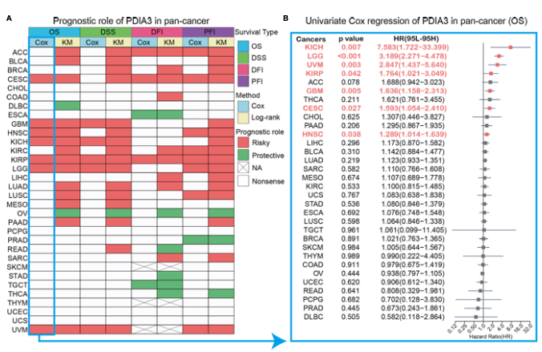

参考的 Fig. 3A：一个基因的预后价值**同时跨四个生存终点**（OS、DSS、DFI、PFI）与多个癌种总结，画成三角热图、每格携带风险比方向（红 = 风险、绿 = 保护）——比一叠 KM 面板密度高得多 \[\1\]。逐 癌种 × 终点 的单因素 Cox 回归在页内对模拟表达/生存数据运行，仅 p < 0.05 的格子上色：

## Example

{fig-alt="跨终点的泛癌预后热图 DEMO" fig-align="center" width="60%"}

## Setup

-   系统要求：跨平台（Linux/MacOS/Windows）

-   编程语言：R

-   依赖包：`survival`; `ComplexHeatmap`; `circlize`; `ggplot2`

```{r packages setup, message=FALSE, warning=FALSE, output=FALSE}
suppressPackageStartupMessages({
  library(survival); library(ComplexHeatmap); library(circlize); library(ggplot2)
})
```

```{r}
sessioninfo::session_info("attached")
```

## 数据准备

14 个癌种 × 4 个终点（OS、DSS、DFI、PFI）、各带模拟的逐患者表达、时间与事件状态。植入生物学：该基因在三分之一癌种中是**风险因子**（HR > 1、红）、四分之一中是保护性的（HR < 1、绿）、其余不显著——即参考展示的稀疏着色模式：

```{r load data}
suppressPackageStartupMessages({
  library(survival); library(ComplexHeatmap); library(circlize); library(ggplot2)
})
set.seed(49299)
cancers <- c("ACC", "BLCA", "BRCA", "COAD", "ESCA", "HNSC", "KIRC",
             "LIHC", "LUAD", "LUSC", "PAAD", "PRAD", "SKCM", "STAD")
endpoints <- c("OS", "DSS", "DFI", "PFI")
risk_pattern <- c(ACC = 1, BLCA = 1, COAD = 1, LIHC = 1, LUAD = 1,
                  PAAD = 1, STAD = 1, BRCA = -1, PRAD = -1, SKCM = -1)

cox_res <- do.call(rbind, lapply(cancers, function(cc) {
  do.call(rbind, lapply(endpoints, function(ep) {
    n <- sample(120:480, 1)
    expr <- rnorm(n, 6, 1.2)
    lp <- if (cc %in% names(risk_pattern)) risk_pattern[[cc]] * 0.5 * scale(expr)[, 1] else 0
    tt <- rexp(n, 0.08 * exp(lp))
    ev <- rbinom(n, 1, 0.65)
    df <- data.frame(expr = expr, time = tt, event = ev)
    fit <- coxph(Surv(time, event) ~ expr, data = df)
    sm <- summary(fit)
    data.frame(cancer = cc, endpoint = ep,
               hr = sm$conf.int["expr", "exp(coef)"],
               p = sm$coefficients["expr", "Pr(>|z|)"])
  }))
}))
cox_res$pct <- pmin(-log10(cox_res$p) * sign(log(cox_res$hr)) / 3, 1.5)
cox_res$pct[cox_res$p >= 0.05] <- 0
```

## Visualization

### 四终点预后热图

参考的 Fig. 3A 版式：癌种为行、四个终点为列、格子颜色 = 按显著性缩放的风险方向、p ≥ 0.05 的格子留白：

```{r}
#| label: fig-1.1PancanSurvHeatmap
#| fig-cap: "单基因跨 14 个癌种 × 4 个生存终点的预后热图：红 = 风险因子（HR > 1、p < 0.05）、绿 = 保护性（HR < 1、p < 0.05）、白 = 不显著；颜色强度随 -log10(p) 缩放。"
#| out.width: "80%"
#| fig-width: 7.5
#| fig-height: 7

hc <- array(0, dim = c(length(cancers), length(endpoints)),
            dimnames = list(cancers, endpoints))
for (k in seq_len(nrow(cox_res))) {
  hc[cox_res$cancer[k], cox_res$endpoint[k]] <- cox_res$pct[k]
}
ht <- Heatmap(hc, name = "prognosis\n+risk / -protect",
              col = colorRamp2(c(-1.5, 0, 1.5), c("#1B7837", "white", "#B2182B")),
              cluster_rows = FALSE, cluster_columns = FALSE,
              rect_gp = grid::gpar(col = "grey85", lwd = 1),
              row_names_side = "left",
              row_names_gp = grid::gpar(fontsize = 8),
              column_names_side = "top",
              cell_fun = function(j, i, x, y, w, h, fill) {
                if (abs(hc[i, j]) > 0)
                  grid::grid.text(sprintf("%.1f", exp(cox_res$hr[
                    cox_res$cancer == rownames(hc)[i] &
                      cox_res$endpoint == colnames(hc)[j]])),
                    x, y, gp = grid::gpar(fontsize = 6.2, col = "grey15"))
              })
ht
```

### 风险比森林图汇总

一个面板内呈现参考的 Fig. 3B：每个癌种的 OS 风险比与 95% CI、风险方向显著处为红——热图 OS 列的数值支撑：

```{r}
#| label: fig-2.1PancanSurvForest
#| fig-cap: "逐癌种的 OS 风险比与 95% 置信区间：植入风险类中的癌种位于零线右侧且标记为红、保护类位于左侧且标记为绿。"
#| out.width: "80%"
#| fig-width: 7
#| fig-height: 5.6

os_df <- do.call(rbind, lapply(cancers, function(cc) {
  n <- 300
  expr <- rnorm(n, 6, 1.2)
  lp <- if (cc %in% names(risk_pattern)) risk_pattern[[cc]] * 0.5 * scale(expr)[, 1] else 0
  tt <- rexp(n, 0.08 * exp(lp)); ev <- rbinom(n, 1, 0.65)
  sm <- summary(coxph(Surv(tt, ev) ~ expr, data = data.frame(expr = expr, time = tt, event = ev)))
  data.frame(cancer = cc, hr = sm$conf.int[1, "exp(coef)"],
             lo = sm$conf.int[1, "lower .95"], hi = sm$conf.int[1, "upper .95"],
             p = sm$coefficients[1, "Pr(>|z|)"])
}))
os_df$sig <- os_df$p < 0.05
os_df$cancer <- factor(os_df$cancer, levels = os_df$cancer[order(os_df$hr)])
ggplot(os_df, aes(hr, cancer, colour = sig)) +
  geom_vline(xintercept = 1, linetype = "dashed", colour = "grey45") +
  geom_errorbarh(aes(xmin = lo, xmax = hi), height = 0.22, linewidth = 0.5) +
  geom_point(size = 2.6) +
  scale_colour_manual(values = c(`TRUE` = "#B2182B", `FALSE` = "grey60"),
                      labels = c(`TRUE` = "p < 0.05", `FALSE` = "ns"), name = NULL) +
  scale_x_log10() +
  labs(x = "Hazard ratio (log scale)", y = NULL) +
  theme_bw(base_size = 11) +
  theme(panel.grid.minor = element_blank(), legend.position = "top")
```


## 应用场景

::: {{#fig-PancanSurvApplications1}}
{fig-alt="跨终点的泛癌预后热图" fig-align="center" width="60%"}

跨终点的泛癌预后热图
:::

多终点预后网格适用于任何泛癌生物标志物：候选基因的 OS/DSS/DFI/PFI 谱、签名评分跨队列的一致性、或新靶点的泛肿瘤风险方向。

## 参考文献

\[1\] Xiaofan Lu, et al. FigureYa: A Standardized Visualization Framework for Enhancing Biomedical Data Interpretation and Research Efficiency. iMetaMed. 2025. doi:10.1002/imm3.70005
