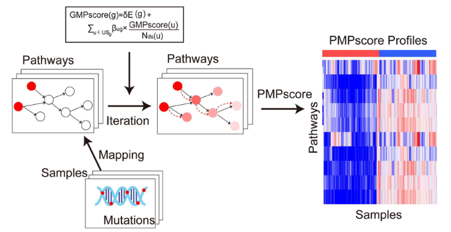

A **weighted pathway-mutation score** (the reference's PMAP idea: a patient's score is the sum of their mutated pathway genes weighted by each gene's prognostic effect, restricted to a curated pathway list) converts sparse per-gene mutation calls into one continuous, testable number per patient \[1\]; the score is then cut at its median and evaluated by Kaplan–Meier and time-dependent ROC. Both steps are re-implemented in-page on simulated mutation/survival data:

## Example

{fig-alt="Decision-Score and Survival After Scoring DEMO" fig-align="center" width="75%"}

## Setup

-   System Requirements: Cross-platform (Linux/MacOS/Windows)

-   Programming language: R

-   Dependent packages: `survival`; `survminer`; `ggplot2`

```{r packages setup, message=FALSE, warning=FALSE, output=FALSE}
suppressPackageStartupMessages({
  library(survival); library(survminer); library(ggplot2)
})
```

```{r}
sessioninfo::session_info("attached")
```

## Data Preparation

180 patients × 120 pathway genes (a KEGG-style pathway panel), with a sparse binary mutation matrix (~8% per gene) and overall survival. A subset of 25 genes carries a planted adverse effect, so the weighted score must separate survival — the property the whole construction exists to deliver:

```{r load data}
suppressPackageStartupMessages({library(survival); library(survminer); library(ggplot2)})
set.seed(50305)
n <- 180
genes <- sprintf("PATH%03d", 1:120)
mut <- matrix(rbinom(length(genes) * n, 1, 0.08), length(genes), n,
              dimnames = list(genes, sprintf("P%03d", 1:n)))

## 25 adverse genes: each mutated patient gets a hazard bump
adverse <- genes[1:25]
w <- setNames(ifelse(genes %in% adverse, runif(length(genes), 0.5, 1.4), 0), genes)
pmap <- colSums(mut * w)
lp <- 0.45 * scale(pmap)[, 1]

surv_df <- data.frame(
  patient = colnames(mut),
  pmap = as.numeric(pmap),
  time = pmin(rexp(n, 0.09 * exp(lp)), 2500),
  status = rbinom(n, 1, 0.7))
surv_df$group <- factor(ifelse(surv_df$pmap > median(surv_df$pmap), "High PMAP", "Low PMAP"),
                        levels = c("Low PMAP", "High PMAP"))
table(surv_df$group)
```

## Visualization

### 1. The Weighted Score Distribution

The reference's first panel: the per-patient weighted pathway-mutation score, sorted, with the median cutoff that defines the high/low groups — the score is sparse (most patients near zero) and long-tailed, which matters for how it is cut:

```{r}
#| label: fig-1.1PmapScoreDist
#| fig-cap: "Distribution of the weighted pathway-mutation score (PMAP) across 180 patients, sorted: most patients carry few mutations so the score is right-skewed; the median splits low from high."
#| out.width: "85%"
#| fig-width: 7.5
#| fig-height: 4.4

srt <- surv_df[order(surv_df$pmap), ]
srt$rank <- seq_len(nrow(srt))
ggplot(srt, aes(rank, pmap, fill = group)) +
  geom_col(width = 1) +
  geom_hline(yintercept = median(surv_df$pmap), linetype = "dashed", colour = "grey30") +
  scale_fill_manual(values = c(`Low PMAP` = "#4472C4", `High PMAP` = "#B2182B"), name = NULL) +
  labs(x = "patients (sorted by score)", y = "PMAP score") +
  theme_bw(base_size = 11) +
  theme(panel.grid.minor = element_blank(), legend.position = "top")
```

### 2. Kaplan–Meier by Score Group

The reference's evaluation: KM curves for high vs low PMAP with the log-rank test — the planted adverse weighting must show up as a clear separation:

```{r}
#| label: fig-2.1PmapScoreKM
#| fig-cap: "Kaplan-Meier overall survival by PMAP group (median split): the high-score group shows significantly worse survival (log-rank p annotated), confirming the weighted adverse genes drive the separation."
#| out.width: "85%"
#| fig-width: 7
#| fig-height: 6

fit <- survfit(Surv(time, status) ~ group, data = surv_df)
ggsurvplot(fit, data = surv_df, pval = TRUE, risk.table = TRUE,
           palette = c("#4472C4", "#B2182B"),
           legend.title = "", xlab = "Time (days)", ylab = "Overall survival",
           ggtheme = theme_bw(base_size = 11))
```

::: callout-tip
**Practice tips**

-   Weight each gene by its **univariate prognostic effect** estimated inside the training cohort; using externally published coefficients without re-estimating imports their cohort's confounders.
-   The score is sparse and right-skewed — report the distribution before cutting it, and prefer a median or a pre-specified quantile over an optimized cutpoint that inflates significance.
-   Restrict the pathway list up front (KEGG pathway membership is a defensible, pre-registered filter); adding pathways after seeing the KM curve is p-hacking with extra steps.
-   Validate the median cutoff and the weights on an independent cohort; a score that only separates in its training set has learned the cohort, not the biology.
-   Report both the log-rank p and a time-dependent AUC — separation and discrimination are different claims.
:::

## Application

::: {#fig-PmapScoreApplications1}
{fig-alt="Decision-Score and Survival After Scoring" fig-align="center" width="75%"}

Decision-score and survival after scoring
:::

Weighted pathway-mutation scores apply to any sparse genomic feature set: pathway-level mutation burden, DNA-repair deficiency panels, or targetable-alteration counts — wherever per-gene calls must be folded into one testable per-patient number.

## Reference

\[1\] Xiaofan Lu, et al. FigureYa: A Standardized Visualization Framework for Enhancing Biomedical Data Interpretation and Research Efficiency. iMetaMed. 2025. doi:10.1002/imm3.70005
