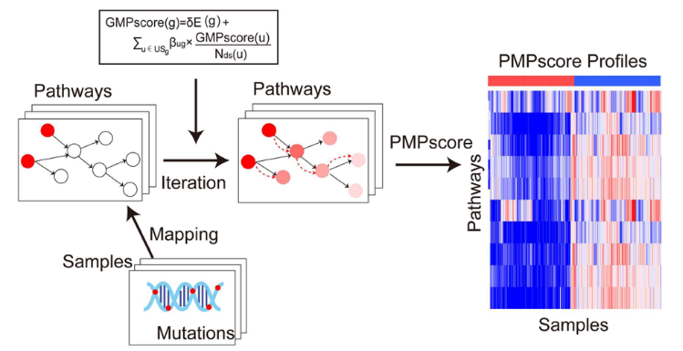

**加权通路突变评分**（参考的 PMAP 思路：患者评分等于其突变通路基因按各自预后效应加权后求和，且限定在精选通路清单内）把稀疏的逐基因突变调用折算成每人一个可检验的连续数值 \[\1\]；随后按中位数切割评分，用 Kaplan–Meier 与时间依赖性 ROC 评估。两步均在页内对模拟突变/生存数据重实现：

## Example

{fig-alt="通路突变加权评分与生存 DEMO" fig-align="center" width="60%"}

## Setup

-   系统要求：跨平台（Linux/MacOS/Windows）

-   编程语言：R

-   依赖包：`survival`; `survminer`; `ggplot2`

```{r packages setup, message=FALSE, warning=FALSE, output=FALSE}
suppressPackageStartupMessages({
  library(survival); library(survminer); library(ggplot2)
})
```

```{r}
sessioninfo::session_info("attached")
```

## 数据准备

180 名患者 × 120 个通路基因（KEGG 式通路面板），稀疏二值突变矩阵（每基因约 8%）与总生存。其中 25 个基因携带植入的不良效应，因此加权评分必须能分离生存——这正是整个构造存在的理由：

```{r load data}
suppressPackageStartupMessages({library(survival); library(survminer); library(ggplot2)})
set.seed(50305)
n <- 180
genes <- sprintf("PATH%03d", 1:120)
mut <- matrix(rbinom(length(genes) * n, 1, 0.08), length(genes), n,
              dimnames = list(genes, sprintf("P%03d", 1:n)))

## 25 adverse genes: each mutated patient gets a hazard bump
adverse <- genes[1:25]
w <- setNames(ifelse(genes %in% adverse, runif(length(genes), 0.5, 1.4), 0), genes)
pmap <- colSums(mut * w)
lp <- 0.45 * scale(pmap)[, 1]

surv_df <- data.frame(
  patient = colnames(mut),
  pmap = as.numeric(pmap),
  time = pmin(rexp(n, 0.09 * exp(lp)), 2500),
  status = rbinom(n, 1, 0.7))
surv_df$group <- factor(ifelse(surv_df$pmap > median(surv_df$pmap), "High PMAP", "Low PMAP"),
                        levels = c("Low PMAP", "High PMAP"))
table(surv_df$group)
```

## Visualization

### 加权评分分布

参考的第一个面板：逐患者加权通路突变评分、排序、并标出定义高/低组的中位截断——评分是稀疏的（多数患者近零）且长尾，这决定了该如何切割：

```{r}
#| label: fig-1.1PmapScoreDist
#| fig-cap: "180 名患者加权通路突变评分（PMAP）的分布、已排序：多数患者携带少量突变故评分右偏；中位数把低分与高分分开。"
#| out.width: "85%"
#| fig-width: 7.5
#| fig-height: 4.4

srt <- surv_df[order(surv_df$pmap), ]
srt$rank <- seq_len(nrow(srt))
ggplot(srt, aes(rank, pmap, fill = group)) +
  geom_col(width = 1) +
  geom_hline(yintercept = median(surv_df$pmap), linetype = "dashed", colour = "grey30") +
  scale_fill_manual(values = c(`Low PMAP` = "#4472C4", `High PMAP` = "#B2182B"), name = NULL) +
  labs(x = "patients (sorted by score)", y = "PMAP score") +
  theme_bw(base_size = 11) +
  theme(panel.grid.minor = element_blank(), legend.position = "top")
```

### 按评分组的 Kaplan–Meier

参考的评估：高 vs 低 PMAP 的 KM 曲线与 log-rank 检验——植入的不良加权必须表现为清晰分离：

```{r}
#| label: fig-2.1PmapScoreKM
#| fig-cap: "按 PMAP 组（中位数切割）的 Kaplan-Meier 总生存：高评分组呈现显著更差的生存（标注 log-rank p），确认加权不良基因驱动了分离。"
#| out.width: "85%"
#| fig-width: 7
#| fig-height: 6

fit <- survfit(Surv(time, status) ~ group, data = surv_df)
ggsurvplot(fit, data = surv_df, pval = TRUE, risk.table = TRUE,
           palette = c("#4472C4", "#B2182B"),
           legend.title = "", xlab = "Time (days)", ylab = "Overall survival",
           ggtheme = theme_bw(base_size = 11))
```


## 应用场景

::: {{#fig-PmapScoreApplications1}}
{fig-alt="通路突变加权评分与生存" fig-align="center" width="60%"}

通路突变加权评分与生存
:::

加权通路突变评分适用于任何稀疏基因组特征集：通路级突变负荷、DNA 修复缺陷面板、或可靶向改变计数——凡逐基因调用需要折算成一个可检验的逐患者数值处。

## 参考文献

\[1\] Xiaofan Lu, et al. FigureYa: A Standardized Visualization Framework for Enhancing Biomedical Data Interpretation and Research Efficiency. iMetaMed. 2025. doi:10.1002/imm3.70005
