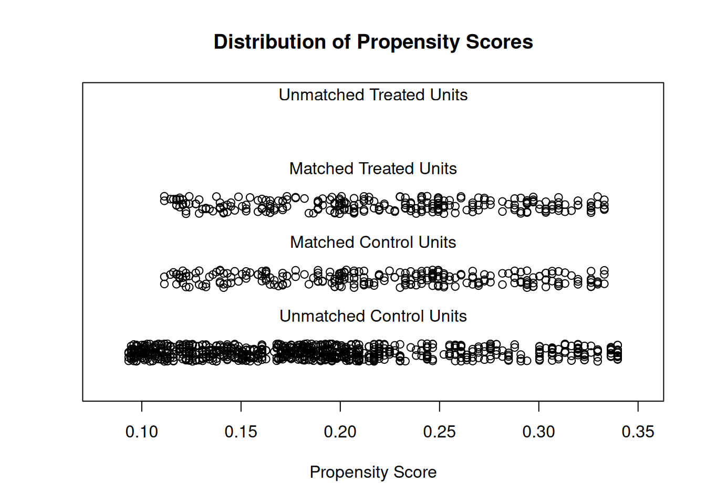

Propensity score matching (PSM) re-balances an observational comparison: each case is paired with the control that has the **nearest propensity score** (here: sex identical, age within 2 years, 1:1 greedy without replacement), so outcome differences can be attributed to the condition rather than the covariates \[1\]. The reference's clinical use-case matches cancer patients to general-population controls by age and sex \[1\]. `MatchIt` is not in this repository's lockfile; the matching — logistic propensity scores, greedy 1:1 nearest-neighbour without replacement — is re-implemented in-page in ~30 lines, with the standard jitter and love-plot diagnostics drawn on ggplot2:

## Example

{fig-alt="Propensity Score Matching DEMO" fig-align="center" width="70%"}

## Setup

-   System Requirements: Cross-platform (Linux/MacOS/Windows)

-   Programming language: R

-   Dependent packages: `ggplot2`

```{r packages setup, message=FALSE, warning=FALSE, output=FALSE}
suppressPackageStartupMessages({
  library(ggplot2)
})
```

```{r}
sessioninfo::session_info("attached")
```

## Data Preparation

250 cancer patients (ages 30-78, 70% male) and 1000 general-population controls (ages 18-80, 50% male), each with an EORTC QLQ-C30-style quality-of-life score. The raw cohorts differ in age and sex mix — exactly the confounding PSM removes:

```{r load data}
suppressPackageStartupMessages({library(ggplot2)})
set.seed(52335)
df.patients <- data.frame(
  Age = sample(30:78, 250, TRUE),
  Sex = sample(c("Male", "Female"), 250, TRUE, prob = c(0.70, 0.30)))
df.patients$Group <- "CASE"
df.patients$ID <- paste0("CASE", seq_len(250))
df.patients$QoL <- 55 - 0.25 * (df.patients$Age - 30) + rnorm(250, 0, 9)

df.population <- data.frame(
  Age = sample(18:80, 1000, TRUE),
  Sex = sample(c("Male", "Female"), 1000, TRUE, prob = c(0.5, 0.5)))
df.population$Group <- "CONTROL"
df.population$ID <- paste0("CONTROL", seq_len(1000))
df.population$QoL <- 60 - 0.25 * (df.population$Age - 30) + rnorm(1000, 0, 9)

mydata <- rbind(df.patients, df.population)
mydata$GroupL <- mydata$Group == "CASE"
```

## Matching (hand-implemented MatchIt equivalent)

Logistic propensity scores, then greedy 1:1 nearest matching **without replacement** inside the same sex with |age difference| ≤ 2:

```{r}
#| label: fig-1.1PsmJitter
#| fig-cap: "Propensity-score distributions before and after matching (left/right panels): before, controls (grey) spread far below the cases (red); after greedy 1:1 nearest matching, the matched controls sit on top of the cases — the covariate overlap PSM restores."
#| out.width: "85%"
#| fig-width: 8
#| fig-height: 5.4

## logistic propensity score
ps_mod <- glm(GroupL ~ Age + Sex, data = mydata, family = binomial)
mydata$ps <- predict(ps_mod, type = "response")

## greedy 1:1 nearest matching without replacement (same sex, |dAge| <= 2)
cases <- which(mydata$GroupL)
ctrl <- which(!mydata$GroupL)
used <- logical(length(ctrl))
pair <- data.frame(case = integer(length(cases)), control = integer(length(cases)))
for (k in seq_along(cases)) {
  cand <- ctrl[!used & mydata$Sex[ctrl] == mydata$Sex[cases[k]] &
                 abs(mydata$Age[ctrl] - mydata$Age[cases[k]]) <= 2]
  if (!length(cand)) next
  best <- cand[which.min(abs(mydata$ps[cand] - mydata$ps[cases[k]]))]
  used[which(ctrl == best)] <- TRUE
  pair$case[k] <- cases[k]; pair$control[k] <- best
}
pair <- pair[pair$case > 0, ]
matched_ctrl <- pair$control
cat("matched pairs:", nrow(pair), "of", length(cases), "cases\n")

jitter_df <- rbind(
  data.frame(set = "Before matching", group = mydata$Group, ps = mydata$ps),
  data.frame(set = "After matching", group = c(rep("CASE", nrow(pair)), rep("CONTROL", nrow(pair))),
             ps = c(mydata$ps[pair$case], mydata$ps[matched_ctrl])))
ggplot(jitter_df, aes(set, ps, colour = group)) +
  geom_jitter(size = 1.2, alpha = 0.4, width = 0.16, height = 0) +
  stat_summary(fun = mean, geom = "crossbar", width = 0.5, linewidth = 0.4) +
  scale_colour_manual(values = c(CASE = "#B2182B", CONTROL = "grey45"), name = NULL) +
  scale_x_discrete(limits = c("Before matching", "After matching")) +
  labs(x = NULL, y = "Propensity score (P(case))") +
  theme_bw(base_size = 11) +
  theme(panel.grid.minor = element_blank(),
        legend.position = "top")
```

### Balance Diagnostics: Love Plot

The standard check: standardized mean differences of Age (and the male share) before vs after matching — matching should pull every covariate under the 0.1 rule-of-thumb line:

```{r}
#| label: fig-2.1PsmLove
#| fig-cap: "Love plot of standardized mean differences: age and male share before matching sit far above the 0.1 rule-of-thumb line, and matching pulls both under it — the covariate balance that licenses an outcome comparison."
#| out.width: "75%"
#| fig-width: 6.5
#| fig-height: 4.8

## SMD between cases and controls (before: all; after: matched pairs only)
smd <- function(x, a, b) abs(mean(x[a]) - mean(x[b])) / sqrt((var(x[a]) + var(x[b])) / 2)
all_case <- which(mydata$Group == "CASE")
all_ctrl <- which(mydata$Group == "CONTROL")
mydata$Male <- as.numeric(mydata$Sex == "Male")
love <- rbind(
  data.frame(covariate = "Age", stage = "before",
             smd = smd(mydata$Age, all_case, all_ctrl)),
  data.frame(covariate = "Male share", stage = "before",
             smd = smd(mydata$Male, all_case, all_ctrl)),
  data.frame(covariate = "Age", stage = "after",
             smd = smd(mydata$Age, pair$case, matched_ctrl)),
  data.frame(covariate = "Male share", stage = "after",
             smd = smd(mydata$Male, pair$case, matched_ctrl)))
ggplot(love, aes(smd, covariate, colour = stage)) +
  geom_vline(xintercept = 0.1, linetype = "dashed", colour = "grey45") +
  geom_point(size = 3.6) +
  geom_line(aes(group = covariate), linewidth = 0.5, colour = "grey60") +
  annotate("text", x = 0.1, y = 1.6, label = "0.1 rule of thumb",
           size = 2.9, colour = "grey45", hjust = -0.06) +
  scale_colour_manual(values = c(before = "#B2182B", after = "#1B7837"), name = NULL) +
  labs(x = "Standardized mean difference", y = NULL) +
  theme_bw(base_size = 11) +
  theme(panel.grid.minor = element_blank(),
        legend.position = "top")
```

::: callout-tip
**Practice tips**
-   Enforce **hard calipers** (same sex, |Δage| ≤ 2 years) *and* the propensity-score nearest rule — a score match that violates a clinically hard constraint is not a valid pair.
-   Match **without replacement** for 1:1 designs; reusing one control inflates the effective sample size and deflates variance.
-   Report the match yield (here ~all cases matched) and drop unmatched cases explicitly — silently keeping them re-introduces the confounding.
-   The **love plot** is the referee: standardised mean differences below 0.1 on every matched covariate is the community rule of thumb before comparing outcomes.
-   Compare outcomes on the matched pairs with a **paired** test — the pairing information from PSM is what buys the statistical power.
:::

## Application

::: {#fig-PsmApplications1}
{fig-alt="Propensity Score Matching" fig-align="center" width="70%"}

Propensity score matching with balance diagnostics
:::

PSM applies to any observational comparison: cancer cohorts vs population references for quality-of-life studies, treated vs untreated registry arms, or device-exposure vs surgical series.

## Reference

\[1\] Xiaofan Lu, et al. FigureYa: A Standardized Visualization Framework for Enhancing Biomedical Data Interpretation and Research Efficiency. iMetaMed. 2025. doi:10.1002/imm3.70005
