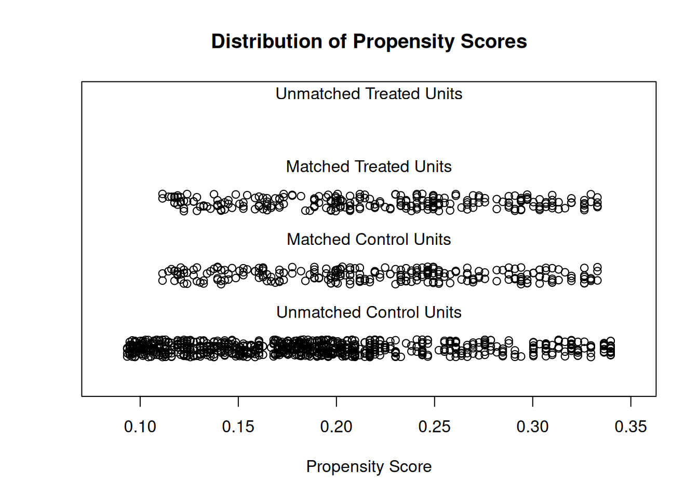

倾向得分匹配（PSM）为观察性比较重新配平：每个病例与**倾向得分最近**的对照配对（此处：性别相同、年龄差 ≤ 2 岁、1:1 贪心不放回），使结局差异可归因于处理而非协变量 \[1\]。参考的临床用例按年龄与性别把癌症患者匹配到一般人群对照 \[1\]。`MatchIt` 不在本仓库 lockfile；匹配——logistic 倾向得分、1:1 贪心最近邻不放回——在页内以约 30 行重实现，标准 jitter 图与 love 图诊断在 ggplot2 上绘制：

## Example

{fig-alt="倾向得分匹配 DEMO" fig-align="center" width="70%"}

## Setup

-   系统要求：跨平台（Linux/MacOS/Windows）

-   编程语言：R

-   依赖包：`ggplot2`

```{r packages setup, message=FALSE, warning=FALSE, output=FALSE}
suppressPackageStartupMessages({
  library(ggplot2)
})
```

```{r}
sessioninfo::session_info("attached")
```

## 数据准备

250 名癌症患者（30-78 岁、70% 男性）与 1000 名一般人群对照（18-80 岁、男女各半），每人带 EORTC QLQ-C30 风格生活质量分数。原始队列在年龄与性别构成上不同——正是 PSM 要移除的混杂：

```{r load data}
suppressPackageStartupMessages({library(ggplot2)})
set.seed(52335)
df.patients <- data.frame(
  Age = sample(30:78, 250, TRUE),
  Sex = sample(c("Male", "Female"), 250, TRUE, prob = c(0.70, 0.30)))
df.patients$Group <- "CASE"
df.patients$ID <- paste0("CASE", seq_len(250))
df.patients$QoL <- 55 - 0.25 * (df.patients$Age - 30) + rnorm(250, 0, 9)

df.population <- data.frame(
  Age = sample(18:80, 1000, TRUE),
  Sex = sample(c("Male", "Female"), 1000, TRUE, prob = c(0.5, 0.5)))
df.population$Group <- "CONTROL"
df.population$ID <- paste0("CONTROL", seq_len(1000))
df.population$QoL <- 60 - 0.25 * (df.population$Age - 30) + rnorm(1000, 0, 9)

mydata <- rbind(df.patients, df.population)
mydata$GroupL <- mydata$Group == "CASE"
```

## 匹配（手写 MatchIt 等价实现）

logistic 倾向得分，然后**不放回**贪心 1:1 最近匹配（同性别、年龄差 ≤ 2）：

```{r}
#| label: fig-1.1PsmJitter
#| fig-cap: "匹配前后倾向得分的分布：匹配前（上）对照（灰）远远散在病例（红）之下；贪心 1:1 最近匹配后（下）被匹配的对照压在病例之上——PSM 恢复的协变量重叠。"
#| out.width: "85%"
#| fig-width: 8
#| fig-height: 5.4

## logistic propensity score
ps_mod <- glm(GroupL ~ Age + Sex, data = mydata, family = binomial)
mydata$ps <- predict(ps_mod, type = "response")

## greedy 1:1 nearest matching without replacement (same sex, |dAge| <= 2)
cases <- which(mydata$GroupL)
ctrl <- which(!mydata$GroupL)
used <- logical(length(ctrl))
pair <- data.frame(case = integer(length(cases)), control = integer(length(cases)))
for (k in seq_along(cases)) {
  cand <- ctrl[!used & mydata$Sex[ctrl] == mydata$Sex[cases[k]] &
                 abs(mydata$Age[ctrl] - mydata$Age[cases[k]]) <= 2]
  if (!length(cand)) next
  best <- cand[which.min(abs(mydata$ps[cand] - mydata$ps[cases[k]]))]
  used[which(ctrl == best)] <- TRUE
  pair$case[k] <- cases[k]; pair$control[k] <- best
}
pair <- pair[pair$case > 0, ]
matched_ctrl <- pair$control
cat("matched pairs:", nrow(pair), "of", length(cases), "cases\n")

jitter_df <- rbind(
  data.frame(set = "Before matching", group = mydata$Group, ps = mydata$ps),
  data.frame(set = "After matching", group = c(rep("CASE", nrow(pair)), rep("CONTROL", nrow(pair))),
             ps = c(mydata$ps[pair$case], mydata$ps[matched_ctrl])))
ggplot(jitter_df, aes(set, ps, colour = group)) +
  geom_jitter(size = 1.2, alpha = 0.4, width = 0.16, height = 0) +
  stat_summary(fun = mean, geom = "crossbar", width = 0.5, linewidth = 0.4) +
  scale_colour_manual(values = c(CASE = "#B2182B", CONTROL = "grey45"), name = NULL) +
  scale_x_discrete(limits = c("Before matching", "After matching")) +
  labs(x = NULL, y = "Propensity score (P(case))") +
  theme_bw(base_size = 11) +
  theme(panel.grid.minor = element_blank(),
        legend.position = "top")
```

### 均衡诊断：Love 图

标准检查：匹配前后年龄（与男性占比）的标准化均数差——匹配应把每个协变量压到 0.1 经验线以下：

```{r}
#| label: fig-2.1PsmLove
#| fig-cap: "标准化均数差的 Love 图：年龄与男性占比在匹配前远高于 0.1 经验线，匹配后都被拉到线以下——可以比较结局的协变量均衡。"
#| out.width: "75%"
#| fig-width: 6.5
#| fig-height: 4.8

smd <- function(x, in_set) {
  a <- x[in_set]; b <- x[!in_set]
  abs(mean(a) - mean(b)) / sqrt((var(a) + var(b)) / 2)
}
before <- rep(FALSE, nrow(mydata)); before[seq_len(250)] <- TRUE
after <- rep(FALSE, nrow(mydata)); after[pair$case] <- TRUE; after[matched_ctrl] <- TRUE
mydata$Male <- as.numeric(mydata$Sex == "Male")
love <- rbind(
  data.frame(covariate = "Age", stage = "before", smd = smd(mydata$Age, before)),
  data.frame(covariate = "Male share", stage = "before", smd = smd(mydata$Male, before)),
  data.frame(covariate = "Age", stage = "after", smd = smd(mydata$Age, after)),
  data.frame(covariate = "Male share", stage = "after", smd = smd(mydata$Male, after)))
ggplot(love, aes(smd, covariate, colour = stage)) +
  geom_vline(xintercept = 0.1, linetype = "dashed", colour = "grey45") +
  geom_point(size = 3.6) +
  geom_line(aes(group = covariate), linewidth = 0.5, colour = "grey60") +
  annotate("text", x = 0.1, y = 1.6, label = "0.1 rule of thumb",
           size = 2.9, colour = "grey45", hjust = -0.06) +
  scale_colour_manual(values = c(before = "#B2182B", after = "#1B7837"), name = NULL) +
  labs(x = "Standardized mean difference", y = NULL) +
  theme_bw(base_size = 11) +
  theme(panel.grid.minor = element_blank(),
        legend.position = "top")
```

::: callout-tip
**实践要点**
-   **硬卡钳**（同性别、年龄差 ≤ 2 岁）与倾向得分最近规则并用——违反临床硬约束的得分匹配不是有效配对。
-   1:1 设计**不放回**匹配；复用同一对照会虚增有效样本量、低估方差。
-   报告匹配产率（此处几乎全部病例匹配）并显式丢弃未匹配病例——悄悄保留它们等于把混杂请回来。
-   **Love 图**是裁判：每个匹配协变量的标准化均数差低于 0.1 才能比较结局。
-   匹配对上的结局用**配对**检验比较——PSM 的配对信息正是统计功效的来源。
:::

## 应用场景

::: {#fig-PsmApplications1}
{fig-alt="倾向得分匹配" fig-align="center" width="70%"}

倾向得分匹配与均衡诊断
:::

PSM 适用于任何观察性比较：癌症队列 vs 一般人群的生活质量研究、登记库的治疗 vs 未治疗臂、或器械暴露 vs 手术系列。

## 参考文献

\[1\] Xiaofan Lu, et al. FigureYa: A Standardized Visualization Framework for Enhancing Biomedical Data Interpretation and Research Efficiency. iMetaMed. 2025. doi:10.1002/imm3.70005
