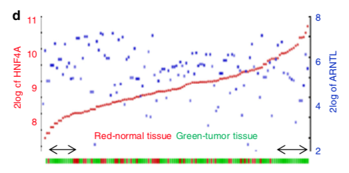

The reference's dual-axis display shows **two genes across one sample ordering**: samples are sorted by gene 1's expression, gene 1 is the left-axis line, gene 2 the right-axis line, and a background band splits samples into immune-high / immune-low halves from an ssGSEA-style score — revealing whether the two genes' expression tracks each other inside the immune contexts \[1\]. The immune matrix and expression data are simulated in-page with planted coupling, and the dual-axis panel runs on ggplot2 with a colour-banded background:

## Example

{fig-alt="Dual-Axis Gene Expression DEMO" fig-align="center" width="70%"}

## Setup

-   System Requirements: Cross-platform (Linux/MacOS/Windows)

-   Programming language: R

-   Dependent packages: `ggplot2`

```{r packages setup, message=FALSE, warning=FALSE, output=FALSE}
suppressPackageStartupMessages({
  library(ggplot2)
})
```

```{r}
sessioninfo::session_info("attached")
```

## Data Preparation

150 samples with an ssGSEA-style immune score and two genes: gene A co-expressed with the immune score (immune-high samples show both high), gene B anti-correlated. Samples are sorted by gene A and split at the median immune score:

```{r load data}
suppressPackageStartupMessages({library(ggplot2)})
set.seed(52343)
n_sam <- 150
immune <- rnorm(n_sam)
geneA <- 6 + 0.9 * immune + rnorm(n_sam, 0, 0.5)
geneB <- 4 - 0.7 * immune + rnorm(n_sam, 0, 0.6)
ord <- order(geneA)
r2_df <- data.frame(
  rank = seq_len(n_sam),
  geneA = geneA[ord],
  geneB = geneB[ord],
  immune = immune[ord])
r2_df$immune_level <- ifelse(r2_df$immune > median(r2_df$immune), "Immune high", "Immune low")
split_rank <- sum(r2_df$immune_level == "Immune low")
```

## Visualization

### 1. Two Genes Across the Immune-Sorted Sample Axis

The reference's dual-axis figure: immune-level background bands, gene A on the left axis (blue line), gene B on the right axis (red line, scaled 4x to share the plot) — gene B steps down as gene A climbs inside the immune-high band:

```{r}
#| label: fig-1.1R2DualAxis
#| fig-cap: "Two genes across samples sorted by gene A (immune-level bands in the background): gene A (left axis, blue) climbs inside the immune-high band while gene B (right axis, red, scaled 4x) declines — the dual-axis design exposes the anti-correlated partner as cleanly as a co-expressed one."
#| out.width: "100%"
#| fig-width: 10
#| fig-height: 5

ggplot(r2_df, aes(rank)) +
  geom_rect(data = data.frame(xmin = 0, xmax = split_rank),
            aes(xmin = xmin, xmax = xmax, ymin = -Inf, ymax = Inf),
            fill = "#DEEBF7", alpha = 0.5, inherit.aes = FALSE) +
  geom_rect(data = data.frame(xmin = split_rank, xmax = n_sam),
            aes(xmin = xmin, xmax = xmax, ymin = -Inf, ymax = Inf),
            fill = "#FCDBDB", alpha = 0.5, inherit.aes = FALSE) +
  geom_line(aes(y = geneA), colour = "#2166AC", linewidth = 0.5) +
  geom_smooth(aes(y = geneA), method = "loess", se = FALSE,
              colour = "#2166AC", linewidth = 1.1) +
  geom_line(aes(y = geneB * 4), colour = "#B2182B", linewidth = 0.5) +
  geom_smooth(aes(y = geneB * 4), method = "loess", se = FALSE,
              colour = "#B2182B", linewidth = 1.1) +
  scale_y_continuous(name = "Gene A expression (log2)",
                     sec.axis = sec_axis(~ . / 4, name = "Gene B expression (log2)")) +
  scale_x_continuous(breaks = c(split_rank / 2, (split_rank + n_sam) / 2),
                     labels = c("Immune low", "Immune high")) +
  annotate("text", x = c(20, n_sam - 20), y = c(1.2, 1.2),
           label = c("Immune low", "Immune high"), size = 3.4, colour = "grey30") +
  labs(x = NULL, title = "Samples sorted by Gene A expression") +
  theme_bw(base_size = 11) +
  theme(axis.text.x = element_blank(),
        axis.ticks.x = element_blank(),
        panel.grid.minor = element_blank())
```

::: callout-tip
**Practice tips**
-   The right axis must be a **documented linear rescale** of the left (`~ . / 4` here) — an unexplained secondary scale is the classic dual-axis deception.
-   Sort samples by **one gene and say which** — the ordering defines the x axis and a different sort rearranges the whole story.
-   The immune high/low split comes from an **independent** score (ssGSEA), not from either plotted gene — otherwise the bands are circular.
-   Add loess trend lines to both series: raw per-sample lines are noisy and the smooth makes the co-movement legible.
-   If the two genes anti-track (one high where the other is low), keep the right-axis scaling positive — flipping it silently disguises the anticorrelation.
:::

## Application

::: {#fig-R2Applications1}
{fig-alt="Dual-Axis Gene Expression" fig-align="center" width="70%"}

Dual-axis gene expression with immune high/low bands
:::

Dual-axis expression panels apply to any two-gene question across a sample ordering: TF and target across subtypes, ligand and receptor across immune contexts, or isoform pairs across developmental stages.

## Reference

\[1\] Xiaofan Lu, et al. FigureYa: A Standardized Visualization Framework for Enhancing Biomedical Data Interpretation and Research Efficiency. iMetaMed. 2025. doi:10.1002/imm3.70005
