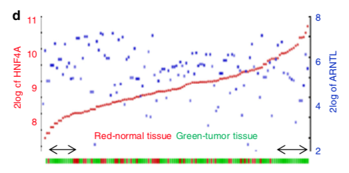

参考的双轴展示在一条样本排序轴上同时呈现**两个基因**：样本按基因 1 的表达排序，基因 1 走左轴、基因 2 走右轴，背景分带按 ssGSEA 式免疫分数把样本切成免疫高/低两半——揭示两个基因的表达是否在各自免疫语境中同步 \[1\]。免疫矩阵与基因表达在页内模拟（植入耦合），双轴面板在 ggplot2 上以颜色分带背景运行：

## Example

{fig-alt="双轴基因表达 DEMO" fig-align="center" width="70%"}

## Setup

-   系统要求：跨平台（Linux/MacOS/Windows）

-   编程语言：R

-   依赖包：`ggplot2`

```{r packages setup, message=FALSE, warning=FALSE, output=FALSE}
suppressPackageStartupMessages({
  library(ggplot2)
})
```

```{r}
sessioninfo::session_info("attached")
```

## 数据准备

150 个样本带 ssGSEA 式免疫分数与两个基因：基因 A 与免疫分数共表达（免疫高样本两者都高）、基因 B 反相关。样本按基因 A 排序并在免疫分数中位数处切分：

```{r load data}
suppressPackageStartupMessages({library(ggplot2)})
set.seed(52343)
n_sam <- 150
immune <- rnorm(n_sam)
geneA <- 6 + 0.9 * immune + rnorm(n_sam, 0, 0.5)
geneB <- 4 - 0.7 * immune + rnorm(n_sam, 0, 0.6)
ord <- order(geneA)
r2_df <- data.frame(
  rank = seq_len(n_sam),
  geneA = geneA[ord],
  geneB = geneB[ord],
  immune = immune[ord])
r2_df$immune_level <- ifelse(r2_df$immune > median(r2_df$immune), "Immune high", "Immune low")
split_rank <- sum(r2_df$immune_level == "Immune low")
```

## Visualization

### 1. 免疫排序样本轴上的双基因

参考的双轴图：免疫水平背景分带、基因 A 走左轴（蓝线）、基因 B 走右轴（红线、按 4 倍缩放共用绘图区）——免疫高分带内基因 B 随基因 A 抬升而下降：

```{r}
#| label: fig-1.1R2DualAxis
#| fig-cap: "按基因 A 排序的样本轴上的两个基因（背景为免疫水平分带）：基因 A（左轴、蓝）在免疫高分带内抬升而基因 B（右轴、红、4 倍缩放）同步下降——双轴设计对反相关伙伴与共表达伙伴同样一目了然。"
#| out.width: "100%"
#| fig-width: 10
#| fig-height: 5

ggplot(r2_df, aes(rank)) +
  geom_rect(data = data.frame(xmin = 0, xmax = split_rank),
            aes(xmin = xmin, xmax = xmax, ymin = -Inf, ymax = Inf),
            fill = "#DEEBF7", alpha = 0.5, inherit.aes = FALSE) +
  geom_rect(data = data.frame(xmin = split_rank, xmax = n_sam),
            aes(xmin = xmin, xmax = xmax, ymin = -Inf, ymax = Inf),
            fill = "#FCDBDB", alpha = 0.5, inherit.aes = FALSE) +
  geom_line(aes(y = geneA), colour = "#2166AC", linewidth = 0.5) +
  geom_smooth(aes(y = geneA), method = "loess", se = FALSE,
              colour = "#2166AC", linewidth = 1.1) +
  geom_line(aes(y = geneB * 4), colour = "#B2182B", linewidth = 0.5) +
  geom_smooth(aes(y = geneB * 4), method = "loess", se = FALSE,
              colour = "#B2182B", linewidth = 1.1) +
  scale_y_continuous(name = "Gene A expression (log2)",
                     sec.axis = sec_axis(~ . / 4, name = "Gene B expression (log2)")) +
  scale_x_continuous(breaks = c(split_rank / 2, (split_rank + n_sam) / 2),
                     labels = c("Immune low", "Immune high")) +
  annotate("text", x = c(20, n_sam - 20), y = c(1.2, 1.2),
           label = c("Immune low", "Immune high"), size = 3.4, colour = "grey30") +
  labs(x = NULL, title = "Samples sorted by Gene A expression") +
  theme_bw(base_size = 11) +
  theme(axis.text.x = element_blank(),
        axis.ticks.x = element_blank(),
        panel.grid.minor = element_blank())
```

::: callout-tip
**实践要点**
-   右轴必须是左轴的**有据线性缩放**（此处 `~ . / 4`）——不解释的次轴是双轴图的经典误导。
-   按**一个基因排序并说明是哪个**——排序定义 x 轴，换一个排序会重排整个故事。
-   免疫高/低切分来自**独立**的分数（ssGSEA），而非两个绘制基因之一——否则分带是循环论证。
-   两条序列都加 loess 趋势线：逐样本的原始线噪声大，平滑让共动关系可读。
-   若两个基因反相（一个高处另一个低），右轴缩放保持正值——悄悄翻转它会掩饰反相关。
:::

## 应用场景

::: {#fig-R2Applications1}
{fig-alt="双轴基因表达" fig-align="center" width="70%"}

双轴基因表达与免疫高/低分带
:::

双轴表达面板适用于任何跨样本排序的双基因问题：跨亚型的 TF 与靶基因、跨免疫语境的配体与受体、或跨发育阶段的异构体对。

## 参考文献

\[1\] Xiaofan Lu, et al. FigureYa: A Standardized Visualization Framework for Enhancing Biomedical Data Interpretation and Research Efficiency. iMetaMed. 2025. doi:10.1002/imm3.70005
