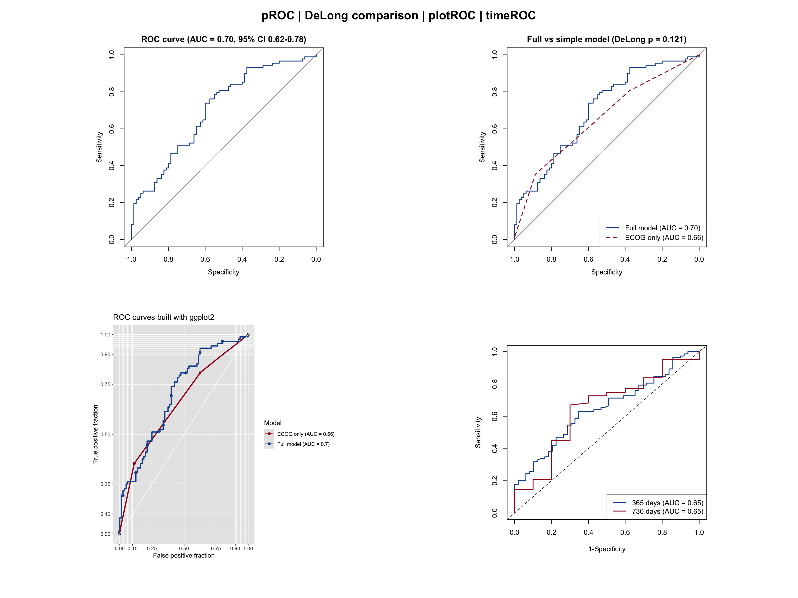
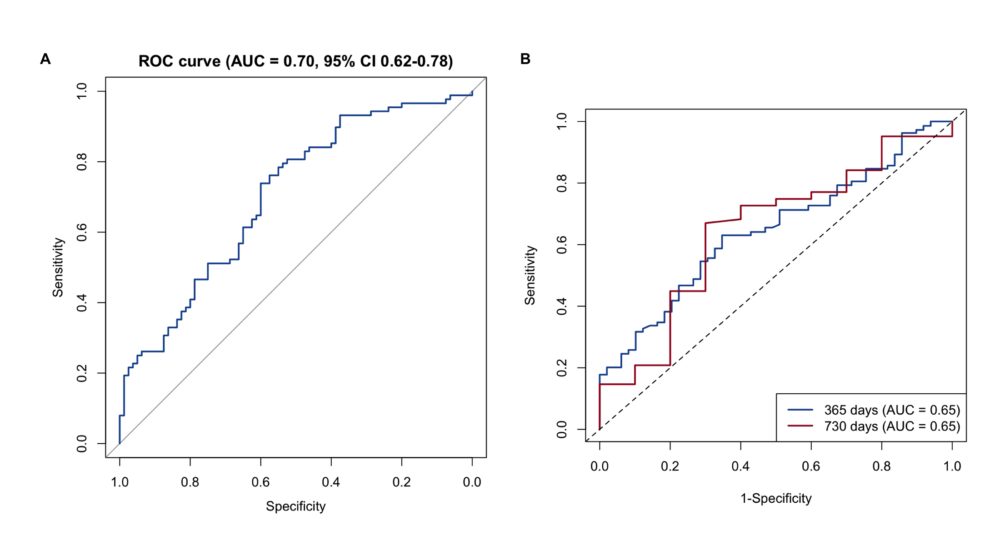

The receiver operating characteristic (ROC) curve evaluates the discrimination of a binary classifier — most commonly a clinical prediction model — across all possible decision thresholds. It plots sensitivity (true-positive rate) against 1 − specificity (false-positive rate), and is summarized by the area under the curve (AUC): 0.5 indicates discrimination no better than chance and 1.0 indicates perfect discrimination. In clinical research, ROC analysis is one of the standard tools for reporting the performance of diagnostic and prognostic models, together with calibration curves and decision curve analysis (see the companion tutorials).

This tutorial covers four practical ROC workflows in R:

1. Basic ROC with AUC and bootstrap confidence interval (`pROC`);
2. Comparing the discrimination of two models with the DeLong test (`pROC`);
3. Publication-style ROC curves with automatically reported AUCs (`plotROC`);
4. Time-dependent ROC for survival outcomes at fixed horizons (`timeROC`).

## Example

{fig-alt="ROCPlot DEMO" fig-align="center" width="60%"}

## Setup

-   System Requirements: Cross-platform (Linux/MacOS/Windows)

-   Programming language: R

-   Dependent packages: `survival`; `dplyr`; `pROC`; `plotROC`; `timeROC`; `ggplot2`; `glmnet`; `survivalROC`

```{r packages setup, message=FALSE, warning=FALSE, output=FALSE}
# Installing necessary packages
if (!requireNamespace("pROC", quietly = TRUE)) {
  install.packages("pROC")
}
if (!requireNamespace("plotROC", quietly = TRUE)) {
  install.packages("plotROC")
}
if (!requireNamespace("timeROC", quietly = TRUE)) {
  install.packages("timeROC")
}
if (!requireNamespace("glmnet", quietly = TRUE)) {
  install.packages("glmnet")
}
if (!requireNamespace("survivalROC", quietly = TRUE)) {
  install.packages("survivalROC")
}

# Load packages
library(survival)
library(dplyr)
library(ggplot2)
library(pROC)
library(plotROC)
library(timeROC)
library(glmnet)
library(survivalROC)
```

```{r}
sessioninfo::session_info("attached")
```

## Data Preparation

We use the built-in `lung` data set from the `survival` package (North Central Cancer Treatment Group lung cancer trial) \[1\]. We define a binary endpoint — death within the first year of follow-up — and fit two logistic models: a full model using five covariates and a simple model using only the ECOG performance score. We also build a Cox model to derive a continuous risk score for the time-dependent ROC analysis.

```{r load data, message=FALSE, warning=FALSE}
# The lung data set ships with the survival package
data(lung, package = "survival")

lung2 <- lung %>%
  filter(complete.cases(age, sex, ph.ecog, ph.karno, pat.karno, meal.cal, wt.loss)) %>%
  mutate(y1y = as.integer(time < 365 & status == 2))  # death within 365 days
  # Caveat: patients censored before day 365 are counted as non-events; for
  # real analyses prefer restricting to >=365 days of follow-up or using
  # censoring-aware methods (cf. the time-dependent ROC below).

cat("Patients:", nrow(lung2), " 1-year deaths:", sum(lung2$y1y), "\n")

# Two logistic models for 1-year mortality
m_full   <- glm(y1y ~ age + sex + ph.ecog + meal.cal + wt.loss,
                data = lung2, family = binomial)
m_simple <- glm(y1y ~ ph.ecog, data = lung2, family = binomial)

# A continuous risk score from a Cox model (used for time-dependent ROC)
cph0 <- coxph(Surv(time, status) ~ age + sex + ph.ecog + wt.loss, data = lung2)
lung2$risk_score <- as.numeric(predict(cph0, type = "risk"))

# Store each model's predicted probability as a column (required by melt_roc)
lung2$risk_full <- fitted(m_full)
lung2$risk_ecog <- fitted(m_simple)
```

## Visualization

### 1. Basic ROC Curve with AUC and Confidence Interval

```{r}
#| label: fig-1.1BasicROC
#| fig-cap: "Basic ROC curve of the full logistic model with AUC and bootstrap 95% CI."
#| out.width: "70%"
#| fig-width: 6
#| fig-height: 6
#| warning: false
#| message: false

roc_full <- roc(lung2$y1y, fitted(m_full), quiet = TRUE)
set.seed(2026)  # keep the bootstrap CI reproducible across renders
ci_full  <- ci.auc(roc_full, method = "bootstrap", boot.n = 1000)

plot(roc_full, col = "#2166AC", lwd = 2,
     main = sprintf("ROC curve (AUC = %.2f, 95%% CI %.2f-%.2f)",
                    as.numeric(auc(roc_full)),
                    ci_full[1], ci_full[3]))
```

The AUC of 0.70 indicates acceptable discrimination of 1-year mortality. The bootstrap confidence interval quantifies the sampling uncertainty of the estimate.

### 2. Comparing Two Models with the DeLong Test

A common question is whether the extra covariates of a full model actually improve discrimination over a simpler model. The DeLong test compares paired ROC curves without resampling.

```{r}
#| label: fig-2.1CompareROC
#| fig-cap: "Full model versus ECOG-only model; the DeLong p-value tests the AUC difference."
#| out.width: "70%"
#| fig-width: 6
#| fig-height: 6
#| warning: false
#| message: false

roc_simple <- roc(lung2$y1y, fitted(m_simple), quiet = TRUE)
roc_test <- roc.test(roc_full, roc_simple, method = "delong")

plot(roc_full, col = "#2166AC", lwd = 2,
     main = sprintf("Full vs simple model (DeLong p = %.3f)", roc_test$p.value))
plot(roc_simple, col = "#B2182B", lwd = 2, lty = 2, add = TRUE)
legend("bottomright",
       legend = c(sprintf("Full model (AUC = %.2f)", auc(roc_full)),
                  sprintf("ECOG only (AUC = %.2f)", auc(roc_simple))),
       col = c("#2166AC", "#B2182B"), lwd = 2, lty = c(1, 2))
```

Here the difference is not statistically significant (p = `r round(roc_test$p.value, 3)`), which cautions against claiming added value from the extra covariates in this small data set.

### 3. Optimal Cutoff Selection

```{r}
#| label: fig-3.1OptimalCutoff
#| fig-cap: "ROC curve with the Youden-index optimal threshold marked."
#| out.width: "70%"
#| fig-width: 6
#| fig-height: 6
#| warning: false
#| message: false

best <- coords(roc_full, x = "best", input = "threshold",
               best.method = "youden", ret = c("threshold", "specificity", "sensitivity"))
print(best)

plot(roc_full, col = "#2166AC", lwd = 2, print.thres = "best",
     print.thres.best.method = "youden",
     main = "ROC curve with Youden-optimal threshold")
```

The Youden index picks the threshold maximizing sensitivity + specificity − 1. Note that a single "optimal" cutoff is context-dependent: clinical consequences (costs of false positives vs false negatives) should guide the choice, e.g. via decision curve analysis.

### 4. Publication-Style ROC with plotROC

```{r}
#| label: fig-4.1PlotROC
#| fig-cap: "ggplot2-based ROC curves with AUCs reported in the legend."
#| out.width: "70%"
#| fig-width: 6
#| fig-height: 6
#| warning: false
#| message: false

longdf <- melt_roc(lung2, d = "y1y", m = c("risk_full", "risk_ecog")) |>
  mutate(name = ifelse(name == "risk_full", "Full model", "ECOG only"))

# Named vectors: match colors/labels to models regardless of level ordering
model_colors <- c("Full model" = "#2166AC", "ECOG only" = "#B2182B")
model_labels <- c("Full model" = paste0("Full model (AUC = ", round(auc(roc_full), 2), ")"),
                  "ECOG only"  = paste0("ECOG only (AUC = ", round(auc(roc_simple), 2), ")"))
ggplot(longdf, aes(d = D, m = M, color = name)) +
  geom_roc(labels = FALSE, linewidth = 1) +
  style_roc(theme = theme_grey()) +
  scale_color_manual(values = model_colors, labels = model_labels, name = "Model") +
  labs(title = "ROC curves built with ggplot2")
```

`melt_roc()` converts the data to long format and `geom_roc()` draws the curves; the AUCs are computed with pROC and reported in the legend.

### 5. Time-Dependent ROC with timeROC

For survival endpoints, standard ROC ignores censoring. Time-dependent ROC evaluates discrimination at a fixed horizon, e.g. 1-year and 2-year mortality predicted by the Cox risk score \[3\].

```{r}
#| label: fig-5.1TimeROC
#| fig-cap: "Time-dependent ROC curves of the Cox risk score at 365 and 730 days."
#| out.width: "70%"
#| fig-width: 6
#| fig-height: 6
#| warning: false
#| message: false

tr <- timeROC(T = as.numeric(lung2$time),
              delta = ifelse(lung2$status == 2, 1, 0),  # 1 = event, 0 = censored
              marker = lung2$risk_score, cause = 1,
              weighting = "marginal",
              times = c(365, 730), ROC = TRUE, iid = TRUE)

plot(tr, time = 365, col = "#2166AC", lwd = 2,
     title = "Time-dependent ROC of the Cox risk score")
plot(tr, time = 730, col = "#B2182B", lwd = 2, add = TRUE)
legend("bottomright",
       legend = sprintf("%d days (AUC = %.2f)", c(365, 730), tr$AUC),
       col = c("#2166AC", "#B2182B"), lwd = 2)
```

Important details: `delta` uses the coding 0 = censored and 1 = event of interest (this is *not* the raw `status` coding of `lung`, where 1 means censored); the risk score is a continuous marker derived from the Cox model. Confidence intervals of the time-dependent AUC are available through `confint(tr)` because `iid = TRUE` was requested.

### 6. Training vs. Validation ROC for a Multi-Biomarker Model

Biomarker-panel papers typically fit the model on a **training set** and re-estimate discrimination on an independent **validation set** \[5\]. If the validation AUC drops markedly, the model overfits; comparing the two curves with a bootstrap `roc.test()` quantifies the difference.

```{r}
#| label: fig-6.1TrainTestROC
#| fig-cap: "ROC of the same model on the training split versus the held-out validation split; the bootstrap p-value tests the AUC difference."
#| out.width: "70%"
#| fig-width: 6
#| fig-height: 6
#| warning: false
#| message: false

set.seed(2026)
idx      <- sample(seq_len(nrow(lung2)), size = floor(0.6 * nrow(lung2)))
train_df <- lung2[idx, ]
test_df  <- lung2[-idx, ]

# Fit the multi-biomarker model on the training split only
m_train    <- glm(y1y ~ age + sex + ph.ecog + wt.loss, data = train_df, family = binomial)
roc_train  <- roc(train_df$y1y, fitted(m_train), quiet = TRUE)
roc_test   <- roc(test_df$y1y, predict(m_train, newdata = test_df, type = "response"),
                  quiet = TRUE)
bt         <- roc.test(roc_train, roc_test, method = "bootstrap", boot.n = 500)

plot(roc_train, col = "#0093FF", lwd = 2, legacy.axes = TRUE,
     main = "Training vs validation ROC")
plot(roc_test, col = "#E43889", lwd = 2, add = TRUE, legacy.axes = TRUE)
legend("bottomright", bty = "n", cex = 0.8, lwd = 2,
       col = c("#0093FF", "#E43889", NA),
       lty = c(1, 1, 0), pch = c(NA, NA, 1),
       legend = c(sprintf("Train (AUC = %.2f)", auc(roc_train)),
                  sprintf("Test  (AUC = %.2f)", auc(roc_test)),
                  sprintf("Bootstrap p = %.3f", bt$p.value)))
```

Here the point estimate drops noticeably on the held-out split, but the bootstrap test does not reach significance (p > 0.05): a validation set of this size yields a noisy AUC estimate, so only large differences are detectable. With a genuinely independent external cohort the comparison becomes far more informative — an in-sample split can only detect within-cohort optimism.

### 7. Building a Consensus Prognostic Signature

Biomarker-discovery papers often need more than a single-model ROC: which *smallest* covariate set carries the prognostic signal? \[6\] The reference workflow is (1) univariate Cox screening, (2) **iterative LASSO** — run `cv.glmnet(family = "cox")` many times and rank variables by selection frequency, because a single run is seed-sensitive — then (3) add variables one by one in frequency order, stopping when the time-dependent AUC peaks. We illustrate with the `lung` clinical covariates standing in for genes:

```{r}
#| label: fig-7.1ConsensusSignature
#| fig-cap: "Consensus signature construction: (A) AUC trajectory as covariates enter in LASSO-frequency order with the peak marked, (B) ROC at the peak, (C) high/low-risk Kaplan-Meier split."
#| out.width: "95%"
#| warning: false
#| message: false
#| fig-width: 11
#| fig-height: 3.8

set.seed(111)
cand <- c("age", "ph.ecog", "ph.karno", "pat.karno", "wt.loss", "meal.cal")

## (1) univariate Cox screening
cox_p <- sapply(cand, function(v) {
  summary(coxph(Surv(time, status == 2) ~ lung2[[v]], data = lung2))$coefficients[, "Pr(>|z|)"]
})
sel <- names(cox_p)[cox_p < 0.2]           # generous screen for this small demo
x_mat <- as.matrix(lung2[, sel])
surv_obj <- Surv(lung2$time, lung2$status == 2)

## (2) iterative LASSO — 20 runs here (the reference uses 500-1000)
surv_lasso <- function(dummy) {
  cvfit <- cv.glmnet(x_mat, surv_obj, nfolds = 10, alpha = 1, family = "cox")
  r <- as.matrix(coef(cvfit, s = "lambda.min"))
  rownames(r)[r != 0]
}
lasso_runs <- lapply(1:20, surv_lasso)
freq <- sort(table(unlist(lasso_runs)), decreasing = TRUE)
genes_freq <- names(freq)                  # variables in consensus order
print(freq)

## (3) add covariates one by one; stop at the time-dependent AUC peak
pred_time <- 365
auc <- c()
roc_list <- list()
for (i in seq_along(genes_freq)) {
  fit_i <- coxph(Surv(time, status == 2) ~ .,
                 data = lung2[, c("time", "status", genes_freq[seq_len(i)])])
  rs <- predict(fit_i, type = "risk")
  sr <- survivalROC::survivalROC(Stime = lung2$time,
                                 status = as.integer(lung2$status == 2),
                                 marker = rs, predict.time = pred_time, method = "KM")
  auc[i] <- sr$AUC
  roc_list[[i]] <- sr
}
best <- which.max(auc)
prog_vars <- genes_freq[seq_len(best)]

## final model, risk split, Kaplan-Meier
fit_f  <- coxph(Surv(time, status == 2) ~ ., data = lung2[, c("time", "status", prog_vars)])
risk   <- predict(fit_f, type = "risk")
lung2$Risk <- ifelse(risk > median(risk), "High", "Low")
fitd   <- survdiff(Surv(time, status == 2) ~ Risk, data = lung2)
p_km   <- 1 - pchisq(fitd$chisq, length(fitd$n) - 1)
fit_km <- survfit(Surv(time, status == 2) ~ Risk, data = lung2)

## three-panel summary (base plots, as in the reference)
red <- "#E94244"; blue <- "#4084BB"
par(mfrow = c(1, 3), mgp = c(2, 0.5, 0), tcl = -0.25)

plot(seq_along(auc), auc, type = "l", lwd = 2, col = blue,
     ylim = range(auc) + c(-0.03, 0.03),
     xlab = "Covariates in LASSO-frequency order", ylab = "AUC at 365 days",
     main = sprintf("(%d covariates)", best))
points(best, auc[best], pch = 16, cex = 1.5, col = red)

plot(roc_list[[best]]$FP, roc_list[[best]]$TP, type = "l", lwd = 2, col = blue,
     xlim = c(0, 1), ylim = c(0, 1), xlab = "1-Specificity", ylab = "Sensitivity",
     main = sprintf("ROC at peak (AUC = %.2f)", auc[best]))
lines(c(0, 1), c(0, 1), lty = 2, col = "grey40")

plot(fit_km, col = c(red, blue), lwd = 1.5, mark.time = TRUE,
     xlab = "Time (days)", ylab = "Overall survival",
     main = sprintf("Risk split (log-rank %s)",
                    ifelse(p_km < 0.001, "p < 0.001", sprintf("p = %.3f", p_km))))
legend("topright", bty = "n", cex = 0.8, lwd = 2,
       col = c(red, blue), legend = c("High risk", "Low risk"))
```

::: callout-tip
**Practice tips**

- The consensus idea matters more than any single run: selection frequency over many LASSO runs is far more stable than one optimal lambda, which flips with the cross-validation folds.
- `survivalROC(..., method = "KM")` gives the censoring-aware AUC at a fixed horizon; `timeROC` (Section 5) is the more modern equivalent with confidence intervals.
- With real expression data the loop stays identical — replace `cand` with gene columns and pass genes-as-rows expression to `cv.glmnet(x = t(expr))`.
:::

### 8. Cross-Cohort AUC Screen (Pairwise AUC)

When a candidate signature is trained on one cohort, its prognostic value must hold in **independent** test cohorts. The pairwise-AUC figure plots each candidate gene by its AUC in cohort 1 (x) versus cohort 2 (y); genes in the top-right box clear the AUC cutoff in *both* cohorts and are the robust hits \[5\].

```{r}
#| label: fig-8.1PairwiseAUC
#| fig-cap: "Cross-cohort AUC screen. (A) each gene plotted by its AUC in cohort 1 vs cohort 2; blue = protein-detected, grey = not detected, red = the gene of interest; the dashed box marks the double-hit region (AUC > 0.6 in both). (B) mean AUC of the hit genes."
#| out.width: "95%"
#| warning: false
#| message: false
#| fig-width: 9
#| fig-height: 4.5

library(patchwork)
set.seed(4302)
n_gene <- 60; n_s <- 90
genes <- paste0("Gene", sprintf("%03d", 1:n_gene))
truth <- sample(n_gene, 12)                    # genes with real prognostic signal

# build one cohort: signal genes carry a class effect, noise genes do not
mk_cohort <- function(coef, sd, seed) {
  set.seed(seed)
  ex <- matrix(rnorm(n_gene * n_s), n_gene)
  cls <- sample(0:1, n_s, replace = TRUE)
  ex[truth, ] <- sweep(ex[truth, ], 2, cls * coef, `+`)
  ex <- ex + rnorm(n_gene * n_s, sd = sd)
  list(ex = ex, cls = cls)
}
c1 <- mk_cohort(1.3, 0.7, 4302)
c2 <- mk_cohort(1.1, 0.8, 4402)

# AUC via the Mann-Whitney rank statistic (equivalent to pROC::roc()$auc)
auc_of <- function(ex, cls) apply(ex, 1, function(g) {
  pos <- g[cls == 1]; neg <- g[cls == 0]
  u <- sum(sapply(pos, function(p) sum(neg < p) + 0.5 * sum(neg == p)))
  u / (length(pos) * length(neg))
})
auc1 <- auc_of(c1$ex, c1$cls); auc2 <- auc_of(c2$ex, c2$cls)
auc_df <- data.frame(gene = genes, auc1 = auc1, auc2 = auc2)
set.seed(4309)
auc_df$detected <- runif(n_gene) > 0.3         # "protein-detected" filter
cutoff <- 0.6
auc_df$hit <- auc_df$auc1 > cutoff & auc_df$auc2 > cutoff & auc_df$detected

pL <- ggplot(auc_df, aes(auc1, auc2)) +
  geom_point(aes(colour = detected), size = 2) +
  scale_colour_manual(values = c(`TRUE` = "#445EAD", `FALSE` = "grey75"),
                      labels = c(`TRUE` = "Protein-detected", `FALSE` = "Not detected"),
                      name = NULL) +
  geom_rect(xmin = cutoff, xmax = max(auc_df$auc1) + 0.02,
            ymin = cutoff, ymax = max(auc_df$auc2) + 0.02,
            fill = NA, colour = "grey40", linetype = "dashed") +
  annotate("point", x = auc_df$auc1[1], y = auc_df$auc2[1],
           colour = "#B2182B", size = 2.5) +
  labs(x = "AUC in cohort 1", y = "AUC in cohort 2", title = "Cross-cohort AUC") +
  theme_classic(base_size = 11) + theme(legend.position = "bottom")

hits <- auc_df[auc_df$hit, ]
hits$gene <- factor(hits$gene, levels = hits$gene[order((hits$auc1 + hits$auc2) / 2)])
pR <- ggplot(hits, aes(reorder(gene, (auc1 + auc2) / 2), (auc1 + auc2) / 2)) +
  geom_col(fill = "#445EAD", width = 0.7) +
  coord_flip() +
  labs(x = NULL, y = "Mean AUC", title = "Hit genes") +
  theme_classic(base_size = 11) + theme(panel.grid.major.y = element_blank())

pL + pR + plot_annotation(tag_levels = "A")
```

::: callout-tip
**Practice tips**

-   The AUC from the Mann-Whitney rank statistic equals `pROC::roc(predictor, response)$auc`; drop-in `pROC` for real cohorts.
-   The grey "not detected" points are a real filter, not decoration: genes without detectable protein in the tissue cannot be biomarkers, so their AUC is excluded from the hit call.
-   Keep the two cohorts genuinely independent (different platforms/institutions); an internal train/test split inflates the double-hit count.
:::

## Application

Time-dependent ROC curves are widely used in oncology prognostic-model papers to report discrimination at clinically meaningful horizons (1, 3, 5 years), often next to calibration curves and decision curve analysis. The panel below mirrors that publication layout with this tutorial's outputs: (A) standard ROC of the binary model and (B) time-dependent ROC at fixed horizons.

{fig-alt="ROCPlot Application" fig-align="center" width="60%"}

## Reference

\[1\] Loprinzi CL, Laurie JA, Wieand HS, et al. Prospective evaluation of prognostic variables from patient-completed questionnaires. North Central Cancer Treatment Group. J Clin Oncol. 1994;12(3):601-607. doi:10.1200/JCO.1994.12.3.601

\[2\] Robin X, Turck N, Hainard A, et al. pROC: an open-source package for R and S+ to analyze and compare ROC curves. BMC Bioinformatics. 2011;12:77. doi:10.1186/1471-2105-12-77

\[3\] Blanche P, Dartigues JF, Jacqmin-Gadda H. Estimating and comparing time-dependent areas under receiver operating characteristic curves for censored event times with competing risks. Stat Med. 2013;32(30):5381-5397. doi:10.1002/sim.5958

\[4\] Sachs MC. plotROC: A Tool for Plotting ROC Curves. J Stat Softw Code Snippets. 2017;79(2):1-12. doi:10.18637/jss.v079.c02

\[5\] Xiaofan Lu, et al. FigureYa: A Standardized Visualization Framework for Enhancing Biomedical Data Interpretation and Research Efficiency. iMetaMed. 2025. doi:10.1002/imm3.70005

\[6\] Seven-gene prognostic signature reference figure: <https://clincancerres.aacrjournals.org/content/18/21/6001> (workflow reproduced by \[5\], FigureYa128Prognostic).
