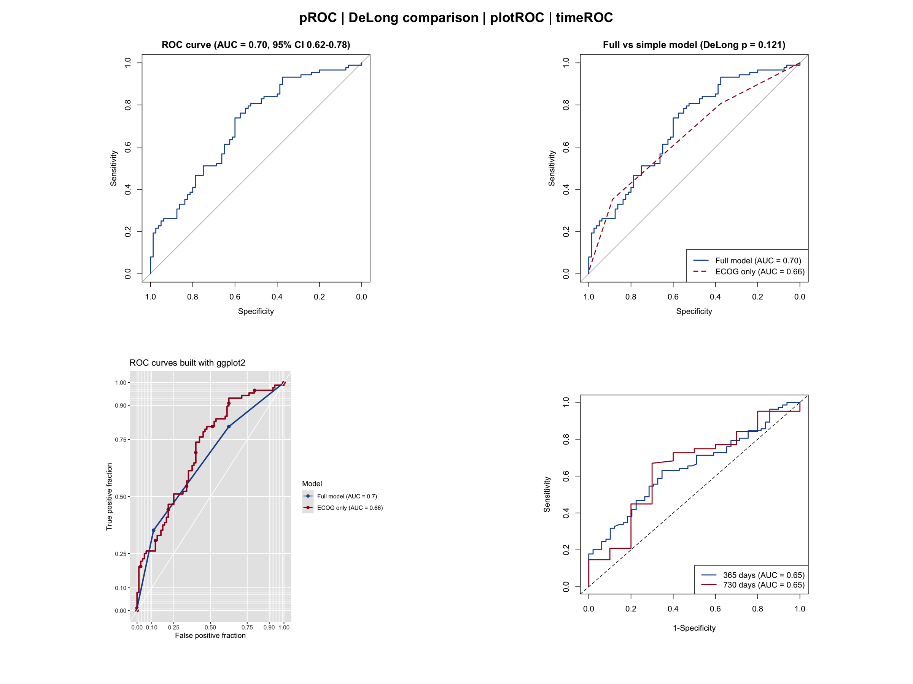
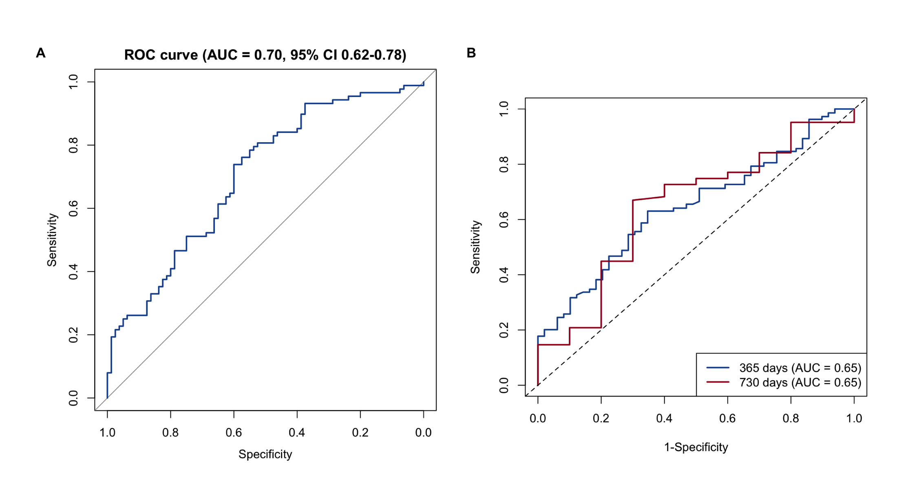

The receiver operating characteristic (ROC) curve evaluates the discrimination of a binary classifier — most commonly a clinical prediction model — across all possible decision thresholds. It plots sensitivity (true-positive rate) against 1 − specificity (false-positive rate), and is summarized by the area under the curve (AUC): 0.5 indicates discrimination no better than chance and 1.0 indicates perfect discrimination. In clinical research, ROC analysis is one of the standard tools for reporting the performance of diagnostic and prognostic models, together with calibration curves and decision curve analysis (see the companion tutorials).

This tutorial covers four practical ROC workflows in R:

1. Basic ROC with AUC and bootstrap confidence interval (`pROC`);
2. Comparing the discrimination of two models with the DeLong test (`pROC`);
3. Publication-style ROC curves with automatically reported AUCs (`plotROC`);
4. Time-dependent ROC for survival outcomes at fixed horizons (`timeROC`).

## Example

{fig-alt="ROCPlot DEMO" fig-align="center" width="60%"}

## Setup

-   System Requirements: Cross-platform (Linux/MacOS/Windows)

-   Programming language: R

-   Dependent packages: `survival`; `dplyr`; `pROC`; `plotROC`; `timeROC`; `ggplot2`

```{r packages setup, message=FALSE, warning=FALSE, output=FALSE}
# Installing necessary packages
if (!requireNamespace("pROC", quietly = TRUE)) {
  install.packages("pROC")
}
if (!requireNamespace("plotROC", quietly = TRUE)) {
  install.packages("plotROC")
}
if (!requireNamespace("timeROC", quietly = TRUE)) {
  install.packages("timeROC")
}

# Load packages
library(survival)
library(dplyr)
library(ggplot2)
library(pROC)
library(plotROC)
library(timeROC)
```

```{r}
sessioninfo::session_info("attached")
```

## Data Preparation

We use the built-in `lung` data set from the `survival` package (North Central Cancer Treatment Group lung cancer trial) \[1\]. We define a binary endpoint — death within the first year of follow-up — and fit two logistic models: a full model using five covariates and a simple model using only the ECOG performance score. We also build a Cox model to derive a continuous risk score for the time-dependent ROC analysis.

```{r load data, message=FALSE, warning=FALSE}
# The lung data set ships with the survival package
data(lung, package = "survival")

lung2 <- lung %>%
  filter(complete.cases(age, sex, ph.ecog, ph.karno, pat.karno, meal.cal, wt.loss)) %>%
  mutate(y1y = as.integer(time < 365 & status == 2))  # death within 365 days

cat("Patients:", nrow(lung2), " 1-year deaths:", sum(lung2$y1y), "\n")

# Two logistic models for 1-year mortality
m_full   <- glm(y1y ~ age + sex + ph.ecog + meal.cal + wt.loss,
                data = lung2, family = binomial)
m_simple <- glm(y1y ~ ph.ecog, data = lung2, family = binomial)

# A continuous risk score from a Cox model (used for time-dependent ROC)
cph0 <- coxph(Surv(time, status) ~ age + sex + ph.ecog + wt.loss, data = lung2)
lung2$risk_score <- as.numeric(predict(cph0, type = "risk"))

# Store each model's predicted probability as a column (required by melt_roc)
lung2$risk_full <- fitted(m_full)
lung2$risk_ecog <- fitted(m_simple)
```

## Visualization

### 1. Basic ROC Curve with AUC and Confidence Interval

```{r}
#| label: fig-1.1BasicROC
#| fig-cap: "Basic ROC curve of the full logistic model with AUC and bootstrap 95% CI."
#| out.width: "70%"
#| fig-width: 6
#| fig-height: 6
#| warning: false
#| message: false

roc_full <- roc(lung2$y1y, fitted(m_full), quiet = TRUE)
ci_full  <- ci.auc(roc_full, method = "bootstrap", boot.n = 1000)

plot(roc_full, col = "#2166AC", lwd = 2,
     main = sprintf("ROC curve (AUC = %.2f, 95%% CI %.2f-%.2f)",
                    as.numeric(auc(roc_full)),
                    ci_full[1], ci_full[3]))
```

The AUC of 0.70 indicates acceptable discrimination of 1-year mortality. The bootstrap confidence interval quantifies the sampling uncertainty of the estimate.

### 2. Comparing Two Models with the DeLong Test

A common question is whether the extra covariates of a full model actually improve discrimination over a simpler model. The DeLong test compares paired ROC curves without resampling.

```{r}
#| label: fig-2.1CompareROC
#| fig-cap: "Full model versus ECOG-only model; the DeLong p-value tests the AUC difference."
#| out.width: "70%"
#| fig-width: 6
#| fig-height: 6
#| warning: false
#| message: false

roc_simple <- roc(lung2$y1y, fitted(m_simple), quiet = TRUE)
roc_test <- roc.test(roc_full, roc_simple, method = "delong")

plot(roc_full, col = "#2166AC", lwd = 2,
     main = sprintf("Full vs simple model (DeLong p = %.3f)", roc_test$p.value))
plot(roc_simple, col = "#B2182B", lwd = 2, lty = 2, add = TRUE)
legend("bottomright",
       legend = c(sprintf("Full model (AUC = %.2f)", auc(roc_full)),
                  sprintf("ECOG only (AUC = %.2f)", auc(roc_simple))),
       col = c("#2166AC", "#B2182B"), lwd = 2, lty = c(1, 2))
```

Here the difference is not statistically significant (p = `r round(roc_test$p.value, 3)`), which cautions against claiming added value from the extra covariates in this small data set.

### 3. Optimal Cutoff Selection

```{r}
#| label: fig-3.1OptimalCutoff
#| fig-cap: "ROC curve with the Youden-index optimal threshold marked."
#| out.width: "70%"
#| fig-width: 6
#| fig-height: 6
#| warning: false
#| message: false

best <- coords(roc_full, x = "best", input = "threshold",
               best.method = "youden", ret = c("threshold", "specificity", "sensitivity"))
print(best)

plot(roc_full, col = "#2166AC", lwd = 2, print.thres = "best",
     print.thres.best.method = "youden",
     main = "ROC curve with Youden-optimal threshold")
```

The Youden index picks the threshold maximizing sensitivity + specificity − 1. Note that a single "optimal" cutoff is context-dependent: clinical consequences (costs of false positives vs false negatives) should guide the choice, e.g. via decision curve analysis.

### 4. Publication-Style ROC with plotROC

```{r}
#| label: fig-4.1PlotROC
#| fig-cap: "ggplot2-based ROC curves with automatically calculated and displayed AUCs."
#| out.width: "70%"
#| fig-width: 6
#| fig-height: 6
#| warning: false
#| message: false

longdf <- melt_roc(lung2, d = "y1y", m = c("risk_full", "risk_ecog")) |>
  mutate(name = ifelse(name == "risk_full", "Full model", "ECOG only"))

auc_labels <- c(
  paste0("Full model (AUC = ", round(auc(roc_full), 2), ")"),
  paste0("ECOG only (AUC = ", round(auc(roc_simple), 2), ")")
)
ggplot(longdf, aes(d = D, m = M, color = name)) +
  geom_roc(labels = FALSE, linewidth = 1) +
  style_roc(theme = theme_grey()) +
  scale_color_manual(values = c("#2166AC", "#B2182B"),
                     name = "Model", labels = auc_labels) +
  labs(title = "ROC curves built with ggplot2")
```

`melt_roc()` converts the data to long format and `geom_roc()` draws the curves; the AUC annotations are computed and placed automatically.

### 5. Time-Dependent ROC with timeROC

For survival endpoints, standard ROC ignores censoring. Time-dependent ROC evaluates discrimination at a fixed horizon, e.g. 1-year and 2-year mortality predicted by the Cox risk score \[3\].

```{r}
#| label: fig-5.1TimeROC
#| fig-cap: "Time-dependent ROC curves of the Cox risk score at 365 and 730 days."
#| out.width: "70%"
#| fig-width: 6
#| fig-height: 6
#| warning: false
#| message: false

tr <- timeROC(T = as.numeric(lung2$time),
              delta = ifelse(lung2$status == 2, 1, 0),  # 1 = event, 0 = censored
              marker = lung2$risk_score, cause = 1,
              weighting = "marginal",
              times = c(365, 730), ROC = TRUE, iid = TRUE)

plot(tr, time = 365, col = "#2166AC", lwd = 2,
     title = "Time-dependent ROC of the Cox risk score")
plot(tr, time = 730, col = "#B2182B", lwd = 2, add = TRUE)
legend("bottomright",
       legend = sprintf("%d days (AUC = %.2f)", c(365, 730), tr$AUC),
       col = c("#2166AC", "#B2182B"), lwd = 2)
```

Important details: `delta` uses the coding 0 = censored and 1 = event of interest (this is *not* the raw `status` coding of `lung`, where 1 means censored); the risk score is a continuous marker derived from the Cox model. Confidence intervals of the time-dependent AUC are available through `confint(tr)` because `iid = TRUE` was requested.

## Application

Time-dependent ROC curves are widely used in oncology prognostic-model papers to report discrimination at clinically meaningful horizons (1, 3, 5 years), often next to calibration curves and decision curve analysis. The panel below mirrors that publication layout with this tutorial's outputs: (A) standard ROC of the binary model and (B) time-dependent ROC at fixed horizons.

{fig-alt="ROCPlot Application" fig-align="center" width="60%"}

## Reference

\[1\] Loprinzi CL, Laurie JA, Wieand HS, et al. Prospective evaluation of prognostic variables from patient-completed questionnaires. North Central Cancer Treatment Group. J Clin Oncol. 1994;12(3):601-607. doi:10.1200/JCO.1994.12.3.601

\[2\] Robin X, Turck N, Hainard A, et al. pROC: an open-source package for R and S+ to analyze and compare ROC curves. BMC Bioinformatics. 2011;12:77. doi:10.1186/1471-2105-12-77

\[3\] Blanche P, Dartigues JF, Jacqmin-Gadda H. Estimating and comparing time-dependent areas under receiver operating characteristic curves for censored event times with competing risks. Stat Med. 2013;32(30):5381-5397. doi:10.1002/sim.5958

\[4\] Sachs MC. plotROC: A Tool for Plotting ROC Curves. R J. 2017;9(1):97-113. doi:10.32614/RJ-2017-019
