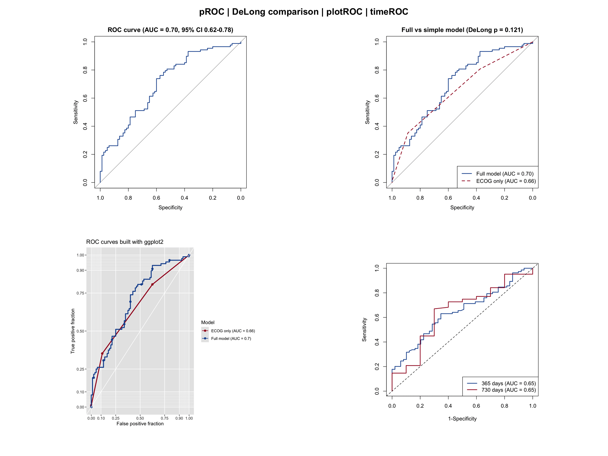
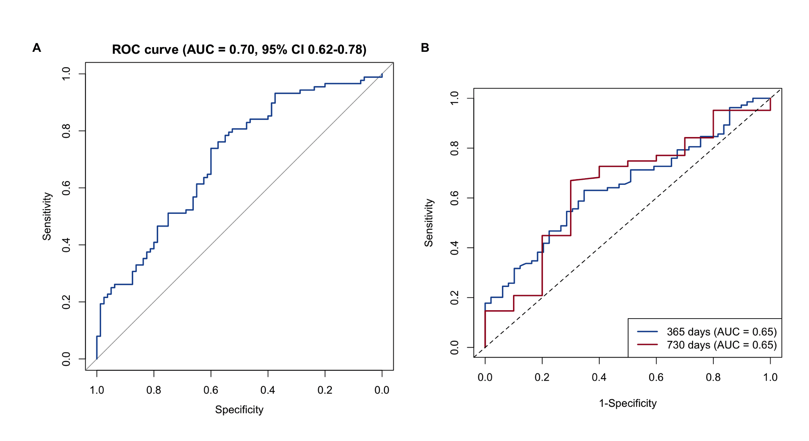

受试者工作特征（Receiver Operating Characteristic，ROC）曲线用于评估二元分类器——最常见的是临床预测模型——在所有可能决策阈值下的区分能力（discrimination）。它以灵敏度（真阳性率）对 1 − 特异度（假阳性率）作图，并用曲线下面积（AUC）概括：0.5 表示区分能力不优于随机猜测，1.0 表示完美区分。在临床研究中，ROC 分析是报告诊断与预后模型性能的标准工具之一，通常与校准曲线、决策曲线分析配合使用（见配套教程）。

本教程涵盖 R 中四种实用的 ROC 工作流：

1. 基础 ROC 曲线及 AUC 与 bootstrap 置信区间（`pROC`）；
2. 使用 DeLong 检验比较两个模型的区分能力（`pROC`）；
3. 自动报告 AUC 的发表级 ROC 曲线（`plotROC`）；
4. 生存结局在固定时间点的 Time-dependent ROC（`timeROC`）。

## 示例

{fig-alt="ROCPlot DEMO" fig-align="center" width="60%"}

## 环境配置

-   系统要求：跨平台（Linux/MacOS/Windows）

-   编程语言：R

-   依赖包：`survival`；`dplyr`；`pROC`；`plotROC`；`timeROC`；`ggplot2`；`glmnet`；`survivalROC`

```{r packages setup, message=FALSE, warning=FALSE, output=FALSE}
# 安装必要的包
if (!requireNamespace("pROC", quietly = TRUE)) {
  install.packages("pROC")
}
if (!requireNamespace("plotROC", quietly = TRUE)) {
  install.packages("plotROC")
}
if (!requireNamespace("timeROC", quietly = TRUE)) {
  install.packages("timeROC")
}
if (!requireNamespace("glmnet", quietly = TRUE)) {
  install.packages("glmnet")
}
if (!requireNamespace("survivalROC", quietly = TRUE)) {
  install.packages("survivalROC")
}

# 加载包
library(survival)
library(dplyr)
library(ggplot2)
library(pROC)
library(plotROC)
library(timeROC)
library(glmnet)
library(survivalROC)
```

```{r}
sessioninfo::session_info("attached")
```

## 数据准备

我们使用 `survival` 包内置的 `lung` 数据集（北中部癌症治疗组肺癌临床试验）\[1\]。定义一个二元终点——随访第一年内死亡——并拟合两个 logistic 模型：一个使用五个协变量的完整模型，一个仅使用 ECOG 体能评分的简单模型。同时构建 Cox 模型得到连续型风险评分，用于 Time-dependent ROC 分析。

```{r load data, message=FALSE, warning=FALSE}
# lung 数据集内置于 survival 包
data(lung, package = "survival")

lung2 <- lung %>%
  filter(complete.cases(age, sex, ph.ecog, ph.karno, pat.karno, meal.cal, wt.loss)) %>%
  mutate(y1y = as.integer(time < 365 & status == 2))  # 365 天内死亡
  # 注意：365 天内删失的患者在此被计为非事件；实际分析中建议仅纳入随访
  # 满 365 天的患者，或使用删失感知的方法（见下文 time-dependent ROC）。

cat("样本量:", nrow(lung2), " 1年死亡数:", sum(lung2$y1y), "\n")

# 两个用于 1 年死亡率的 logistic 模型
m_full   <- glm(y1y ~ age + sex + ph.ecog + meal.cal + wt.loss,
                data = lung2, family = binomial)
m_simple <- glm(y1y ~ ph.ecog, data = lung2, family = binomial)

# 由 Cox 模型得到连续型风险评分（用于 time-dependent ROC）
cph0 <- coxph(Surv(time, status) ~ age + sex + ph.ecog + wt.loss, data = lung2)
lung2$risk_score <- as.numeric(predict(cph0, type = "risk"))

# 将每个模型的预测概率存为列（melt_roc 需要）
lung2$risk_full <- fitted(m_full)
lung2$risk_ecog <- fitted(m_simple)
```

## 可视化

### 1. 基础 ROC 曲线与 AUC 置信区间

```{r}
#| label: fig-1.1BasicROC
#| fig-cap: "完整 logistic 模型的基础 ROC 曲线，标注 AUC 与 bootstrap 95% 置信区间。"
#| out.width: "70%"
#| fig-width: 6
#| fig-height: 6
#| warning: false
#| message: false

roc_full <- roc(lung2$y1y, fitted(m_full), quiet = TRUE)
set.seed(2026)  # 固定随机种子，保证 bootstrap 置信区间跨渲染可复现
ci_full  <- ci.auc(roc_full, method = "bootstrap", boot.n = 1000)

plot(roc_full, col = "#2166AC", lwd = 2,
     main = sprintf("ROC curve (AUC = %.2f, 95%% CI %.2f-%.2f)",
                    as.numeric(auc(roc_full)),
                    ci_full[1], ci_full[3]))
```

AUC 为 0.70 表示模型对 1 年死亡具有可接受的区分能力。bootstrap 置信区间量化了该估计的抽样不确定性。

### 2. 使用 DeLong 检验比较两个模型

常见的问题是：完整模型的额外协变量是否真的比简单模型提升了区分能力？DeLong 检验无需重抽样即可比较配对的 ROC 曲线。

```{r}
#| label: fig-2.1CompareROC
#| fig-cap: "完整模型与仅 ECOG 模型的比较；DeLong p 值检验 AUC 差异。"
#| out.width: "70%"
#| fig-width: 6
#| fig-height: 6
#| warning: false
#| message: false

roc_simple <- roc(lung2$y1y, fitted(m_simple), quiet = TRUE)
roc_test <- roc.test(roc_full, roc_simple, method = "delong")

plot(roc_full, col = "#2166AC", lwd = 2,
     main = sprintf("Full vs simple model (DeLong p = %.3f)", roc_test$p.value))
plot(roc_simple, col = "#B2182B", lwd = 2, lty = 2, add = TRUE)
legend("bottomright",
       legend = c(sprintf("Full model (AUC = %.2f)", auc(roc_full)),
                  sprintf("ECOG only (AUC = %.2f)", auc(roc_simple))),
       col = c("#2166AC", "#B2182B"), lwd = 2, lty = c(1, 2))
```

本例中差异不显著（p = `r round(roc_test$p.value, 3)`），提示在这个小样本数据中不宜宣称额外协变量带来了增益。

### 3. 最佳截断值选择

```{r}
#| label: fig-3.1OptimalCutoff
#| fig-cap: "标注 Youden 指数最佳阈值的 ROC 曲线。"
#| out.width: "70%"
#| fig-width: 6
#| fig-height: 6
#| warning: false
#| message: false

best <- coords(roc_full, x = "best", input = "threshold",
               best.method = "youden", ret = c("threshold", "specificity", "sensitivity"))
print(best)

plot(roc_full, col = "#2166AC", lwd = 2, print.thres = "best",
     print.thres.best.method = "youden",
     main = "ROC curve with Youden-optimal threshold")
```

Youden 指数选取使灵敏度 + 特异度 − 1 最大化的阈值。注意“最佳”截断值依赖于具体场景：应结合临床代价（假阳性与假阴性的危害）来选择，例如借助决策曲线分析。

### 4. 使用 plotROC 绘制发表级 ROC 曲线

```{r}
#| label: fig-4.1PlotROC
#| fig-cap: "基于 ggplot2 的 ROC 曲线，图例中报告 AUC。"
#| out.width: "70%"
#| fig-width: 6
#| fig-height: 6
#| warning: false
#| message: false

longdf <- melt_roc(lung2, d = "y1y", m = c("risk_full", "risk_ecog")) |>
  mutate(name = ifelse(name == "risk_full", "Full model", "ECOG only"))

# 命名向量：无论水平顺序如何都能正确匹配颜色与标签
model_colors <- c("Full model" = "#2166AC", "ECOG only" = "#B2182B")
model_labels <- c("Full model" = paste0("Full model (AUC = ", round(auc(roc_full), 2), ")"),
                  "ECOG only"  = paste0("ECOG only (AUC = ", round(auc(roc_simple), 2), ")"))
ggplot(longdf, aes(d = D, m = M, color = name)) +
  geom_roc(labels = FALSE, linewidth = 1) +
  style_roc(theme = theme_grey()) +
  scale_color_manual(values = model_colors, labels = model_labels, name = "Model") +
  labs(title = "ROC curves built with ggplot2")
```

`melt_roc()` 将数据转换为长格式，`geom_roc()` 绘制曲线；AUC 由 pROC 计算并在图例中显示。

### 5. 使用 timeROC 的 Time-dependent ROC

对于生存终点，标准 ROC 无法处理删失。Time-dependent ROC 评估固定时间点的区分能力，例如用 Cox 风险评分预测 1 年和 2 年死亡率 \[3\]。

```{r}
#| label: fig-5.1TimeROC
#| fig-cap: "Cox 风险评分在 365 天和 730 天的 Time-dependent ROC 曲线。"
#| out.width: "70%"
#| fig-width: 6
#| fig-height: 6
#| warning: false
#| message: false

tr <- timeROC(T = as.numeric(lung2$time),
              delta = ifelse(lung2$status == 2, 1, 0),  # 1 = 事件, 0 = 删失
              marker = lung2$risk_score, cause = 1,
              weighting = "marginal",
              times = c(365, 730), ROC = TRUE, iid = TRUE)

plot(tr, time = 365, col = "#2166AC", lwd = 2,
     title = "Time-dependent ROC of the Cox risk score")
plot(tr, time = 730, col = "#B2182B", lwd = 2, add = TRUE)
legend("bottomright",
       legend = sprintf("%d days (AUC = %.2f)", c(365, 730), tr$AUC),
       col = c("#2166AC", "#B2182B"), lwd = 2)
```

关键细节：`delta` 使用 0 = 删失、1 = 感兴趣事件的编码（注意这**不是** `lung` 数据中 `status` 的原始编码——那里 1 表示删失）；风险评分是由 Cox 模型导出的连续型 marker。由于设置了 `iid = TRUE`，可以通过 `confint(tr)` 获得 time-dependent AUC 的置信区间。

### 6. 多指标模型的训练集与验证集 ROC

生物标志物 panel 类论文通常在**训练集**上拟合模型，再在独立的**验证集**上重新估计区分能力 \[5\]。如果验证集 AUC 明显下降，说明模型过拟合；用 bootstrap 版 `roc.test()` 比较两条曲线可以定量检验差异。

```{r}
#| label: fig-6.1TrainTestROC
#| fig-cap: "同一模型在训练集与预留验证集上的 ROC；bootstrap p 值检验两者 AUC 的差异。"
#| out.width: "70%"
#| fig-width: 6
#| fig-height: 6
#| warning: false
#| message: false

set.seed(2026)
idx      <- sample(seq_len(nrow(lung2)), size = floor(0.6 * nrow(lung2)))
train_df <- lung2[idx, ]
test_df  <- lung2[-idx, ]

# 仅在训练集上拟合多指标模型
m_train    <- glm(y1y ~ age + sex + ph.ecog + wt.loss, data = train_df, family = binomial)
roc_train  <- roc(train_df$y1y, fitted(m_train), quiet = TRUE)
roc_test   <- roc(test_df$y1y, predict(m_train, newdata = test_df, type = "response"),
                  quiet = TRUE)
bt         <- roc.test(roc_train, roc_test, method = "bootstrap", boot.n = 500)

plot(roc_train, col = "#0093FF", lwd = 2, legacy.axes = TRUE,
     main = "Training vs validation ROC")
plot(roc_test, col = "#E43889", lwd = 2, add = TRUE, legacy.axes = TRUE)
legend("bottomright", bty = "n", cex = 0.8, lwd = 2,
       col = c("#0093FF", "#E43889", NA),
       lty = c(1, 1, 0), pch = c(NA, NA, 1),
       legend = c(sprintf("Train (AUC = %.2f)", auc(roc_train)),
                  sprintf("Test  (AUC = %.2f)", auc(roc_test)),
                  sprintf("Bootstrap p = %.3f", bt$p.value)))
```

本例中验证集上的点估计下降明显，但 bootstrap 检验未达显著（p > 0.05）：这个规模的验证集给出的 AUC 估计噪声较大，只有足够大的差异才能被检出。如果换成真正独立的外部队列，对比的信息量会大得多——同一队列内部的拆分只能检测队列内的乐观偏差。
### 7. 构建共识预后 signature

生物标志物研究往往超出单模型 ROC 的范畴：哪个*最小*协变量集合携带预后信号？\[6\] 参考工作流是（1）单因素 Cox 筛选，（2）**迭代 LASSO**——多次运行 `cv.glmnet(family = "cox")` 并按入选频次排序变量，因为单次运行对种子高度敏感——然后（3）按频次顺序逐个纳入变量，直到 time-dependent AUC 达峰为止。这里用 `lung` 的临床协变量代替基因做演示：

```{r}
#| label: fig-7.1ConsensusSignature
#| fig-cap: "共识 signature 构建：(A) 变量按 LASSO 频次逐一纳入时的 AUC 轨迹并标记峰值，(B) 峰值处的 ROC，(C) 高/低风险组的 Kaplan-Meier 分层。"
#| out.width: "95%"
#| warning: false
#| message: false
#| fig-width: 11
#| fig-height: 3.8

set.seed(111)
cand <- c("age", "ph.ecog", "ph.karno", "pat.karno", "wt.loss", "meal.cal")

## （1）单因素 Cox 筛选
cox_p <- sapply(cand, function(v) {
  summary(coxph(Surv(time, status == 2) ~ lung2[[v]], data = lung2))$coefficients[, "Pr(>|z|)"]
})
sel <- names(cox_p)[cox_p < 0.2]           # 小样例用宽松阈值
x_mat <- as.matrix(lung2[, sel])
surv_obj <- Surv(lung2$time, lung2$status == 2)

## （2）迭代 LASSO——此处 20 次（参考文献用 500-1000 次）
surv_lasso <- function(dummy) {
  cvfit <- cv.glmnet(x_mat, surv_obj, nfolds = 10, alpha = 1, family = "cox")
  r <- as.matrix(coef(cvfit, s = "lambda.min"))
  rownames(r)[r != 0]
}
lasso_runs <- lapply(1:20, surv_lasso)
freq <- sort(table(unlist(lasso_runs)), decreasing = TRUE)
genes_freq <- names(freq)                  # 按共识频次排序的变量
print(freq)

## （3）逐个纳入变量；在 time-dependent AUC 峰值处停止
pred_time <- 365
auc <- c()
roc_list <- list()
for (i in seq_along(genes_freq)) {
  fit_i <- coxph(Surv(time, status == 2) ~ .,
                 data = lung2[, c("time", "status", genes_freq[seq_len(i)])])
  rs <- predict(fit_i, type = "risk")
  sr <- survivalROC::survivalROC(Stime = lung2$time,
                                 status = as.integer(lung2$status == 2),
                                 marker = rs, predict.time = pred_time, method = "KM")
  auc[i] <- sr$AUC
  roc_list[[i]] <- sr
}
best <- which.max(auc)
prog_vars <- genes_freq[seq_len(best)]

## 最终模型、风险分组、Kaplan-Meier
fit_f  <- coxph(Surv(time, status == 2) ~ ., data = lung2[, c("time", "status", prog_vars)])
risk   <- predict(fit_f, type = "risk")
lung2$Risk <- ifelse(risk > median(risk), "High", "Low")
fitd   <- survdiff(Surv(time, status == 2) ~ Risk, data = lung2)
p_km   <- 1 - pchisq(fitd$chisq, length(fitd$n) - 1)
fit_km <- survfit(Surv(time, status == 2) ~ Risk, data = lung2)

## 三面板汇总（与参考文献一致使用 base plot）
red <- "#E94244"; blue <- "#4084BB"
par(mfrow = c(1, 3), mgp = c(2, 0.5, 0), tcl = -0.25)

plot(seq_along(auc), auc, type = "l", lwd = 2, col = blue,
     ylim = range(auc) + c(-0.03, 0.03),
     xlab = "Covariates in LASSO-frequency order", ylab = "AUC at 365 days",
     main = sprintf("(%d covariates)", best))
points(best, auc[best], pch = 16, cex = 1.5, col = red)

plot(roc_list[[best]]$FP, roc_list[[best]]$TP, type = "l", lwd = 2, col = blue,
     xlim = c(0, 1), ylim = c(0, 1), xlab = "1-Specificity", ylab = "Sensitivity",
     main = sprintf("ROC at peak (AUC = %.2f)", auc[best]))
lines(c(0, 1), c(0, 1), lty = 2, col = "grey40")

plot(fit_km, col = c(red, blue), lwd = 1.5, mark.time = TRUE,
     xlab = "Time (days)", ylab = "Overall survival",
     main = sprintf("Risk split (log-rank %s)",
                    ifelse(p_km < 0.001, "p < 0.001", sprintf("p = %.3f", p_km))))
legend("topright", bty = "n", cex = 0.8, lwd = 2,
       col = c(red, blue), legend = c("High risk", "Low risk"))
```

::: callout-tip
**实践要点**

- 共识思想比任何单次运行更重要：多次 LASSO 的入选频次远比单一最优 lambda 稳定——后者会随交叉验证折数的不同而翻转。
- `survivalROC(..., method = "KM")` 给出固定时间点的删失感知 AUC；第 5 节的 `timeROC` 是更现代的等价实现，且自带置信区间。
- 换成真实表达数据时循环不变——把 `cand` 换成基因列，并把基因在行的表达矩阵经 `cv.glmnet(x = t(expr))` 传入。
:::

### 8. 跨队列 AUC 筛选（成对 AUC）

当候选 signature 在一个队列上训练后，其预后价值必须在**独立**的测试队列中依然成立。成对 AUC 图把每个候选基因按其在队列 1 的 AUC（横轴）对队列 2 的 AUC（纵轴）散点绘制；落入右上角方框的基因在*两个*队列中均越过 AUC 阈值，即为稳健的命中基因 \[5\]。

```{r}
#| label: fig-8.1PairwiseAUC
#| fig-cap: "跨队列 AUC 筛选。(A) 每个基因按其在队列 1 与队列 2 的 AUC 散点；蓝色 = 蛋白可检出，灰色 = 未检出，红色 = 目标基因；虚线框标记双重命中区（两者 AUC 均 > 0.6）。(B) 命中基因的平均 AUC。"
#| out.width: "95%"
#| warning: false
#| message: false
#| fig-width: 9
#| fig-height: 4.5

library(patchwork)
set.seed(4302)
n_gene <- 60; n_s <- 90
genes <- paste0("Gene", sprintf("%03d", 1:n_gene))
truth <- sample(n_gene, 12)                    # 具有真实预后信号的基因

# 构造一个队列：信号基因携带类别效应，噪声基因无
mk_cohort <- function(coef, sd, seed) {
  set.seed(seed)
  ex <- matrix(rnorm(n_gene * n_s), n_gene)
  cls <- sample(0:1, n_s, replace = TRUE)
  ex[truth, ] <- sweep(ex[truth, ], 2, cls * coef, `+`)
  ex <- ex + rnorm(n_gene * n_s, sd = sd)
  list(ex = ex, cls = cls)
}
c1 <- mk_cohort(1.3, 0.7, 4302)
c2 <- mk_cohort(1.1, 0.8, 4402)

# 由 Mann-Whitney 秩统计量求 AUC（等价于 pROC::roc()$auc）
auc_of <- function(ex, cls) apply(ex, 1, function(g) {
  pos <- g[cls == 1]; neg <- g[cls == 0]
  u <- sum(sapply(pos, function(p) sum(neg < p) + 0.5 * sum(neg == p)))
  u / (length(pos) * length(neg))
})
auc1 <- auc_of(c1$ex, c1$cls); auc2 <- auc_of(c2$ex, c2$cls)
auc_df <- data.frame(gene = genes, auc1 = auc1, auc2 = auc2)
set.seed(4309)
auc_df$detected <- runif(n_gene) > 0.3         # “蛋白可检出”过滤
cutoff <- 0.6
auc_df$hit <- auc_df$auc1 > cutoff & auc_df$auc2 > cutoff & auc_df$detected

pL <- ggplot(auc_df, aes(auc1, auc2)) +
  geom_point(aes(colour = detected), size = 2) +
  scale_colour_manual(values = c(`TRUE` = "#445EAD", `FALSE` = "grey75"),
                      labels = c(`TRUE` = "Protein-detected", `FALSE` = "Not detected"),
                      name = NULL) +
  geom_rect(xmin = cutoff, xmax = max(auc_df$auc1) + 0.02,
            ymin = cutoff, ymax = max(auc_df$auc2) + 0.02,
            fill = NA, colour = "grey40", linetype = "dashed") +
  annotate("point", x = auc_df$auc1[1], y = auc_df$auc2[1],
           colour = "#B2182B", size = 2.5) +
  labs(x = "AUC in cohort 1", y = "AUC in cohort 2", title = "Cross-cohort AUC") +
  theme_classic(base_size = 11) + theme(legend.position = "bottom")

hits <- auc_df[auc_df$hit, ]
hits$gene <- factor(hits$gene, levels = hits$gene[order((hits$auc1 + hits$auc2) / 2)])
pR <- ggplot(hits, aes(reorder(gene, (auc1 + auc2) / 2), (auc1 + auc2) / 2)) +
  geom_col(fill = "#445EAD", width = 0.7) +
  coord_flip() +
  labs(x = NULL, y = "Mean AUC", title = "Hit genes") +
  theme_classic(base_size = 11) + theme(panel.grid.major.y = element_blank())

pL + pR + plot_annotation(tag_levels = "A")
```

::: callout-tip
**实践要点**

-   由 Mann-Whitney 秩统计量求得的 AUC 等于 `pROC::roc(predictor, response)$auc`；真实队列可直接改用 `pROC`。
-   灰色“未检出”点是真实过滤而非装饰：在组织中无可检出蛋白的基因不可能成为标志物，故其 AUC 被排除在命中判定之外。
-   两个队列须真正独立（不同平台/机构）；内部训练/测试划分会虚增双重命中数。
:::

## 应用

Time-dependent ROC 曲线广泛用于肿瘤预后模型论文中，以报告在临床有意义的时间点（1、3、5 年）的区分能力，常与校准曲线、决策曲线分析并列出现。下图按照论文常用版式组装本教程的输出：(A) 二元模型的标准 ROC；(B) 固定时间点的 time-dependent ROC。

{fig-alt="ROCPlot Application" fig-align="center" width="60%"}

## 参考文献

\[1\] Loprinzi CL, Laurie JA, Wieand HS, et al. Prospective evaluation of prognostic variables from patient-completed questionnaires. North Central Cancer Treatment Group. J Clin Oncol. 1994;12(3):601-607. doi:10.1200/JCO.1994.12.3.601

\[2\] Robin X, Turck N, Hainard A, et al. pROC: an open-source package for R and S+ to analyze and compare ROC curves. BMC Bioinformatics. 2011;12:77. doi:10.1186/1471-2105-12-77

\[3\] Blanche P, Dartigues JF, Jacqmin-Gadda H. Estimating and comparing time-dependent areas under receiver operating characteristic curves for censored event times with competing risks. Stat Med. 2013;32(30):5381-5397. doi:10.1002/sim.5958

\[4\] Sachs MC. plotROC: A Tool for Plotting ROC Curves. J Stat Softw Code Snippets. 2017;79(2):1-12. doi:10.18637/jss.v079.c02

\[5\] Xiaofan Lu, et al. FigureYa: A Standardized Visualization Framework for Enhancing Biomedical Data Interpretation and Research Efficiency. iMetaMed. 2025. doi:10.1002/imm3.70005

\[6\] 七基因预后 signature 参考图出处：<https://clincancerres.aacrjournals.org/content/18/21/6001>（工作流由 \[5\] FigureYa128Prognostic 复现）。
