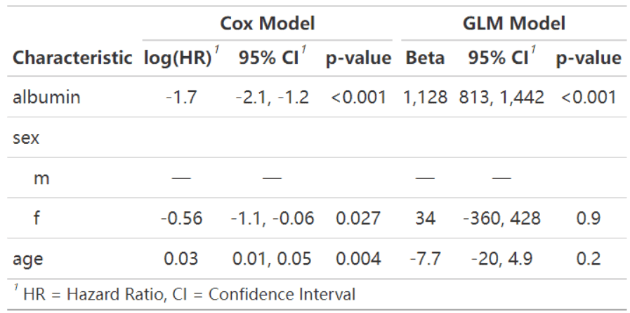
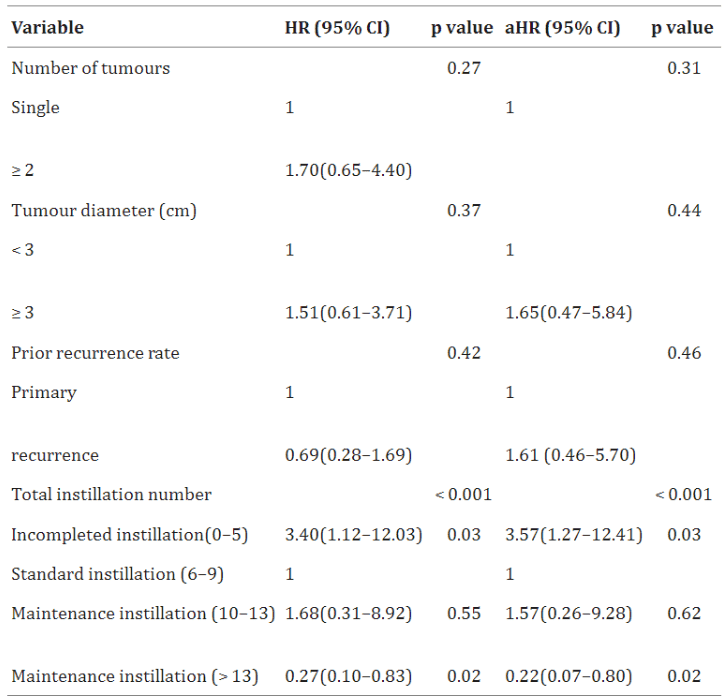
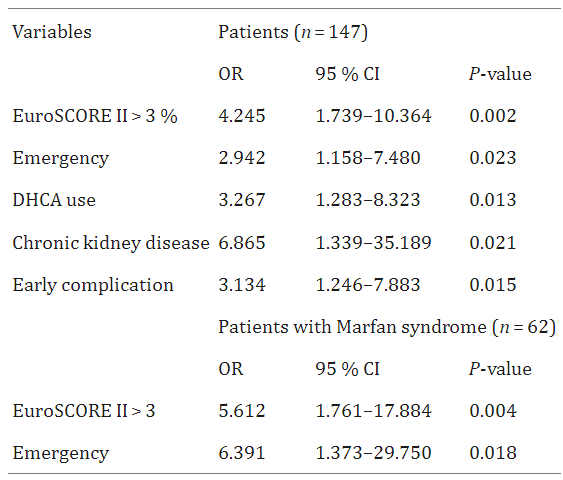

The regression analysis table is used to display the results of the regression model. It provides statistical information about the variables in the model and helps explain the relationship between the variables.

## Example

{fig-alt="RegressionTable DEMO1" fig-align="center" width="60%"}

The figure below shows a regression analysis based on the pbc dataset built into the `survival` package. The figure uses the Cox proportional hazards model and generalized linear regression model to explore the effects of serum protein, sex, and age on survival.

## Setup

-   System Requirements: Cross-platform (Linux/MacOS/Windows)

-   Programming language: R

-   Dependent packages: `survival`, `gtsummary`, `dplyr`, `datawizard`, `kableExtra`

```{r packages setup, message=FALSE, warning=FALSE, output=FALSE}
# Installing packages
if (!requireNamespace("survival", quietly = TRUE)) {
  install.packages("survival")
}
if (!requireNamespace("gtsummary", quietly = TRUE)) {
  install.packages("gtsummary")
}
if (!requireNamespace("dplyr", quietly = TRUE)) {
  install.packages("dplyr")
}
if (!requireNamespace("datawizard", quietly = TRUE)) {
  install.packages("datawizard")
}
if (!requireNamespace("broom.helpers", quietly = TRUE)) {
  remotes::install_github("larmarange/broom.helpers")
}

# Load packages
library(survival)
library(gtsummary)
library(dplyr)
library(datawizard)
# Install kableExtra if missing (used by the grouped HR table)
if (!requireNamespace("kableExtra", quietly = TRUE)) {
  install.packages("kableExtra")
}
library(broom.helpers)
library(kableExtra)
library(kableExtra)
```

```{r}
sessioninfo::session_info("attached")
```

## Data Preparation

The pbc dataset, built into the survival R package, contains information on 418 patients with primary biliary cirrhosis (PBC) who had received ursodeoxycholic acid (UDCA) treatment at or before the start of the study. The pbc dataset records clinical information such as survival time, survival status, treatment method, age, sex, albumin level, and hepatomegaly.

```{r load data, message=FALSE}
df <- pbc %>%
  filter(status != 1) %>%
  mutate(status = ifelse(status == 2, 1, 0)) %>%
  select(2:13) %>%
  na.omit() %>% 
  # Divide `albumin` into 3 groups
  mutate(albumin3cat = categorize(albumin, split = "quantile", n_groups = 3))

head(df[,1:6])
```

## Visualization

### 1. Basic regression analysis table

```{r}
#| label: fig-1.1BasicRegressionTable
#| fig-cap: "Basic regression analysis table"
#| out.width: "95%"
#| warning: false
#| message: false
#| fig-width: 8
#| fig-height: 6

# Basic regression analysis table
t1 <- coxph(Surv(time, status) ~ albumin + sex + age,
  data = df
) %>%
  tbl_regression()

t1
```

This table is a basic regression analysis table. The Cox proportional hazard model is called by `coxph()` and the results of the regression analysis are tabulated using `tbl_regression()`.

### 2. tbl_regression() parameter settings

```{r}
#| label: fig-2.1tbl_regression
#| fig-cap: "tbl_regression() parameter settings"
#| out.width: "95%"
#| warning: false
#| message: false
#| fig-width: 8
#| fig-height: 6

# tbl_regression() parameter settings
t1 <- coxph(Surv(time, status) ~ albumin + sex + age,
  data = df
) %>%
  # parameter settings
  tbl_regression(
    conf.level = 0.90,
    exponentiate = TRUE,
    include = c("sex", "albumin"),
    show_single_row = sex,
    label = list(sex ~ "sex as categorical")
  )

t1
```

There are many parameter settings in the table `tbl_regression()`, which can change the confidence interval, row names and other information of the table.

::: callout-tip
**Important parameter: tbl_regression**

- `conf.level`: Determines the confidence level for the regression analysis. The default value of 0.95 indicates a 95% confidence interval.

- `exponentiate`: Whether to exponentiate the HR values. The default column is log(HR) values.

- `include`: Which independent variables (rows) are included in the statistical table.

- `show_single_row`: Applies to binary variables and does not display the control group.

- `label`: Changes the name (row name) of the independent variable.
:::

### 3. Add global-p

```{r}
#| label: fig-3.1global-p
#| fig-cap: "Add global-p"
#| out.width: "95%"
#| warning: false
#| message: false
#| fig-width: 8
#| fig-height: 6

# Add global-p
df$albumin3cat=as.factor(df$albumin3cat)

t1 <- coxph(Surv(time, status) ~ albumin3cat + sex + age,
            data = df) %>%
  tbl_regression()  %>%
  add_global_p()

t1
```

This table adds global P values via `add_global_p()`.

### 4. Add q-value

```{r}
#| label: fig-4.1q-value
#| fig-cap: "Add q-value"
#| out.width: "95%"
#| warning: false
#| message: false
#| fig-width: 8
#| fig-height: 6

# Add q-value
t1 <- coxph(Surv(time, status) ~ albumin + sex + age,
  data = df
) %>%
  tbl_regression() %>%
  # Add a q-value column
  add_q()

t1
```

The table adds a q-value column via `add_q()`.

### 5. Merge columns

```{r}
#| label: fig-5.1Merge
#| fig-cap: "Merge columns"
#| out.width: "95%"
#| warning: false
#| message: false
#| fig-width: 8
#| fig-height: 6

# Merge columns
t1 <- coxph(Surv(time, status) ~ albumin3cat + sex + age,
            data = df) %>%
  tbl_regression()  %>%
  # Modify the header name
  modify_header(p.value = "**P**",estimate="**log(HR) (CI)**") %>%
  # Combine the score column and the CI column and apply to rows where the score is not NA
  modify_column_merge(
    pattern = "{estimate} ({conf.low}, {conf.high})",
    rows = !is.na(estimate)
  )

t1
```

This table merges the score column and the CI column, which is a common form. The table header is appropriately modified after the merger.

::: callout-tip
**Important Functions** `modify_header` / `modify_column_merge`:

`modify_header:modify_header()` can be used to modify the header name. `label` represents the variable column, `p.value` represents the P-value column, `ci` represents the confidence interval column, `estimate` represents the score column, `conf.low` represents the lower confidence interval, and `conf.high` represents the upper confidence interval.

`modify_column_merge`: The `pattern` parameter specifies the pattern of columns to be merged, and the `rows` parameter specifies the rows to apply the merge to.
:::

### 6. Model integration

**Model horizontal integration合**

```{r}
#| label: fig-6.1Merge
#| fig-cap: "Model horizontal integration"
#| out.width: "95%"
#| warning: false
#| message: false
#| fig-width: 8
#| fig-height: 6

# Model horizontal integration
t1 <- coxph(Surv(time, status) ~ albumin + sex + age,
  data = df
) %>%
  tbl_regression()
t2 <- glm(time ~ albumin + sex + age,
  data = df
) %>%
  tbl_regression()
# t1, t2 model integration
t3 <- tbl_merge(
  tbls = list(t1, t2),
  tab_spanner = c("**Cox Model**", "**GLM Model**")
)

t3
```

This table uses `tbl_merge` to horizontally integrate the results of the Cox proportional hazards model and the generalized linear regression model for patients with pdb.

**Model vertical integration**

```{r}
#| label: fig-6.2Merge
#| fig-cap: "Model vertical integration"
#| out.width: "95%"
#| warning: false
#| message: false
#| fig-width: 8
#| fig-height: 6

# Model vertical integration
t1 <- coxph(Surv(time, status) ~ albumin + sex + age,
  data = df[df$hepato==0,]
) %>%
  tbl_regression()

t2 <- coxph(Surv(time, status) ~ albumin + sex + age,
  data = df[df$hepato==1,]
) %>%
  tbl_regression()

tbl_stack(list(t1, t2), group_header = c("Patients without hepato", "Patients with hepato"))
```

This table uses `tbl_stack` to longitudinally integrate the results of the Cox proportional hazards model for the two groups of pdb patients with and without hepato.

### 7. HR Table: Univariate + Multivariate, Training vs Validation Cohorts

The FigureYa47 layout \[3\] is the publication-grade companion table: every covariate runs through **batch univariate Cox**, the p < 0.05 survivors enter a **multivariate model**, and the whole thing repeats on an independent validation cohort — printed as one grouped kable table with `HR (95% CI)` and p-value columns per cohort:

```{r}
#| label: tbl-7.1HrTable
#| tbl-cap: "Univariate and multivariate Cox analyses of simulated covariates: training cohort (70%) and validation cohort (30%); multivariate columns only carry the covariates significant in the training univariate screen."
#| warning: false
#| message: false

set.seed(4701)
n_hr <- 260
hrdata <- data.frame(
  age = factor(ifelse(rnorm(n_hr, 62, 10) > 62, ">=median", "<median"),
               levels = c("<median", ">=median")),
  stage = factor(sample(c("I-II", "III-IV"), n_hr, TRUE), levels = c("I-II", "III-IV")),
  invasion = factor(sample(c("no", "yes"), n_hr, TRUE, c(0.6, 0.4)), levels = c("no", "yes")),
  marker = factor(ifelse(rnorm(n_hr) > 0, ">=median", "<median"),
                  levels = c("<median", ">=median")))
lp <- -3.4 + 0.35 * (hrdata$stage == "III-IV") + 0.5 * (hrdata$invasion == "yes") -
  0.45 * (hrdata$marker == ">=median")
hrdata$time <- rexp(n_hr, exp(lp) * 0.02)
hrdata$event <- rbinom(n_hr, 1, 0.8)
vars <- c("age", "stage", "invasion", "marker")

uni_cox <- function(dat) {
  do.call(rbind, lapply(vars, function(v) {
    sm <- summary(coxph(as.formula(paste0("Surv(time, event) ~ ", v)), data = dat))
    data.frame(characteristics = v,
               HR = round(sm$coefficients[, "exp(coef)"], 2),
               CI = paste0(round(sm$conf.int[, "lower .95"], 2), "-",
                           round(sm$conf.int[, "upper .95"], 2)),
               p = sm$coefficients[, "Pr(>|z|)"])
  }))
}
set.seed(4702)
train_idx <- sample(n_hr, round(n_hr * 0.7))
tr <- hrdata[train_idx, ]; va <- hrdata[-train_idx, ]
uni_tr <- uni_cox(tr); uni_va <- uni_cox(va)
sig_vars <- uni_tr$characteristics[uni_tr$p < 0.05]

mk_rows <- function(sm, sig_vars) {
  cm <- sm$coefficients; ci <- sm$conf.int
  do.call(rbind, lapply(vars, function(v) {
    idx <- which(startsWith(rownames(cm), v))   # factor contrasts: "stageIII-IV"
    if (length(idx) == 1) {
      data.frame(characteristics = v, HR = round(cm[idx, "exp(coef)"], 2),
                 CI = paste0(round(ci[idx, "lower .95"], 2), "-",
                             round(ci[idx, "upper .95"], 2)),
                 p = ifelse(cm[idx, "Pr(>|z|)"] < 0.001, "< 0.001",
                            round(cm[idx, "Pr(>|z|)"], 3)))
    } else {
      data.frame(characteristics = v, HR = NA, CI = NA, p = NA)
    }
  }))
}
m_tr <- mk_rows(summary(coxph(as.formula(paste("Surv(time, event) ~",
                                               paste(sig_vars, collapse = "+"))), data = tr)), sig_vars)
m_va <- mk_rows(summary(coxph(as.formula(paste("Surv(time, event) ~",
                                               paste(sig_vars, collapse = "+"))), data = va)), sig_vars)

fmt <- function(df) dplyr::mutate(
  df,
  characteristics = dplyr::case_when(
    characteristics == "age" ~ "Age (>=median vs <median)",
    characteristics == "stage" ~ "Stage (III-IV vs I-II)",
    characteristics == "invasion" ~ "Lymphatic invasion (yes vs no)",
    characteristics == "marker" ~ "Marker score (>=median vs <median)"),
  `HR (95% CI)` = ifelse(is.na(HR), "", paste0(HR, " (", CI, ")")),
  `P value` = ifelse(is.na(p), "", as.character(p))) %>%
  dplyr::select(characteristics, `HR (95% CI)`, `P value`)

tbl <- data.frame(
  characteristics = c("", "Training cohort (n = 182)", fmt(uni_tr)$characteristics,
                      "Validation cohort (n = 78)", fmt(uni_va)$characteristics),
  uni_hr = c("", "", fmt(uni_tr)$`HR (95% CI)`, "", fmt(uni_va)$`HR (95% CI)`),
  uni_p = c("", "", fmt(uni_tr)$`P value`, "", fmt(uni_va)$`P value`),
  multi_hr = c("HR (95% CI)", "", fmt(m_tr)$`HR (95% CI)`, "", fmt(m_va)$`HR (95% CI)`),
  multi_p = c("P value", "", fmt(m_tr)$`P value`, "", fmt(m_va)$`P value`),
  stringsAsFactors = FALSE)

kableExtra::kable(tbl, booktabs = TRUE, escape = FALSE,
                  col.names = c("Characteristics", "Univariate analysis", "",
                                "Multivariate analysis", ""),
                  caption = "Univariate and multivariate Cox analyses, training vs validation (simulated)") %>%
  kableExtra::kable_styling(c("striped", "scale_down"), font_size = 11) %>%
  kableExtra::add_header_above(c(" " = 1, "Training cohort" = 2, "Validation cohort" = 2))
```

::: callout-tip
**Practice tips**

-   Factor contrast rows in a Cox summary are named `stageIII-IV`, not `stage` — match them with `startsWith(rownames(cm), v)` when assembling the table programmatically, or the multivariate column silently fills with blanks.
-   The multivariate column shows **only the covariates that survived the training univariate screen**, and the same formula (not re-screened) is applied to the validation cohort — re-screening per cohort is a subtle double-dipping.
-   `add_header_above()` places the cohort names over the column pairs; keep `escape = FALSE` so the bracketed CI strings render.
:::

## Application

::: {#fig-RegressionTableApplications1}
{fig-alt="RegressionTableApp1" fig-align="center" width="60%"}

Regression Analysis Table
:::

Univariate and multivariate Cox regression analyses were performed to assess 3-year tumor recurrence in patients with intermediate-risk NMIBC. \[1\]

::: {#fig-RegressionTableApplications2}
{fig-alt="RegressionTableApp2" fig-align="center" width="60%"}

Regression Analysis Table
:::

This regression analysis table shows the independent predictors of late total mortality in multivariable Cox regression analysis. \[2\]

## Reference

\[1\] CHEN J X, HUANG W T, ZHANG Q Y, et al. The optimal intravesical maintenance chemotherapy scheme for the intermediate-risk group non-muscle-invasive bladder cancer[J]. BMC Cancer, 2023,23(1): 1018.

\[2\] BENKE K, ÁGG B, SZABÓ L, et al. Bentall procedure: quarter century of clinical experiences of a single surgeon[J]. J Cardiothorac Surg, 2016,11: 19.

\[3\] Xiaofan Lu, et al. FigureYa: A Standardized Visualization Framework for Enhancing Biomedical Data Interpretation and Research Efficiency. iMetaMed. 2025. doi:10.1002/imm3.70005
