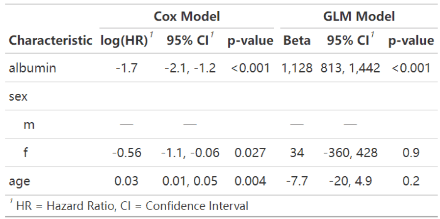
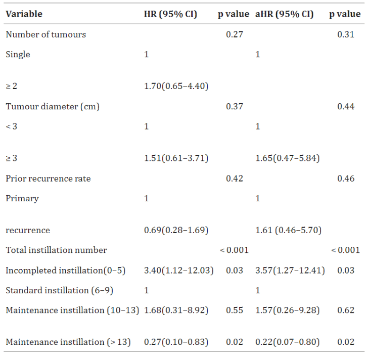
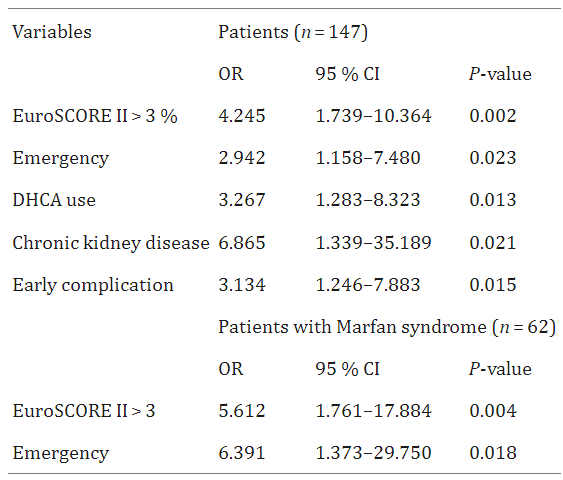

回归分析表格是用于展示回归模型结果的表格，它提供了模型中变量的统计信息，帮助解释变量之间的关系。

## 示例

{fig-alt="RegressionTable DEMO1" fig-align="center" width="60%"}

如图是基于`survival`包的内置pbc数据集绘制的回归分析表格。图中分别使用了Cox风险比例模型和广义线性回归模型探索血清蛋白、性别、年龄对生存状况的影响。

## 环境配置

-   系统要求： 跨平台（Linux/MacOS/Windows）

-   编程语言：R

-   依赖包：`survival`, `gtsummary`, `dplyr`, `datawizard`

```{r packages setup, message=FALSE, warning=FALSE, output=FALSE}
# 安装包
if (!requireNamespace("survival", quietly = TRUE)) {
  install.packages("survival")
}
if (!requireNamespace("gtsummary", quietly = TRUE)) {
  install.packages("gtsummary")
}
if (!requireNamespace("dplyr", quietly = TRUE)) {
  install.packages("dplyr")
}
if (!requireNamespace("datawizard", quietly = TRUE)) {
  install.packages("datawizard")
}
if (!requireNamespace("broom.helpers", quietly = TRUE)) {
  remotes::install_github("larmarange/broom.helpers")
}

# 加载包
library(survival)
library(gtsummary)
library(dplyr)
library(datawizard)
# Install kableExtra if missing (used by the grouped HR table)
if (!requireNamespace("kableExtra", quietly = TRUE)) {
  install.packages("kableExtra", repos = "https://cloud.r-project.org")
}
library(broom.helpers)
library(kableExtra)
```

```{r}
sessioninfo::session_info("attached")
```

## 数据准备

使用R包survival内置的pbc数据集，包含了418名原发性胆汁性肝硬化（PBC）患者的信息，这些患者在研究开始时或之前已经接受了熊去氧胆酸（UDCA）治疗。pbc数据集记录了pbc患者的生存时间、生存状态、治疗方式、年龄、性别、白蛋白水平、肝肿大情况等临床信息。

```{r load data, message=FALSE}
df <- pbc %>%
  filter(status != 1) %>%
  mutate(status = ifelse(status == 2, 1, 0)) %>%
  select(2:13) %>%
  na.omit() %>% 
  # 将`albumin`分为3组
  mutate(albumin3cat = categorize(albumin, split = "quantile", n_groups = 3))

head(df[,1:6])
```

## 可视化

### 1. 基础回归分析表格

```{r}
#| label: fig-1.1BasicRegressionTable
#| fig-cap: "基础回归分析表格"
#| out.width: "95%"
#| warning: false
#| message: false
#| fig-width: 8
#| fig-height: 6

# 基本绘图
t1 <- coxph(Surv(time, status) ~ albumin + sex + age,
  data = df
) %>%
  tbl_regression()

t1
```

该表是基础回归分析表格，通过`coxph()`调用Cox比例风险模型和使用`tbl_regression()`将回归分析的结果表格化。

### 2. tbl_regression()参数设置

```{r}
#| label: fig-2.1tbl_regression
#| fig-cap: "tbl_regression()参数设置"
#| out.width: "95%"
#| warning: false
#| message: false
#| fig-width: 8
#| fig-height: 6

# tbl_regression()参数设置
t1 <- coxph(Surv(time, status) ~ albumin + sex + age,
  data = df
) %>%
  # 参数设置
  tbl_regression(
    conf.level = 0.90,
    exponentiate = TRUE,
    include = c("sex", "albumin"),
    show_single_row = sex,
    label = list(sex ~ "sex as categorical")
  )

t1
```

表中`tbl_regression()`有很多参数设置，可以更改表格的置信区间，行名等信息。

::: callout-tip
**重要参数：tbl_regression**

- `conf.level`: 确定回归分析的置信水平，默认的0.95表示95%置信区间。

- `exponentiate`: 是否对HR值取指数，默认列是log(HR)值。

- `include`: 统计表格中包含哪些自变量因素（行）

- `show_single_row`: 适用于二分类变量，不显示对照组。

- `label`: 更改自变量因素的名称（行名）。
:::

### 3. 添加global-p

```{r}
#| label: fig-3.1global-p
#| fig-cap: "添加global-p"
#| out.width: "95%"
#| warning: false
#| message: false
#| fig-width: 8
#| fig-height: 6

# 添加global-p
df$albumin3cat=as.factor(df$albumin3cat)

t1 <- coxph(Surv(time, status) ~ albumin3cat + sex + age,
            data = df) %>%
  tbl_regression()  %>%
  add_global_p()

t1
```

该表通过`add_global_p()`添加全局P值。

### 4. 添加q-value

```{r}
#| label: fig-4.1q-value
#| fig-cap: "添加q-value"
#| out.width: "95%"
#| warning: false
#| message: false
#| fig-width: 8
#| fig-height: 6

# 添加q-value
t1 <- coxph(Surv(time, status) ~ albumin + sex + age,
  data = df
) %>%
  tbl_regression() %>%
  # 添加q-value列
  add_q()

t1
```

该表通过`add_q()`添加q-value列。

### 5. 合并列

```{r}
#| label: fig-5.1Merge
#| fig-cap: "合并列"
#| out.width: "95%"
#| warning: false
#| message: false
#| fig-width: 8
#| fig-height: 6

# 合并列
t1 <- coxph(Surv(time, status) ~ albumin3cat + sex + age,
            data = df) %>%
  tbl_regression()  %>%
  # 修改表头名称
  modify_header(p.value = "**P**",estimate="**log(HR) (CI)**") %>%
  # 将评分列和CI列合并并应用于评分不为NA的行
  modify_column_merge(
    pattern = "{estimate} ({conf.low}, {conf.high})",
    rows = !is.na(estimate)
  )

t1
```

该表将评分列和CI列合并，是一种常见的形式，合并后恰当修改了表头。

::: callout-tip
**重要函数** `modify_header` / `modify_column_merge`:

`modify_header:modify_header()`可用于修改标题名称。其中`label`表示变量列，`p.value`表示P值列，`ci`表示置信区间列，`estimate`表示评分列，`conf.low`表示置信区间下区间，`conf.high`表示置信区间上区间。

`modify_column_merge`:参数`pattern`是要合并列的模式，参数`rows`是要应用到的行。
:::

### 6. 模型整合

**模型横向整合**

```{r}
#| label: fig-6.1Merge
#| fig-cap: "模型横向整合"
#| out.width: "95%"
#| warning: false
#| message: false
#| fig-width: 8
#| fig-height: 6

# 模型横向整合
t1 <- coxph(Surv(time, status) ~ albumin + sex + age,
  data = df
) %>%
  tbl_regression()
t2 <- glm(time ~ albumin + sex + age,
  data = df
) %>%
  tbl_regression()
# t1, t2模型整合
t3 <- tbl_merge(
  tbls = list(t1, t2),
  tab_spanner = c("**Cox Model**", "**GLM Model**")
)

t3
```

该表使用`tbl_merge`横向整合了pdb患者的Cox比例风险模型和广义线性回归模型的结果。

**模型纵向整合**

```{r}
#| label: fig-6.2Merge
#| fig-cap: "模型纵向整合"
#| out.width: "95%"
#| warning: false
#| message: false
#| fig-width: 8
#| fig-height: 6

# 模型纵向整合
t1 <- coxph(Surv(time, status) ~ albumin + sex + age,
  data = df[df$hepato==0,]
) %>%
  tbl_regression()

t2 <- coxph(Surv(time, status) ~ albumin + sex + age,
  data = df[df$hepato==1,]
) %>%
  tbl_regression()

tbl_stack(list(t1, t2), group_header = c("Patients without hepato", "Patients with hepato"))
```

该表使用`tbl_stack`纵向整合了有无hepato的两组pdb患者的Cox比例风险模型的结果。

### 7. HR 表：单因素 + 多因素，训练 vs 验证队列

FigureYa47 版式 \[3\] 是论文级的配套表格：每个协变量做**批量单因素 Cox**，p < 0.05 者进入**多因素模型**，整套流程在独立验证队列上重跑——以一张分组 kable 表输出，每个队列各带 `HR (95% CI)` 与 p 值列：

```{r}
#| label: tbl-7.1HrTable
#| tbl-cap: "模拟协变量的单因素与多因素 Cox 分析：训练队列（70%）与验证队列（30%）；多因素列仅保留训练集单因素筛选显著（p < 0.05）的协变量。"
#| warning: false
#| message: false

set.seed(4701)
n_hr <- 260
hrdata <- data.frame(
  age = factor(ifelse(rnorm(n_hr, 62, 10) > 62, ">=median", "<median"),
               levels = c("<median", ">=median")),
  stage = factor(sample(c("I-II", "III-IV"), n_hr, TRUE), levels = c("I-II", "III-IV")),
  invasion = factor(sample(c("no", "yes"), n_hr, TRUE, c(0.6, 0.4)), levels = c("no", "yes")),
  marker = factor(ifelse(rnorm(n_hr) > 0, ">=median", "<median"),
                  levels = c("<median", ">=median")))
lp <- -3.4 + 0.35 * (hrdata$stage == "III-IV") + 0.5 * (hrdata$invasion == "yes") -
  0.45 * (hrdata$marker == ">=median")
hrdata$time <- rexp(n_hr, exp(lp) * 0.02)
hrdata$event <- rbinom(n_hr, 1, 0.8)
vars <- c("age", "stage", "invasion", "marker")

uni_cox <- function(dat) {
  do.call(rbind, lapply(vars, function(v) {
    sm <- summary(coxph(as.formula(paste0("Surv(time, event) ~ ", v)), data = dat))
    data.frame(characteristics = v,
               HR = round(sm$coefficients[, "exp(coef)"], 2),
               CI = paste0(round(sm$conf.int[, "lower .95"], 2), "-",
                           round(sm$conf.int[, "upper .95"], 2)),
               p = sm$coefficients[, "Pr(>|z|)"])
  }))
}
set.seed(4702)
train_idx <- sample(n_hr, round(n_hr * 0.7))
tr <- hrdata[train_idx, ]; va <- hrdata[-train_idx, ]
uni_tr <- uni_cox(tr); uni_va <- uni_cox(va)
sig_vars <- uni_tr$characteristics[uni_tr$p < 0.05]

mk_rows <- function(sm, sig_vars) {
  cm <- sm$coefficients; ci <- sm$conf.int
  do.call(rbind, lapply(vars, function(v) {
    idx <- which(startsWith(rownames(cm), v))   # 因子对比行名形如 "stageIII-IV"
    if (length(idx) == 1) {
      data.frame(characteristics = v, HR = round(cm[idx, "exp(coef)"], 2),
                 CI = paste0(round(ci[idx, "lower .95"], 2), "-",
                             round(ci[idx, "upper .95"], 2)),
                 p = ifelse(cm[idx, "Pr(>|z|)"] < 0.001, "< 0.001",
                            round(cm[idx, "Pr(>|z|)"], 3)))
    } else {
      data.frame(characteristics = v, HR = NA, CI = NA, p = NA)
    }
  }))
}
m_tr <- mk_rows(summary(coxph(as.formula(paste("Surv(time, event) ~",
                                               paste(sig_vars, collapse = "+"))), data = tr)), sig_vars)
m_va <- mk_rows(summary(coxph(as.formula(paste("Surv(time, event) ~",
                                               paste(sig_vars, collapse = "+"))), data = va)), sig_vars)

fmt <- function(df) dplyr::mutate(
  df,
  characteristics = dplyr::case_when(
    characteristics == "age" ~ "Age (>=median vs <median)",
    characteristics == "stage" ~ "Stage (III-IV vs I-II)",
    characteristics == "invasion" ~ "Lymphatic invasion (yes vs no)",
    characteristics == "marker" ~ "Marker score (>=median vs <median)"),
  `HR (95% CI)` = ifelse(is.na(HR), "", paste0(HR, " (", CI, ")")),
  `P value` = ifelse(is.na(p), "", as.character(p))) %>%
  dplyr::select(characteristics, `HR (95% CI)`, `P value`)

tbl <- data.frame(
  characteristics = c("", "Training cohort (n = 182)", fmt(uni_tr)$characteristics,
                      "Validation cohort (n = 78)", fmt(uni_va)$characteristics),
  uni_hr = c("", "", fmt(uni_tr)$`HR (95% CI)`, "", fmt(uni_va)$`HR (95% CI)`),
  uni_p = c("", "", fmt(uni_tr)$`P value`, "", fmt(uni_va)$`P value`),
  multi_hr = c("HR (95% CI)", "", fmt(m_tr)$`HR (95% CI)`, "", fmt(m_va)$`HR (95% CI)`),
  multi_p = c("P value", "", fmt(m_tr)$`P value`, "", fmt(m_va)$`P value`),
  stringsAsFactors = FALSE)

kableExtra::kable(tbl, booktabs = TRUE, escape = FALSE,
                  col.names = c("Characteristics", "Univariate analysis", "",
                                "Multivariate analysis", ""),
                  caption = "Univariate and multivariate Cox analyses, training vs validation (simulated)") %>%
  kableExtra::kable_styling(c("striped", "scale_down"), font_size = 11) %>%
  kableExtra::add_header_above(c(" " = 1, "Training cohort" = 2, "Validation cohort" = 2))
```

::: callout-tip
**实践要点**

-   Cox 摘要中因子对比行名是 `stageIII-IV` 而非 `stage`——程序化装配表格时用 `startsWith(rownames(cm), v)` 匹配，否则多因素列会静默地填满空白。
-   多因素列**只显示训练集单因素筛选存活者**，且同一公式（不再逐队重筛）用于验证队列——逐队重筛是隐性双重 dipping。
-   `add_header_above()` 把队列名放到列对上方；保留 `escape = FALSE` 让括号 CI 字符串正常渲染。
:::

### 8. 批量单因素 Cox 森林图（FigureYa66UnivariateCox）

FigureYa66 \[11\] 对**每个基因的表达**循环拟合 Cox 模型，把幸存者画成森林图：菱形点 = HR，误差线 = 95% CI，x 轴 log2，viridis 颜色 = p 值，HR = 1 虚线。参考文档的 `theme_ggstatsplot()` 需要外部 helper 文件，下块改用等价的朴素 `theme_bw()`。同一循环把列改名为 HR / lower / upper 后即可衔接 FigureYa6rHRs 的各种森林变体：

```{r}
#| label: tbl-8.1UnivariateCoxForest
#| tbl-cap: "24 个模拟基因的批量单因素 Cox 筛选：仅绘制 p < 0.05 且 HR 落在 0.92-1.15 带外的基因；viridis 颜色编码 p 值。"
#| warning: false
#| message: false

## freeze:auto 只对新 chunk 在新会话中重跑——在此重新挂载所需包
suppressPackageStartupMessages({library(survival); library(ggplot2); library(dplyr)})
set.seed(6601)
n_ux <- 240
ux <- data.frame(futime = rexp(n_ux, 0.02), fustat = rbinom(n_ux, 1, 0.8))
gene_expr <- matrix(rnorm(n_ux * 24, 5, 1.2), n_ux, 24,
                    dimnames = list(NULL, paste0("GENE", sprintf("%02d", 1:24))))
## 植入一个保护基因与一个风险基因，让筛选有信号
gene_expr[, 1] <- gene_expr[, 1] - (ux$futime < quantile(ux$futime, 0.4)) * 1.8
gene_expr[, 5] <- gene_expr[, 5] + (ux$futime < quantile(ux$futime, 0.4)) * 1.8
ux_all <- cbind(ux, as.data.frame(gene_expr))
Coxoutput <- do.call(rbind, lapply(paste0("GENE", sprintf("%02d", 1:24)), function(g) {
  sm <- summary(coxph(as.formula(paste0("Surv(futime, fustat) ~ ", g)), data = ux_all))
  data.frame(gene = g,
             HR = sm$coefficients[, "exp(coef)"],
             lower = sm$conf.int[, "lower .95"],
             upper = sm$conf.int[, "upper .95"],
             pvalue = sm$coefficients[, "Pr(>|z|)"])
}))
Coxoutput <- dplyr::arrange(Coxoutput, pvalue) %>% dplyr::filter(pvalue < 0.05)
plotCoxoutput <- dplyr::filter(Coxoutput, HR <= 0.92 | HR >= 1.15)

ggplot(data = plotCoxoutput, aes(x = HR, y = gene, color = pvalue)) +
  geom_errorbarh(aes(xmax = upper, xmin = lower), color = "black",
                 height = 0, linewidth = 1.1) +
  geom_point(aes(x = HR, y = gene), size = 3.5, shape = 18) +
  geom_vline(xintercept = 1, linetype = "dashed", linewidth = 1) +
  coord_trans(x = "log2") +
  scale_color_viridis_c() +
  labs(x = "Hazard ratio, univariate Cox (simulated LUAD-like cohort)",
       y = "Gene", colour = "P value",
       title = "Univariate Cox regression screen") +
  theme_bw(base_size = 11) + theme(panel.grid = element_blank())
```

::: callout-tip
**实践要点**

-   筛选后还要过滤*效应量*（参考的 HR ≤ 0.92 | ≥ 1.15）：基因足够多时，纯噪声也会产生 HR 临床上毫无意义的 p < 0.05 命中。
-   p 值色带并不提供误差线之外的信息——但它让读者的眼睛按表格顺序排列命中；保留它并写明标尺。
-   24 个基因的 p < 0.05 筛选预期约 1 个假命中；在独立队列验证幸存者后再下结论。
:::

## 应用场景## 应用场景

::: {#fig-RegressionTableApplications1}
{fig-alt="RegressionTableApp1" fig-align="center" width="60%"}

回归分析表格
:::

单变量和多变量Cox回归分析表格用于中危NMIBC患者3年肿瘤复发情况。\[1\]

::: {#fig-RegressionTableApplications2}
{fig-alt="RegressionTableApp2" fig-align="center" width="60%"}

回归分析表格
:::

该回归分析表格显示了多变量Cox回归分析中晚期总死亡率的独立预测因素。\[2\]

## 参考文献

\[1\] CHEN J X, HUANG W T, ZHANG Q Y, et al. The optimal intravesical maintenance chemotherapy scheme for the intermediate-risk group non-muscle-invasive bladder cancer[J]. BMC Cancer, 2023,23(1): 1018.

\[2\] BENKE K, ÁGG B, SZABÓ L, et al. Bentall procedure: quarter century of clinical experiences of a single surgeon[J]. J Cardiothorac Surg, 2016,11: 19.

\[3\] Xiaofan Lu, et al. FigureYa: A Standardized Visualization Framework for Enhancing Biomedical Data Interpretation and Research Efficiency. iMetaMed. 2025. doi:10.1002/imm3.70005
